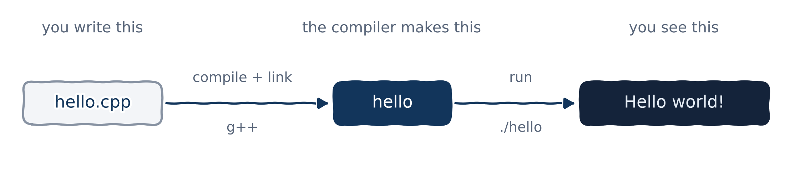
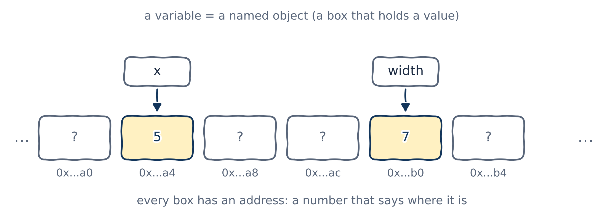
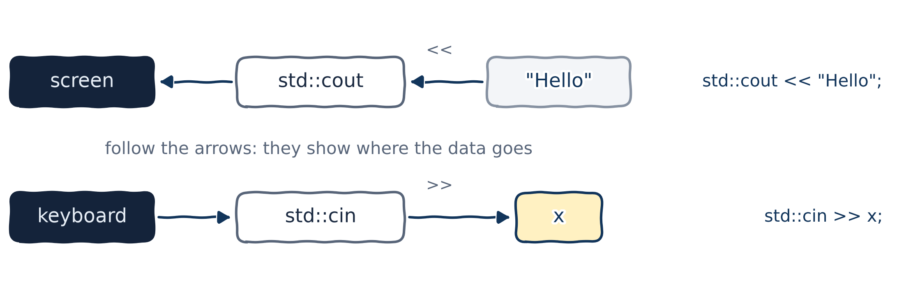
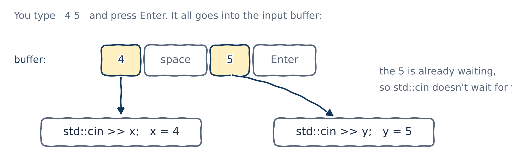

# Your first C++ program

## Hello, world!

::: {.columns}
::: {.column width="72%"}
```{.cpp filename="hello.cpp"}

```
:::
::: {.column width="28%"}
```{.text .output}
Hello world!
```
:::
:::

Every C++ program you'll ever write has this shape:

- `#include <iostream>` brings in the code we need to print text (more on this later today).
- `int main() { ... }` is the **main function**. Every C++ program must have exactly one, and it's where the program starts.
- Between the braces `{` and `}` are **statements**, which run in order, from top to bottom.
- `return 0;` tells the operating system that everything went fine.

## From source code to a running program

{fig-alt="hello.cpp is compiled and linked by g++ into a program called hello. Running hello prints Hello world! in the terminal." width="88%"}

```{.text .terminal}
$ g++ -std=c++20 -Wall -Wextra hello.cpp -o hello
$ ./hello
Hello world!
```

- `g++` turns your source code into a program; `-o hello` names it. (On Windows, the program is `hello.exe`.)
- `-std=c++20` picks the version of C++; `-Wall -Wextra` turns on the useful warnings. Always use them!
- Your IDE runs these commands for you when you press "Run". Watch me do both in the lecture.

## Statements

- When we tell another person something, we use sentences. When we tell a computer what to do, we write **statements**.
- Statements are by far the most common instruction in a C++ program.
- Most statements end with a **semicolon** `;`. Forgetting it is the classic beginner's mistake.

You'll meet many kinds of statements during the course, for example:

| Kind | Example | Where we meet it |
|------|---------|-------|
| Declaration | `int x;` | today |
| Expression | `x = 5;` | today |
| Selection | `if (x > 0) { ... }` | Chapter 03 |
| Iteration (loops) | `while (x > 0) { ... }` | Chapter 03 |
| Jump | `return 0;` | today and Chapter 02 |

## Syntax and syntax errors

English has grammar; C++ has **syntax**: rules about how a program must be written. The compiler checks them, and if you break one you get a **syntax error** and no program.

```{.cpp filename="hello_error.cpp" .no-compile}

```

```{.text .output .compiler}
hello_error.cpp:4:34: error: expected ';' before 'return'
```

`4:34` means line 4, column 34: exactly where the `;` should go. g++ noticed when it found `return` on the next line, hence "before 'return'". Other compilers may point at line 5 instead, so check the line it points to *and the one before*.

::: {.callout-tip title="Best practice"}
Fix the **first** error the compiler reports, then compile again. One mistake often causes a whole list of follow-on errors.
:::

# Comments

## Single-line comments

`//` starts a comment: the compiler ignores everything from `//` to the end of the line.

```{.cpp}
std::cout << "Hello world!\n"; // everything from here on is ignored

// A comment on its own line keeps long lines short.
std::cout << "It is very nice to meet you!\n";
```

::: {.callout-note title="Coming from Python"}
Python comments start with `#`. In C++ they start with `//`. Careful: in C++, a line starting with `#` is something else entirely, an instruction to the *preprocessor*, like `#include <iostream>`.
:::

## Multi-line comments

Everything between `/*` and `*/` is ignored, however many lines it spans.

```{.cpp}
/* This is a multi-line comment.
   This line is ignored.
   So is this one. */

/* Some programmers line up stars
 * on the left, which makes long
 * comments easier to read.
 */
```

::: {.callout-warning title="Watch out"}
Multi-line comments can't be nested: `/* outer /* inner */ still outer? */` ends at the **first** `*/`, and the compiler then chokes on `still outer? */`.
:::

## Comment *why*, not *what*

The code already says *what* it does. A good comment says *why*.

```{.cpp}
cost = cost * 1.2; // multiply cost by 1.2   (useless: the code says that)
cost = cost * 1.2; // add 20% VAT            (useful: now we know why)
```

::: {.callout-tip title="Best practice"}
Write comments for the person who reads your code next. Very often, that person is you in six months.
:::

# Objects and variables

## Objects and variables

{fig-alt="A row of memory boxes, each with an address underneath. Two boxes are highlighted: one named x holds 5, one named width holds 7. The others hold unknown values." width="82%"}

- A program stores values in memory. C++ lets us use memory through **objects**: an object is a region of memory that can hold a value.
- An object can have a name, called an **identifier**. A named object is a **variable**.
- The word "object" means much more in object-oriented programming, which is where this course is heading.

## Defining a variable

To get a variable, we write a **definition**: a type, then a name, then a semicolon.

```{.cpp}
int x; // define a variable named x, of type int (a whole number)
```

```{.cpp filename="define_variables.cpp"}

```

This compiles, but with `-Wall` g++ warns that none of these variables is ever used. Fair enough: it's only a demo!

## A few fundamental types

```{.cpp}
int count;     // whole numbers:            -3, 0, 42
double price;  // numbers with a fraction:  3.99, -0.5
char grade;    // a single character:       'A', '?'
bool passed;   // true or false
```

- The **type** decides what a variable can hold and what you can do with it.
- These four will carry us a long way. Text (strings) comes in Chapter 04.

## Naming variables

The **rules** (break them and it won't compile):

- Letters, digits and underscores only, and the first character can't be a digit: `total2` is fine, `2total` is not.
- Names are case-sensitive: `width`, `Width` and `WIDTH` are three different variables.
- You can't use a **keyword** that C++ reserves for itself, such as `int`, `return` or `double`.

The **conventions** (good habits):

- Choose names that say what the value means: `width`, not `w` or `x1`.
- In this course, we write variable and function names in `snake_case`: `max_speed`, `get_value_from_user`.

# Assignment and initialization

## Assignment

After a variable is defined, `=` gives it a value. This is called **assignment**, and `=` is the **assignment operator**.

::: {.columns}
::: {.column width="72%"}
```{.cpp filename="variable_assignment.cpp"}

```
:::
::: {.column width="28%"}
```{.text .output}
5
7
```

Assigning a new value **replaces** the old one.
:::
:::

## Initialization

Defining and then assigning takes two statements. **Initialization** does both at once: it gives a variable its first value at the moment it is defined.

::: {.columns}
::: {.column width="72%"}
```{.cpp filename="variable_initialization.cpp"}

```
:::
::: {.column width="28%"}
```{.text .output}
5
```
:::
:::

- The value in the braces, `5`, is called the **initializer**.
- Initialization happens exactly once, when the variable is created. Assignment can happen as often as you like afterwards.

## Five ways to initialize

```{.cpp}
int a;     // default-initialization: no initializer (a holds garbage!)

// Traditional forms
int b = 5; // copy-initialization: value after an equals sign
int c(6);  // direct-initialization: value in parentheses

// Modern forms, using braces (preferred)
int d{7};  // direct-list-initialization: value in braces
int e{};   // value-initialization: empty braces give 0
```

- The forms with braces are called **list initialization** (or **brace initialization**).
- For a simple `int` like this, `b`, `c` and `d` all end up holding their value in the same way. But braces have one big advantage: next slide!

::: {.callout-tip title="Best practice"}
Initialize with braces: `int d{7};` when you know the value, `int e{};` when you don't (yet).
:::

## Why braces? They stop narrowing

```{.cpp filename="narrowing.cpp" .no-compile}

```

```{.text .output .compiler}
error: narrowing conversion of '4.7000000000000002e+0' from 'double' to 'int'
```

- `int a = 4.7;` compiles without a word, even with `-Wall -Wextra`, and quietly throws away the `.7`. That's a bug waiting to happen.
- `int b{4.7};` is a compile error. Brace initialization refuses to lose information. (The strange `4.7000000000000002` is how the computer really stores 4.7. More on that another day.)

## Unused variables

```{.cpp filename="unused_variable.cpp"}

```

```{.text .terminal}
$ g++ -std=c++20 -Wall unused_variable.cpp
warning: unused variable 'x' [-Wunused-variable]
```

- A variable that's defined but never used is almost always a mistake (or leftover code), so g++ warns you.
- It's a **warning**, not an error: the program still compiles.

# Input and output with `iostream`

## The `iostream` library

- The **input/output library** is the part of the C++ standard library that reads input and prints output. The *io* in *iostream* stands for input/output.
- To use it, a file needs `#include <iostream>` at the top.
- It gives us two ready-made variables:
  - `std::cout`, "character output", which prints text to the screen;
  - `std::cin`, "character input", which reads what the user types on the keyboard.

## Printing with `std::cout`

::: {.columns}
::: {.column width="72%"}
```{.cpp filename="use_stdcout.cpp"}

```
:::
::: {.column width="28%"}
```{.text .output}
Hello world!
4
5
I am Khiem Nguyen
8 planets and 1 sun
```

`<<` can be chained to print several things in one statement.
:::
:::

## New lines: `'\n'` or `std::endl`?

::: {.columns}
::: {.column width="72%"}
```{.cpp filename="use_stdnewline.cpp"}

```
:::
::: {.column width="28%"}
```{.text .output}
Hi!
My name is Khiem.
Nice to meet you!
```
:::
:::

- Both `'\n'` and `std::endl` move the cursor to the next line.
- `std::endl` also **flushes** the output: it forces everything waiting to be printed out to the screen *right now*. Doing that after every line is slow.

::: {.callout-tip title="Best practice"}
Use `'\n'` for new lines. You rarely need `std::endl`.
:::

## Reading input with `std::cin`

::: {.columns}
::: {.column width="70%"}
```{.cpp filename="use_stdcin.cpp"}

```
:::
::: {.column width="30%"}
```{.text .terminal}
$ ./use_stdcin
Enter a number: 7
You entered 7
```
:::
:::

- `std::cin >> x;` waits for the user to type something and press Enter, then stores it in `x`.
- We still initialize `x` with `{}`. If the read never happens (say, the input has already failed), `x` holds `0` instead of garbage. Always initializing is simply a good habit.

## `<<` and `>>`: follow the arrows

{fig-alt="std::cout << \"Hello\": the text moves from \"Hello\" into std::cout and on to the screen. std::cin >> x: the input moves from the keyboard into std::cin and on into x." width="88%"}

- `<<` is the **insertion operator**: `std::cout << 4` moves `4` *into* `std::cout`, and so to the screen.
- `>>` is the **extraction operator**: `std::cin >> x` moves what the user typed *out of* `std::cin` and into `x`.
- Mixing them up is a very common beginner's mistake. The arrows always point the way the data moves.

## `std::cin` is buffered

::: {.columns}
::: {.column width="60%"}
```{.cpp filename="stdcin_buffered.cpp"}

```
:::
::: {.column width="40%"}
Run 1: type `4`, Enter, then `5`, Enter.

```{.text .terminal}
Enter two numbers: 4
You entered 4
5
You entered 5
```

Run 2: type `4 5`, then Enter.

```{.text .terminal}
Enter two numbers: 4 5
You entered 4
You entered 5
```
:::
:::

In run 2, the program never waits for the second number. Why?

## How the input buffer works

{fig-alt="The user types 4 space 5 Enter, which all goes into the input buffer. The first std::cin >> x takes the 4. The second std::cin >> y finds the 5 already waiting in the buffer, so it doesn't wait for the user." width="85%"}

- Everything you type goes into an **input buffer** when you press Enter.
- `>>` takes what it needs from the buffer and leaves the rest there. It only waits for you if the buffer is empty.
- That's why `4 5` on one line fills both `x` and `y`.

# Uninitialized variables and undefined behaviour

## Uninitialized variables

- C++ does **not** automatically set variables to zero. A variable that is never given a value holds whatever happened to be in that memory before: a **garbage value**.
- Such a variable is called **uninitialized**.

| | The variable gets a known value... |
|---|---|
| **Initialized** | when it is defined: `int x{5};` |
| **Assigned** | after it is defined: `int x; x = 5;` |
| **Uninitialized** | not yet: `int x;` |

"Initialized" and "uninitialized" are not quite opposites: a variable that is assigned a value later stops being uninitialized, even though it was never initialized.

## What does an uninitialized variable hold?

::: {.columns}
::: {.column width="68%"}
```{.cpp filename="uninitialized_variable_01.cpp"}

```
:::
::: {.column width="32%"}
```{.text .terminal}
$ g++ -std=c++20 -Wall ...
warning: 'x' is used
uninitialized [-Wuninitialized]
$ ./a.out
0
0
42
```
:::
:::

On my machine, `x` happened to print `0`. Don't be fooled: nothing guarantees that. Look what happens in the next program.

## Garbage values in action

```{.cpp filename="uninitialized_variable_02.cpp"}

```

(Don't worry about the two extra functions: they're the topic of Chapter 02.) `dirty_the_memory()` leaves some values behind in memory; `see_the_junk()` then prints an uninitialized `x`. What will it print?

## Same code, different answers

::: {.columns}
::: {.column width="50%"}
```{.text .terminal}
$ g++ -std=c++20 uninitialized_variable_02.cpp
$ ./a.out
Leaving behind 42, 24, 66
Uninitialized x holds 66
```
:::
::: {.column width="50%"}
```{.text .terminal}
$ g++ -std=c++20 -O2 uninitialized_variable_02.cpp
$ ./a.out
Leaving behind 42, 24, 66
Uninitialized x holds 0
```
:::
:::

- Without optimization, `x` landed exactly where `c` had been, and picked up its leftover `66`.
- With `-O2` (asking the compiler to optimize), the same code printed `0`.
- Same code, different compiler setting, different answer. And neither answer is "wrong", because the program never said what `x` should be.

## Undefined behaviour

Using an uninitialized variable is our first example of **undefined behaviour** (UB): code whose result the C++ language doesn't define. A program with UB might:

- print a different value every time you run it, or the same value every time;
- work on your computer and fail on someone else's, or after a change of compiler settings;
- crash, now or later;
- seem to work perfectly... until the day it doesn't.

::: {.callout-important title="Key idea"}
Avoid undefined behaviour at all costs. Here that's easy: **always initialize your variables**, and keep `-Wall -Wextra` on so the compiler can warn you.
:::

# Wrapping up

## Summary

- Every program has a `main()` function, where it starts. Its statements run top to bottom, and most end with `;`.
- `g++` compiles source code into a program; syntax errors stop it. Read the first error first.
- Comments start with `//` or sit between `/*` and `*/`. Comment *why*, not *what*.
- A variable is a named object: a piece of memory holding a value of some type.
- Initialize variables with braces: `int x{5};` or `int x{};`. Braces also catch narrowing.
- `std::cout <<` prints, `std::cin >>` reads: the arrows show where the data goes. Use `'\n'` for new lines.
- Uninitialized variables give undefined behaviour. Always initialize!

## Keep learning

Explore these on your own, with Google Gemini in Guided Learning mode or on [learncpp.com](https://www.learncpp.com):

1. [Keywords and naming identifiers](https://www.learncpp.com/cpp-tutorial/keywords-and-naming-identifiers/)
2. [Whitespace and basic formatting](https://www.learncpp.com/cpp-tutorial/whitespace-and-basic-formatting/)
3. [Introduction to literals and operators](https://www.learncpp.com/cpp-tutorial/introduction-to-literals-and-operators/)
4. [Introduction to expressions](https://www.learncpp.com/cpp-tutorial/introduction-to-expressions/)

**Next up, Chapter 02:** functions and files. We'll stop repeating ourselves and split programs across several files.
