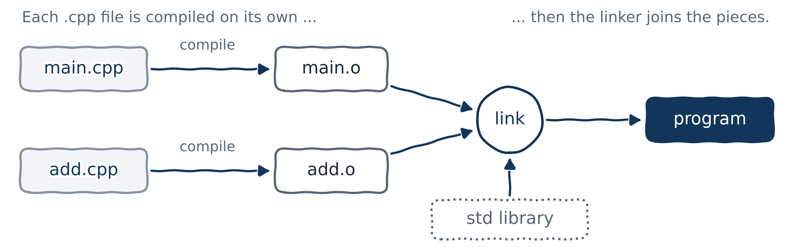
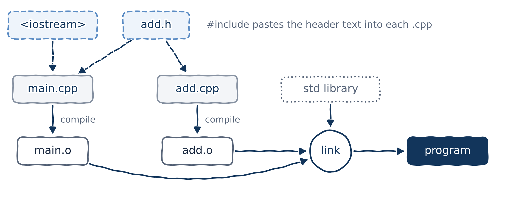

# Why functions?

## Copy, paste, repeat

Here is a program that reads two integers and adds them.

```{.cpp filename="repeat_yourself.cpp" code-line-numbers="|4-6,8-10"}

```

Lines 4--6 and 8--10 do exactly the same job. Now imagine reading *ten* numbers. Or changing the prompt text in every copy, and forgetting one.

## Don't Repeat Yourself (DRY)

The golden rule: **write it once, give it a name, use it as often as you like.**

::: {.columns}
::: {.column width="62%"}
```{.cpp filename="dont_repeat_yourself.cpp"}

```
:::
::: {.column width="38%"}
```{.text .terminal}
$ ./dont_repeat_yourself
Enter an integer: 3
Enter an integer: 4
Sum: 7
```

- `get_value_from_user()` is a **function**: a named, reusable block of code.
- `main()` **calls** it twice. Change the prompt once, and both calls change.
:::
:::

The rest of this chapter explains every piece of this program.

# Defining and calling functions

## Anatomy of a function

::: {.columns}
::: {.column width="50%"}
The general form

```{.cpp}
return_type name(parameters) {
    statements
}
```
:::
::: {.column width="50%"}
A real one

```{.cpp}
int add(int x, int y) {
    return x + y;
}
```
:::
:::

- The **header** (first line) gives the function's name, what goes in (the **parameters**) and what comes out (the **return type**).
- The **body**, between `{` and `}`, holds the statements that run every time the function is called.
- `main()` is a function too. It's special only because every program starts there.

## Calling a function

::: {.columns}
::: {.column width="60%"}
```{.cpp filename="call_function.cpp"}

```
:::
::: {.column width="40%"}
```{.text .output}
Starting main()
  In say_hello(): Hello there!
  In say_hello(): Hello there!
Ending main()
```

- A **function call** is the name followed by parentheses: `say_hello();`
- `main()` pauses, `say_hello()` runs, then `main()` carries on right after the call.
:::
:::

`main()` is the **caller** and `say_hello()` is the **callee**. (`void` means "gives nothing back". More on that soon.)

## Functions can call functions (that call functions...)

::: {.columns}
::: {.column width="58%"}
```{.cpp filename="function_call_function.cpp"}

```
:::
::: {.column width="42%"}
```{.text .output}
Starting main()
  Starting do_a()
    In do_b()
  Ending do_a()
Ending main()
```

Read the output from top to bottom: every call returns to exactly the place it was called from.
:::
:::

## No functions inside functions

```{.cpp filename="nested_function.cpp" .no-compile}

```

```{.text .output .compiler}
error: a function-definition is not allowed here before '{' token
```

A function defined inside another function is a **nested function**. C++ doesn't allow them: every function definition lives at the top level of a file. (`foo` is the name programmers use when the name doesn't matter.)

::: {.callout-note title="Coming from Python"}
Python and MATLAB let you define a function inside another one. C++ does not.
:::

# Return values

## Sending a value back to the caller

A function can hand **one value** back to whoever called it. It needs two things:

1. a **return type** in the header, saying what kind of value comes back (e.g. `int`);
2. a **return statement** in the body, saying which value: `return input;`

When the return statement runs:

1. The expression after `return` is evaluated.
2. A **copy** of the result is sent back to the caller. This copy is the **return value**.
3. The function ends, and the caller carries on.

## Return values in action

::: {.columns}
::: {.column width="65%"}
```{.cpp filename="return_value.cpp"}

```
:::
::: {.column width="35%"}
```{.text .terminal}
$ ./return_value
Enter an integer: 21
21 x 2 = 42
```

On line 12, the call `get_value_from_user()` produces the value it returns (here `21`), and that value initialises `num`.
:::
:::

## One call, one return value

- Each call returns exactly **one** value.
- Need two results from one function? There are ways around it (references, structs and classes), and we'll meet them in later chapters.

::: {.callout-note title="Coming from Python"}
`return total, average` in Python *looks* like two values, but it actually returns **one** tuple. C++ can play the same trick by returning one object that holds several values, such as a struct or a `std::pair`. Later!
:::

## `main()` is special

- `main()` must return an `int`. The value goes back to the operating system: `0` means "everything went fine".
- `main()` is the only value-returning function allowed to skip `return`: reaching its closing `}` returns `0`. We'll keep writing `return 0;` anyway. It's clearer.
- Never call `main()` yourself. The C++ standard forbids it, although g++ only complains if you compile with `-pedantic-errors`.

```{.cpp .no-compile}
void main() { // error: '::main' must return 'int'
}
```

## Forgetting to return a value

::: {.columns}
::: {.column width="55%"}
```{.cpp filename="missing_return.cpp"}

```
:::
::: {.column width="45%"}
```{.text .terminal}
$ g++ -std=c++20 -Wall missing_return.cpp
warning: no return statement in function
returning non-void [-Wreturn-type]
$ ./a.out
Thinking...
Illegal instruction
```
:::
:::

- This **compiles**: g++ only gives a *warning*. But the program has **undefined behaviour**, which means anything can happen. On my machine, it crashed.
- Warnings are free bug reports. Turn them on and read them!

::: {.callout-tip title="Best practice"}
Compile with `g++ -std=c++20 -Wall -Wextra` and treat every warning as a bug to fix.
:::

## `void` functions: nothing to return

::: {.columns}
::: {.column width="58%"}
```{.cpp filename="void_return.cpp"}

```
:::
::: {.column width="42%"}
```{.text .output}
Hi
I'm Khiem
Back in main()
```

- `void` means "this function returns no value".
- A `void` function needs no `return`: it goes back to the caller at its closing `}`.
- `return;` goes back *immediately*, so line 8 never runs.
:::
:::

On its own, an early `return;` is pointless. Together with `if` statements (Chapter 03) it becomes really useful.

## A `void` function cannot return a value

No surprise here: if you promise to return nothing, the compiler holds you to your promise.

```{.cpp .no-compile}
void say_hi() {
    std::cout << "Hi\n";
    return 5; // we promised void!
}
```

```{.text .output .compiler}
error: return-statement with a value, in function returning 'void'
```

# Parameters and arguments

## Parameters and arguments

- A **parameter** is a variable declared in the function header. It's a placeholder for a value the caller will supply.
- An **argument** is the actual value the caller passes in the function call.

> Memory trick: **P**arameters are **P**laceholders; **A**rguments are **A**ctual values.

```{.cpp}
void print_double(int value) { // value is a PARAMETER
    std::cout << value * 2 << '\n';
}

int main() {
    print_double(21); // 21 is an ARGUMENT
    return 0;
}
```

## Zero, one or more parameters

::: {.columns}
::: {.column width="70%"}
```{.cpp filename="function_parameters.cpp"}

```
:::
::: {.column width="30%"}
```{.text .output}
Hello World
6.5
5.5
```

A call must supply one argument for each parameter, in the same order.
:::
:::

## Pass by value

When a function is called:

1. each parameter is created as a brand-new local variable, and
2. it is initialised with a **copy** of the matching argument.

This is called **pass by value**, and parameters like these are **value parameters**.

::: {.callout-important title="Key idea"}
With pass by value, the function works on its **own copy** of each argument. Whatever it does to the copy stays inside the function.
:::

## Pass by value in action

::: {.columns}
::: {.column width="70%"}
```{.cpp filename="double_a_number.cpp"}

```
:::
::: {.column width="30%"}
```{.text .terminal}
$ ./double_a_number
Enter an integer: 7
7 x 2 = 14
Enter an integer: 21
21 x 2 = 42
```

On line 18, the return value of one call becomes the argument of another.
:::
:::

## The swap that doesn't swap

What does this program print? Think before you look!

```{.cpp filename="pass_by_value.cpp"}

```

::: {.fragment}
::: {.columns}
::: {.column width="45%"}
```{.text .output}
In try_to_swap(): 200 100
Back in main():   100 200
```
:::
::: {.column width="55%"}
`try_to_swap()` swapped its own **copies**; `main()`'s `x` and `y` never changed. To change the caller's variables we need *references* (Chapter 07).
:::
:::
:::

## Coming from Python: what gets copied?

::: {.columns}
::: {.column width="50%"}
```{.python filename="pass_by_value.py"}

```
:::
::: {.column width="50%"}
- In Python, the parameter and the argument refer to the **same object**. Change the list inside the function and the caller sees the change.
- In C++, pass by value makes a **separate copy** of the whole argument, even if it's a big container of numbers. Nothing the function does to its copy can reach the caller.
:::
:::

## Arguments can be any expression

::: {.columns}
::: {.column width="72%"}
```{.cpp filename="pass_by_value_more.cpp"}

```
:::
::: {.column width="28%"}
```{.text .output}
9
15
10
7
6
```
:::
:::

Each argument is evaluated first, and the resulting value is copied into the parameter. An argument can even be another function call, like `multiply(2, 3)`.

## Watch out: argument order is not guaranteed

::: {.columns}
::: {.column width="70%"}
```{.cpp filename="evaluation_order.cpp"}

```
:::
::: {.column width="30%"}
```{.text .terminal}
$ ./evaluation_order
Enter an integer: 10
Enter an integer: 3
3 - 10 = -7
```

Wait, what? We typed `10` first!

C++ does **not** fix the order in which arguments are evaluated. g++ called the *second* `get_value_from_user()` first.
:::
:::

**The fix:** read the values into variables in separate statements, then pass the variables.

# Local variables: scope and lifetime

## Local variables

Variables defined inside a function body are **local variables**. Parameters count as local variables too.

```{.cpp}
int add(int x, int y) { // parameters x and y are local variables
    int z{x + y};       // z is a local variable
    return z;
}
```

Every variable raises two different questions:

|                    | **Scope**                                  | **Lifetime**                                 |
|--------------------|--------------------------------------------|----------------------------------------------|
| The question       | *Where* in the code can I use the name?    | *When* does the variable exist in memory?    |
| Decided at         | compile time                               | run time                                     |
| A local variable's | from its definition to the end of its block | from its creation to the end of its block    |

## Lifetime: created, used, destroyed

```{.cpp filename="local_variable_lifetime.cpp"}

```

- Parameters are created when the function starts; other local variables when their definition runs.
- At the closing `}`, local variables are destroyed in the **reverse** order of creation.
- "Destroyed" usually just means the memory can be reused. For class objects, a special function called a **destructor** runs first (Chapter 12).

## Scope: two variables, one name

::: {.columns}
::: {.column width="62%"}
```{.cpp filename="local_scope_01.cpp"}

```
:::
::: {.column width="38%"}
```{.text .output}
In print_x(): x = 42
In main():    x = 7
```
:::
:::

- Each function has its own `x`. They just happen to share a name.
- A local name only means something inside its own function, so you can reuse good names freely.

## Scope: blocks inside functions

```{.cpp filename="local_scope_02.cpp" .no-compile}

```

::: {.columns}
::: {.column width="52%"}
```{.text .output .compiler}
error: 'b' was not declared in this scope
```

A name can be used from its definition to the end of the innermost `{ }` around it, hence the name **block scope**. Break that rule and you get a **compile-time** error.
:::
::: {.column width="48%"}
::: {.callout-note title="Coming from Python"}
Python has no block scope: a variable created inside an `if` or `for` body is still usable after it, until the function ends. In C++, it's gone at the `}`.
:::
:::
:::

## Scope is not lifetime

::: {.columns}
::: {.column width="60%"}
```{.cpp filename="scope_vs_lifetime.cpp"}

```
:::
::: {.column width="40%"}
- While `second_function()` runs, `x` is **out of scope**: the name `x` can't be used there.
- But `x` is still **alive**: `first_function()` hasn't finished yet, and line 11 still prints `10`.

::: {.fragment}
I don't think you believe me. Let me prove it to you!
:::
:::
:::

## Scope is not lifetime: the proof

::: {.columns}
::: {.column width="72%"}
```{.cpp filename="scope_vs_lifetime_proof.cpp"}

```
:::
::: {.column width="28%"}
```{.text .output}
x is at 0x7fffdc7401c4
x holds 10
```

No *name* `x` in sight, yet `10` is still there. So `x` is alive!

::: {.callout-note title="Sneak peek"}
`&x` is the address of `x`; `*address_of_x` reads the value stored there. These are **pointers** (Chapter 08).
:::
:::
:::

Your address will differ. Prefer a debugger? Pause inside `second_function()` and you'll see `x` alive and well in `first_function()`.

# Declarations and definitions

## An innocent-looking program

```{.cpp filename="without_forward_declaration.cpp" .no-compile}

```

```{.text .output .compiler}
error: 'add' was not declared in this scope
```

- The compiler reads a file **from top to bottom**.
- When it reaches `add(3, 4)` on line 4, it has never heard of `add`. The definition further down comes too late.

## Fix 1: define before use

```{.cpp filename="reorder_function_defs.cpp"}

```

- Simple! But with many functions calling each other, you have to work out a valid order by hand.
- Sometimes no valid order exists: think of two functions that call each other.

## Fix 2: a forward declaration

```{.cpp filename="with_forward_declaration.cpp"}

```

- `int add(int x, int y);` is a **forward declaration**, also called a **function prototype**: the function header followed by a semicolon.
- It tells the compiler "`add` exists, and this is how to call it. The body comes later."
- The parameter names are optional in a declaration (`int add(int, int);`), but good names document what each parameter is for.

## Declarations and definitions

- A **declaration** introduces a name and its type: `int add(int x, int y);`
- A **definition** also provides the body: `int add(int x, int y) { return x + y; }`
- Every definition is also a declaration.

> Declare as often as you like; define **exactly once**. That's the gist of C++'s *one definition rule*.

What if we declare a function but never define it?

```{.cpp filename="declared_not_defined.cpp"}

```

## Compiler happy, linker not

```{.text .terminal}
$ g++ -std=c++20 declared_not_defined.cpp
/usr/bin/ld: in function `main':
undefined reference to `add(int, int)'
collect2: error: ld returned 1 exit status
```

- The **compiler** is happy: it trusted the declaration.
- Then the **linker** (`ld`) tries to connect the call `add(3, 4)` to the body of `add`, and there is no body to be found.
- Learn to tell them apart: *"was not declared in this scope"* comes from the compiler; *"undefined reference"* comes from the linker.

## Why bother with forward declarations?

- **The main reason:** the function is defined in **another file**. Reordering can't help when caller and callee live in different files. That's the next section!
- **Two functions that call each other:** no order works, but a declaration does.
- **Readability:** you can arrange functions in whatever order reads best, for example `main()` first.

::: {.callout-note title="Coming from Python"}
Python looks up a name when a line *runs*. A function body can call a function defined further down the file, as long as that definition has run by the time the call happens. C++ checks every name when it *compiles*, from top to bottom.
:::

# Programs with multiple files

## Why split a program into files?

- **Organisation:** related functions live together, e.g. `geometry.cpp`, `input.cpp`.
- **Reuse:** the same file can serve several programs.
- **Teamwork:** different people can work on different files.
- **Speed:** after an edit, only the changed file needs recompiling.

Adding a new file to your project in the IDE is a couple of clicks. That's much easier to show than to put on a slide, so watch me do it live (it's also in the recorded video).

## How g++ builds a multi-file program

{fig-alt="Two source files, main.cpp and add.cpp, are each compiled into object files main.o and add.o. The linker joins both object files and the standard library into one program." width="92%"}

- **Compile:** each `.cpp` file is compiled *on its own* into an **object file** (`.o`). While compiling one file, the compiler knows nothing about the others.
- **Link:** the **linker** joins the object files (plus the standard library) into one program, connecting each function call to its body.

## The same problem, now across two files

```{.cpp filename="add.cpp"}
int add(int x, int y) { return x + y; }
```

```{.cpp filename="main.cpp" .no-compile}
#include <iostream>

int main() {
    std::cout << "3 + 4 = " << add(3, 4) << '\n';
    return 0;
}
```

```{.text .terminal}
$ g++ -std=c++20 main.cpp add.cpp -o program
main.cpp:4:32: error: 'add' was not declared in this scope
```

- `main.cpp` is compiled on its own, so the compiler never sees `add.cpp` while compiling it.
- Reordering is no help: `add` lives in a different file.

## The fix: forward-declare `add` in `main.cpp`

```{.cpp filename="add.cpp"}

```

```{.cpp filename="main.cpp"}

```

```{.text .terminal}
$ g++ -std=c++20 -Wall main.cpp add.cpp -o program
$ ./program
3 + 4 = 7
```

List **every** `.cpp` file on the command line. (On Windows, the program is `program.exe`.)

## Why are files compiled in isolation?

That short memory is deliberate:

- Files can be compiled in any order, or several at once.
- After an edit, only the changed file needs recompiling. In a big project that saves minutes, sometimes hours.
- A name used privately in one file can't clash with the same name in another.

# Header files

## Forward declarations don't scale

- 5 files, each needing 10 forward declarations: 50 declarations to copy, paste and keep in sync.
- 100 files needing 100 each: 10,000. Change one function's parameters and enjoy fixing them all.

::: {.fragment}
The C++ answer: write the declarations **once**, in a **header file**, and `#include` it wherever it's needed.
:::

## Header files

- A header file (`.h`, sometimes `.hpp`) holds **declarations**, not function bodies.
- `#include "add.h"` asks the **preprocessor** to paste the text of `add.h` in place of that line, before the compiler sees the file.
- You've used headers since your first program: `#include <iostream>` pastes in the declarations of `std::cout` and friends.

::: {.callout-important title="Key idea"}
Header files let you write each declaration once and reuse it everywhere.
:::

## Our first header

::: {.columns}
::: {.column width="40%"}
```{.cpp filename="add.h"}

```
:::
::: {.column width="60%"}
```{.cpp filename="add.cpp"}

```
:::
:::

- `add.h` holds the declaration of `add()`. The `#ifndef`/`#define`/`#endif` lines are a **header guard**, explained in two slides.
- `add.cpp` includes its own header, so the compiler checks that the declaration and the definition match.

## Using the header

```{.cpp filename="main.cpp"}

```

```{.text .terminal}
$ g++ -std=c++20 -Wall main.cpp add.cpp -o program
$ ./program
3 + 4 = 7
```

- `"add.h"` in quotes: a header from **your project**, searched for next to your file first.
- `<iostream>` in angle brackets: a header from the **standard library**.
- Headers are never compiled on their own, so they never go on the command line.

## Building step by step

{fig-alt="The headers iostream and add.h are pasted into main.cpp and add.cpp. Each .cpp file is compiled into an object file, and the linker joins main.o, add.o and the standard library into one program." width="70%"}

```{.text .terminal}
$ g++ -std=c++20 -c main.cpp     # compile only: makes main.o
$ g++ -std=c++20 -c add.cpp      # compile only: makes add.o
$ g++ main.o add.o -o program    # link: makes program
```

`-c` means "compile, but don't link". Change `add.cpp` and only `add.o` needs rebuilding. Build tools like `make` and CMake automate exactly this.

## Header guards

```{.cpp filename="add.h"}
#ifndef ADD_H  // if ADD_H isn't defined yet...
#define ADD_H  // ...define it and keep everything up to #endif

int add(int x, int y);

#endif         // second time round, all of this is skipped
```

- A header can end up included twice in the same `.cpp` file, often indirectly through another header. Its text would then be pasted twice.
- Repeating a *declaration* is harmless, but soon our headers will hold *class definitions* (Chapter 11), and defining something twice is an error.
- With a guard, the second `#include` pastes nothing. Give every header a guard with a unique name (`ADD_H`, `GEOMETRY_H`, ...).
- You'll also see `#pragma once`: one line, same job, supported by all major compilers, though not part of the C++ standard.

## Header files: rules of thumb

- Pair them up: `add.cpp` shares its functions through `add.h`.
- Declarations go in the header; definitions go in the `.cpp` file. (Classes and templates bend this rule; we'll see why later.)
- Every header gets a header guard.
- `#include` header files only. Never `#include` a `.cpp` file.
- Include what you use: if a file uses `std::cout`, it includes `<iostream>` itself rather than relying on another header to do it.

# Wrapping up

## Summary

- Functions let you write code once and use it many times (DRY).
- A function has a **header** (return type, name, parameters) and a **body**.
- Arguments are **copied** into parameters: this is *pass by value*.
- `return` sends one value back to the caller; `void` functions send none.
- **Scope** is *where* a name can be used (compile time); **lifetime** is *when* a variable exists (run time).
- The compiler reads each file top to bottom and one file at a time: declare before you use.
- Header files share declarations between files; header guards make them safe to include.

## Keep learning

Explore these on your own, with Google Gemini in Guided Learning mode or on [learncpp.com](https://www.learncpp.com):

1. [Naming collisions and an introduction to namespaces](https://www.learncpp.com/cpp-tutorial/naming-collisions-and-an-introduction-to-namespaces/)
2. [Introduction to the preprocessor](https://www.learncpp.com/cpp-tutorial/introduction-to-the-preprocessor/)
3. [Header guards](https://www.learncpp.com/cpp-tutorial/header-guards/), in more depth

**Next up, Chapter 03:** control flow. With `if`, `switch` and loops, our functions can finally make decisions.
