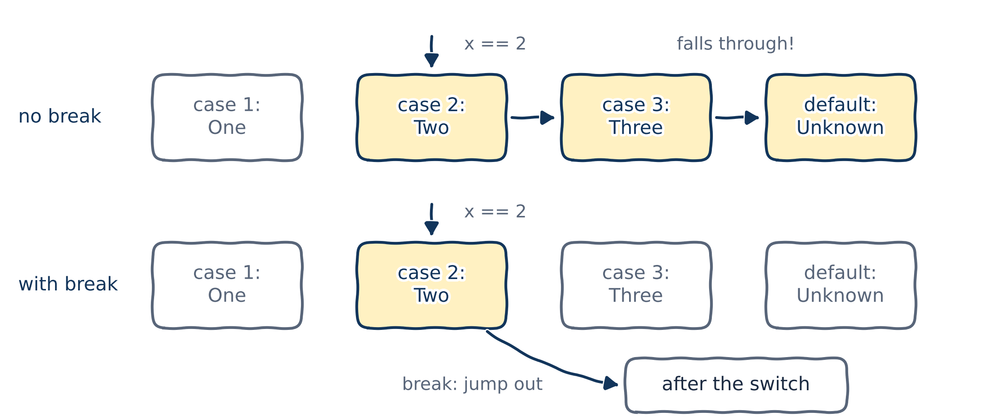
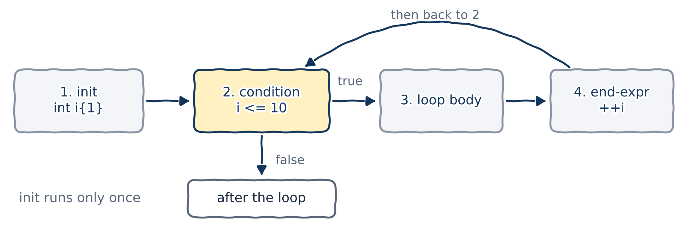
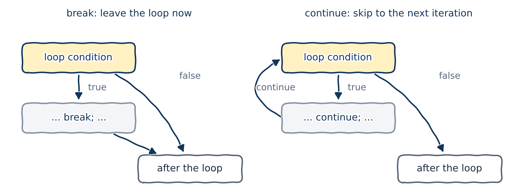

# Control flow

## What is control flow?

You already know control flow from Python, so I won't explain what it is or what it's for. Here's what C++ offers:

| Category | Implemented by |
|------------|----------------|
| Conditionals | `if`, `else`, `switch` |
| Loops | `while`, `do-while`, `for`, range-based `for` |
| Jumps | `break`, `continue`, `goto` |
| Function calls | `function()`, `return` |
| Halts | `std::exit()`, `std::abort()` |
| Exceptions | `try`, `throw`, `catch` |

::: {.fragment}
**Our goal:** learn the ones you'll use every day, and point you to the rest. You don't need all of them to get an A1!
:::

## From Python to C++: a phrasebook

| Python | C++ |
|--------|-----|
| `if x > 0:` ... `elif` ... `else:` | `if (x > 0) { ... } else if ... else { ... }` |
| `True`, `False` | `true`, `false` |
| indentation marks a block | **braces** `{ }` mark a block |
| `x += 1` | `x += 1` or `++x` |
| `for i in range(10):` | `for (int i{0}; i < 10; ++i)` |
| `match` | `switch` (sort of) |
| *(nothing)* | `do { ... } while (...);` |

The conditions go in **parentheses**, and the body goes in **braces**. The logical operators change too: `and`, `or` and `not` become `&&`, `||` and `!`.

# `if` statements

## `if` and `if-else`

::: {.columns}
::: {.column width="50%"}
```{.cpp}
if (condition) {
    true_statements;
}
```
:::
::: {.column width="50%"}
```{.cpp}
if (condition) {
    true_statements;
} else {
    false_statements;
}
```
:::
:::

::: {.columns}
::: {.column width="65%"}
```{.cpp filename="example_if_else.cpp"}

```
:::
::: {.column width="35%"}
```{.text .terminal}
$ ./example_if_else
Enter a number: 12
12 is greater than 10
```
:::
:::

## Indentation means nothing in C++

New programmers, and especially Python people, often write something like this:

::: {.columns}
::: {.column width="65%"}
```{.cpp filename="example_if_else_without_braces.cpp"}

```
:::
::: {.column width="35%"}
```{.text .terminal}
$ ./example_if_else_without_braces
Enter your height (in cm): 180
You are tall enough to ride.
Too bad!
```
:::
:::

Without braces, `if` and `else` each control **one** statement, so "Too bad!" always runs. g++ `-Wall` even warns: *this 'else' clause does not guard...*

## Fix it with a block

::: {.columns}
::: {.column width="65%"}
```{.cpp filename="example_if_else_with_braces.cpp"}

```
:::
::: {.column width="35%"}
```{.text .terminal}
$ ./example_if_else_with_braces
Enter your height (in cm): 180
You are tall enough to ride.
```
:::
:::

Braces `{ }` turn several statements into one **block** (a *compound statement*), so both lines now belong to the `else`.

## Always use braces: two cautionary tales

::: {.columns}
::: {.column width="50%"}
In a hurry, we add a line:

```{.cpp}
if (age >= min_drinking_age)
    purchase_beer();
    gamble(); // always runs!
```
:::
::: {.column width="50%"}
Debugging, we comment out a line:

```{.cpp}
if (age >= min_drinking_age)
    // add_beer_to_cart();

check_out(); // now conditional!
```
:::
:::

The usual argument *against* braces is that they spread code out vertically, so you see less of it at once. My opinion: with today's big screens, that argument is obsolete.

::: {.callout-tip title="Best practice"}
Put the statements of every `if` and `else` in braces, even single ones, at least while you're learning.
:::

## Implicit blocks

Without braces, the compiler puts the single statement in a block of its own anyway. So what does this print?

```{.cpp filename="define_variable_in_implicit_block_01.cpp" .no-compile}

```

::: {.fragment}
```{.text .output .compiler}
error: 'x' was not declared in this scope
```

Nothing: it doesn't compile! Each `x` lives in its own invisible block and is destroyed immediately, so no `x` is in scope on line 9. Remember **block scope** from Chapter 02?
:::

## What the compiler sees

The program on the last slide is exactly the same as this one:

```{.cpp filename="define_variable_in_implicit_block_02.cpp" .no-compile}

```

## `else if` chains

::: {.columns}
::: {.column width="72%"}
```{.cpp filename="print_digit_name_ifelse.cpp"}

```
:::
::: {.column width="28%"}
```{.text .output}
Two
```

C++ has no `elif`: write `else if` in full.
:::
:::

## `if`, `if` versus `if`, `else if`

::: {.columns}
::: {.column width="72%"}
```{.cpp filename="if_if_vs_else_if.cpp"}

```
:::
::: {.column width="28%"}
```{.text .output}
if, if:
  A
  B
if, else if:
  A
```

Separate `if`s check **every** condition; an `else if` chain stops at the **first** true one.

Which to use? It depends on the logic you want. Practice and you'll see!
:::
:::

## `=` is not `==`

::: {.columns}
::: {.column width="65%"}
```{.cpp filename="assignment_in_condition.cpp"}

```
:::
::: {.column width="35%"}
```{.text .output}
x is not zero
x is now 0
```
:::
:::

- `x = 0` **assigns** 0 to `x`, and the condition is then the value `0`, which counts as `false`. Our variable is clobbered too!
- It compiles. Only `-Wall` saves you: *suggest parentheses around assignment used as truth value*.

# `switch` statements

## `switch`: testing one value against many

::: {.columns}
::: {.column width="72%"}
```{.cpp filename="print_digit_name_switch.cpp"}

```
:::
::: {.column width="28%"}
```{.text .output}
Two
```

Same job as the `else if` chain, but easier to read.
:::
:::

## `switch` syntax

::: {.columns}
::: {.column width="40%"}
```{.cpp}
switch (expression) {
case x:
    // statements
    break;
case y:
    // statements
    break;
default:
    // statements
}
// carries on here
```
:::
::: {.column width="60%"}
1. The `expression` is evaluated.
2. If its value matches a `case` label, execution jumps to that label.
3. If nothing matches, execution jumps to `default` (if there is one).
4. If nothing matches and there's no `default`, the whole `switch` is skipped.

The expression must have an **integral** type, such as `int` or `char` (or an enumeration, later). `double` and strings are not allowed.
:::
:::

## Fallthrough: the classic `switch` bug

::: {.columns}
::: {.column width="65%"}
```{.cpp filename="switch_fallthrough.cpp"}

```
:::
::: {.column width="35%"}
```{.text .output}
Two
Three
Unknown
```

`-Wextra` warns: *this statement may fall through*.
:::
:::

A `case` label only marks where execution **starts**. Once it starts, it carries on through every case below, until something stops it.

## `break` stops the fall

{fig-alt="Two rows of switch cases. Without break, x equal to 2 enters case 2 and runs case 2, case 3 and default. With break, x equal to 2 runs case 2 only and then jumps to after the switch." width="80%"}

`break` means "done: jump to the end of the `switch`". Put one at the end of every case. (In our first example, `return` did the same job, because it left the whole function.)

## `break` in action

::: {.columns}
::: {.column width="72%"}
```{.cpp filename="break_a_switch.cpp"}

```
:::
::: {.column width="28%"}
```{.text .output}
7 + 2 = 9
7 - 2 = 5
7 / 2 = 3
```

::: {.callout-note title="Coming from Python"}
`7 / 2` is `3` here, not `3.5`: dividing one `int` by another drops the fraction, like Python's `7 // 2`.
:::
:::
:::

## `case` labels must be constants

::: {.columns}
::: {.column width="72%"}
```{.cpp filename="case_label_expression.cpp"}

```
:::
::: {.column width="28%"}
```{.text .output}
Three
```
:::
:::

- The `switch` expression can be any integer expression: here, `1 - 2 + 3 - 4 + 5` is `3`.
- Each `case` label must be a **constant expression**: `2 + 2` is fine, a variable is not.

## `goto`: just don't

- C++ has a `goto` statement that jumps to a labelled line anywhere in a function.
- It makes code very hard to follow, and loops plus `break` and `continue` almost always do the job better.
- Avoid it unless you have a truly compelling reason. If you're curious: [`goto` statements on learncpp.com](https://www.learncpp.com/cpp-tutorial/goto-statements/).

# `while` loops

## `while` loops

::: {.columns}
::: {.column width="40%"}
```{.cpp}
while (condition) {
    statements;
}
```
:::
::: {.column width="60%"}
1. Evaluate `condition`.
2. If it's `true`, run the body, then go back to step 1.
3. If it's `false`, carry on after the loop.
:::
:::

::: {.columns}
::: {.column width="62%"}
```{.cpp filename="while_count.cpp"}

```
:::
::: {.column width="38%"}
```{.text .output}
1 2 3 4 5 6 7 8 9 10 done!
```

`++count` adds 1 to `count`, like `count += 1`.
:::
:::

## When the condition is false from the start

::: {.columns}
::: {.column width="62%"}
```{.cpp filename="while_loop_ex.cpp"}

```
:::
::: {.column width="38%"}
```{.text .output}
done!
```
:::
:::

- If the condition is `false` the first time, the body never runs at all.
- Sometimes that's a bug; often it's exactly what we want. "Process every item in the list" should do nothing at all for an empty list.

## Infinite loops

::: {.columns}
::: {.column width="62%"}
```{.cpp filename="infinite_loop.cpp"}

```
:::
::: {.column width="38%"}
```{.text .terminal}
$ ./infinite_loop
Loop again (y/n)? y
Loop again (y/n)? y
Loop again (y/n)? n
```
:::
:::

- A condition that is always `true` makes an **infinite loop**. Write them on purpose, with a way out, never by accident!
- A runaway program stuck in a loop? Press **Ctrl+C** in the terminal to stop it.

## Doing something every *N* iterations

::: {.columns}
::: {.column width="58%"}
```{.cpp filename="program_using_if_and_while.cpp"}

```
:::
::: {.column width="42%"}
```{.text .output}
01 02 03 04 05 06 07 08 09 10
11 12 13 14 15 16 17 18 19 20
21 22 23 24 25 26 27 28 29 30
31 32 33 34 35 36 37 38 39 40
41 42 43 44 45 46 47 48 49 50
```

`%` gives the remainder after division, as in Python: `count % 10 == 0` is true for 10, 20, 30, ...
:::
:::

## Nested loops

::: {.columns}
::: {.column width="64%"}
```{.cpp filename="nested_loop_example.cpp"}

```
:::
::: {.column width="36%"}
```{.text .output}
1
1 2
1 2 3
1 2 3 4
1 2 3 4 5
```

For each turn of the outer loop, the inner loop runs to completion.
:::
:::

# `do-while` loops

## `do-while`: at least once

::: {.columns}
::: {.column width="64%"}
```{.cpp filename="do_while_loop_example.cpp"}

```
:::
::: {.column width="36%"}
```{.text .terminal}
$ ./do_while_loop_example
Please make a selection:
1) Addition
2) Subtraction
7
Please make a selection:
1) Addition
2) Subtraction
2
You selected option 2
```
:::
:::

- The condition is checked at the **end**, so the body always runs at least once. Perfect for "ask until the answer is valid".
- Don't forget the semicolon after `while (...)`. Python has no `do-while`.

# `for` loops

## `for` loops

```{.cpp}
for (init-statement; condition; end-expression) {
    statements;
}
```

{fig-alt="The four parts of a for loop: 1 init runs once; 2 the condition is checked; if true, 3 the loop body runs, then 4 the end-expression, then back to 2. If the condition is false, execution continues after the loop." width="80%"}

The init-statement runs **once**. Then: condition, body, end-expression, condition, body, end-expression... until the condition is `false`.

## A `for` loop is a tidy `while` loop

::: {.columns}
::: {.column width="50%"}
```{.cpp filename="for_loop_simple.cpp"}

```
:::
::: {.column width="50%"}
```{.cpp}
{ // this block limits the scope of i
    int i{1};          // init-statement
    while (i <= 10) {  // condition
        std::cout << i << ' ';
        ++i;           // end-expression
    }
} // i is destroyed here
```
:::
:::

```{.text .output}
1 2 3 4 5 6 7 8 9 10
```

::: {.callout-warning title="Watch out"}
`i <= 10` runs 10 times starting from 1; `i < 10` runs only 9. Getting this wrong by one is so common it has a name: an **off-by-one error**.
:::

## Leaving parts out

Every part of a `for` statement is optional:

::: {.columns}
::: {.column width="55%"}
```{.cpp}
int i{0};
for (; i < 10;) { // no init, no end-expression
    std::cout << i << ' ';
    ++i;
}
```
:::
::: {.column width="45%"}
```{.cpp}
for (;;) { // loops forever
    statements;
}
// same as while (true) { ... }
```
:::
:::

Legal, but rarely clearer. If you leave out the init and the end-expression, a `while` loop says the same thing more plainly.

## More than one counter

::: {.columns}
::: {.column width="72%"}
```{.cpp filename="for_loop_multi_counters.cpp"}

```

A comma separates the counters, both in the init-statement and in the end-expression.
:::
::: {.column width="28%"}
```{.text .output}
0 9
1 8
2 7
3 6
4 5
5 4
6 3
7 2
8 1
9 0
```
:::
:::

## Nested `for` loops

::: {.columns}
::: {.column width="72%"}
```{.cpp filename="nested_for_loops.cpp"}

```
:::
::: {.column width="28%"}
```{.text .output}
a012
b012
c012
d012
e012
```

A `char` can be a loop counter too: `'a'`, `'b'`, `'c'`, ...
:::
:::

# `break` and `continue`

## `break` and `continue`

{fig-alt="Two loop diagrams. With break, execution leaves the loop and goes to after the loop. With continue, execution skips the rest of the body and goes back to the loop condition." width="78%"}

- `break` ends the whole loop (or `switch`); execution continues after it.
- `continue` ends only the **current iteration** and jumps to the next one. In a `for` loop, the end-expression still runs.
- Both work just as they do in Python, and both usually sit inside an `if`.

## Breaking out of a loop

::: {.columns}
::: {.column width="72%"}
```{.cpp filename="break_a_loop.cpp"}

```
:::
::: {.column width="28%"}
```{.text .terminal}
$ ./break_a_loop
Number to add (0 to stop): 3
Number to add (0 to stop): 5
Number to add (0 to stop): 0
The sum is 8
```
:::
:::

## Breaking out of an infinite loop

::: {.columns}
::: {.column width="65%"}
```{.cpp filename="break_infinite_loop.cpp"}

```
:::
::: {.column width="35%"}
```{.text .terminal}
$ ./break_infinite_loop
Enter 0 to exit: 5
Enter 0 to exit: 0
We're out!
```
:::
:::

A `while (true)` loop with a `break` is the usual way to write "keep going until something happens".

## `break` versus `return`

::: {.columns}
::: {.column width="64%"}
```{.cpp filename="break_vs_return.cpp"}

```
:::
::: {.column width="36%"}
```{.text .terminal}
$ ./break_vs_return
Type b (break) or r (return): b
We broke out of the loop
It returned 0
$ ./break_vs_return
Type b (break) or r (return): r
It returned 1
```

`break` leaves the **loop**; `return` leaves the whole **function**.
:::
:::

## `continue`: skip to the next iteration

::: {.columns}
::: {.column width="72%"}
```{.cpp filename="continue_to_print_even.cpp"}

```
:::
::: {.column width="28%"}
```{.text .output}
0 2 4 6 8
```
:::
:::

For an odd number, `continue` skips the printing. The end-expression `++count` still runs, so the loop moves on to the next number.

## When `continue` makes code clearer

Some people say `break` and `continue` are just `goto` in disguise and should be avoided. Today's consensus: **use them when they make code easier to read.** Compare:

```{.cpp filename="nested_ifs.cpp"}

```

## When `continue` makes code clearer (continued)

```{.cpp filename="guard_clauses.cpp"}

```

```{.text .output}
6 12 18 24 30 36 42 48
```

Same output, but the checks sit up front and the real work stays at the top level instead of being buried in nested `if`s.

# Questions for chocolate

## Question 1: how does this program behave?

```{.cpp filename="Q_and_A_01.cpp"}

```

::: {.fragment}
```{.text .output}
0
1
2
3
4
```

...and then nothing, ever. When `count` reaches 5, `continue` skips `++count`, so `count` stays 5 forever: an accidental infinite loop. Ctrl+C to the rescue!
:::

## Question 2: what's your opinion of this code?

Just say something: whatever you think!

```{.cpp filename="Q_and_A_02.cpp"}

```

## Question 2: my suggestion

::: {.fragment}
It works, but the `keep_looping` variable only exists to end the loop. `break` says the same thing directly:

```{.cpp filename="Q_and_A_02_rewrite.cpp"}

```
:::

# Wrapping up

## Summary

- Conditions go in parentheses, bodies in braces. Indentation means nothing to the compiler, so **always use braces**.
- `else if`, not `elif`; `&&`, `||`, `!`, not `and`, `or`, `not`; and `==`, not `=`, when comparing.
- `switch` tests one integral value against constant `case` labels. End each case with `break`, or it falls through.
- `while` checks first; `do-while` runs at least once; `for` keeps init, condition and end-expression together.
- `break` leaves the loop, `continue` skips to the next iteration, `return` leaves the function.
- Compile with `-Wall -Wextra`: it caught misleading indentation, `=` in a condition, and fallthrough today.

## Your turn: two small challenges

Go home, don't sleep yet, and write programs that print these. Try loops of each kind!

::: {.columns}
::: {.column width="50%"}
```{.text .output}
6 5 4 3 2 1
5 4 3 2 1
4 3 2 1
3 2 1
2 1
1
```
:::
::: {.column width="50%"}
```{.text .output}
          1
        2 1
      3 2 1
    4 3 2 1
  5 4 3 2 1
6 5 4 3 2 1
```
:::
:::

## Keep learning

Explore these on your own, with Google Gemini in Guided Learning mode or on [learncpp.com](https://www.learncpp.com):

1. Fundamental data types in more depth: [integers](https://www.learncpp.com/cpp-tutorial/introduction-to-integers/), [floating point numbers](https://www.learncpp.com/cpp-tutorial/floating-point-numbers/), [Booleans](https://www.learncpp.com/cpp-tutorial/boolean-values/) and [chars](https://www.learncpp.com/cpp-tutorial/chars/)
2. [Logical operators](https://www.learncpp.com/cpp-tutorial/logical-operators/) (`&&`, `||`, `!`)
3. [`switch` fallthrough and scoping](https://www.learncpp.com/cpp-tutorial/switch-fallthrough-and-scoping/)

**Next up, Chapter 04:** constants and strings.
