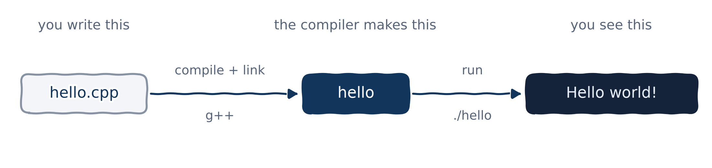
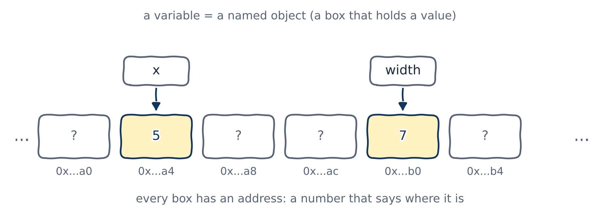
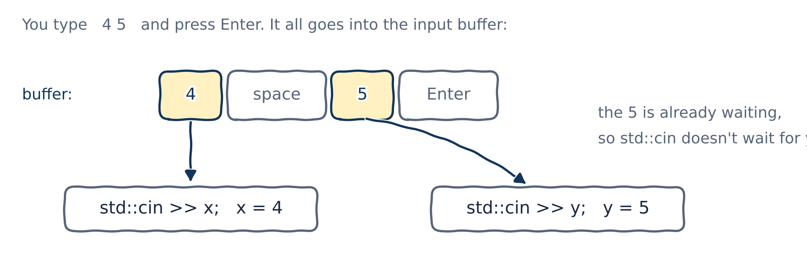

# Program Structure and Variables {#sec-ch01}

This chapter writes, compiles and runs a first program, then introduces variables, input and output, and the first big trap in C++: uninitialized variables.

## Your first program

```{.cpp filename="hello.cpp"}

```

This program prints `Hello world!`, and every C++ program has the same shape. `#include <iostream>` brings in the code for printing text. `int main() { ... }` is the **main function**: every program has exactly one, and that's where it starts, wherever it sits in the file (a Python script, by contrast, simply runs from top to bottom). Between the braces are **statements**, which run in order; most of them end with a **semicolon**. `return 0;` tells the operating system that all went well.

### Building and running

{fig-alt="hello.cpp is compiled and linked by g++ into a program called hello. Running hello prints Hello world! in the terminal." width="65%"}

The computer can't run `hello.cpp` directly: first, the compiler `g++` builds a program from it.

```{.text .terminal}
$ g++ -std=c++20 -Wall -Wextra hello.cpp -o hello
$ ./hello
Hello world!
```

`-std=c++20` selects the version of C++ this course uses, `-o hello` names the program (`hello.exe` on Windows; without `-o`, it's `a.out`), and `-Wall -Wextra` turn on **warnings**: messages about code that compiles but is probably wrong. Always use them. When you press "Run" in an IDE, it types these commands for you.

### Syntax errors

C++ has strict rules about how code must be written, its **syntax**. Break one, and you get a **syntax error** and no program:

```{.cpp filename="hello_error.cpp" .no-compile}

```

```{.text .output .compiler}
hello_error.cpp:4:34: error: expected ';' before 'return'
```

`4:34` is line 4, column 34, exactly where the `;` belongs. g++ only noticed when it reached `return` on the next line, and other compilers may point there instead, so check the line an error points to *and the one before*.

::: {.callout-tip title="Best practice"}
Fix the **first** error the compiler reports, then compile again. One mistake often causes a list of follow-on errors.
:::

## Comments

`//` starts a comment that runs to the end of the line, and `/* ... */` encloses a comment that can span several lines (but can't be nested: it ends at the first `*/`). The compiler ignores both. Note that `#` does *not* start a comment as in Python: a line starting with `#`, like `#include`, is an instruction to the *preprocessor* (Chapter 02). A good comment says *why*, because the code already says *what*:

```{.cpp}
cost = cost * 1.2; // multiply cost by 1.2   (useless: the code says that)
cost = cost * 1.2; // add 20% VAT            (useful: now we know why)
```

## Variables and types

{fig-alt="A row of memory boxes, each with an address underneath. Two boxes are highlighted: one named x holds 5, one named width holds 7. The others hold unknown values." width="60%"}

A program keeps its data in memory, which you can picture as a row of numbered boxes. C++ lets you use memory through **objects**, regions of memory that hold a value; a named object is a **variable**. (In object-oriented programming, "object" will mean much more.) A **definition** creates a variable: a type, a name and a semicolon.

```{.cpp}
int count;     // whole numbers:            -3, 0, 42
double price;  // numbers with a fraction:  3.99, -0.5
char grade;    // a single character:       'A', '?'
bool passed;   // true or false
```

These four **fundamental types** will carry us a long way; text (`std::string`) comes in Chapter 04. The **type** decides what a variable can hold and what you can do with it.

::: {.callout-note title="Coming from Python"}
A Python name can refer to an integer now and a string later. A C++ variable's type is fixed when you define it: this is *static typing*, and it lets the compiler catch type mistakes before the program runs.
:::

Names may contain letters, digits and underscores, can't start with a digit, are case-sensitive (`width` and `Width` are different), and can't be a **keyword** such as `int` or `return`. Choose names that say what the value means, and in this course write them in `snake_case`: `max_speed`, `get_value_from_user`.

## Assignment and initialization

**Assignment** gives an existing variable a new value with `=`, replacing the old one. **Initialization** gives a variable its first value at the moment it's defined; it happens exactly once, whereas assignment can happen as often as you like. C++ has several ways to write an initialization:

```{.cpp}
int a;     // default-initialization: no initializer (a holds garbage!)
int b = 5; // copy-initialization
int c(6);  // direct-initialization
int d{7};  // direct-list-initialization (braces)
int e{};   // value-initialization: empty braces give 0
a = 8;     // assignment, not initialization
```

The brace forms are called **list initialization**. For an `int`, `b`, `c` and `d` end up the same, but braces have one big advantage: they refuse **narrowing conversions**, which lose information.

```{.cpp filename="narrowing.cpp" .no-compile}

```

```{.text .output .compiler}
error: narrowing conversion of '4.7000000000000002e+0' from 'double' to 'int'
```

Line 4 compiles silently, even with `-Wall -Wextra`, and quietly stores `4`: a bug waiting to happen. Line 7 is a compile error. (`4.7000000000000002` is how 4.7 is really stored in binary.)

::: {.callout-tip title="Best practice"}
Initialize with braces: `int d{7};` when you know the value, `int e{};` when you don't yet.
:::

A variable that is defined but never used is usually a mistake or leftover code, and `-Wall` warns about it: *unused variable 'x'*. It's only a warning, so the program still compiles.

## Input and output

### Printing

`#include <iostream>` gives us `std::cout`, which prints to the screen, and `std::cin`, which reads from the keyboard; `std::` means they belong to the **standard library**.

```{.cpp filename="use_stdcout.cpp"}

```

```{.text .output}
Hello world!
4
5
I am Khiem Nguyen
8 planets and 1 sun
```

`std::cout` prints text, numbers and variables alike, and `<<` can be chained to print several things in one statement (lines 11 and 15). Nothing starts a new line unless you ask: print `'\n'`, on its own or inside text. `std::endl` also starts a new line, but it *flushes* the output to the screen immediately, which is slow if done after every line.

::: {.callout-tip title="Best practice"}
Use `'\n'` for new lines, not `std::endl`.
:::

### Reading

```{.cpp filename="use_stdcin.cpp"}

```

`std::cin >> x` waits for the user to type something and press Enter, then stores it in `x`, already as an `int` (Python's `input()` always gives a string). We still initialize `x` with `{}`, so that it holds `0` rather than garbage if the read fails. `<<` is the **insertion operator** and `>>` the **extraction operator**, and beginners often mix them up. Read them as arrows showing where the data moves: `std::cout << 4` moves 4 *into* the output, and `std::cin >> x` moves the input *out of* `std::cin` into `x`.

### The input buffer

```{.cpp filename="stdcin_buffered.cpp"}

```

Type `4`, Enter, `5`, Enter, and the program behaves as expected. But type `4 5` on one line:

```{.text .terminal}
Enter two numbers: 4 5
You entered 4
You entered 5
```

The program never waits for the second number. Input is **buffered**: when you press Enter, the whole line goes into an *input buffer*. `>>` takes what it needs and leaves the rest there, and only waits for you if the buffer is empty. So the second `>>` finds the `5` already waiting. The buffer comes back to bite us in Chapter 04.

{fig-alt="The user types 4 space 5 Enter, which all goes into the input buffer. The first std::cin >> x takes the 4. The second std::cin >> y finds the 5 already waiting in the buffer, so it doesn't wait for the user." width="62%"}

## Uninitialized variables and undefined behaviour

C++ does **not** set variables to zero for you. A variable that is never given a value is **uninitialized**: it holds whatever was left in that memory, a **garbage value**. (A variable that is assigned a value later stops being uninitialized, even though it was never *initialized*.) In `uninitialized_variable_01.cpp`, `-Wall` warns *'x' is used uninitialized*, and on my machine `x` happened to print `0`, but nothing guarantees that. This program makes the garbage visible:

```{.cpp filename="uninitialized_variable_02.cpp"}

```

`dirty_the_memory()` leaves values behind in memory, then `see_the_junk()` prints an uninitialized `x` (functions are Chapter 02's topic). Built normally, then with `-O2` (optimize for speed):

```{.text .terminal}
$ g++ -std=c++20 uninitialized_variable_02.cpp && ./a.out
Leaving behind 42, 24, 66
Uninitialized x holds 66
$ g++ -std=c++20 -O2 uninitialized_variable_02.cpp && ./a.out
Leaving behind 42, 24, 66
Uninitialized x holds 0
```

Without optimization, `x` landed where `c` had been and picked up its `66`; with `-O2` it printed `0`. Same code, different answers, and neither is "wrong", because the program never said what `x` should be. Using an uninitialized variable is our first case of **undefined behaviour** (UB): code whose result C++ doesn't define. A program with UB may give different results on each run or each computer, crash, or seem to work perfectly until the day it doesn't. This is "trust the programmer" at its most dangerous.

::: {.callout-important title="Key idea"}
Avoid undefined behaviour. Here it's easy: **always initialize your variables**, and keep `-Wall -Wextra` on, so that the compiler can warn you.
:::

## Summary

- A program starts at `main()`; statements run top to bottom and most end with `;`.
- `g++ -std=c++20 -Wall -Wextra` builds a program. Fix the first error first.
- Comments use `//` or `/* */`; comment *why*, not *what*.
- A variable is a named object with a fixed type. Initialize with braces, which also block narrowing.
- `std::cout <<` prints and `std::cin >>` reads; use `'\n'` for new lines. Input is buffered.
- Uninitialized variables cause undefined behaviour. Always initialize.

**Further reading** on [learncpp.com](https://www.learncpp.com): [keywords and naming identifiers](https://www.learncpp.com/cpp-tutorial/keywords-and-naming-identifiers/), [whitespace and basic formatting](https://www.learncpp.com/cpp-tutorial/whitespace-and-basic-formatting/), [literals and operators](https://www.learncpp.com/cpp-tutorial/introduction-to-literals-and-operators/), [expressions](https://www.learncpp.com/cpp-tutorial/introduction-to-expressions/).
