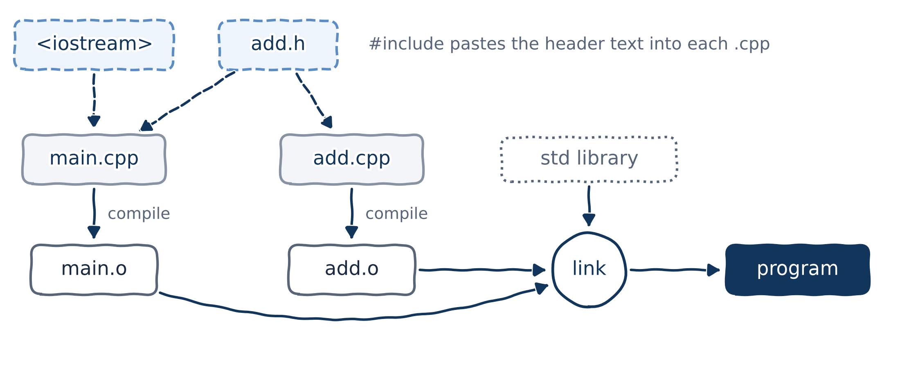

# Functions and Files {#sec-ch02}

This chapter breaks programs into **functions**, named and reusable pieces of code, and then splits them across several files, which brings in declarations, header files and the linker.

## Why functions?

`repeat_yourself.cpp` reads two integers with the same three lines of code written out twice. Reading ten numbers would mean ten copies, and changing the prompt would mean changing every copy, and probably forgetting one. The golden rule is **DRY**, *Don't Repeat Yourself*: write the code once, give it a name, and use it as often as you like.

```{.cpp filename="dont_repeat_yourself.cpp"}

```

`get_value_from_user()` is a function, and `main()` **calls** it twice, on lines 11 and 12. Change the prompt on line 4, and both calls change with it.

## Defining and calling functions

A function definition has a **header** and a **body**:

```{.cpp}
int add(int x, int y) { // header: return type, name, parameters
    return x + y;       // body: runs every time add() is called
}
```

The header says what goes in (the **parameters** `x` and `y`) and what comes out (the **return type**, `int`); Python's `def add(x, y):` gives neither type. `main()` is a function too, special only because the program starts there.

```{.cpp filename="call_function.cpp"}

```

```{.text .output}
Starting main()
  In say_hello(): Hello there!
  In say_hello(): Hello there!
Ending main()
```

A **function call** is the name followed by parentheses: `say_hello();`. The **caller** (`main()`) pauses, the **callee** (`say_hello()`) runs, and then the caller carries on right after the call. Functions can call other functions, and every call returns to exactly the place it was called from (try `function_call_function.cpp`). Unlike Python, C++ doesn't allow **nested functions**: every function is defined at the top level of a file.

## Return values

### Sending a value back

A function hands one value back to its caller with a **return statement**. When `return input;` runs, the expression is evaluated, a **copy** of the result goes back to the caller as the **return value**, and the function ends.

```{.cpp filename="return_value.cpp"}

```

```{.text .terminal}
$ ./return_value
Enter an integer: 21
21 x 2 = 42
```

On line 12, the call produces the value it returns, `21`, and that value initializes `num`: a call can be used wherever a value of its return type can. Each call returns exactly **one** value. Python's `return total, average` only *looks* like two values: it returns one tuple. C++ can do the same with a struct or `std::pair`, later in the course.

### `main()` and missing returns

`main()` must return an `int`, which goes back to the operating system (`0` means success). It's the only function that may leave out its return statement, and you must never call it yourself. Any other function that promises a value but doesn't return one has undefined behaviour, and it still compiles, with only a warning. In `missing_return.cpp`, `get_answer()` prints `Thinking...` but forgets its `return 42;`:

```{.text .terminal}
$ g++ -std=c++20 -Wall missing_return.cpp
warning: no return statement in function returning non-void [-Wreturn-type]
$ ./a.out
Thinking...
Illegal instruction
```

::: {.callout-tip title="Best practice"}
Compile with `-Wall -Wextra`, and treat every warning as a bug: warnings are free bug reports.
:::

### `void` functions

A function with nothing to give back has the return type **`void`**. It returns to the caller at its closing `}`, or immediately at `return;`:

```{.cpp filename="void_return.cpp"}

```

```{.text .output}
Hi
I'm Khiem
Back in main()
```

Line 8 never runs. An early `return;` becomes really useful with the `if` statements of Chapter 03. A `void` function can't return a value: `return 5;` in one is a compile error.

## Parameters, arguments and pass by value {#sec-pass-by-value}

A **parameter** is a variable declared in the function header, a *placeholder*. An **argument** is the *actual* value passed in the call: in `print_double(21)`, `21` is the argument for the parameter `value`. A call needs one argument per parameter, in order, and an argument can be any expression, even another call, such as `add(1, multiply(2, 3))`.

When a function is called, each parameter is created as a new local variable and initialized with a **copy** of its argument. This is **pass by value**.

::: {.callout-important title="Key idea"}
With pass by value, the function works on its **own copy** of each argument. Whatever it does to the copy stays inside the function.
:::

```{.cpp filename="pass_by_value.cpp"}

```

```{.text .output}
In try_to_swap(): 200 100
Back in main():   100 200
```

`try_to_swap()` swapped its own copies; `main()`'s `x` and `y` never changed, even though they share the parameters' names. To change the caller's variables we need *references* (Chapter 07).

::: {.callout-note title="Coming from Python"}
In Python, a parameter refers to the *same object* as its argument, so a function that changes a list changes the caller's list (`pass_by_value.py` prints `[15]`). C++ pass by value copies the whole argument, so nothing the function does can reach the caller.
:::

### Watch out: argument order

```{.cpp filename="evaluation_order.cpp"}

```

```{.text .terminal}
$ ./evaluation_order
Enter an integer: 10
Enter an integer: 3
3 - 10 = -7
```

We typed `10` first, yet it ended up in `y`. C++ doesn't fix the **order in which arguments are evaluated**, and g++ evaluated the second call first. When order matters, use separate statements, which do run in order:

```{.cpp}
int x{get_value_from_user()}; // runs first
int y{get_value_from_user()}; // runs second
print_diff(x, y);
```

## Scope and lifetime

Variables defined in a function body, and its parameters, are **local variables**. Every variable raises two separate questions:

|                    | **Scope**                                  | **Lifetime**                                 |
|--------------------|--------------------------------------------|----------------------------------------------|
| The question       | *where* can I use the name?                | *when* does the variable exist?              |
| Decided at         | compile time                               | run time                                     |
| A local variable's | from its definition to the end of its block | from its creation to the end of its block    |

Local variables are destroyed at the closing `}` of their block, in reverse order of creation.

### Scope

```{.cpp filename="local_scope_01.cpp"}

```

```{.text .output}
In print_x(): x = 42
In main():    x = 7
```

Each function has its own `x`: a name only means something inside its own function, so you can reuse good names freely. Scope is even finer than a function. Any pair of braces makes a **block**, and a name defined in a block can't be used after its `}`:

```{.cpp filename="local_scope_02.cpp" .no-compile}

```

```{.text .output .compiler}
error: 'b' was not declared in this scope
```

This is **block scope**: `b` disappears at the `}` on line 9.

::: {.callout-note title="Coming from Python"}
Python has no block scope: a variable created inside an `if` or `for` body is still usable after it. In C++, it's gone at the `}`.
:::

### Scope is not lifetime

```{.cpp filename="scope_vs_lifetime.cpp"}

```

While `second_function()` runs, `x` is out of scope, because that function can't use the name. But `x` is still alive: `first_function()` hasn't finished, and line 11 prints `10` afterwards. `scope_vs_lifetime_proof.cpp` proves it: it passes the *address* of `x` to `second_function()`, which prints `x holds 10` without ever using the name `x` (a sneak peek at pointers, Chapter 08).

## Declarations and definitions

```{.cpp filename="without_forward_declaration.cpp" .no-compile}

```

```{.text .output .compiler}
error: 'add' was not declared in this scope
```

The compiler reads a file **from top to bottom**: when it reaches `add(3, 4)` on line 4, it has never heard of `add`. You can move `add` above `main()`, but with many functions that gets awkward, and two functions that call each other have no valid order at all. The real fix is a **forward declaration**, or *function prototype*: the header followed by a semicolon.

```{.cpp filename="with_forward_declaration.cpp"}

```

A **declaration** (line 3) introduces a name and its type; a **definition** (lines 10–12) also provides the body, and is also a declaration. *Declare as often as you like; define exactly once*: that's the gist of the **one definition rule**. If you declare a function but never define it (`declared_not_defined.cpp`), the compiler is happy, but the next step of the build, the **linker**, which connects each call to its function's body, fails:

```{.text .terminal}
$ g++ -std=c++20 declared_not_defined.cpp
undefined reference to `add(int, int)'
collect2: error: ld returned 1 exit status
```

Tell the two apart: *"was not declared in this scope"* comes from the compiler; *"undefined reference"* comes from the linker. (Python looks names up only when a line runs, so order in the file matters much less there.)

## Multiple files and header files

### Compiling and linking

Larger programs are split into files, to keep related code together, reuse it in other programs, let people work in parallel, and recompile only what changed. Each `.cpp` file is **compiled on its own** into an **object file** (`.o`), knowing nothing about the other files; then the **linker** joins the object files and the standard library into one program (see the figure below). So if `add()` lives in `add.cpp`, `main.cpp` must still declare it before calling it (`multiple_files/main.cpp`). Compiling files separately is deliberate: they can be compiled in any order or in parallel, only changed files need recompiling, and a name used in one file can't clash with the same name in another.

### Header files

Copying declarations into every file that needs them doesn't scale: a hundred files needing a hundred declarations each is ten thousand copies to keep in sync. Instead, we write them once in a **header file** and `#include` it. The **preprocessor**, which runs before the compiler, pastes the header's text in place of the `#include` line, just as `#include <iostream>` pastes in the declarations of `std::cout`.

```{.cpp filename="add.h"}

```

```{.cpp filename="add.cpp"}

```

```{.cpp filename="main.cpp"}

```

```{.text .terminal}
$ g++ -std=c++20 -Wall main.cpp add.cpp -o program
$ ./program
3 + 4 = 7
```

List every `.cpp` file on the command line, but never a header: headers are pasted into `.cpp` files, not compiled on their own. Quotes, `"add.h"`, mean a header from your project; angle brackets, `<iostream>`, one from the standard library. `add.cpp` includes its own header so that the compiler can check that the declaration and the definition match.

{fig-alt="The headers iostream and add.h are pasted into main.cpp and add.cpp. Each .cpp file is compiled into an object file, and the linker joins main.o, add.o and the standard library into one program." width="50%"}

You can also build step by step:

```{.text .terminal}
$ g++ -std=c++20 -c main.cpp     # compile only: makes main.o
$ g++ -std=c++20 -c add.cpp      # compile only: makes add.o
$ g++ main.o add.o -o program    # link: makes program
```

After editing `add.cpp`, only `add.o` needs rebuilding; tools like `make` and CMake automate exactly this.

### Header guards

The `#ifndef ADD_H` / `#define ADD_H` / `#endif` lines in `add.h` are a **header guard**. A header can end up included twice in one file, often through another header. The first time, `ADD_H` isn't defined yet, so the preprocessor defines it and keeps the contents; the second time, everything up to `#endif` is skipped. That matters once headers contain class definitions (Chapter 11), because defining something twice is an error. `#pragma once` does the same in one line, and all major compilers support it, although it isn't standard C++.

::: {.callout-tip title="Best practice"}
Pair each `.cpp` file with a header of the same name. Put declarations in the header and definitions in the `.cpp` file, give every header a guard, never `#include` a `.cpp` file, and include what you use.
:::

## Summary

- Functions let you write code once and use it many times (DRY). A function has a header (return type, name, parameters) and a body.
- Arguments are **copied** into parameters (*pass by value*). `return` sends one value back; `void` functions send none.
- **Scope** is *where* a name can be used (compile time); **lifetime** is *when* a variable exists (run time).
- The compiler reads each file top to bottom, one file at a time: declare before you use. Missing definitions are linker errors.
- Header files share declarations between files; header guards make them safe to include.

**Further reading** on [learncpp.com](https://www.learncpp.com): [namespaces](https://www.learncpp.com/cpp-tutorial/naming-collisions-and-an-introduction-to-namespaces/), [the preprocessor](https://www.learncpp.com/cpp-tutorial/introduction-to-the-preprocessor/), [header guards](https://www.learncpp.com/cpp-tutorial/header-guards/).
