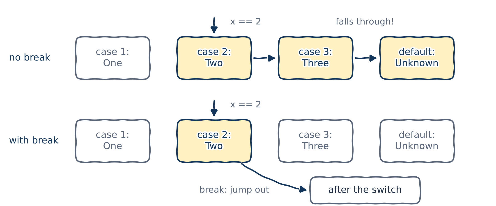
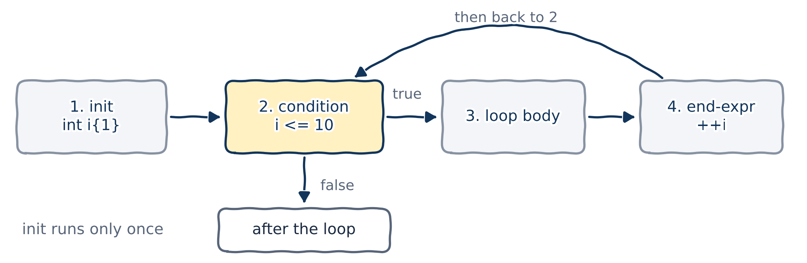
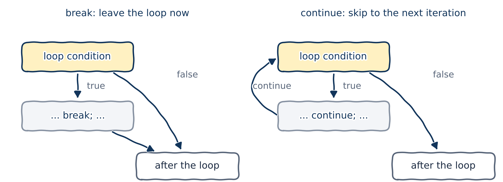

# Control Flow {#sec-ch03}

You already know decisions and loops from Python, so this chapter concentrates on how C++ writes them, and on the traps that catch people moving from Python to C++.

## From Python to C++

C++ offers conditionals (`if`, `else`, `switch`), loops (`while`, `do-while`, `for`), jumps (`break`, `continue`, `goto`), function calls and `return`, halts (`std::exit()`) and exceptions. You'll use the first three every day. The phrasebook:

| Python | C++ |
|--------|-----|
| `if x > 0:` ... `elif` ... `else:` | `if (x > 0) { ... } else if ... else { ... }` |
| `True`, `False` | `true`, `false` |
| indentation marks a block | **braces** `{ }` mark a block |
| `x += 1` | `x += 1` or `++x` |
| `for i in range(10):` | `for (int i{0}; i < 10; ++i)` |
| `match` | `switch` (sort of) |
| *(nothing)* | `do { ... } while (...);` |

Conditions go in **parentheses**, bodies in **braces**, and the logical operators `and`, `or` and `not` become `&&`, `||` and `!`.

## `if` statements

### Indentation means nothing

`if (condition) { ... } else { ... }` works as in Python. The big difference is that **indentation means nothing** to the compiler:

```{.cpp filename="example_if_else_without_braces.cpp"}

```

```{.text .terminal}
$ ./example_if_else_without_braces
Enter your height (in cm): 180
You are tall enough to ride.
Too bad!
```

Without braces, `if` and `else` each control exactly **one** statement. The `else` controls line 11 only, so line 12 always runs, whatever its indentation. (`-Wall` warns: *this 'else' clause does not guard...*) Braces turn several statements into one **block**, which fixes it (`example_if_else_with_braces.cpp`). Leaving braces out even for a single statement is risky, because adding or commenting out a line later silently changes the meaning:

```{.cpp}
if (age >= min_drinking_age)
    purchase_beer();
    gamble(); // always runs!

if (age >= min_drinking_age)
    // add_beer_to_cart();

check_out(); // now conditional!
```

::: {.callout-tip title="Best practice"}
Put the body of every `if` and `else` in braces, even a single statement.
:::

A brace-less body still gets an invisible block of its own. So what does this print?

```{.cpp filename="define_variable_in_implicit_block_01.cpp" .no-compile}

```

```{.text .output .compiler}
error: 'x' was not declared in this scope
```

Nothing: each `x` lives in its own invisible block and is destroyed immediately, so no `x` is in scope on line 9. That's block scope, from Chapter 02.

### `else if` chains

C++ has no `elif`: you write `else if` in full. An `else if` chain is not the same as separate `if`s:

```{.cpp filename="if_if_vs_else_if.cpp"}

```

```{.text .output}
if, if:
  A
  B
if, else if:
  A
```

Separate `if`s check **every** condition; an `else if` chain stops at the **first** true one. Which to use depends on the logic you want.

### `=` is not `==`

The most famous bug in C and C++:

```{.cpp filename="assignment_in_condition.cpp"}

```

```{.text .output}
x is not zero
x is now 0
```

`x = 0` *assigns* 0 to `x`, and the value of the assignment, `0`, counts as `false`, so the `else` branch runs and `x` has been clobbered as well. Python rejects `if x = 0:` as a syntax error, but C++ compiles it; only `-Wall` warns you (*suggest parentheses around assignment used as truth value*).

## `switch` statements

A `switch` tests one value against a list of constant `case` labels, which is often clearer than a long `else if` chain:

```{.cpp filename="break_a_switch.cpp"}

```

```{.text .output}
7 + 2 = 9
7 - 2 = 5
7 / 2 = 3
```

Execution jumps to the matching `case`, or to `default` if no case matches (and if there's no `default`, the `switch` is skipped). The expression must have an **integral** type such as `int` or `char`, not `double` or a string, and each label must be a **constant expression** like `3` or `2 + 2`, never a variable. (`7 / 2` is `3` because dividing two `int`s drops the fraction, like Python's `7 // 2`.)

### Fallthrough

What happens without the `break`s?

```{.cpp filename="switch_fallthrough.cpp"}

```

```{.text .output}
Two
Three
Unknown
```

A `case` label only marks where execution **starts**. Once started, it carries on through all the cases below until something stops it: this is **fallthrough**, and `-Wextra` warns about it (*this statement may fall through*). End every case with `break`, or with `return`, which leaves the whole function.

{fig-alt="Two rows of switch cases. Without break, x equal to 2 enters case 2 and runs case 2, case 3 and default. With break, x equal to 2 runs case 2 only and then jumps to after the switch." width="60%"}

C++ also has `goto`, which jumps anywhere in a function and makes code hard to follow. Don't use it.

## Loops

### `while` and `do-while`

A **`while`** loop checks its condition, runs the body if it's `true`, and repeats:

```{.cpp}
int count{1};
while (count <= 10) {
    std::cout << count << ' '; // prints 1 2 3 4 5 6 7 8 9 10
    ++count;                   // add 1, like count += 1
}
```

If the condition is `false` at the start, the body never runs, which is often exactly right: "process every item" should do nothing for an empty list. A condition that is always true, as in `while (true)`, makes an **infinite loop**. Write one on purpose, with a way out such as `return` (`infinite_loop.cpp`), never by accident, and press **Ctrl+C** in the terminal to stop a runaway program. Loops can be nested: for each turn of the outer loop, the inner loop runs to completion (`nested_loop_example.cpp` prints a triangle of numbers this way).

A **`do-while`** loop checks its condition at the *end*, so the body runs at least once, which is perfect for "ask until the answer is valid". Python has no equivalent. Mind the semicolon at the end:

```{.cpp filename="do_while_loop_example.cpp"}

```

Typing `7` shows the menu again; typing `2` ends the loop. `selection` is defined before the loop because it's used after it.

### `for` loops

A **`for`** loop gathers the three parts that control a counting loop on one line:

{fig-alt="The four parts of a for loop: 1 init runs once; 2 the condition is checked; if true, 3 the loop body runs, then 4 the end-expression, then back to 2. If the condition is false, execution continues after the loop." width="58%"}

The init-statement runs once; then condition, body, end-expression, condition, body... until the condition is false. These two loops do the same thing:

```{.cpp}
for (int i{1}; i <= 10; ++i) { // init; condition; end-expression
    std::cout << i << ' ';     // prints 1 2 3 4 5 6 7 8 9 10
}

{                              // this block limits the scope of i
    int i{1};                  // init-statement
    while (i <= 10) {          // condition
        std::cout << i << ' ';
        ++i;                   // end-expression
    }
}
```

The `for` loop keeps the loop's controls together, and its counter only exists inside the loop. Every part is optional (`for (;;)` loops forever, like `while (true)`), several counters are separated by commas (`for (int x{0}, y{9}; x < 10; ++x, --y)`), and a `char` can count too (`for (char c{'a'}; c <= 'e'; ++c)`). Python's `for item in collection` corresponds to C++'s *range-based* `for` loop, which works with containers such as `std::vector`.

::: {.callout-warning title="Watch out"}
`i <= 10` runs 10 times from 1, `i < 10` only 9. Being wrong by one iteration is so common it has a name: an **off-by-one error**.
:::

## `break` and `continue`

{fig-alt="Two loop diagrams. With break, execution leaves the loop and goes to after the loop. With continue, execution skips the rest of the body and goes back to the loop condition." width="58%"}

As in Python, `break` ends the whole loop (or `switch`), and `continue` ends only the current iteration and moves on to the next. Both usually sit inside an `if`.

```{.cpp filename="break_a_loop.cpp"}

```

```{.text .terminal}
$ ./break_a_loop
Number to add (0 to stop): 3
Number to add (0 to stop): 5
Number to add (0 to stop): 0
The sum is 8
```

Typing `0` triggers the `break` on line 12, and execution continues on line 18. `break` leaves the **loop**, whereas `return` leaves the whole **function** (`break_vs_return.cpp`). A `while (true)` loop with a `break` inside is the usual way to write "keep going until something happens".

```{.cpp filename="continue_to_print_even.cpp"}

```

```{.text .output}
0 2 4 6 8
```

For an odd number, `continue` skips the printing; in a `for` loop, the end-expression `++count` still runs.

### When `continue` makes code clearer

Some people call `break` and `continue` disguised `goto`s, but today's consensus is to use them when they make code easier to read. `nested_ifs.cpp` prints the numbers under 50 that are even and multiples of 3, with the printing buried two `if`s deep. This version does the same with `continue`:

```{.cpp filename="guard_clauses.cpp"}

```

```{.text .output}
6 12 18 24 30 36 42 48
```

These checks are **guard clauses**: they sit up front, each skipping the numbers we don't want, and the real work stays at the top level of the loop.

## Test yourself

**Question 1.** How does this program behave?

```{.cpp filename="Q_and_A_01.cpp"}

```

::: {.callout-tip title="Answer" collapse="true"}
It prints `0` to `4` and then hangs forever: when `count` reaches 5, `continue` skips `++count`, so `count` stays 5. An accidental infinite loop: Ctrl+C! (In `continue_to_print_even.cpp`, the increment was in the `for` loop's end-expression, which `continue` doesn't skip.)
:::

**Question 2.** What do you think of this code?

```{.cpp filename="Q_and_A_02.cpp"}

```

::: {.callout-tip title="My suggestion" collapse="true"}
It works, but `keep_looping` only exists to end the loop. `break` says the same thing directly:

```{.cpp filename="Q_and_A_02_rewrite.cpp"}

```
:::

**Challenges.** Write programs that print these two patterns, with loops of each kind:

```{.text .output}
6 5 4 3 2 1
5 4 3 2 1
4 3 2 1
3 2 1
2 1
1
```

```{.text .output}
          1
        2 1
      3 2 1
    4 3 2 1
  5 4 3 2 1
6 5 4 3 2 1
```

## Summary

- Conditions go in parentheses, bodies in braces. Indentation means nothing to the compiler: **always use braces**.
- `else if`, not `elif`; `&&`, `||`, `!`; and `==`, not `=`, when comparing.
- `switch` tests one integral value against constant labels. End each case with `break`, or it falls through.
- `while` checks first, `do-while` runs at least once, and `for` keeps init, condition and end-expression together.
- `break` leaves the loop, `continue` skips to the next iteration, `return` leaves the function.
- `-Wall -Wextra` caught misleading indentation, `=` in a condition, and fallthrough in this chapter alone.

**Further reading** on [learncpp.com](https://www.learncpp.com): fundamental types ([integers](https://www.learncpp.com/cpp-tutorial/introduction-to-integers/), [floating point](https://www.learncpp.com/cpp-tutorial/floating-point-numbers/), [Booleans](https://www.learncpp.com/cpp-tutorial/boolean-values/), [chars](https://www.learncpp.com/cpp-tutorial/chars/)), [logical operators](https://www.learncpp.com/cpp-tutorial/logical-operators/), [`switch` fallthrough and scoping](https://www.learncpp.com/cpp-tutorial/switch-fallthrough-and-scoping/).
