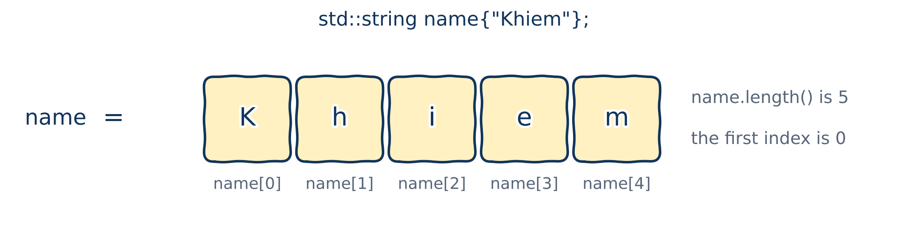
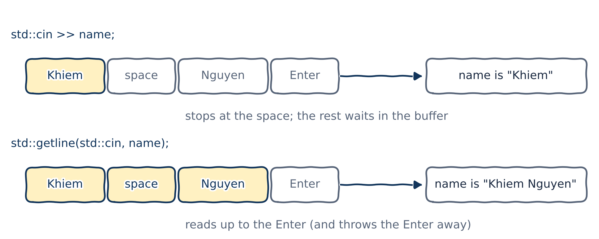

# Constants and Strings {#sec-ch04}

This chapter completes the basics with **constants**, values the compiler won't let you change, and **text**, stored in `std::string`.

## Constants

### `const`

Some values should never change while a program runs: `gravity` and `pi` are not meant to vary, so assigning a new value to them is always a mistake. Adding the **const qualifier** makes the compiler stop that mistake. Because a `const` variable can't be assigned to, it must also be initialized when it's defined:

```{.cpp filename="const_must_be_initialized.cpp" .no-compile}

```

```{.text .output .compiler}
error: uninitialized 'const gravity' [-fpermissive]
error: assignment of read-only variable 'gravity'
```

`const double gravity{9.81};` is correct, and the type of `gravity` is then `const double`. The value can come from anywhere, even from user input: after `const int const_age{age};`, `const_age` can't change, even if `age` does (`initialize_const_variables.cpp`). `const` can also go after the type (`int const`), but before is more common. Constants need no special naming style such as `EARTH_GRAVITY` or `kEarthGravity`; in this course they use `snake_case` like any other variable.

> **If a variable can be made constant, it generally should be.**

`const` prevents accidental changes, helps the compiler optimize, and makes code easier to read: a `const` variable is one less moving part when you're debugging. Well-written C++ libraries use it almost everywhere. There are two exceptions:

```{.cpp}
void print_double(const int x) { ... } // pointless: x is only a copy
const double get_value() { ... }       // ignored: "type qualifiers ignored
                                       //  on function return type"
```

A `const` **value parameter** protects nothing, because the parameter is only a copy of the argument (pass by value, @sec-pass-by-value), and a `const` return value of a fundamental type is ignored altogether, as `-Wextra` points out.

::: {.callout-tip title="Best practice"}
Don't put `const` on value parameters or on values returned by value. (`const` *references* are different: Chapter 07.)
:::

### `constexpr`

C++ has a second keyword, **`constexpr`**, for constants whose value the compiler can work out **while compiling**:

```{.cpp filename="constexpr_example.cpp"}

```

`pi` (line 5) is known at compile time, so it can be `constexpr`. It comes from `<numbers>`, new in C++20: don't type out the digits yourself. `area` (line 11) depends on what the user types, so it's only known when the program runs: it can be `const`, but not `constexpr`.

::: {.callout-tip title="Best practice"}
Use `constexpr` for values known at compile time, and `const` for the rest.
:::

## Literals

A **literal** is a value written straight into the code, and its type follows from how it's written:

| Literal | Type | Literal | Type |
|---------|------|---------|------|
| `42` | `int` | `'A'` | `char` (single quotes) |
| `42u` | `unsigned int` | `"Hello"` | text (double quotes) |
| `3.14` | `double` | `true`, `false` | `bool` |
| `3.14f` | `float` | `1.5e3` | `double` (1500.0) |

Unlike Python, single and double quotes are not interchangeable: `'A'` is one `char`, `"A"` is text.

A literal whose meaning isn't explained, like the `140` in `if (height >= 140)` from Chapter 03, is a **magic number**: is it a height, a weight, an age? And if the rule changes, you must find every copy. Give it a name instead:

```{.cpp filename="magic_numbers.cpp"}

```

Line 10 now explains itself, and changing the rule means changing one line.

## Strings

### `std::string`

{fig-alt="The string Khiem drawn as five boxes, K, h, i, e and m, labelled name[0] to name[4]. name.length() is 5 and the first index is 0." width="58%"}

A `std::string`, from `#include <string>`, holds text: a sequence of characters numbered from **0**. It grows and shrinks as needed, so you never say how long it is (`string_basics.cpp` changes `"Khiem"` into `"Ada Lovelace"`), and `length()` counts its characters, spaces included.

```{.cpp filename="string_operations.cpp"}

```

```{.text .output}
Khiem Nguyen
First letter: K
Hello, lecturer!
```

::: {.callout-note title="Coming from Python"}
`+` joins and `==` compares, as in Python, and `len(s)` becomes `s.length()`. But a C++ string can be changed in place, and there are no negative indices: `s[-1]` is *not* the last character.
:::

### Reading text

```{.cpp filename="string_input_cin.cpp"}

```

```{.text .terminal}
$ ./string_input_cin
Enter your full name: Khiem Nguyen
Hello, Khiem
```

`>>` reads one *word*: it stops at the first space and leaves ` Nguyen` in the input buffer. To read a whole line, spaces included, use `std::getline(std::cin, name)`, which reads up to the Enter key and throws the Enter away.

{fig-alt="The typed input Khiem, space, Nguyen, Enter. std::cin >> name takes only Khiem and leaves the rest in the buffer. std::getline takes Khiem space Nguyen, up to the Enter, which it throws away." width="62%"}

Mixing the two has a trap. `string_input_getline_bug.cpp` reads an age with `>>` and then a name with `std::getline`:

```{.text .terminal}
$ ./string_input_getline_bug
Enter your age: 35
Enter your full name: Hello, , age 35
```

It never waited for the name! `>>` read the `35` but left the **Enter** in the buffer, and `std::getline` read the empty line in front of it. The fix is `std::ws`, which skips leftover whitespace (spaces, tabs and Enters) before `std::getline` starts reading:

```{.cpp filename="string_input_getline.cpp"}

```

```{.text .terminal}
$ ./string_input_getline
Enter your age: 35
Enter your full name: Khiem Nguyen
Hello, Khiem Nguyen, age 35
```

::: {.callout-tip title="Best practice"}
Read whole lines with `std::getline(std::cin >> std::ws, name)`. It works whatever was read before.
:::

### Strings and functions

A function can take a `std::string` parameter like any other, but pass by value copies every character. That's nothing for a name, but slow for a book. Chapter 07 shows how to avoid the copy with **references** (C++17's `std::string_view` is another option); until then, passing strings by value is fine.

## Summary

- `const` makes a variable read-only and must be initialized; **if a variable can be `const`, it should be**.
- `constexpr` for values known at compile time, `const` for the rest. Get pi from `<numbers>`.
- Don't put `const` on value parameters or return values.
- Every literal has a type: `'A'` is a `char`, `"A"` is text. Name your magic numbers.
- `std::string`: `+` joins, `==` compares, `s[0]` is the first character, `s.length()` counts them.
- `>>` reads one word; `std::getline(std::cin >> std::ws, s)` reads a whole line.

**Further reading** on [learncpp.com](https://www.learncpp.com): [literals](https://www.learncpp.com/cpp-tutorial/literals/), [numeral systems](https://www.learncpp.com/cpp-tutorial/numeral-systems-decimal-binary-hexadecimal-and-octal/), [`std::string`](https://www.learncpp.com/cpp-tutorial/introduction-to-stdstring/), [`std::string_view`](https://www.learncpp.com/cpp-tutorial/introduction-to-stdstring_view/), [constexpr variables](https://www.learncpp.com/cpp-tutorial/constexpr-variables/).
