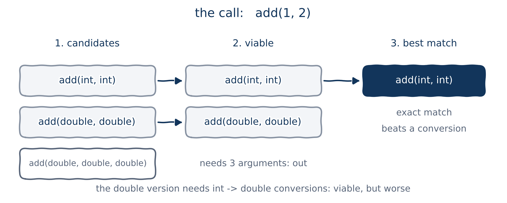
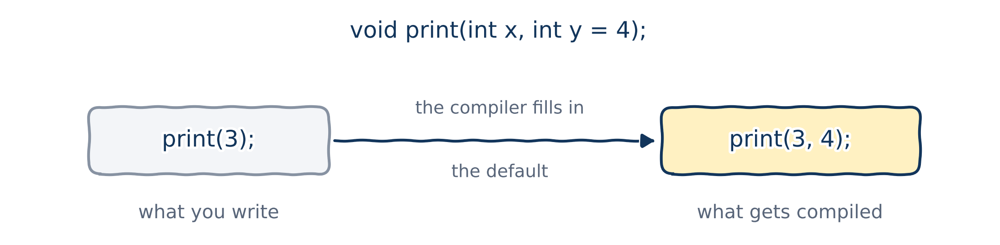

# Function overloading

## One job, many types

Here's a simple function that adds two integers:

```{.cpp}
int add(int x, int y) {
    return x + y;
}
```

What if we also want to add two `double`s? This `add()` won't do: the arguments would be converted to `int`, and their fractional parts lost.

::: {.fragment}
A workaround is to give every version its own name:

```{.cpp}
int add_integer(int x, int y) { return x + y; }
double add_double(double x, double y) { return x + y; }
```

Now we have to remember all the names. And what about `add(int, double)`, `add(double, int)`, or adding three numbers? The names multiply fast.
:::

## Function overloading

**Function overloading** lets several functions share one name, as long as their **parameter types** differ. Each one is an **overloaded function**, or *overload* for short.

::: {.columns}
::: {.column width="72%"}
```{.cpp filename="function_overloading.cpp"}

```
:::
::: {.column width="28%"}
```{.text .output}
3
66.75
```

::: {.callout-note title="Coming from Python"}
Python has no overloading: a second `def add` replaces the first. In C++, both exist side by side.
:::
:::
:::

You write `add` every time; the compiler works out which `add` you mean from the arguments.

## Overload resolution

When you call an overloaded function, the compiler matches the call to the right overload by looking at the arguments. This is called **overload resolution**.

```{.cpp filename="overload_resolution.cpp"}

```

```{.text .output}
3
4.6
4.7
```

## Making it compile

A program with overloaded functions compiles only if two things are true:

1. **Every overload can be told apart** from the others. *How?* Next section.
2. **Every call can be resolved** to exactly one overload. *How does the compiler choose?* The section after.

Break either rule and you get a compile error. It's just common sense: if *you* couldn't tell which function is meant, neither can the compiler.

# Telling overloads apart

## What counts, and what doesn't

| Property | Tells overloads apart? |
|:---|:---|
| Number of parameters | Yes |
| Types of parameters | Yes (but not type aliases, and not `const` on a value parameter) |
| Return type | **No** |

::: {.columns}
::: {.column width="50%"}
By **number** of parameters:

```{.cpp}
int add(int x, int y);
int add(int x, int y, int z);
```
:::
::: {.column width="50%"}
By **types** of parameters:

```{.cpp}
int add(int x, int y);
double add(double x, double y);
double add(int x, double y);
double add(double x, int y);
```
:::
:::

## Type aliases don't count

A **type alias** gives an existing type a second name. It's the same type underneath, so it can't tell overloads apart:

```{.cpp}
using Age = int;     // Age is just another name for int
typedef int Height;  // the older way to write the same thing

void print(int value);
void print(Age value);    // same as print(int): not a new overload
void print(Height value); // same as print(int): not a new overload
```

## The return type doesn't count

```{.cpp filename="return_type_not_enough.cpp" .no-compile}

```

```{.text .output .compiler}
error: ambiguating new declaration of 'double get_random_value()'
```

Imagine you're the compiler and you see the call `get_random_value()`. Which one would you call? You can't tell from the call, so C++ doesn't allow it.

## Function signatures

The parts of a function that tell overloads apart are called its **signature**: the function's **name** plus the **number and types of its parameters**. The return type is *not* part of it.

| Declaration | Signature |
|---|---|
| `int add(int x, int y);` | `add(int, int)` |
| `double add(double x, double y);` | `add(double, double)` |
| `double add(int a, double b, int c);` | `add(int, double, int)` |

Every overload must have a different signature. Parameter names don't matter either: `add(int x, int y)` and `add(int a, int b)` have the same signature.

# How the compiler picks an overload

## Overload resolution, step by step

{fig-alt="For the call add(1, 2): all three add functions are candidates. add(double, double, double) is not viable because it needs three arguments. Of the two viable functions, add(int, int) is an exact match and beats add(double, double), which needs conversions." width="82%"}

1. **Candidates:** every function with that name.
2. **Viable functions:** those with the right number of parameters, where each argument can be converted to the parameter type.
3. **Best match:** an exact match beats a promotion, which beats a conversion. If one function is strictly better than the rest, it's called.

## Ambiguous matches

If two overloads are *equally* good, the compiler refuses to guess:

```{.cpp filename="ambiguous_match.cpp" .no-compile}

```

```{.text .output .compiler}
error: call of overloaded 'print(long int)' is ambiguous
```

`5L` is a `long`. Converting it to `int` and converting it to `double` are equally good, so neither wins. The fix: pass an argument of the type you mean, like `5` or `5.0`.

## Calls that make no sense

```{.cpp filename="print_int_surprise.cpp"}

```

```{.text .output}
5
97
1
```

A `char` and a `bool` both convert to `int` silently: `'a'` is stored as the number 97. Suppose that printing a character or a Boolean as a number makes no sense for us. Can we forbid it?

## Deleting a function with `= delete`

```{.cpp filename="delete_function.cpp" .no-compile}

```

```{.text .output .compiler}
error: use of deleted function 'void print_int(char)'
```

- `= delete` declares an overload that **must not be called**. Overload resolution still picks it for a `char` argument, and then the compiler reports an error.
- Careful: `print_int(5.0)` is now an error too, because a `double` converts equally well to `int`, `char` and `bool`, so the call is ambiguous.

# Default arguments

## Default arguments

A **default argument** is a value a parameter gets when the caller doesn't supply one.

::: {.columns}
::: {.column width="72%"}
```{.cpp filename="default_argument.cpp"}

```
:::
::: {.column width="28%"}
```{.text .output}
x: 1, y: 2
x: 3, y: 4
```
:::
:::

{fig-alt="With the declaration void print(int x, int y = 4), a call written as print(3) is compiled as print(3, 4): the compiler fills in the default." width="62%"}

## Several default arguments

::: {.columns}
::: {.column width="72%"}
```{.cpp filename="multiple_default_arguments.cpp"}

```
:::
::: {.column width="28%"}
```{.text .output}
1 2 3
1 2 30
1 20 30
10 20 30
```
:::
:::

Arguments are matched to parameters from the **left**, and the defaults fill in the rest from the right.

## The rules (and the reasons)

C++ has no syntax like `print_numbers( , , 3)`. Everything else follows from that:

- **You can't skip an argument.** To give `z` a value, you must also give `x` and `y`.
- **Defaults must come last.** Once a parameter has a default, every parameter to its right needs one too:

  ```{.cpp}
  void print(int x = 10, int y); // error: y needs a default as well
  ```

- **Put the parameter callers most often change first** among the defaulted ones.

::: {.callout-note title="Coming from Python"}
Python lets you name arguments in the call: `print_numbers(z=3)`. C++ has no named arguments, so the order of parameters matters much more.
:::

## Give the default once...

A function with a forward declaration can have its default in the declaration *or* in the definition, but **not both**:

```{.cpp filename="default_argument_twice.cpp" .no-compile}

```

```{.text .output .compiler}
error: default argument given for parameter 2 of 'void print(int, int)'
```

## ...and before it's used

The compiler reads top to bottom (Chapter 02!), so it must see the default before the call:

```{.cpp filename="default_argument_too_late.cpp" .no-compile}

```

```{.text .output .compiler}
error: too few arguments to function 'void print(int, int)'
```

## Where the default should go

Put the default in the **forward declaration**:

```{.cpp filename="forward_declaration_default_arguments.cpp"}

```

```{.text .output}
x: 3, y: 4
```

::: {.callout-tip title="Best practice"}
Default in the forward declaration if there is one (especially in a header); otherwise in the definition.
:::

## With a header file

::: {.columns}
::: {.column width="50%"}
```{.cpp filename="print.h"}

```
:::
::: {.column width="50%"}
```{.cpp filename="main.cpp"}

```
:::
:::

```{.cpp filename="print.cpp"}

```

```{.text .terminal}
$ g++ -std=c++20 -Wall main.cpp print.cpp -o program
$ ./program
x: 5, y: 4
```

## Default arguments and overloading

Functions with default arguments can be overloaded:

```{.cpp filename="default_argument_overloaded.cpp"}

```

```{.text .output}
Hello, world
a
*
```

## Watch out: defaults can make calls ambiguous

A default value is **not** part of the signature, so these are two different overloads. But a call can still match both:

```{.cpp filename="default_argument_ambiguous.cpp" .no-compile}

```

```{.text .output .compiler}
error: call of overloaded 'print(int)' is ambiguous
```

# Wrapping up

## Summary

- **Overloading:** several functions can share a name if their **signatures** (name, number and types of parameters) differ. The return type doesn't count.
- **Overload resolution:** the compiler picks the best match; an exact match beats a conversion. If two overloads tie, the call is **ambiguous** and won't compile.
- `= delete` forbids particular calls.
- **Default arguments** fill in parameters the caller leaves out. Defaults must be the rightmost parameters, and can't be skipped.
- Give a default **once**, in the forward declaration (header) if there is one, and before it's used.
- Defaults are not part of the signature, so they can make calls ambiguous.

## Keep learning

Explore these on your own, with Google Gemini in Guided Learning mode or on [learncpp.com](https://www.learncpp.com):

1. [Function overload resolution and ambiguous matches](https://www.learncpp.com/cpp-tutorial/function-overload-resolution-and-ambiguous-matches/). The exact ranking rules are long; try asking Gemini: *"Please teach me function overload resolution and ambiguous matches in C++."*
2. [Implicit type conversion](https://www.learncpp.com/cpp-tutorial/implicit-type-conversion/), and the difference between promotions and conversions
3. [Type aliases](https://www.learncpp.com/cpp-tutorial/typedefs-and-type-aliases/)

**Next up, Chapter 06:** function templates. Overloading means writing every version by hand. What if the compiler could write them for us?
