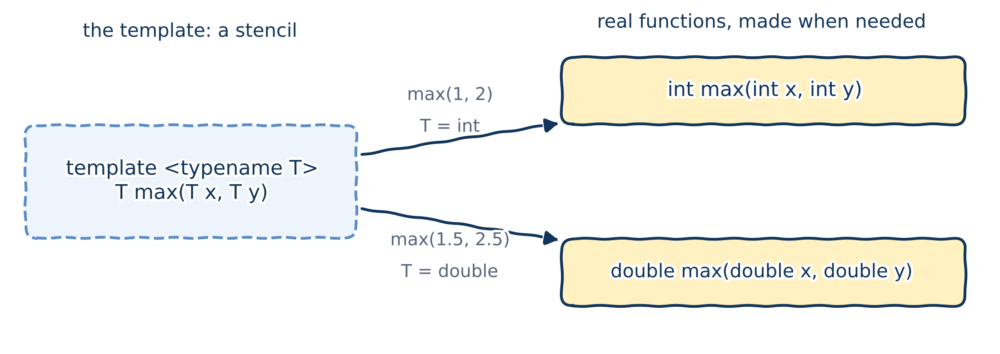

# Why templates?

## You've already used templates

In the lab assignments you met types like these:

- `std::vector<double>`: a growable list of `double`s;
- `std::vector<int>`: the same thing, holding `int`s.

And functions like these:

- `std::max(1, 2)`: the compiler works out that both arguments are `int`;
- `std::max<double>(10, 42.24)`: we tell it to treat both as `double`.

The part in angle brackets `< >` picks the type. `std::vector` and `std::max` are **templates**: written once, usable with many types. Today we learn to write our own **function templates**.

## One function per type?

```{.cpp}
int max(int x, int y) {
    return (x < y) ? y : x;
}

double max(double x, double y) { // overloading, Chapter 05
    return (x < y) ? y : x;
}
```

`c ? a : b` is the **conditional operator**: "if `c` then `a`, otherwise `b`", like Python's `a if c else b`.

::: {.fragment}
Two copies of the same code already. And `long`, `float`, `char`...? Every new type means another copy. C++ has a feature designed for exactly this problem: **templates**.
:::

## A wish

What we'd like to write, once:

```{.cpp .no-compile}
T max(T x, T y) { // error: what is T?
    return (x < y) ? y : x;
}
```

...where `T` stands for *any* type for which `x < y` makes sense.

A **template** gives us exactly that:

- one definition, with a **placeholder type** `T` that isn't known yet;
- the compiler then **generates** a real function for each type we actually use.

# Function templates

## Writing a function template

```{.cpp}
template <typename T> // the template parameter declaration
T max(T x, T y) {     // the function template itself
    return (x < y) ? y : x;
}
```

- The **template parameter declaration** starts with the keyword `template`, then lists the placeholder types in angle brackets.
- `typename T` declares `T` as a **type template parameter**. (`class T` also works, but `typename` is preferred.)
- This whole definition is a **function template**: a recipe the compiler uses to generate functions, one per type.

## Naming template parameters

- If the meaning is obvious, use a single capital letter: `T`, then `U`, `V`, ...
- If the parameter has a specific job, give it a descriptive name starting with a capital letter, like `Allocator` (the standard library's style) or `TAllocator`.

Any name works as far as the compiler is concerned:

```{.cpp}
template <typename Banana>
Banana max(Banana x, Banana y) { // legal, but please don't
    return (x < y) ? y : x;
}
```

::: {.callout-tip title="Best practice"}
Use `T`, `U`, `V`... for type template parameters that are used in obvious ways.
:::

## Using a function template

Put the actual type in angle brackets: `max<int>(1, 2)`. The type in the brackets is the **template argument**.

```{.cpp filename="use_template_function.cpp"}

```

```{.text .output}
2
1.5
```

## Function template instantiation

{fig-alt="The template max of T is drawn as a dashed stencil. The call max(1, 2) produces the function int max(int x, int y); the call max(1.5, 2.5) produces double max(double x, double y)." width="80%"}

- Creating a real function from a template is called **instantiation**. It happens when a call needs it (**implicit instantiation**).
- The generated function is a **function instance** (technically, a *specialization*). The template it came from is the **primary template**.
- Function instances are ordinary functions in every way.

::: {.callout-important title="Key idea"}
A function template is **not** a function. It's a recipe for making functions.
:::

## What the compiler generates

When it meets `max<int>(1, 2)`, the compiler copies the template, replaces every `T` with `int`, and compiles the result. As if we'd written:

```{.cpp filename="instantiation_look_breakdown.cpp"}

```

You'll never write `template <>` like this yourself in this course: it's only here to show you what the compiler produces. (It compiles, and prints `2`.)

## Instantiated once, then reused

::: {.columns}
::: {.column width="78%"}
```{.cpp filename="instantiation_look_more.cpp"}

```
:::
::: {.column width="22%"}
```{.text .output}
2
4
2
```
:::
:::

- A template is instantiated the **first** time a call needs that type. Later calls reuse the same function.
- A template that's never called is never instantiated: no function is generated at all.

## ...which is the same as

```{.cpp filename="instantiation_look_more_breakdown.cpp"}

```

Two instances: `max<int>` (used twice) and `max<double>`. Note that `max<double>(1, 2)` returns `2.0`, which `std::cout` prints as `2`.

# Template argument deduction

## Let the compiler work out `T`

Usually, the template argument just repeats the types of the arguments:

```{.cpp}
max<int>(1, 2) // we say T = int... but 1 and 2 are ints anyway
```

So we can leave it out, and let the compiler **deduce** `T` from the arguments:

```{.cpp}
max<>(1, 2) // T deduced as int; only templates are considered
max(1, 2)   // T deduced as int; ordinary functions are considered too
```

The second form looks exactly like an ordinary function call, and that's the one we normally use.

## Templates versus ordinary functions

::: {.columns}
::: {.column width="72%"}
```{.cpp filename="template_argument_deduction_more.cpp"}

```
:::
::: {.column width="28%"}
```{.text .output}
template max<T>: 2
template max<T>: 2
ordinary max: 2
```

::: {.callout-important title="Key idea"}
When an ordinary function and a template instance match equally well, `max(1, 2)` picks the **ordinary function**.
:::
:::
:::

## Why that's useful

::: {.columns}
::: {.column width="62%"}
```{.cpp filename="favor_normal_func_over_func_template_call.cpp"}

```
:::
::: {.column width="38%"}
```{.text .output}
1
1
true
```

::: {.callout-tip title="Best practice"}
Call function templates with the normal syntax, `print(true)`, unless you specifically need the template version.
:::
:::
:::

The template handles every type in a general way; the ordinary function handles `bool` specially. With the normal call syntax, the special version wins automatically.

# More about function templates

## Templates can have ordinary parameters too

A function template can mix template parameters with ordinary ones, and those can have default arguments (Chapter 05):

::: {.columns}
::: {.column width="65%"}
```{.cpp filename="func_template_with_non_template_parameters.cpp"}

```
:::
::: {.column width="35%"}
```{.text .output}
5
a a a
2.5 2.5
```
:::
:::


## Some instances don't compile

```{.cpp filename="instantiated_func_not_compile.cpp" .no-compile}

```

```{.text .output .compiler}
error: no match for 'operator+' (operand types are 'std::__cxx11::basic_string<char>' and 'double')
```

...followed by dozens of lines of notes. The template itself is fine; the **instance** `add_value<std::string>` isn't, because you can't add a `double` to a string. Template error messages are famously long: read the first line first!

## Some instances compile, but make no sense

```{.cpp filename="not_make_sense_semantically.cpp"}

```

```{.text .output}
42
ello, world!
```

`"Hello, world!"` is not a `std::string`: it's a *C-style string*, and `T` becomes the memory address of its first character. Adding 1 moves to the next character, so the `H` is lost. (Addresses are the topic of Chapter 08.) The compiler can't know that wasn't what you meant.

## Templates live in header files

::: {.columns}
::: {.column width="50%"}
```{.cpp filename="max.h"}

```
:::
::: {.column width="50%"}
```{.cpp filename="main.cpp"}

```

```{.text .output}
7
2.5
```
:::
:::

- `main.cpp` instantiates `max<int>` and `max<double>`. To do that, the compiler needs the template's **whole definition**, body included, in every `.cpp` file that uses it. A declaration alone isn't enough.
- So templates go **entirely in the header**. They are exempt from the "define exactly once" rule. This is the exception to the header rules from Chapter 02.

# Templates with several types

## `max(2, 3.5)` doesn't compile

```{.cpp filename="max_mismatched_types.cpp" .no-compile}

```

```{.text .output .compiler}
error: no matching function for call to 'max(int, double)'
note:   deduced conflicting types for parameter 'T' ('int' and 'double')
```

Can somebody explain why? (Hint: read the second line.)

::: {.fragment}
`T` can only be one type. From `2` the compiler deduces `int`, from `3.5` it deduces `double`, and it refuses to choose.
:::

## Fix 1: say which type you want

```{.cpp filename="max_explicit_type.cpp"}

```

```{.text .output}
3.5
```

With `T` given explicitly, there's nothing to deduce: `2` is simply converted to `2.0`. It works, but it would be nicer not to have to think about the types at all.

## Fix 2: two type parameters?

```{.cpp filename="two_template_type_parameters.cpp"}

```

Now `x` and `y` can have different types: `T = int`, `U = double`. Let's run it!

::: {.fragment}
```{.text .output}
3
```

Why `3`, not `3.5`? The **return type** is `T`, which is `int`, so the result `3.5` is converted to `int`, losing the `.5`. No error, no warning: just a wrong answer.
:::

## Fix 3: let the compiler choose the return type

```{.cpp filename="two_template_type_parameters_auto.cpp"}

```

```{.text .output}
3.5
```

With the return type `auto`, the compiler works it out from the `return` statement. Since the conditional operator's two branches have types `int` and `double`, the result is a `double`.

## Or say it with `std::common_type_t`

::: {.columns}
::: {.column width="45%"}
`std::common_type_t<T, U>` is the type that both `T` and `U` convert to without losing information:

| `T` and `U` | Common type |
|:---|:---|
| `int`, `double` | `double` |
| `int`, `long` | `long` |
| `float`, `double` | `double` |
:::
::: {.column width="55%"}
```{.cpp filename="using_common_type_t.cpp"}

```

```{.text .output}
10.5
```
:::
:::

It needs `#include <type_traits>`. With modern compilers, `auto` is usually simpler.

## The `auto` keyword

`auto` asks the compiler to **deduce a type** from the initializer:

```{.cpp}
auto age{25};           // int
auto price{42.99};      // double
auto initial{'K'};      // char
auto name{std::string{"Khiem"}}; // std::string
```

- This does **not** make C++ dynamically typed like Python. Each variable still gets exactly one type, fixed at compile time; you just don't have to spell it out.
- Careful: plain `auto` drops `const`. Write `const auto` if you want to keep it. (`auto` and references: next chapter.)

## Abbreviated function templates (C++20)

```{.cpp filename="abbreviated_function_template.cpp"}

```

```{.text .output}
3.5
z
```

Since C++20, a parameter of type `auto` turns an ordinary function into a function template, with one type template parameter per `auto`. The code above is shorthand for `template <typename T, typename U> auto max(T x, U y)`.

## Function templates can be overloaded

::: {.columns}
::: {.column width="72%"}
```{.cpp filename="function_templates_overloaded.cpp"}

```
:::
::: {.column width="28%"}
```{.text .output}
4.6
12.6
27
```
:::
:::

# Non-type template parameters

## `constexpr` functions

Remember `constexpr` variables from Chapter 04? A function can be `constexpr` too, so that the compiler can call it **while compiling**:

```{.cpp}
constexpr int square(int x) {
    return x * x;
}

constexpr int result{square(10)}; // 100, worked out at compile time
```

We need this idea for the next kind of template parameter.

## Non-type template parameters

A template parameter doesn't have to be a type. A **non-type template parameter** has a fixed type and stands for a **value** known at compile time.

It can be, for example:

- an integer type: `int`, `char`, `bool`, ...
- a floating-point type (since C++20);
- an enumeration (later in the course);
- a pointer or reference (also later).

## A non-type template parameter in action

::: {.columns}
::: {.column width="72%"}
```{.cpp filename="nontype_template_parameters.cpp"}

```
:::
::: {.column width="28%"}
```{.text .output}
Raw: 10
High (x5): 50
Low  (x2): 20
```
:::
:::

`Factor` is given explicitly in the angle brackets; `T` is still deduced from the argument.

## The compiler's point of view

Each different `Factor` produces a different function, with the value baked in:

::: {.columns}
::: {.column width="70%"}
```{.cpp filename="nontype_template_parameters_pov.cpp"}

```
:::
::: {.column width="30%"}
```{.text .output}
50
20
```
:::
:::


# Wrapping up

## Summary

- A **function template** is a recipe for functions: `template <typename T>` introduces a placeholder type `T`.
- The compiler **instantiates** a real function for each type a call needs. The template itself is not a function.
- **Template argument deduction** works out `T` from the arguments: write `max(1, 2)`, not `max<int>(1, 2)`. An equally good ordinary function wins.
- An instance may fail to compile, or compile and do something silly: the compiler only checks it once it's instantiated.
- Templates live **entirely in header files**.
- For mixed types, use two type parameters with an `auto` return type, or the C++20 shorthand `auto max(auto x, auto y)`.
- A **non-type template parameter** is a compile-time value, like `template <int Factor>`.

## Keep learning

Explore these on your own, with Google Gemini in Guided Learning mode or on [learncpp.com](https://www.learncpp.com):

1. [Function templates with multiple template types](https://www.learncpp.com/cpp-tutorial/function-templates-with-multiple-template-types/)
2. [Non-type template parameters](https://www.learncpp.com/cpp-tutorial/non-type-template-parameters/)
3. [Type deduction for objects using `auto`](https://www.learncpp.com/cpp-tutorial/type-deduction-for-objects-using-the-auto-keyword/)
4. [Constexpr functions](https://www.learncpp.com/cpp-tutorial/constexpr-functions/)

**Next up, Chapter 07:** references, and how to pass arguments without copying them.
