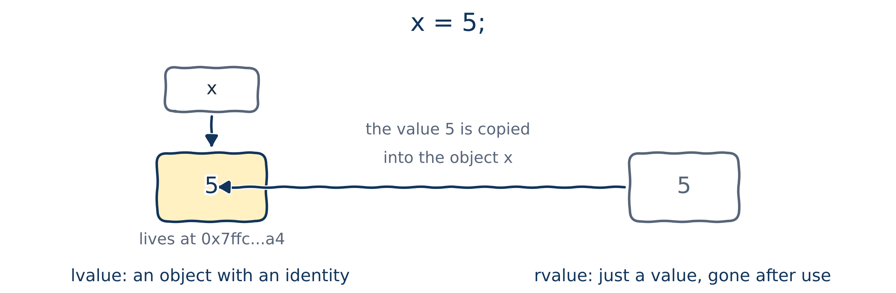
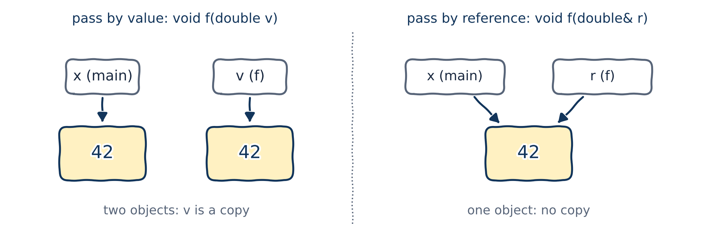

# Compound types

## Types built from other types

Imagine a program that keeps track of employees:

```{.cpp}
int id1{42};
int id2{24};
int id3{162};

double salary1{42123.3};
double salary2{43784.5};
double salary3{39469.2};
// ...names, roles, job titles, and so on
```

With 100 employees, this simply doesn't scale. We need types that are **built from other types**: **compound types** (also called *composite types*).

## The compound types of C++

::: {.columns}
::: {.column width="50%"}
**Built into the language**

- functions (Chapter 02)
- references (**today**)
- pointers (Chapter 08)
- C-style arrays
:::
::: {.column width="50%"}
**Defined by you, the programmer**

- enumerations (`enum`, `enum class`)
- structs (`struct`)
- classes (`class`): the heart of this course, from Chapter 10
- unions (`union`)
:::
:::

We won't cover all of them: there isn't time. You'll see that structs and classes are very similar, so studying one carefully is enough.

Even a function has a compound type: the type of `void do_something(int x, double y)` is `void(int, double)`.

# Value categories: lvalues and rvalues

## Two properties of every expression

Recall: an **expression** combines literals, variables, operators and function calls to produce a value. Every expression has:

- a **type**: the type of the value it produces;

  ```{.cpp}
  auto v1{12 / 4};   // int / int gives int
  auto v2{12.0 / 4}; // double / int gives double
  ```

- a **value category**: what *kind* of thing it produces, an object or just a value.

The type tells the compiler whether an expression makes sense in a given place: `print("foo")` won't compile if `print` expects an `int`. The value category does the same job in a different way. Before references can make sense, we need value categories.

## Why is `x = 5` fine, but `5 = x` isn't?

```{.cpp filename="lvalue_assignment.cpp" .no-compile}

```

```{.text .output .compiler}
error: lvalue required as left operand of assignment
```

As humans, we can see that `5 = x` makes no sense. But how does the compiler know which expressions may go on the left of `=`?

::: {.fragment}
The answer is in the error message: the left side must be an **lvalue**.
:::

## lvalues and rvalues

{fig-alt="For x = 5: x is an object that lives at an address, an lvalue. 5 is just a value that disappears after use, an rvalue. The value 5 is copied into the object x." width="74%"}

- An **lvalue** evaluates to an **identifiable object** (or function): something with a name or an address, which outlives the expression. Example: a variable `x`.
- An **rvalue** evaluates to a **value**: a literal, a temporary result, something returned by value. It's gone at the end of the expression.

Since C++11 there are also *glvalues*, *prvalues* and *xvalues*, for a feature called *move semantics*. Lvalues and rvalues are enough for us.

## Spot the rvalues

```{.cpp filename="rvalue_expression_example.cpp"}

```

- `return5()`, `x + 1` and `static_cast<int>(d)` produce temporary values, not identifiable objects: they're rvalues.
- `static_cast<int>(d)` is an **explicit conversion**: it turns the `double` `1.2` into the `int` `1`.
- One surprise: a string literal like `"Hello"` is an lvalue. (It's stored somewhere in memory for the whole program.)

## lvalue-to-rvalue conversion

Operators expect rvalues as operands, unless stated otherwise. But this compiles:

```{.cpp}
int x{1};
int y{2};
x = y;     // y is an lvalue, not an rvalue!
x = x + 1; // x appears on both sides
```

::: {.fragment}
- Where an rvalue is expected and an lvalue is given, the lvalue goes through an **lvalue-to-rvalue conversion**: it's simply evaluated to produce its value. In `x = y`, `y` becomes the value `2`.
- In `x = x + 1`, the left `x` is an lvalue (the object we assign to). The right `x` is converted to its value, say `42`, and `x + 1` produces the rvalue `43`.
:::

::: {.fragment}
::: {.callout-important title="Key idea"}
An lvalue can be used wherever an rvalue is expected. An rvalue can never be used where an lvalue is required.
:::
:::

## A tool to tell them apart

::: {.columns}
::: {.column width="58%"}
```{.cpp filename="tell_value_categories.cpp"}

```
:::
::: {.column width="42%"}
```{.text .output}
5 is an rvalue
get_int() is an rvalue
x is an lvalue
x + 1 is an rvalue
std::string{"Hello"} is an rvalue
"Hello" is an lvalue
++x is an lvalue
x++ is an rvalue
```
:::
:::

The tool lives in `value_category.h`. Don't worry about how it works.

# lvalue references

## A reference is another name for an object

A **reference** is an **alias**: a second name for an object that already exists.

- Anything you do to the reference happens to the object it refers to.
- References may seem pointless at first. They're used *everywhere* in C++, as you'll see shortly.

```{.cpp}
int        // an int
int&       // an lvalue reference to an int
double&    // an lvalue reference to a double
const int& // an lvalue reference to a const int
```

- `int&` (one ampersand) is an **lvalue reference**. There are also *rvalue references*, `int&&`, with two ampersands. They came with C++11, and many experienced programmers have never needed them.
- Since lvalue references are by far the most common, "reference" on its own means *lvalue reference*.

## Your first reference

::: {.columns}
::: {.column width="70%"}
```{.cpp filename="lvalue_reference_variables.cpp"}

```
:::
::: {.column width="30%"}
```{.text .output}
5
5
```
:::
:::

{fig-alt="One object holding 42 with two name tags, x and ref, both pointing at it: one object, two names." width="66%"}

## Changing an object through a reference

::: {.columns}
::: {.column width="70%"}
```{.cpp filename="modify_value_through_nonconst_reference.cpp"}

```
:::
::: {.column width="30%"}
What will this print? Think first!

::: {.fragment}
```{.text .output}
42 42
24 24
12 12
```
:::
:::
:::

::: {.callout-tip title="Best practice"}
Write the ampersand next to the type, `int& ref`, not next to the name. It's part of the type.
:::

## A reference must be initialized

```{.cpp filename="reference_must_be_initialized.cpp" .no-compile}

```

```{.text .output .compiler}
error: 'invalid_ref' declared as reference but not initialized
```

- Initializing a reference **binds** it to an object; the object is called its **referent**.
- Don't worry: I won't test your memory of these terms in the paper exam!

## Which objects can a reference bind to?

```{.cpp filename="nonconst_reference_binding.cpp" .no-compile}

```

```{.text .output .compiler}
error: binding reference of type 'int&' to 'const int' discards qualifiers
error: cannot bind non-const lvalue reference of type 'int&' to an rvalue of type 'int'
```

Why not? A non-const reference lets you **change** its referent. Binding one to a `const` object, or to a temporary value like `0`, would let you change something that must not, or cannot, change.

## A reference can't be reseated

::: {.columns}
::: {.column width="70%"}
```{.cpp filename="reference_cannot_be_reseated.cpp"}

```
:::
::: {.column width="30%"}
::: {.fragment}
```{.text .output}
6
```
:::
:::
:::

::: {.fragment}
`ref = y` does **not** make `ref` refer to `y`. `ref` *is* `x`, so this is simply `x = y`. Once bound, a reference stays bound to the same object for its whole life.

::: {.callout-note title="Coming from Python"}
A Python name can be rebound to a different object at any time: `a = b` does exactly that. A C++ reference never can be.
:::
:::

## Lifetimes and dangling references

::: {.columns}
::: {.column width="70%"}
```{.cpp filename="lifetime_reference_and_referent.cpp"}

```
:::
::: {.column width="30%"}
```{.text .output}
42
42
```
:::
:::

- A reference and its referent have **independent lifetimes**. Destroying the reference doesn't affect the object.
- The other way round is dangerous: if the **object** is destroyed first, the reference is left **dangling**. Using a dangling reference is undefined behaviour.

## References are not objects

- A reference is just a name. The compiler often replaces it with the referent and gives it no memory at all (though sometimes it does need some).
- So "reference variable" is a slight misnomer: variables are named *objects*.
- One consequence: you can't have a reference to a reference.

So far references look like a curiosity. Their real job is coming up next.

# Pass by reference

## Pass by value can be expensive

In Chapter 02 we learned **pass by value**: the argument is **copied** into the parameter. Copying a `double` is cheap; copying a long `std::string` is not:

```{.cpp filename="pass_by_value_string.cpp"}

```

The copy is made, used once, and thrown away. A waste! Most standard library types, like `std::string`, are expensive to copy.

## Pass by reference

Make the parameter a **reference**, and it is simply bound to the argument. No copy is made:

::: {.columns}
::: {.column width="70%"}
```{.cpp filename="pass_by_reference.cpp"}

```
:::
::: {.column width="30%"}
```{.text .output}
Hello, world!
```
:::
:::

## Value versus reference, in a picture

{fig-alt="Pass by value: x in main and v in f are two separate objects, v is a copy. Pass by reference: x in main and r in f are two names for one object, no copy." width="92%"}

- **Pass by value:** the parameter is a new object, initialized with a copy of the argument.
- **Pass by reference:** the parameter is just another name for the argument. Nothing is copied, and the function works on the caller's object itself.

## Don't believe me? Check the addresses

```{.cpp filename="pass_by_value_vs_pass_by_reference.cpp"}

```

```{.text .output}
address of x:             0x7ffcc2285eb0
address of val (a copy):  0x7ffcc2285e98
address of ref (no copy): 0x7ffcc2285eb0
```

`ref` has the **same address** as `x`: it is `x`. `val` lives somewhere else. (`&x` gives the address of `x`, more in Chapter 08. Your addresses will differ.)

## Changing the caller's variable

::: {.columns}
::: {.column width="62%"}
```{.cpp filename="pass_by_reference_change_value.cpp"}

```
:::
::: {.column width="38%"}
```{.text .output}
x = 42
x = 66
```
:::
:::

Any change made through a non-const reference parameter changes the caller's argument itself. That's useful when a function's whole purpose is to modify something.

## The swap that finally swaps

::: {.columns}
::: {.column width="62%"}
```{.cpp filename="swap_by_reference.cpp"}

```
:::
::: {.column width="38%"}
```{.text .output}
x = 200, y = 100
```

Remember the swap that didn't swap in Chapter 02? With references, it finally works.
:::
:::

## Non-const reference parameters are picky

```{.cpp filename="pass_by_reference_accept_modifiable_lvalues.cpp" .no-compile}

```

```{.text .output .compiler}
error: binding reference of type 'int&' to 'const int' discards qualifiers
error: cannot bind non-const lvalue reference of type 'int&' to an rvalue of type 'int'
```

A non-const reference parameter only accepts **modifiable lvalues**: in practice, non-const variables. But often we just want to *read* an expensive argument without copying it, whatever it is.

## Pass by const reference

::: {.columns}
::: {.column width="62%"}
```{.cpp filename="pass_by_const_reference.cpp"}

```
:::
::: {.column width="38%"}
```{.text .output}
5
6
7
```
:::
:::

A **const reference** binds to anything: modifiable lvalues, const lvalues and rvalues. That's exactly why C++ allows const references to bind to rvalues. Without it, you couldn't pass a literal like `7` to a function taking a reference.

## A const reference can't change its referent

```{.cpp filename="const_reference_cannot_modify.cpp" .no-compile}

```

```{.text .output .compiler}
error: assignment of read-only reference 'ref'
```

No copy **and** no accidental changes: we're greedy, and with const references we get both.

## Value, reference or const reference?

::: {.callout-tip title="Best practice"}
- **Fundamental types** (`int`, `double`, `char`, `bool`): pass by **value**. They're cheap to copy.
- **Class types** (`std::string`, `std::vector`, your own classes later): pass by **const reference**, so there's no copy.
- Pass by **non-const reference** only when the function is meant to change the argument.
:::

For read-only text, C++17 also offers `std::string_view`, a cheap view of a string. Strings are the case Chapter 04 promised we'd come back to.

# Return by reference

## Return by reference

Returning by value **copies** the result back to the caller. Returning a **reference** avoids that copy:

```{.cpp filename="return_by_ref_academic.cpp"}

```

```{.text .output}
This program is named Calculator
```

A **static** local variable is created once and lives until the program ends, unlike an ordinary local variable. Here that's essential, as the next slide shows.

## The object must outlive the function

```{.cpp filename="return_by_ref_lifetime.cpp"}

```

```{.text .terminal}
$ g++ -std=c++20 -Wall return_by_ref_lifetime.cpp
warning: reference to local variable 'program_name' returned
$ ./a.out
Segmentation fault
```

`program_name` is destroyed when the function returns, so the caller receives a **dangling reference**: undefined behaviour. On my machine, it crashed.

## A use for return by reference

::: {.columns}
::: {.column width="70%"}
```{.cpp filename="return_by_ref_larger.cpp"}

```
:::
::: {.column width="30%"}
```{.text .output}
x = 5, y = 0
```
:::
:::

`larger()` returns a reference to the caller's own variable, so the call can even appear on the **left** of `=`: it's an lvalue! This is safe because `x` and `y` outlive the call.

# Wrapping up

## Summary

- Every expression has a **type** and a **value category**. An **lvalue** is an identifiable object; an **rvalue** is just a value.
- A **reference** (`int& ref{x};`) is another name for an existing object. It must be initialized and can't be reseated.
- A non-const reference binds only to modifiable lvalues; a **const reference** binds to anything.
- **Pass by reference** avoids copies and lets a function change its argument. **Pass by const reference** avoids copies without allowing changes.
- Pass fundamental types by value, class types by const reference.
- Never return (or keep) a reference to an object that is about to be destroyed: **dangling references** are undefined behaviour.

## Keep learning

Explore these on your own, with Google Gemini in Guided Learning mode or on [learncpp.com](https://www.learncpp.com):

1. [Value categories (lvalues and rvalues)](https://www.learncpp.com/cpp-tutorial/value-categories-lvalues-and-rvalues/)
2. [Pass by const lvalue reference](https://www.learncpp.com/cpp-tutorial/pass-by-const-lvalue-reference/), and when to pass by value instead
3. [`std::string_view`](https://www.learncpp.com/cpp-tutorial/introduction-to-stdstring_view/)
4. [Static local variables](https://www.learncpp.com/cpp-tutorial/static-local-variables/)

**Next up, Chapter 08:** pointers, the other way to refer to an object.
