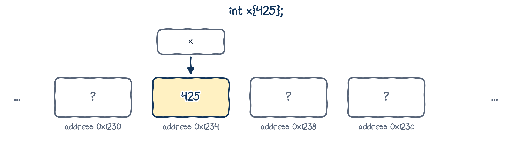
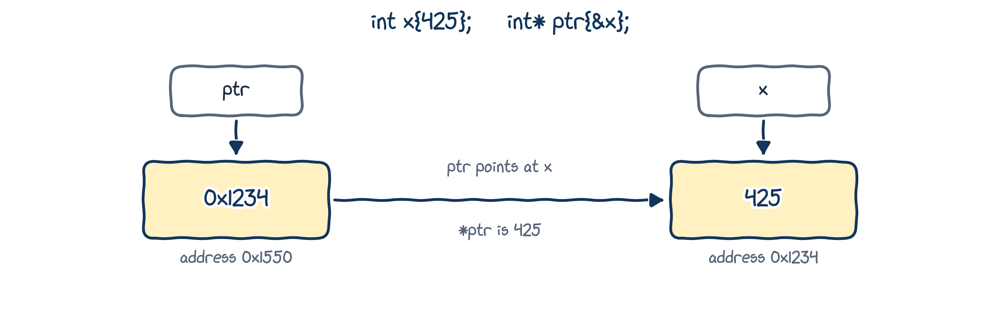
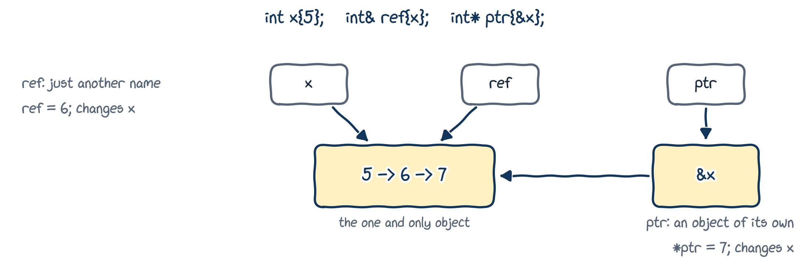

# Memory and addresses

## Every variable lives at an address

{fig-alt="A row of memory boxes with addresses 0x1230, 0x1234, 0x1238 and 0x123c. The box at 0x1234 holds 425 and is named x." width="80%"}

- When `int x{425};` runs, the program sets aside a piece of memory for `x`, at some **address**, say `0x1234`.
- Whenever we use `x`, the program goes to address `0x1234` and reads or writes the value stored there.
- The same is true for a reference: `int& ref{x};` is just another name for whatever lives at `0x1234`.

## The address-of operator `&`

`&x` gives the **address** of `x`:

::: {.columns}
::: {.column width="65%"}
```{.cpp filename="address_of_operator_example.cpp"}

```
:::
::: {.column width="35%"}
```{.text .output}
5
0x7ffd9bdba4ac
0x7ffd9bdba4b0
```
:::
:::

- Addresses are usually printed in hexadecimal. Yours will be different, and may change every run.
- An object bigger than one byte occupies several addresses; `&` gives the first one.

## The dereference operator `*`

`*` does the opposite: given an address, it gives you the **object at that address**.

::: {.columns}
::: {.column width="68%"}
```{.cpp filename="dereference_operator_example.cpp"}

```
:::
::: {.column width="32%"}
```{.text .output}
5
0x7ffcc49e7ee0
5
```
:::
:::

::: {.callout-important title="Key idea"}
`&` and `*` are opposites: `&` gets the address of an object, and `*` gets the object at an address. So `*(&x)` is just `x`.
:::

## One symbol, three meanings

The ampersand `&` means different things in different places:

| Where | Meaning | Example |
|---|---|---|
| after a type | lvalue reference (Chapter 07) | `int& ref{x};` |
| before an expression | address-of | `std::cout << &x;` |
| between two expressions | bitwise AND (not covered here) | `int z{x & y};` |

The asterisk `*` is similar: after a type it declares a pointer (next!), before an expression it dereferences, and between two expressions it multiplies.

# Pointers

## A pointer holds an address

A **pointer** is an **object** whose value is a memory address, usually the address of another object.

```{.cpp}
double   // a double
double&  // a reference to a double
double*  // a pointer to a double: holds the address of a double
```

{fig-alt="ptr lives at address 0x1550 and holds the value 0x1234. x lives at address 0x1234 and holds 425. An arrow from ptr to x: ptr points at x, and *ptr is 425." width="78%"}

That's where pointers get their name: `ptr` holds the address of `x`, so `ptr` **points at** `x`.

## Your first pointer

```{.cpp filename="pointer_example.cpp"}

```

```{.text .output}
x lives at:   0x7ffc45506a0c
ptr holds:    0x7ffc45506a0c
*ptr gives:   425
ptr lives at: 0x7ffc45506a10
```

`ptr` holds the address of `x`, `*ptr` is `x` itself, and `ptr` has an address of its own, because it's an object.

## Declaring pointers

The `*` in a declaration belongs to **each** variable, not to the type:

```{.cpp}
int* ptr1, ptr2;  // careful: ptr1 is a pointer, but ptr2 is a plain int!
int* ptr3, *ptr4; // both are pointers
```

Yet another reason to define one variable per line.

::: {.callout-tip title="Best practice"}
Write the asterisk next to the type, `int* ptr`, just as with references (`int& ref`).
:::

## Always initialize your pointers

```{.cpp filename="initialize_pointers.cpp"}

```

- An uninitialized pointer is a **wild pointer**: dereferencing its garbage address is undefined behaviour.
- `int* ptr2{};` creates a **null pointer**: one that points at nothing. More on these soon.

::: {.callout-tip title="Best practice"}
Always initialize your pointers: with an address, or with `nullptr`.
:::

## Changing the pointer, or what it points at

::: {.columns}
::: {.column width="65%"}
```{.cpp filename="pointer_assignment.cpp"}

```
:::
::: {.column width="35%"}
```{.text .output}
x = 10
y = 12
```
:::
:::

::: {.callout-important title="Key idea"}
- `ptr = &y;` assigns to the **pointer**: it points somewhere else.
- `*ptr = 12.0;` assigns to the **object pointed at**.
:::

## Pointers behave much like references...

::: {.columns}
::: {.column width="65%"}
```{.cpp filename="pointers_behave_like_references.cpp"}

```
:::
::: {.column width="35%"}
```{.text .output}
5 5 5
6 6 6
7 7 7
```
:::
:::

{fig-alt="One object, x, whose value goes from 5 to 6 to 7. The names x and ref both label it directly. ptr is a separate object holding the address of x and pointing at it." width="70%"}

## ...but a pointer is not a reference

| References | Pointers |
|:---|:---|
| must be initialized | don't have to be (but should be!) |
| are not objects | are objects |
| can't be reseated | can be made to point somewhere else |
| always refer to an object | can point at nothing (null) |
| "safe", apart from dangling | dangerous: wild, null and dangling pointers |

## The type of `&x`

`&x` doesn't produce a bare number: it produces a **pointer**. For an `int x`, `&x` has type `int*`:

```{.cpp filename="address_of_type.cpp" .no-compile}

```

```{.text .output .compiler}
error: cannot convert 'int*' to 'double*' in initialization
```

A pointer's type says what kind of object lives at the address, so an `int*` can't be used as a `double*`.

## The size of a pointer

::: {.columns}
::: {.column width="65%"}
```{.cpp filename="size_of_pointers.cpp"}

```
:::
::: {.column width="35%"}
```{.text .output}
8
8
8
```
:::
:::

- A pointer is just an address, so all pointers are the same size, whatever they point at.
- That size depends on the machine: 8 bytes (64 bits) on a 64-bit system like mine, 4 bytes on a 32-bit one.

# Null pointers

## `nullptr`: pointing at nothing

::: {.columns}
::: {.column width="65%"}
```{.cpp filename="null_pointer.cpp"}

```
:::
::: {.column width="35%"}
```{.text .output}
ptr is null
ptr points at 5
```
:::
:::

- `nullptr` is a special value meaning "no address". A pointer holding it is a **null pointer**.
- A null pointer converts to `false` and any other pointer to `true`, so `if (ptr)` asks "does `ptr` point at something?"

## Never dereference a null pointer

::: {.columns}
::: {.column width="60%"}
```{.cpp filename="null_dereference.cpp"}

```
:::
::: {.column width="40%"}
```{.text .terminal}
$ ./null_dereference
Segmentation fault
```
:::
:::

There's no object at "no address", so `*ptr` is undefined behaviour. On most systems, the program crashes with a **segmentation fault**.

::: {.callout-tip title="Best practice"}
If a pointer might be null, check it before you dereference it.
:::

## Dangling pointers

::: {.columns}
::: {.column width="65%"}
```{.cpp filename="dangling_pointer.cpp"}

```
:::
::: {.column width="35%"}
```{.text .terminal}
$ g++ -Wall dangling_pointer.cpp
warning: using dangling
pointer 'ptr' to 'x'
$ ./a.out
5
```
:::
:::

- Like a dangling reference, a **dangling pointer** still holds the address of an object that has been destroyed.
- It printed `5` here, but with `-O2` the same code printed `0`. Undefined behaviour: anything can happen. Thank you, `-Wall`!

# Pass by address

## Pass by address

A function can take a **pointer** parameter. The caller passes an **address**:

::: {.columns}
::: {.column width="65%"}
```{.cpp filename="pass_by_address.cpp"}

```
:::
::: {.column width="35%"}
```{.text .output}
42
(no object)
```

`const int*` is a pointer to a `const int`: the function may read `*ptr` but not change it. With a plain `int*`, it could change the caller's `x` through `*ptr`.
:::
:::

## References or pointers?

Pass by address can do what pass by reference does: avoid copies, and change the caller's object. The one extra thing it can do is mean **"no object at all"**, with `nullptr`.

::: {.callout-tip title="Best practice"}
Prefer pass by (const) reference. Use pass by address only when "no object" is a valid argument.
:::

Pointers really earn their place when we create objects while the program runs (next chapter!) and when we work with class hierarchies. Remember the "proof" that scope is not lifetime in Chapter 02? That was pass by address.

# Wrapping up

## Summary

- Every object lives at an **address**. `&x` gives the address of `x`; `*ptr` gives the object at the address in `ptr`.
- A **pointer** (`int* ptr{&x};`) is an object that holds an address. Assign to `ptr` to point elsewhere; assign to `*ptr` to change the object pointed at.
- Always initialize pointers. `nullptr` means "points at nothing"; check before dereferencing.
- **Wild**, **null** and **dangling** pointers lead to undefined behaviour when dereferenced.
- References are safer; prefer them. Use a pointer when "no object" must be possible.

## Keep learning

Explore these on your own, with Google Gemini in Guided Learning mode or on [learncpp.com](https://www.learncpp.com):

1. [Null pointers](https://www.learncpp.com/cpp-tutorial/null-pointers/)
2. [Pointers and const](https://www.learncpp.com/cpp-tutorial/pointers-and-const/): pointers to const, and const pointers
3. [Pass by address](https://www.learncpp.com/cpp-tutorial/pass-by-address/)
4. [C-style arrays](https://www.learncpp.com/cpp-tutorial/introduction-to-c-style-arrays/), and how they turn into pointers

**Next up, Chapter 09:** dynamic memory allocation, where pointers become essential.
