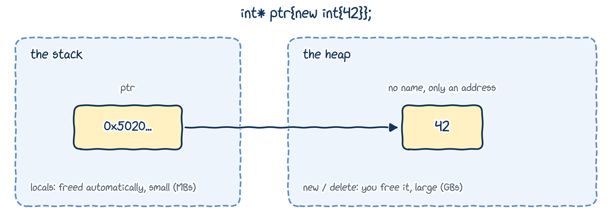
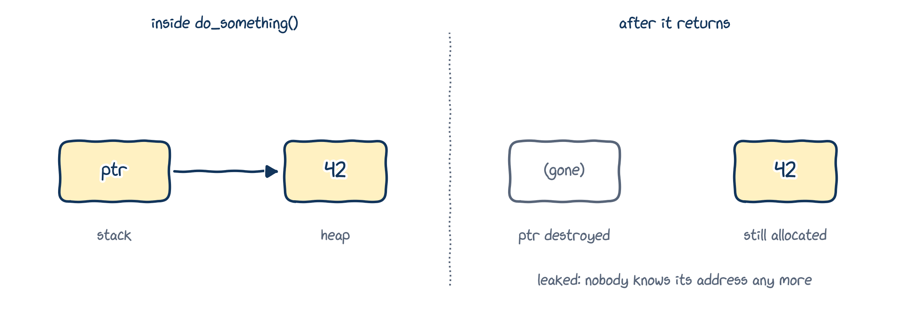
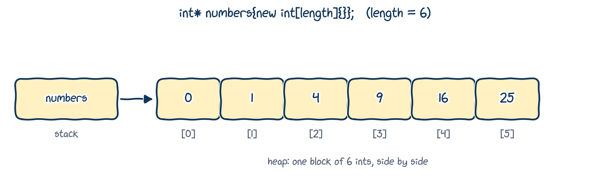

# Why dynamic memory?

## Three ways to get memory

C++ gives memory to objects in three ways. You've already met two of them:

| Allocation | For | Memory is obtained... | ...and given back |
|:---|:---|:---|:---|
| **Static** | global and `static` variables | once, when the program starts | when the program ends |
| **Automatic** | local variables, parameters | when the block is entered | automatically, at its `}` |
| **Dynamic** | whatever you ask for | when *you* ask, with `new` | when *you* say, with `delete` |

Static and automatic allocation have two things in common:

- the **size** of every object must be known when the program is **compiled**;
- memory is obtained and given back **automatically**.

Most of the time that's exactly what we want. But not always.

## When automatic memory isn't enough

**Problem 1: we don't know the size in advance.** How many measurements are in the data file? How long is the user's name? How many particles are in the simulation right now? We find out only when the program **runs**.

Guessing a maximum, "500 records should be enough", wastes memory when there are fewer, and breaks when there are more.

**Problem 2: the stack is small.** Local variables live in a region of memory called the **stack**. It's typically 1 MB (Windows) to 8 MB (Linux): plenty for a few numbers, nowhere near enough for big data.

## Overflowing the stack

```{.cpp filename="stack_overflow.cpp"}

```

```{.text .terminal}
$ ./stack_overflow
Segmentation fault
```

`int numbers[10'000'000];` is a *C-style array* of 10 million `int`s (arrays: later in this chapter). At 40 MB, it doesn't fit on my 8 MB stack: a **stack overflow**, and the program crashes.

## The heap

**Dynamic memory allocation** lets a running program ask the operating system for memory, whenever it likes and as much as it needs.

{fig-alt="ptr lives on the stack and holds an address. An int holding 42 lives on the heap, with no name, only an address. ptr points at it. The stack is freed automatically and is small; the heap is managed with new and delete and is large." width="80%"}

That memory comes from a much bigger region called the **heap** (or *free store*): gigabytes on a modern machine. Its objects have **no names**, only addresses, and that's what pointers are for!

# `new` and `delete`

## Allocating one object with `new`

::: {.columns}
::: {.column width="65%"}
```{.cpp filename="new_single.cpp"}

```
:::
::: {.column width="35%"}
```{.text .output}
7
6
```
:::
:::

- `new int` creates an `int` on the heap and returns its **address**, an `int*`. Keep it in a pointer, or it's lost.
- `new int{6}` creates it *and* initializes it, with braces as usual.

## Giving memory back with `delete`

When you're done with a heap object, **you** must give its memory back:

```{.cpp}
delete ptr;    // return the memory ptr points at
ptr = nullptr; // ptr now says "nothing allocated"
```

- Despite its name, `delete` doesn't delete the *pointer*. The pointer `ptr` is an ordinary local variable and lives on. `delete` destroys the **object it points at** and hands the memory back.
- Only `delete` what came from `new`. Deleting anything else is undefined behaviour.

::: {.callout-important title="Key idea"}
Local variables are freed automatically. Heap objects are not: every `new` needs exactly one matching `delete`.
:::

## `delete` and `nullptr`

::: {.columns}
::: {.column width="68%"}
```{.cpp filename="delete_and_nullptr.cpp"}

```
:::
::: {.column width="32%"}
```{.text .output}
42
7
```

::: {.callout-tip title="Best practice"}
After `delete`, set the pointer to `nullptr`, unless it's about to go out of scope anyway.
:::
:::
:::

A null pointer is a handy way to say "nothing allocated yet". And `delete` on a null pointer does nothing, so there's no need to write `if (ptr) delete ptr;`.

## Dangling pointers, again

```{.cpp filename="use_after_delete.cpp"}

```

```{.text .terminal}
$ ./use_after_delete
1573893628
free(): double free detected in tcache 2
Aborted
```

After `delete`, `ptr` still holds the old address: it's a **dangling pointer** (Chapter 08). Reading through it printed garbage; deleting it again crashed the program. Both are undefined behaviour.

## Two pointers, one object

Dangling pointers are easy to create without noticing:

```{.cpp}
int* owner{new int{5}};
int* viewer{owner}; // two pointers to the same heap int

delete owner;       // the int is gone...
owner = nullptr;    // ...and owner says so

// ...but viewer still holds the old address: it dangles!
```

::: {.callout-tip title="Best practice"}
Avoid having several pointers to the same heap object. If you must, be clear about which one **owns** it: the owner is the only one that deletes it.
:::

# Memory leaks

## A memory leak

::: {.columns}
::: {.column width="64%"}
```{.cpp filename="memory_leak.cpp"}

```
:::
::: {.column width="36%"}
The pointer `ptr` is a local variable: it's destroyed at the `}`. The heap `int` is not. Nobody holds its address any more, so nobody can ever `delete` it.
:::
:::

{fig-alt="Inside do_something, ptr on the stack points at 42 on the heap. After the function returns, ptr is gone but 42 is still allocated: leaked, because nobody knows its address any more." width="76%"}

## Why leaks matter

- A leaked object stays allocated until the **program ends**. The operating system can't reuse that memory either: as far as it knows, your program is still using it.
- One leaked `int` is harmless. A leak inside a loop that runs a million times, in a simulation that runs for a week, eats all the memory and slows down the whole machine.
- Leaks make no noise: the program still "works". You need a tool to find them.

::: {.callout-note title="Coming from Python"}
Python has a **garbage collector** that frees objects nobody refers to any more. C++ has none: if you `new` it, you `delete` it. (Or let something else do it for you: the end of this chapter.)
:::

## Catching leaks with AddressSanitizer

g++ can build your program with **AddressSanitizer**, a checker for memory bugs:

```{.text .terminal}
$ g++ -std=c++20 -g -fsanitize=address memory_leak.cpp
$ ./a.out
==6651==ERROR: LeakSanitizer: detected memory leaks
Direct leak of 4 byte(s) in 1 object(s) allocated from:
    #1 in do_something() memory_leak.cpp:2
SUMMARY: AddressSanitizer: 4 byte(s) leaked in 1 allocation(s).
```

It even tells you which line allocated the leaked memory. (Output shortened: the real report also shows addresses and full paths.) It catches dangling pointers too: on `use_after_delete.cpp` it reports *heap-use-after-free* on line 7.

::: {.callout-tip title="Best practice"}
While developing, compile with `-g -fsanitize=address` now and then. It's free bug-hunting. (It works on Linux and macOS; on Windows, MSVC has its own version.)
:::

## Three ways to leak

::: {.columns}
::: {.column width="50%"}
**1. The pointer goes out of scope** (the last slides).

**2. The pointer is reassigned:**

```{.cpp}
int value{5};
int* ptr{new int{}};
ptr = &value; // the heap int is lost
```
:::
::: {.column width="50%"}
**3. Allocating twice:**

```{.cpp}
int* ptr{new int{}};
ptr = new int{}; // the first int is lost
```

**The fix** for 2 and 3: `delete` before you reassign.

```{.cpp}
int* ptr{new int{}};
delete ptr;      // give it back first
ptr = new int{}; // now this is fine
```
:::
:::

# Dynamic arrays

## Allocating an array with `new[]`

::: {.columns}
::: {.column width="70%"}
```{.cpp filename="dynamic_array.cpp"}

```
:::
::: {.column width="30%"}
```{.text .terminal}
$ ./dynamic_array
How many numbers? 6
0 1 4 9 16 25
```

The length can be **any value known at run time**: exactly what automatic memory couldn't do.
:::
:::

## What `new int[length]` gives you

{fig-alt="numbers on the stack points at the first of six ints on the heap, holding 0, 1, 4, 9, 16 and 25, numbered 0 to 5: one block of 6 ints side by side." width="85%"}

- One block of `length` `int`s, side by side, and a pointer to the first one.
- `numbers[i]` is the `int` at position `i`, counting from 0, as with `std::string` in Chapter 04. There's no checking: `numbers[length]` is out of bounds and undefined behaviour.
- `new int[5]{}` sets them all to 0; `new int[5]{9, 7, 5, 3, 1}` gives them values.

## `new[]` needs `delete[]`

```{.cpp filename="delete_mismatch.cpp"}

```

```{.text .output .compiler}
warning: 'void operator delete(void*, long unsigned int)' called on
pointer returned from a mismatched allocation function [-Wmismatched-new-delete]
```

- Memory from `new[]` must be returned with `delete[]`, and memory from `new` with plain `delete`. Mixing them up is undefined behaviour.
- It compiles! Only `-Wall` warns, and AddressSanitizer reports *alloc-dealloc-mismatch (operator new [] vs operator delete)*.

## `new` can fail

::: {.columns}
::: {.column width="72%"}
```{.cpp filename="new_can_fail.cpp"}

```
:::
::: {.column width="28%"}
```{.text .terminal}
$ ./new_can_fail
Could not allocate memory
terminate called after throwing an instance of 'std::bad_alloc'
  what():  std::bad_alloc
Aborted
```
:::
:::

If the memory isn't available, `new` throws an **exception**, `std::bad_alloc` (exceptions are beyond this course), and the program stops. `new (std::nothrow)` returns `nullptr` instead, so you can check. For everyday sizes, failure is rare.

# Let someone else `delete`

## `std::vector`: a dynamic array that cleans up after itself

::: {.columns}
::: {.column width="70%"}
```{.cpp filename="vector_instead.cpp"}

```
:::
::: {.column width="30%"}
```{.text .terminal}
$ ./vector_instead
How many numbers? 6
0 1 4 9 16 25
```

Note the **parentheses**: `numbers(length)` makes `length` zeros; `numbers{length}` would hold the single value `length`.
:::
:::

You've used `std::vector` in the labs. Inside, it does exactly what we did by hand: `new[]` to get memory, and `delete[]` when it's destroyed. You can't forget the `delete[]`, because you never write it.

## Smart pointers: `std::unique_ptr`

::: {.columns}
::: {.column width="70%"}
```{.cpp filename="unique_ptr_example.cpp"}

```
:::
::: {.column width="30%"}
```{.text .output}
42
```
:::
:::

- A `std::unique_ptr` is a **smart pointer**: it owns one heap object and deletes it automatically when it goes out of scope. No leaks, no forgotten `delete`.
- `std::make_unique<int>(42)` does the `new` for you.
- How can an object clean up after itself? With a **destructor**, a special function that runs when an object is destroyed. We'll write our own in Chapter 12.

## So why learn `new` and `delete` at all?

::: {.callout-tip title="Best practice"}
In your own code, prefer `std::vector` for dynamic arrays and `std::unique_ptr` (with `std::make_unique`) for single heap objects. Write `new` and `delete` by hand only when you have a good reason.
:::

But you still need to understand them:

- they're what `std::vector`, `std::string` and smart pointers do **under the hood**;
- you'll meet them in older code, in libraries, and when we write classes that manage memory themselves (Chapter 12);
- they make clear what "owning" an object means, an idea that runs through all of modern C++.

# Wrapping up

## Summary

- Local variables live on the small **stack** and are freed automatically. **Dynamic** objects live on the large **heap**, and *you* manage them.
- `new` creates an object on the heap and returns its address; `delete` gives the memory back. Every `new` needs exactly one `delete`.
- After `delete`, the pointer **dangles**: set it to `nullptr`. Deleting `nullptr` is safe.
- Losing the last pointer to a heap object is a **memory leak**. Find leaks with `-fsanitize=address`.
- `new int[n]` makes an array whose length is known only at run time; free it with `delete[]`, never plain `delete`.
- In practice, let `std::vector` and `std::unique_ptr` do the deleting for you.

## Keep learning

Explore these on your own, with Google Gemini in Guided Learning mode or on [learncpp.com](https://www.learncpp.com):

1. [Dynamic memory allocation with `new` and `delete`](https://www.learncpp.com/cpp-tutorial/dynamic-memory-allocation-with-new-and-delete/)
2. [Dynamically allocating arrays](https://www.learncpp.com/cpp-tutorial/dynamically-allocating-arrays/)
3. [Introduction to `std::vector`](https://www.learncpp.com/cpp-tutorial/introduction-to-containers-and-arrays/)
4. [`std::unique_ptr`](https://www.learncpp.com/cpp-tutorial/stdunique_ptr/) and smart pointers

**Next up, Section 3:** object-oriented programming, starting with Chapter 10.
