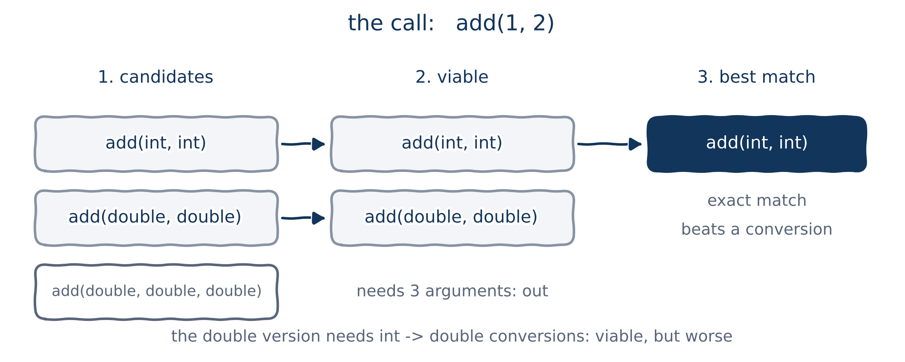
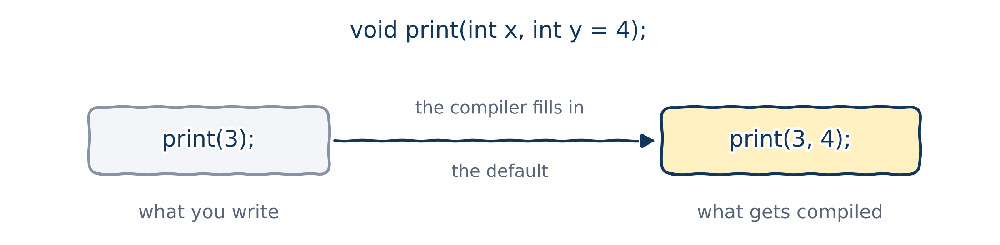

# Function Overloading and Default Arguments {#sec-ch05}

This chapter lets several functions share one name, shows how the compiler decides which one a call means, and lets a function fill in arguments the caller leaves out.

## Function overloading

`int add(int x, int y)` adds two integers, but it's no good for two `double`s: the arguments would be converted to `int`, losing their fractional parts. Giving every version its own name, `add_integer`, `add_double` and so on, quickly gets out of hand once you add `add(int, double)`, `add(double, int)` or three numbers. **Function overloading** lets several functions share one name, as long as their **parameter types** differ. Each one is an **overloaded function**, or *overload*.

```{.cpp filename="function_overloading.cpp"}

```

```{.text .output}
3
66.75
```

You write `add` every time, and the compiler works out which `add` you mean from the arguments. Matching a call to the right overload is called **overload resolution**:

```{.cpp filename="overload_resolution.cpp"}

```

```{.text .output}
3
4.6
4.7
```

The third call has three arguments, so only the three-parameter version fits, and its `int` and `float` arguments are converted to `double`.

::: {.callout-note title="Coming from Python"}
Python has no overloading: a second `def add` simply replaces the first. In C++, both exist side by side.
:::

A program with overloads compiles only if **every overload can be told apart** from the others, and **every call can be resolved** to exactly one of them. It's common sense: if *you* can't tell which function is meant, neither can the compiler.

## Telling overloads apart

Overloads can differ in the **number** of parameters, or in their **types**:

```{.cpp}
int add(int x, int y);
int add(int x, int y, int z);   // a different number of parameters
double add(double x, double y); // different types
double add(int x, double y);    // different types
```

Two things do **not** tell overloads apart. The first is a **type alias**, a second name for an existing type: `using Age = int;` (or the older `typedef int Age;`) makes `print(Age)` exactly the same as `print(int)`. Likewise, `const` on a value parameter doesn't count. The second is the **return type**:

```{.cpp .no-compile}
int get_random_value();
double get_random_value(); // error: ambiguating new declaration
```

Imagine you're the compiler and you meet the call `get_random_value()`. Which one would you call? The call gives you no clue, so C++ doesn't allow it.

The parts of a function that tell overloads apart are its **signature**: its **name** plus the **number and types of its parameters**. So `int add(int x, int y)` has the signature `add(int, int)`. The return type and the parameter names are not part of it, and every overload must have a different signature.

## How the compiler picks an overload

{fig-alt="For the call add(1, 2): all three add functions are candidates. add(double, double, double) is not viable because it needs three arguments. Of the two viable functions, add(int, int) is an exact match and beats add(double, double), which needs conversions." width="65%"}

Overload resolution takes three steps:

1. **Candidates:** every function with that name.
2. **Viable functions:** the candidates with the right number of parameters, where each argument can be converted to the parameter's type.
3. **Best match:** an exact match beats a *promotion* (such as `float` to `double`), which beats any other conversion. If one function is strictly better than all the others, it's called.

If two overloads are *equally* good, the compiler refuses to guess:

```{.cpp filename="ambiguous_match.cpp" .no-compile}

```

```{.text .output .compiler}
error: call of overloaded 'print(long int)' is ambiguous
```

`5L` is a `long`, and converting it to `int` or to `double` is equally good, so neither wins. The fix is to pass an argument of the type you mean, such as `5` or `5.0`.

### Deleting unwanted calls with `= delete`

Conversions can also make calls work that shouldn't. Given only `void print_int(int x)`, the call `print_int('a')` prints `97` (the number that stores `'a'`) and `print_int(true)` prints `1`, because `char` and `bool` both convert silently to `int` (`print_int_surprise.cpp`). If that makes no sense for your function, forbid it:

```{.cpp filename="delete_function.cpp" .no-compile}

```

```{.text .output .compiler}
error: use of deleted function 'void print_int(char)'
```

`= delete` declares an overload that **must not be called**. Overload resolution still picks it for a `char` argument, and the compiler then reports an error. Careful: `print_int(5.0)` is now an error too, because a `double` converts equally well to `int`, `char` and `bool`, so the call is ambiguous.

## Default arguments

A **default argument** is a value a parameter gets when the caller doesn't supply one:

```{.cpp filename="default_argument.cpp"}

```

```{.text .output}
x: 1, y: 2
x: 3, y: 4
```

{fig-alt="With the declaration void print(int x, int y = 4), a call written as print(3) is compiled as print(3, 4): the compiler fills in the default." width="50%"}

With several defaults, arguments are matched to parameters from the **left**, and the defaults fill in the rest from the right:

```{.cpp filename="multiple_default_arguments.cpp"}

```

```{.text .output}
1 2 3
1 2 30
1 20 30
10 20 30
```

C++ has no syntax like `print_numbers( , , 3)`, and the rules follow from that. You can't skip an argument: to give `z` a value, you must also give `x` and `y`. Defaults must come last: once a parameter has a default, every parameter to its right needs one too, so `void print(int x = 10, int y);` is an error. And among the defaulted parameters, put the one callers change most often first.

::: {.callout-note title="Coming from Python"}
Python lets you name arguments in a call: `print_numbers(z=3)`. C++ has no named arguments, so the order of parameters matters much more.
:::

### Where the default goes

A function with a forward declaration can have its default in the declaration *or* in the definition, but **not both**: repeating it gives *error: default argument given for parameter 2* (`default_argument_twice.cpp`). And because the compiler reads from top to bottom, it must see the default before the call; if the default is only in a definition below `main()`, the call `print(3)` fails with *too few arguments* (`default_argument_too_late.cpp`). So put the default in the forward declaration, which in a multi-file program means the header:

```{.cpp filename="print.h"}

```

`print.cpp` defines `print(int x, int y)` without repeating the default, and `main.cpp`, which includes `print.h`, can call `print(5)` to print `x: 5, y: 4`.

::: {.callout-tip title="Best practice"}
Give a default in the forward declaration if there is one (especially in a header), otherwise in the definition.
:::

### Default arguments and overloading

Functions with default arguments can be overloaded: with `print(std::string)` and `print(char c = '*')`, the call `print()` prints `*` (`default_argument_overloaded.cpp`). But a default is **not** part of the signature, so it can make a call match two overloads:

```{.cpp filename="default_argument_ambiguous.cpp" .no-compile}

```

```{.text .output .compiler}
error: call of overloaded 'print(int)' is ambiguous
```

## Summary

- **Overloading:** functions can share a name if their **signatures** (name, number and types of parameters) differ. The return type doesn't count.
- **Overload resolution** picks the best match; an exact match beats a conversion. If two overloads tie, the call is **ambiguous** and won't compile.
- `= delete` forbids particular calls.
- **Default arguments** fill in parameters the caller leaves out. Defaults must be the rightmost parameters, and can't be skipped.
- Give a default **once**, in the forward declaration (header) if there is one, and before it's used. Defaults are not part of the signature, so they can make calls ambiguous.

**Further reading** on [learncpp.com](https://www.learncpp.com): [overload resolution and ambiguous matches](https://www.learncpp.com/cpp-tutorial/function-overload-resolution-and-ambiguous-matches/) (the full ranking rules are long: try asking Gemini to teach them to you), [implicit type conversion](https://www.learncpp.com/cpp-tutorial/implicit-type-conversion/), [type aliases](https://www.learncpp.com/cpp-tutorial/typedefs-and-type-aliases/).
