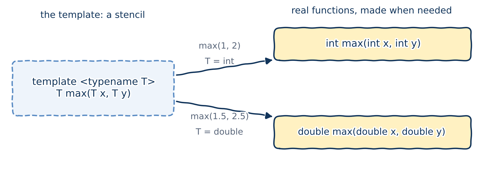

# Function Templates {#sec-ch06}

Overloading means writing every version of a function by hand. This chapter lets the compiler write them for us, from one **function template**.

## Why templates?

You've already used templates in the labs. `std::vector<double>` is a growable list of `double`s, and `std::vector<int>` the same thing holding `int`s. `std::max(1, 2)` works out that both arguments are `int`, while `std::max<double>(10, 42.24)` tells it to treat both as `double`. The type in angle brackets `< >` picks the type: `std::vector` and `std::max` are **templates**, written once and usable with many types.

Without templates, a `max()` function needs one overload per type:

```{.cpp}
int max(int x, int y) {
    return (x < y) ? y : x;
}

double max(double x, double y) { // the same code again
    return (x < y) ? y : x;
}
```

`c ? a : b` is the **conditional operator**: "if `c` then `a`, otherwise `b`", like Python's `a if c else b`. Two copies of the same code already, and every new type (`long`, `float`, `char`...) means another. What we'd like is to write `T max(T x, T y)` once, where `T` stands for *any* type for which `x < y` makes sense. A template gives us exactly that: one definition with a **placeholder type**, from which the compiler **generates** a real function for each type we actually use.

## Writing and using a function template

```{.cpp}
template <typename T> // the template parameter declaration
T max(T x, T y) {     // the function template itself
    return (x < y) ? y : x;
}
```

The **template parameter declaration** starts with the keyword `template` and lists the placeholder types in angle brackets. `typename T` declares `T` as a **type template parameter** (`class T` also works, but `typename` is preferred). Use `T`, then `U`, `V`... when the meaning is obvious, and a descriptive name starting with a capital letter, like `Allocator`, when the parameter has a specific job. To use the template, put the actual type, the **template argument**, in angle brackets:

```{.cpp filename="use_template_function.cpp"}

```

```{.text .output}
2
1.5
```

### Instantiation

{fig-alt="The template max of T is drawn as a dashed stencil. The call max(1, 2) produces the function int max(int x, int y); the call max(1.5, 2.5) produces double max(double x, double y)." width="62%"}

Creating a real function from a template is called **instantiation**, and it happens when a call needs it (**implicit instantiation**). For `max<int>(1, 2)`, the compiler copies the template, replaces every `T` with `int`, and compiles the result, as if we had written:

```{.cpp}
template <>
int max<int>(int x, int y) { // generated for T = int
    return (x < y) ? y : x;
}
```

(The `template <>` line marks it as generated from the template; you won't write this yourself, but `instantiation_look_breakdown.cpp` shows it compiles.) The generated function is a **function instance**, an ordinary function in every way, and the template it came from is the **primary template**. A template is instantiated the **first** time a call needs a type, and later calls with that type reuse the same instance: in `instantiation_look_more.cpp`, two calls to `max<int>` and one to `max<double>` produce just two functions. A template that is never called produces no function at all.

::: {.callout-important title="Key idea"}
A function template is **not** a function. It's a recipe for making functions.
:::

## Template argument deduction

The template argument usually just repeats the types of the arguments: in `max<int>(1, 2)`, `1` and `2` are `int`s anyway. So we can leave it out and let the compiler **deduce** `T` from the arguments. `max<>(1, 2)` deduces `T` and considers only templates; `max(1, 2)` deduces `T` and considers ordinary functions too. The second form looks like an ordinary call, and it's the one we normally use. But note what happens when an ordinary function matches equally well:

```{.cpp filename="template_argument_deduction_more.cpp"}

```

```{.text .output}
template max<T>: 2
template max<T>: 2
ordinary max: 2
```

::: {.callout-important title="Key idea"}
When an ordinary function and a template instance match equally well, `max(1, 2)` picks the **ordinary function**.
:::

That's useful. In `favor_normal_func_over_func_template_call.cpp`, a template `print(T x)` handles every type in a general way, and an ordinary `print(bool x)` prints `true` or `false` instead of `1` or `0`. With the normal call `print(true)`, the special version wins automatically.

::: {.callout-tip title="Best practice"}
Call function templates with the normal syntax, `print(true)`, unless you specifically need the template version.
:::

## What templates can and can't do

A function template can mix template parameters with ordinary ones, which can have default arguments: `template <typename T> void print_repeated(T value, int times = 1)` prints any value `times` times (`func_template_with_non_template_parameters.cpp`).

The template itself is only checked properly once it's instantiated, and some instances don't compile:

```{.cpp filename="instantiated_func_not_compile.cpp" .no-compile}

```

```{.text .output .compiler}
error: no match for 'operator+' (operand types are 'std::__cxx11::basic_string<char>' and 'double')
```

...followed by dozens of lines of notes. The template is fine, but the **instance** `add_value<std::string>` isn't, because you can't add a `double` to a string. Template error messages are famously long: read the first line first. Worse, some instances compile but make no sense:

```{.cpp filename="not_make_sense_semantically.cpp"}

```

```{.text .output}
42
ello, world!
```

`"Hello, world!"` is not a `std::string` but a *C-style string*, so `T` becomes the memory address of its first character. Adding 1 moves on to the next character, and the `H` is lost. (Addresses are Chapter 08's topic.) The compiler can't know that wasn't what you meant.

### Templates live in header files

```{.cpp filename="max.h"}

```

To instantiate `max<int>`, the compiler needs the template's **whole definition**, body included, in every `.cpp` file that uses it; a declaration alone isn't enough. So templates go **entirely in the header**, and they are exempt from the "define exactly once" rule. This is the exception to the header rules from Chapter 02.

## Templates with several types

`max(2, 3.5)` doesn't compile:

```{.text .output .compiler}
error: no matching function for call to 'max(int, double)'
note:   deduced conflicting types for parameter 'T' ('int' and 'double')
```

`T` can only be one type: from `2` the compiler deduces `int`, from `3.5` it deduces `double`, and it refuses to choose. One fix is to say which type you want, `max<double>(2, 3.5)`: there's nothing left to deduce, and `2` is simply converted to `2.0`. It would be nicer not to have to think about the types at all, though. So let `x` and `y` have different types:

```{.cpp filename="two_template_type_parameters.cpp"}

```

```{.text .output}
3
```

Why `3`, not `3.5`? The return type is `T`, which is `int`, so the result `3.5` is converted to `int`. No error, no warning: just a wrong answer. The fix is to let the compiler work out the return type from the `return` statement, with **`auto`**: `template <typename T, typename U> auto max(T x, U y)` returns a `double` here, and prints `3.5`. (Alternatively, `std::common_type_t<T, U>` from `<type_traits>` names the type that both `T` and `U` convert to without losing information, such as `double` for `int` and `double`; but `auto` is usually simpler.)

`auto` works for variables too: it asks the compiler to deduce a type from the initializer.

```{.cpp}
auto age{25};                    // int
auto price{42.99};               // double
auto name{std::string{"Khiem"}}; // std::string
```

This does **not** make C++ dynamically typed like Python: each variable still gets exactly one type, fixed at compile time; you just don't have to spell it out. Careful: plain `auto` drops `const`, so write `const auto` to keep it.

### Abbreviated function templates (C++20)

Since C++20, a parameter of type `auto` turns an ordinary function into a function template, with one type template parameter per `auto`:

```{.cpp filename="abbreviated_function_template.cpp"}

```

```{.text .output}
3.5
z
```

This is shorthand for `template <typename T, typename U> auto max(T x, U y)`. Function templates can also be overloaded like ordinary functions, for example with two and three parameters (`function_templates_overloaded.cpp`).

## Non-type template parameters

Remember `constexpr` variables from Chapter 04? A function can be `constexpr` too, so that the compiler can call it **while compiling**: with `constexpr int square(int x) { return x * x; }`, the value of `constexpr int result{square(10)};` is worked out at compile time.

A template parameter doesn't have to be a type. A **non-type template parameter** has a fixed type and stands for a **value** known at compile time: an integer type such as `int`, `char` or `bool`, a floating-point type (since C++20), and a few others we meet later.

```{.cpp filename="nontype_template_parameters.cpp"}

```

```{.text .output}
Raw: 10
High (x5): 50
Low  (x2): 20
```

`Factor` is given explicitly in the angle brackets, while `T` is still deduced from the argument. Each different `Factor` produces a different function with the value baked in: here, one that multiplies by 5 and one that multiplies by 2 (`nontype_template_parameters_pov.cpp` shows both).

## Summary

- A **function template** is a recipe for functions: `template <typename T>` introduces a placeholder type `T`.
- The compiler **instantiates** a real function for each type a call needs. The template itself is not a function.
- **Template argument deduction** works out `T` from the arguments: write `max(1, 2)`, not `max<int>(1, 2)`. An equally good ordinary function wins.
- An instance may fail to compile, or compile and do something silly: the compiler only checks it once it's instantiated.
- Templates live **entirely in header files**.
- For mixed types, use two type parameters with an `auto` return type, or the C++20 shorthand `auto max(auto x, auto y)`.
- A **non-type template parameter** is a compile-time value, like `template <int Factor>`.

**Further reading** on [learncpp.com](https://www.learncpp.com): [templates with multiple template types](https://www.learncpp.com/cpp-tutorial/function-templates-with-multiple-template-types/), [non-type template parameters](https://www.learncpp.com/cpp-tutorial/non-type-template-parameters/), [type deduction with `auto`](https://www.learncpp.com/cpp-tutorial/type-deduction-for-objects-using-the-auto-keyword/), [constexpr functions](https://www.learncpp.com/cpp-tutorial/constexpr-functions/).
