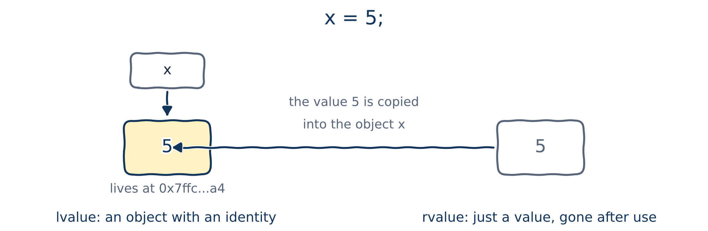
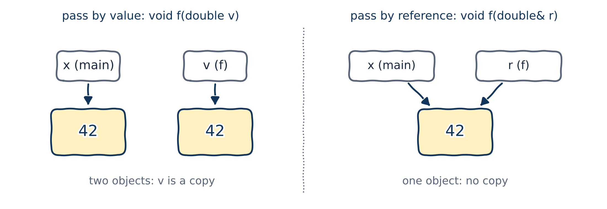

# Compound Types and References {#sec-ch07}

This chapter introduces **references**: second names for existing objects. To understand them, we first need *value categories*. References then give us pass by reference, the way to hand a function an object without copying it.

## Compound types

A program that tracks a hundred employees can't have a separate `int id1`, `int id2`, `double salary1`... for each one. We need types **built from other types**: **compound types**. Some are built into the language: functions (Chapter 02), references (this chapter), pointers (Chapter 08) and C-style arrays. Others are defined by you, the programmer: enumerations, structs, unions, and **classes**, the heart of this course from Chapter 10. We won't cover them all; structs and classes are so similar that studying one carefully is enough. Even a function has a compound type: `void do_something(int x, double y)` has the type `void(int, double)`.

## Value categories: lvalues and rvalues

Every expression has a **type**, the type of the value it produces (`12 / 4` is an `int`, `12.0 / 4` a `double`), and a **value category**, which says what *kind* of thing it produces: an object, or just a value. Why is `x = 5` fine, but `5 = x` isn't? The compiler's answer is in its error message:

```{.cpp filename="lvalue_assignment.cpp" .no-compile}

```

```{.text .output .compiler}
error: lvalue required as left operand of assignment
```

{fig-alt="For x = 5: x is an object that lives at an address, an lvalue. 5 is just a value that disappears after use, an rvalue. The value 5 is copied into the object x." width="58%"}

- An **lvalue** evaluates to an **identifiable object** (or function): something with a name or an address, which outlives the expression. A variable `x` is an lvalue.
- An **rvalue** evaluates to a **value**: a literal, a temporary result, something returned by value. It's gone at the end of the expression.

(C++11 added *glvalues*, *prvalues* and *xvalues*, for a feature called *move semantics*; lvalues and rvalues are enough for us.) In `rvalue_expression_example.cpp`, `return5()`, `x + 1` and `static_cast<int>(d)` all produce temporary values, so they're rvalues. (`static_cast<int>(d)` is an **explicit conversion**: it turns the `double` `1.2` into the `int` `1`.) One surprise: a string literal like `"Hello"` is an lvalue, because it's stored in memory for the whole program. Running the expressions through a small tool, `tell_value_categories.cpp`, confirms it:

```{.text .output}
5 is an rvalue
get_int() is an rvalue
x is an lvalue
x + 1 is an rvalue
std::string{"Hello"} is an rvalue
"Hello" is an lvalue
++x is an lvalue
x++ is an rvalue
```

Operators expect rvalues as operands unless stated otherwise, yet `x = y` and `x = x + 1` compile. Where an rvalue is expected and an lvalue is given, the lvalue goes through an **lvalue-to-rvalue conversion**: it's simply evaluated to produce its value. In `x = x + 1`, the left `x` is the object we assign to; the right `x` is converted to its value, say `42`, and `x + 1` produces the rvalue `43`.

::: {.callout-important title="Key idea"}
An lvalue can be used wherever an rvalue is expected. An rvalue can never be used where an lvalue is required.
:::

## lvalue references

A **reference** is an **alias**: a second name for an object that already exists. Anything you do to the reference happens to the object. `int&` (one ampersand) is an **lvalue reference** to an `int`, and `const int&` an lvalue reference to a `const int`. (C++11 also added *rvalue references*, `int&&`, which many experienced programmers have never needed.) Since lvalue references are by far the most common, "reference" on its own means *lvalue reference*.

```{.cpp filename="modify_value_through_nonconst_reference.cpp"}

```

```{.text .output}
42 42
24 24
12 12
```

{fig-alt="One object holding 42 with two name tags, x and ref, both pointing at it: one object, two names." width="50%"}

One object, two names: changing `x` changes `ref`, and changing `ref` changes `x`.

::: {.callout-tip title="Best practice"}
Write the ampersand next to the type, `int& ref`, not next to the name. It's part of the type.
:::

### The rules of references

A reference **must be initialized** (`int& invalid_ref;` is an error). Initializing it **binds** it to an object, its **referent**. A non-const reference can only bind to a **modifiable lvalue**:

```{.cpp filename="nonconst_reference_binding.cpp" .no-compile}

```

```{.text .output .compiler}
error: binding reference of type 'int&' to 'const int' discards qualifiers
error: cannot bind non-const lvalue reference of type 'int&' to an rvalue of type 'int'
```

A non-const reference lets you change its referent, so binding one to a `const` object, or to a temporary value like `0`, would let you change something that must not, or cannot, change. Once bound, a reference **can't be reseated**:

```{.cpp filename="reference_cannot_be_reseated.cpp"}

```

This prints `6`. `ref = y` does **not** make `ref` refer to `y`: `ref` *is* `x`, so this is simply `x = y`. (A Python name, by contrast, can be rebound at any time: `a = b` does exactly that.)

A reference and its referent have **independent lifetimes**: destroying a reference doesn't affect the object (`lifetime_reference_and_referent.cpp`). The other way round is dangerous: if the object is destroyed first, the reference is left **dangling**, and using it is undefined behaviour. Finally, a reference is not an object, just a name; the compiler often gives it no memory at all. So far references look like a curiosity. Their real job comes next.

## Pass by reference

Pass by value (Chapter 02) **copies** the argument into the parameter. That's cheap for a `double` but not for a long `std::string`, and most standard library types are expensive to copy: in `pass_by_value_string.cpp`, every character is copied, used once and thrown away. Make the parameter a **reference** instead, `void print_value(std::string& y)`, and it is simply bound to the argument. Nothing is copied.

{fig-alt="Pass by value: x in main and v in f are two separate objects, v is a copy. Pass by reference: x in main and r in f are two names for one object, no copy." width="75%"}

The addresses prove it (`&x` gives the address of `x`, more in Chapter 08):

```{.cpp filename="pass_by_value_vs_pass_by_reference.cpp"}

```

```{.text .output}
address of x:             0x7ffcc2285eb0
address of val (a copy):  0x7ffcc2285e98
address of ref (no copy): 0x7ffcc2285eb0
```

`ref` has the **same address** as `x`: it *is* `x`. Any change made through a non-const reference parameter therefore changes the caller's argument, which is exactly what we need when a function's purpose is to modify something. Remember the swap that didn't swap in Chapter 02?

```{.cpp filename="swap_by_reference.cpp"}

```

```{.text .output}
x = 200, y = 100
```

### Pass by const reference

A non-const reference parameter only accepts modifiable lvalues: `print_value(z)` with a `const int z`, or `print_value(5)`, fails with the binding errors above (`pass_by_reference_accept_modifiable_lvalues.cpp`). But often we just want to *read* an expensive argument without copying it, whatever it is. A **const reference** binds to anything:

```{.cpp filename="pass_by_const_reference.cpp"}

```

```{.text .output}
5
6
7
```

That's exactly why C++ lets const references bind to rvalues: otherwise you couldn't pass a literal like `7` to a function taking a reference. And through a const reference, the function can't change the argument (*assignment of read-only reference*). No copy **and** no accidental changes.

::: {.callout-tip title="Best practice"}
- **Fundamental types** (`int`, `double`, `char`, `bool`): pass by **value**. They're cheap to copy.
- **Class types** (`std::string`, `std::vector`, your own classes later): pass by **const reference**.
- Pass by **non-const reference** only when the function is meant to change the argument.
:::

For read-only text, C++17 also offers `std::string_view`, a cheap view of a string: the alternative Chapter 04 promised.

## Return by reference

Returning by value copies the result back to the caller; returning a **reference** avoids that copy:

```{.cpp filename="return_by_ref_academic.cpp"}

```

```{.text .output}
This program is named Calculator
```

A **static** local variable is created once and lives until the program ends, unlike an ordinary local variable, and here that's essential. Remove `static`, and `program_name` is destroyed when the function returns, so the caller receives a **dangling reference** (`return_by_ref_lifetime.cpp`):

```{.text .terminal}
$ g++ -std=c++20 -Wall return_by_ref_lifetime.cpp
warning: reference to local variable 'program_name' returned
$ ./a.out
Segmentation fault
```

The object must outlive the function. That's the case when a function returns a reference to one of the caller's own objects:

```{.cpp filename="return_by_ref_larger.cpp"}

```

```{.text .output}
x = 5, y = 0
```

`larger()` returns a reference to the caller's `y`, so the call can even appear on the **left** of `=`: it's an lvalue! This is safe because `x` and `y` outlive the call.

## Summary

- Every expression has a **type** and a **value category**. An **lvalue** is an identifiable object; an **rvalue** is just a value.
- A **reference** (`int& ref{x};`) is another name for an existing object. It must be initialized and can't be reseated.
- A non-const reference binds only to modifiable lvalues; a **const reference** binds to anything.
- **Pass by reference** avoids copies and lets a function change its argument; **pass by const reference** avoids copies without allowing changes. Pass fundamental types by value, class types by const reference.
- Never return (or keep) a reference to an object that is about to be destroyed: **dangling references** are undefined behaviour.

**Further reading** on [learncpp.com](https://www.learncpp.com): [value categories](https://www.learncpp.com/cpp-tutorial/value-categories-lvalues-and-rvalues/), [pass by const lvalue reference](https://www.learncpp.com/cpp-tutorial/pass-by-const-lvalue-reference/), [`std::string_view`](https://www.learncpp.com/cpp-tutorial/introduction-to-stdstring_view/), [static local variables](https://www.learncpp.com/cpp-tutorial/static-local-variables/).
