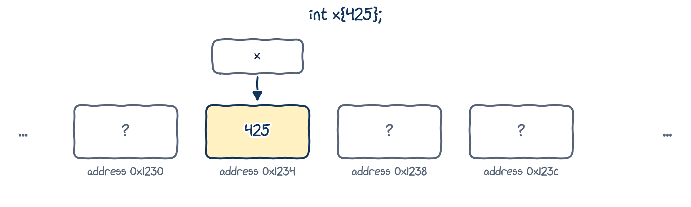
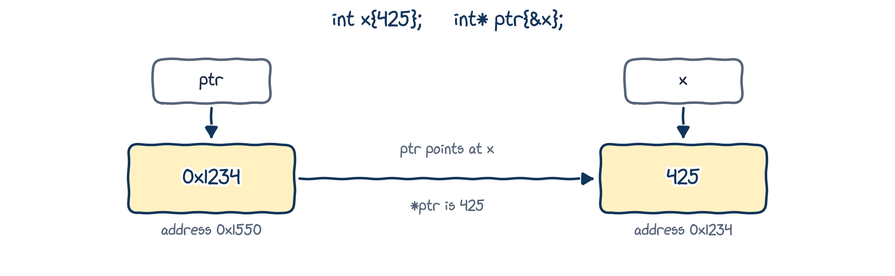
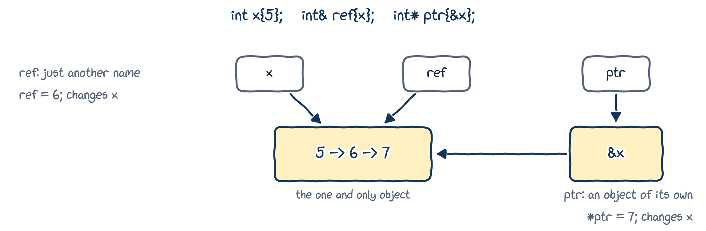

# Pointers {#sec-ch08}

A reference is a second name for an object. A **pointer** is another way to refer to an object: an object of its own, which holds the object's address. This chapter introduces addresses, pointers, null and dangling pointers, and pass by address.

## Memory and addresses

{fig-alt="A row of memory boxes with addresses 0x1230, 0x1234, 0x1238 and 0x123c. The box at 0x1234 holds 425 and is named x." width="62%"}

When `int x{425};` runs, the program sets aside memory for `x` at some **address**, say `0x1234`. Whenever we use `x`, the program reads or writes the value stored at that address, and a reference `int& ref{x};` is just another name for the same memory. Two operators work with addresses. The **address-of operator** `&x` gives the address of `x`, and the **dereference operator** `*` does the opposite: given an address, it gives the object stored there.

```{.cpp filename="dereference_operator_example.cpp"}

```

```{.text .output}
5
0x7ffcc49e7ee0
5
```

Addresses are usually printed in hexadecimal; yours will differ, and may change every run. An object bigger than one byte occupies several addresses, and `&` gives the first.

::: {.callout-important title="Key idea"}
`&` and `*` are opposites: `&` gets the address of an object, and `*` gets the object at an address. So `*(&x)` is just `x`.
:::

The ampersand means different things in different places: after a type it declares a reference (`int& ref{x};`), before an expression it takes an address (`&x`), and between two expressions it's bitwise AND (not covered here). The asterisk is similar: after a type it declares a pointer, before an expression it dereferences, and between two expressions it multiplies.

## Pointers

A **pointer** is an **object** whose value is a memory address, usually the address of another object. `double*` is a pointer to a `double`: it holds the address of a `double`.

{fig-alt="ptr lives at address 0x1550 and holds the value 0x1234. x lives at address 0x1234 and holds 425. An arrow from ptr to x: ptr points at x, and *ptr is 425." width="60%"}

```{.cpp filename="pointer_example.cpp"}

```

```{.text .output}
x lives at:   0x7ffc45506a0c
ptr holds:    0x7ffc45506a0c
*ptr gives:   425
ptr lives at: 0x7ffc45506a10
```

`ptr` holds the address of `x`, so we say `ptr` **points at** `x`. `*ptr` is `x` itself, and `ptr` has an address of its own, because it's an object.

The `*` in a declaration belongs to each variable, not to the type: `int* ptr1, ptr2;` makes `ptr1` a pointer but `ptr2` a plain `int`. Yet another reason to define one variable per line. An uninitialized pointer holds a garbage address and is called a **wild pointer**; dereferencing it is undefined behaviour. `int* ptr{};` instead makes a **null pointer**, which points at nothing.

::: {.callout-tip title="Best practice"}
Write the asterisk next to the type, `int* ptr`, as with references, and always initialize your pointers: with an address, or with `nullptr`.
:::

### Changing the pointer, or what it points at

```{.cpp filename="pointer_assignment.cpp"}

```

```{.text .output}
x = 10
y = 12
```

::: {.callout-important title="Key idea"}
`ptr = &y;` assigns to the **pointer**: it now points somewhere else. `*ptr = 12.0;` assigns to the **object pointed at**.
:::

### Pointers versus references

{fig-alt="One object, x, whose value goes from 5 to 6 to 7. The names x and ref both label it directly. ptr is a separate object holding the address of x and pointing at it." width="55%"}

A pointer can do much of what a reference does: in `pointers_behave_like_references.cpp`, changing `x` through `ref` or through `*ptr` changes the same object. But they are not the same thing:

| References | Pointers |
|:---|:---|
| must be initialized | don't have to be (but should be!) |
| are not objects | are objects |
| can't be reseated | can be made to point somewhere else |
| always refer to an object | can point at nothing (null) |
| "safe", apart from dangling | dangerous: wild, null and dangling pointers |

`&x` doesn't produce a bare number but a **pointer**: for an `int x`, `&x` has type `int*`, and `double* dptr{&x};` fails with *cannot convert 'int\*' to 'double\*'*. A pointer's type says what kind of object lives at the address. Since a pointer is just an address, all pointers are the same size, whatever they point at: 8 bytes on a 64-bit machine (`size_of_pointers.cpp`).

## Null and dangling pointers

```{.cpp filename="null_pointer.cpp"}

```

```{.text .output}
ptr is null
ptr points at 5
```

`nullptr` is a special value meaning "no address", and a pointer holding it is a **null pointer**. A null pointer converts to `false` and any other pointer to `true`, so `if (ptr)` asks "does `ptr` point at something?". There is no object at "no address", so dereferencing a null pointer is undefined behaviour; on most systems the program crashes with a **segmentation fault** (`null_dereference.cpp`).

::: {.callout-tip title="Best practice"}
If a pointer might be null, check it before you dereference it.
:::

Like a dangling reference, a **dangling pointer** still holds the address of an object that has been destroyed:

```{.cpp filename="dangling_pointer.cpp"}

```

```{.text .terminal}
$ g++ -Wall dangling_pointer.cpp
warning: using dangling pointer 'ptr' to 'x'
$ ./a.out
5
```

It printed `5` here, but with `-O2` the same code printed `0`: undefined behaviour, so anything can happen. Thank you, `-Wall`!

## Pass by address

A function can take a **pointer** parameter, and the caller then passes an **address**:

```{.cpp filename="pass_by_address.cpp"}

```

```{.text .output}
42
(no object)
```

`const int*` is a pointer to a `const int`: the function may read `*ptr` but not change it. With a plain `int*`, it could change the caller's `x` through `*ptr`. Pass by address can do what pass by reference does, avoiding copies and changing the caller's object, and the one extra thing it can do is mean **"no object at all"**, with `nullptr`. (The "proof" that scope is not lifetime in Chapter 02 was pass by address.)

::: {.callout-tip title="Best practice"}
Prefer pass by (const) reference. Use pass by address only when "no object" is a valid argument.
:::

Pointers really earn their place when a program creates objects while it runs, in the next chapter, and when we work with class hierarchies in Section 03.

## Summary

- Every object lives at an **address**. `&x` gives the address of `x`; `*ptr` gives the object at the address in `ptr`.
- A **pointer** (`int* ptr{&x};`) is an object that holds an address. Assign to `ptr` to point elsewhere; assign to `*ptr` to change the object pointed at.
- Always initialize pointers. `nullptr` means "points at nothing"; check before dereferencing.
- **Wild**, **null** and **dangling** pointers lead to undefined behaviour when dereferenced.
- References are safer, so prefer them. Use a pointer when "no object" must be possible.

**Further reading** on [learncpp.com](https://www.learncpp.com): [null pointers](https://www.learncpp.com/cpp-tutorial/null-pointers/), [pointers and const](https://www.learncpp.com/cpp-tutorial/pointers-and-const/), [pass by address](https://www.learncpp.com/cpp-tutorial/pass-by-address/), [C-style arrays](https://www.learncpp.com/cpp-tutorial/introduction-to-c-style-arrays/).
