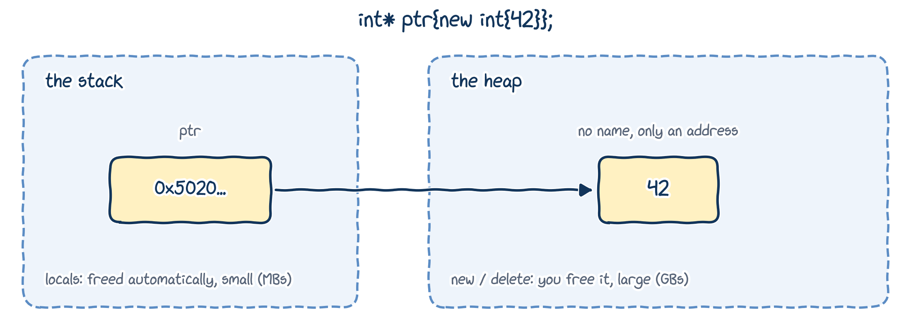
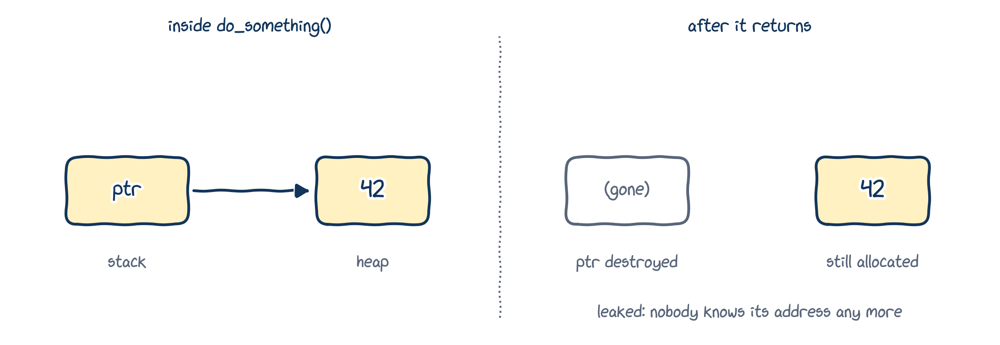
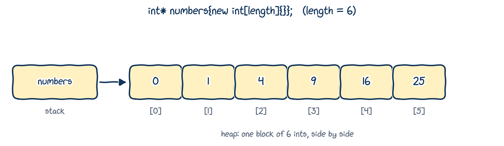

# Dynamic Memory Allocation {#sec-ch09}

So far, every object got its memory automatically. This chapter creates objects while the program runs, on the **heap**, where pointers become essential, and where *you* are responsible for giving the memory back.

## Why dynamic memory?

C++ gives memory to objects in three ways:

| Allocation | For | Memory is obtained... | ...and given back |
|:---|:---|:---|:---|
| **Static** | global and `static` variables | once, when the program starts | when the program ends |
| **Automatic** | local variables, parameters | when the block is entered | automatically, at its `}` |
| **Dynamic** | whatever you ask for | when *you* ask, with `new` | when *you* say, with `delete` |

With static and automatic allocation, memory is obtained and given back automatically, and the **size** of every object must be known when the program is **compiled**. Usually that's what we want, but not always. Often we only find out how much data there is when the program **runs**: how many measurements are in the file, how many particles are in the simulation. Guessing a maximum wastes memory when there are fewer and breaks when there are more. And local variables live in a region of memory called the **stack**, which is small: typically 1 MB (Windows) to 8 MB (Linux).

```{.cpp filename="stack_overflow.cpp"}

```

```{.text .terminal}
$ ./stack_overflow
Segmentation fault
```

`int numbers[10'000'000];` is a *C-style array* of ten million `int`s. At 40 MB, it doesn't fit on an 8 MB stack: a **stack overflow**, and the program crashes.

{fig-alt="ptr lives on the stack and holds an address. An int holding 42 lives on the heap, with no name, only an address. ptr points at it. The stack is freed automatically and is small; the heap is managed with new and delete and is large." width="62%"}

**Dynamic memory allocation** lets a running program ask for memory whenever it likes, as much as it needs. That memory comes from a much bigger region called the **heap** (or *free store*): gigabytes on a modern machine. Heap objects have **no names**, only addresses, and that's what pointers are for.

## `new` and `delete`

```{.cpp filename="new_single.cpp"}

```

```{.text .output}
7
6
```

`new int` creates an `int` on the heap and returns its **address**, an `int*`, which we must keep in a pointer, or the object is lost. `new int{6}` creates it *and* initializes it. When you're done with a heap object, **you** must give its memory back with `delete ptr;`. Despite its name, `delete` doesn't delete the pointer: `ptr` is an ordinary local variable and lives on. It destroys the **object pointed at** and hands the memory back. Only `delete` what came from `new`.

::: {.callout-important title="Key idea"}
Local variables are freed automatically. Heap objects are not: every `new` needs exactly one matching `delete`.
:::

After `delete`, `ptr` still holds the old address: it's a **dangling pointer** (Chapter 08).

```{.cpp filename="use_after_delete.cpp"}

```

```{.text .terminal}
$ ./use_after_delete
1573893628
free(): double free detected in tcache 2
Aborted
```

Reading through the dangling pointer printed garbage, and deleting it again crashed the program: both are undefined behaviour. So after `delete`, set the pointer to `nullptr`, which also makes a handy "nothing allocated yet" marker. `delete` on a null pointer does nothing, so there's no need to write `if (ptr) delete ptr;` (`delete_and_nullptr.cpp`).

::: {.callout-tip title="Best practice"}
After `delete`, set the pointer to `nullptr`, unless it's about to go out of scope anyway.
:::

Dangling pointers are easy to create without noticing, when two pointers hold the same address:

```{.cpp}
int* owner{new int{5}};
int* viewer{owner}; // two pointers to the same heap int

delete owner;       // the int is gone...
owner = nullptr;    // ...and owner says so

// ...but viewer still holds the old address: it dangles!
```

::: {.callout-tip title="Best practice"}
Avoid having several pointers to the same heap object. If you must, be clear about which one **owns** it: the owner is the only one that deletes it.
:::

## Memory leaks

```{.cpp filename="memory_leak.cpp"}

```

{fig-alt="Inside do_something, ptr on the stack points at 42 on the heap. After the function returns, ptr is gone but 42 is still allocated: leaked, because nobody knows its address any more." width="58%"}

The pointer `ptr` is a local variable, destroyed at the `}`, but the heap `int` is not. Nobody holds its address any more, so nobody can ever `delete` it: a **memory leak**. A leaked object stays allocated until the program ends, and the operating system can't reuse that memory either. One leaked `int` is harmless, but a leak inside a loop that runs a million times, in a simulation that runs for a week, eats all the memory and slows the whole machine down. And leaks make no noise: the program still "works".

::: {.callout-note title="Coming from Python"}
Python has a **garbage collector** that frees objects nobody refers to any more. C++ has none: if you `new` it, you `delete` it. (Or let something else do it for you: the end of this chapter.)
:::

You need a tool to find leaks. g++ can build your program with **AddressSanitizer**, a checker for memory bugs:

```{.text .terminal}
$ g++ -std=c++20 -g -fsanitize=address memory_leak.cpp
$ ./a.out
==6651==ERROR: LeakSanitizer: detected memory leaks
Direct leak of 4 byte(s) in 1 object(s) allocated from:
    #1 in do_something() memory_leak.cpp:2
SUMMARY: AddressSanitizer: 4 byte(s) leaked in 1 allocation(s).
```

It even names the line that allocated the leaked memory (the real report is longer). It catches dangling pointers too: on `use_after_delete.cpp` it reports *heap-use-after-free* on line 7.

::: {.callout-tip title="Best practice"}
While developing, compile with `-g -fsanitize=address` now and then: it's free bug-hunting. (It works on Linux and macOS; on Windows, MSVC has its own version.)
:::

Besides a pointer going out of scope, there are two more common ways to leak. Reassigning the pointer, as in `ptr = &value;`, loses the heap object it pointed at, and so does allocating twice, as in `ptr = new int{};` when `ptr` already holds an allocation. The fix for both is to `delete` before you reassign.

## Dynamic arrays

`new` can also allocate a whole array, whose length can be **any value known at run time**: exactly what automatic memory couldn't do.

```{.cpp filename="dynamic_array.cpp"}

```

```{.text .terminal}
$ ./dynamic_array
How many numbers? 6
0 1 4 9 16 25
```

{fig-alt="numbers on the stack points at the first of six ints on the heap, holding 0, 1, 4, 9, 16 and 25, numbered 0 to 5: one block of 6 ints side by side." width="62%"}

`new int[length]` gives one block of `length` `int`s side by side, and a pointer to the first. `numbers[i]` is the `int` at position `i`, counting from 0 as with `std::string`. There's no checking: `numbers[length]` is out of bounds, and undefined behaviour. `new int[5]{}` sets all the elements to 0, and `new int[5]{9, 7, 5, 3, 1}` gives them values.

Memory from `new[]` must be returned with **`delete[]`**, and memory from `new` with plain `delete`. Mixing them up is undefined behaviour, yet it compiles: only `-Wall` warns (*called on pointer returned from a mismatched allocation function*, `delete_mismatch.cpp`), and AddressSanitizer reports an *alloc-dealloc-mismatch*.

Finally, `new` can fail if the memory isn't available. It then throws an **exception**, `std::bad_alloc`, and the program stops (exceptions are beyond this course); `new (std::nothrow)` returns `nullptr` instead, so that you can check (`new_can_fail.cpp`). For everyday sizes, failure is rare.

## Let someone else `delete`

Here is the dynamic array program again, with `std::vector`, which you've used in the labs:

```{.cpp filename="vector_instead.cpp"}

```

Inside, `std::vector` does exactly what we did by hand: `new[]` to get memory, and `delete[]` when the vector is destroyed. You can't forget the `delete[]`, because you never write it. Note the **parentheses** on line 9: `numbers(length)` makes `length` zeros, whereas `numbers{length}` would hold the single value `length`.

For a single heap object, use a **smart pointer**:

```{.cpp filename="unique_ptr_example.cpp"}

```

A `std::unique_ptr` owns one heap object and deletes it automatically when it goes out of scope: no leaks, no forgotten `delete`. `std::make_unique<int>(42)` does the `new` for you. How can an object clean up after itself? With a **destructor**, a special function that runs when an object is destroyed; we write our own in Chapter 12.

::: {.callout-tip title="Best practice"}
In your own code, prefer `std::vector` for dynamic arrays and `std::unique_ptr` (with `std::make_unique`) for single heap objects. Write `new` and `delete` by hand only when you have a good reason.
:::

You still need to understand `new` and `delete`, though: they're what `std::vector`, `std::string` and smart pointers do under the hood, you'll meet them in older code and libraries and when we write classes that manage memory (Chapter 12), and they make clear what "owning" an object means, an idea that runs through all of modern C++.

## Summary

- Local variables live on the small **stack** and are freed automatically. **Dynamic** objects live on the large **heap**, and *you* manage them.
- `new` creates an object on the heap and returns its address; `delete` gives the memory back. Every `new` needs exactly one `delete`.
- After `delete`, the pointer **dangles**: set it to `nullptr`. Deleting `nullptr` is safe.
- Losing the last pointer to a heap object is a **memory leak**. Find leaks with `-fsanitize=address`.
- `new int[n]` makes an array whose length is known only at run time; free it with `delete[]`, never plain `delete`.
- In practice, let `std::vector` and `std::unique_ptr` do the deleting for you.

**Further reading** on [learncpp.com](https://www.learncpp.com): [`new` and `delete`](https://www.learncpp.com/cpp-tutorial/dynamic-memory-allocation-with-new-and-delete/), [dynamically allocating arrays](https://www.learncpp.com/cpp-tutorial/dynamically-allocating-arrays/), [`std::vector`](https://www.learncpp.com/cpp-tutorial/introduction-to-containers-and-arrays/), [`std::unique_ptr`](https://www.learncpp.com/cpp-tutorial/stdunique_ptr/).

That's the end of Section 02. Section 03, *Object-Oriented Programming*, starts with Chapter 10.
