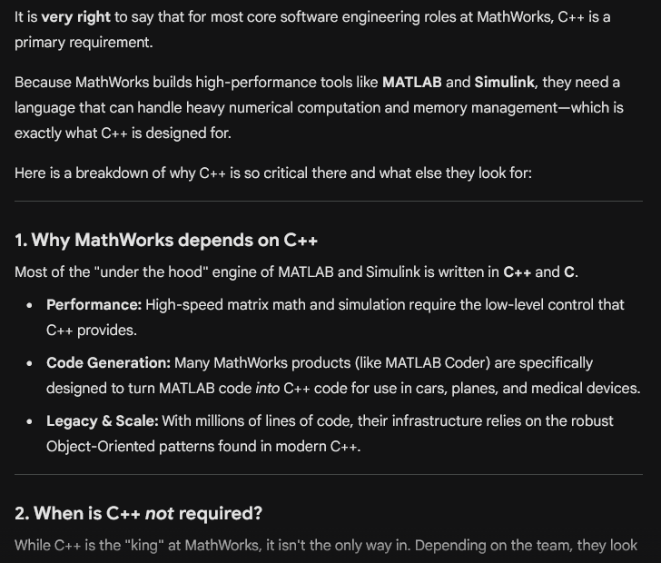
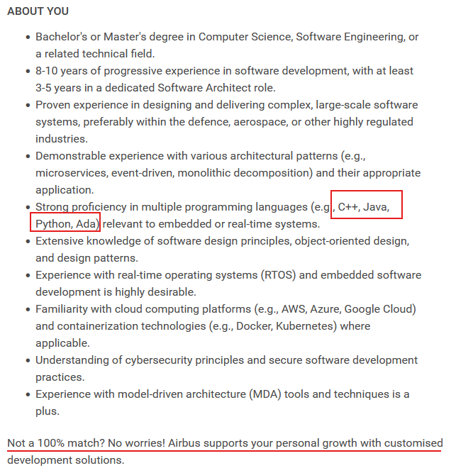
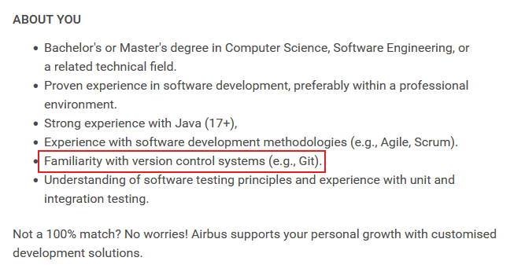
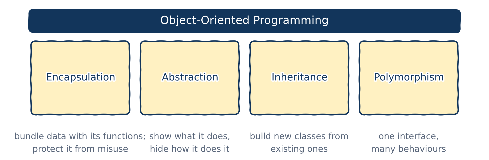
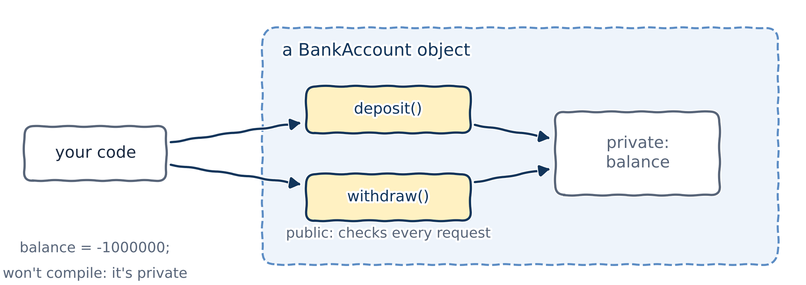
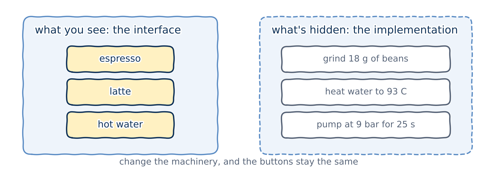
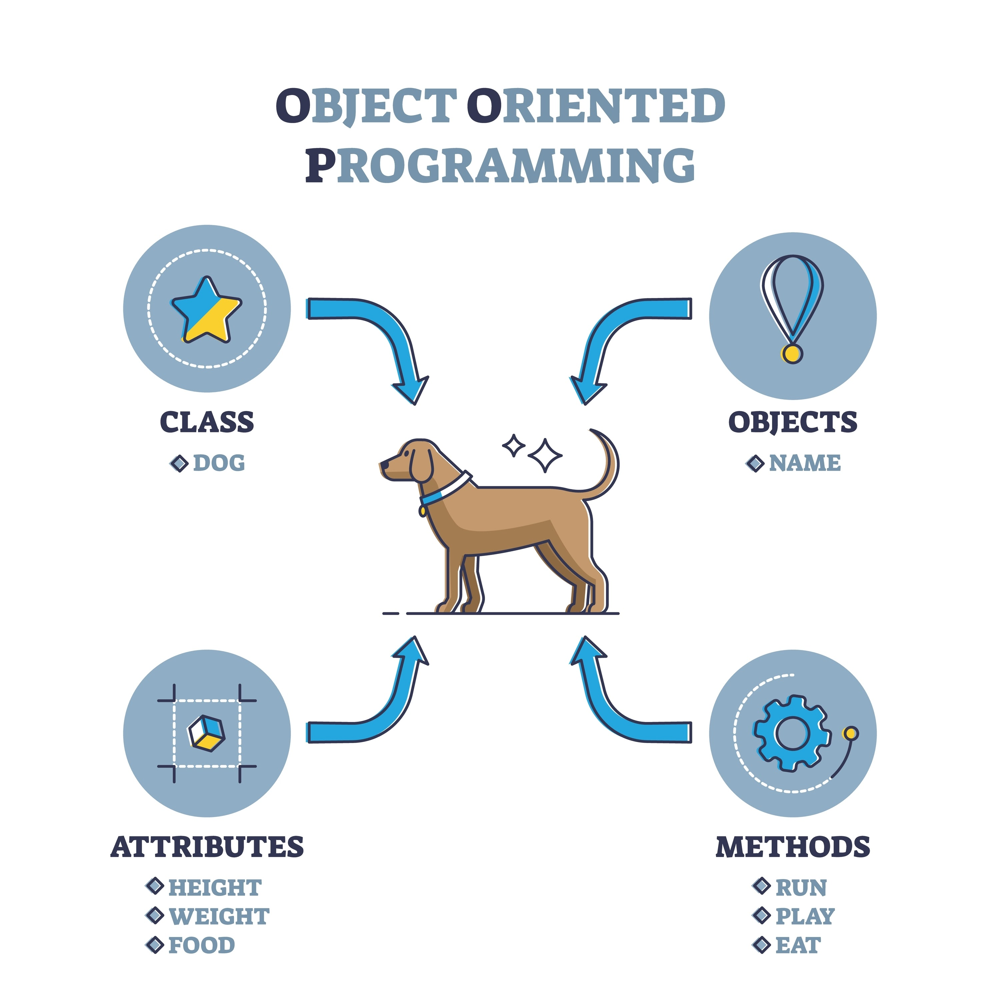
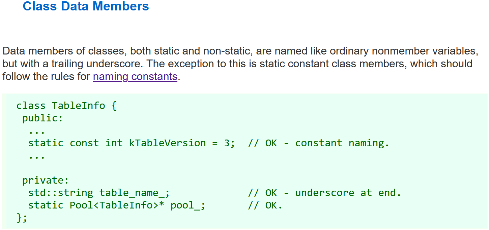
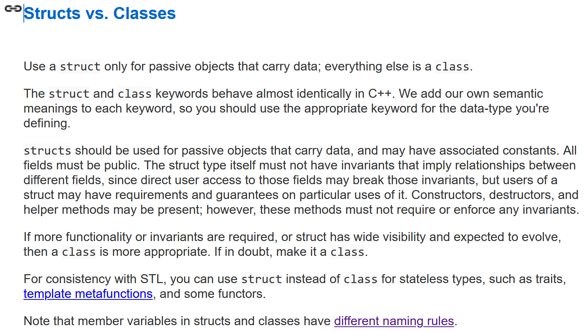
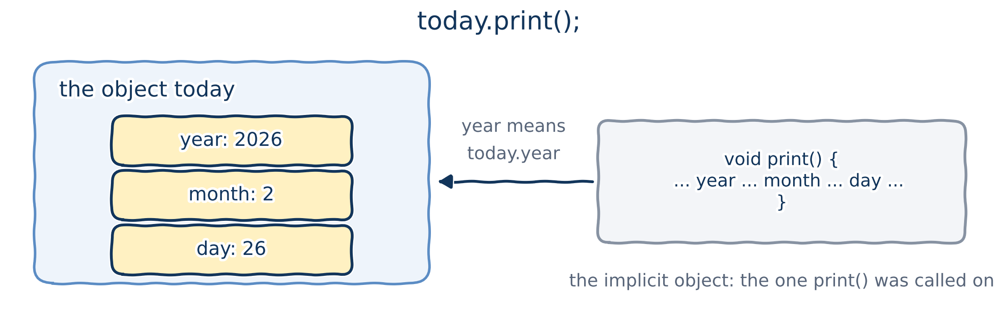

# Why object-oriented programming?

## Procedural versus object-oriented programming

- So far we've written **procedural** programs: the data and the functions that work on it are separate things.
- In **object-oriented programming** (OOP), we create our own data types that bundle **data** (properties) together with **behaviour** (functions).

I won't spend long on *why* OOP matters:

- you met it in Introductory Programming 2 and other programming courses;
- since the 1990s, OOP has been the industry standard.

Instead, let me walk you through some real job adverts.

## OOP is everywhere

- **It's natural:** it mirrors how we think about the world, as objects with properties and behaviours.
- **It scales:** it makes large, complex systems manageable, by *encapsulating* data so bugs can't spread.
- **It's what industry uses:** look at any job advert or large codebase.

{fig-alt="A MathWorks internship advert asking for experience with object-oriented design and with C++, among other languages." width="70%"}

You don't need MATLAB to get a job at MathWorks. You need C++ and OOP.

## C++ is in high demand

I asked Gemini about software engineering roles at MathWorks, the company that makes the MATLAB you use all the time:

{fig-alt="Gemini's answer about software engineering roles at MathWorks."}

## Software architecture at Airbus

{fig-alt="An Airbus job advert for a software architect."}

## Git and OOP are essential skills

Note the requirement for Java experience. For the record, Java is an object-oriented language through and through.

{fig-alt="An Airbus job advert for a software developer, asking for Git and Java experience."}

## The four pillars of OOP

I hope that's more than enough to convince you. But it's a lazy explanation!

{fig-alt="Four pillars holding up object-oriented programming: encapsulation, abstraction, inheritance and polymorphism." width="88%"}

Let's go through what each pillar is, and why it's there.

## Encapsulation

**Encapsulation** means bundling data and the functions that work on it into one unit, a **class**, and hiding the data from the outside world, to prevent accidental interference.

You've already relied on it in Python:

- A NumPy `ndarray` or a Matplotlib `Figure` hides its internals; you just use it.
- `np.array([1, 'two', 3])` with `dtype=float` fails with a clear message about exactly what's wrong: plenty of checking happens behind the scenes, and you never need to see it.
- Registering a student as `Student(name="", age=-7)` should fail. Some code, somewhere, has to check the data and tell the user.

## Encapsulation in C++: `public` and `private`

{fig-alt="A BankAccount object. Its balance is private. Your code can only reach it through the public functions deposit() and withdraw(), which check every request. Writing balance = -1000000 directly won't compile." width="78%"}

C++ uses **access specifiers**: `private` members can only be used inside the class; `public` members can be used from outside. If anyone could change a bank account's `balance` directly, the bank would be in serious trouble. Instead, you go through `deposit()` and `withdraw()`, which check that each transaction is valid.

## Abstraction

**Abstraction** means showing only what an object **does**, and hiding **how** it does it.

{fig-alt="A coffee machine. You see buttons: espresso, latte, hot water. Hidden inside: grind 18 g of beans, heat water to 93 C, pump at 9 bar for 25 s. Change the machinery and the buttons stay the same." width="80%"}

- **Less complexity:** users deal with a simple interface.
- **Easier maintenance:** developers can change the hidden machinery without changing how anyone uses it.

## Abstraction: an example from graphics

We want to draw different shapes, but a circle and a square are drawn differently. So we write an **abstract class** `Shape` that says "anything that is a shape must have a `draw()` function":

```{.cpp}
class Shape {
public:
    virtual void draw() = 0; // "= 0": every real shape must provide draw()
};
```

Code that draws shapes only needs to know about `draw()`, not about circles and squares. We'll write classes like this in Chapter 15.

## Encapsulation versus abstraction

- **Encapsulation** is about **protection and data integrity**: refusing a negative `battery_level`, or a `withdrawal` larger than the balance.
- **Abstraction** is about **simplification and interfaces**: the user just calls `set_battery(50)`, without ever seeing the `if (value < 0)` check inside.

**My own opinion:**

- I've tried hard to find examples that separate the two cleanly. Sometimes I get confused myself!
- Many examples sit at the intersection of both.
- Don't worry if you're a little confused after this slide.

## Inheritance

**Inheritance** lets us create a new class (a **derived** or **child** class) from an existing one (a **base** or **parent** class). The child **inherits** the parent's data and behaviour, so we don't write the same code over and over: Don't Repeat Yourself!

::: {.fragment}
**Example:** lecturers, technicians, teaching-office staff and demonstrators are all **employees**, each with a name, an age, a salary...

- Put everything they have in common into an `Employee` class.
- Each kind of employee inherits it, and only adds what's special about it.
:::

## Polymorphism

**Polymorphism** lets us treat an object as its parent type, while it still behaves according to its own specific type.

::: {.fragment}
**Example:** keep a list of different shapes, tell every one of them to `draw()`, and each one draws itself correctly: circles as circles, squares as squares.

We'll understand this pillar properly when we get there, in Chapter 15.
:::

# Classes and objects

## Classes and objects

- A **class** is a type that **you** define, a *program-defined* (or *user-defined*) type. Think of it as a **blueprint**.
- An **object** is one particular thing built from that blueprint: an **instance** of the class.

{fig-alt="An infographic: a class Dog describes attributes (height, weight, food) and methods (run, play, eat); objects are individual dogs made from it." width="38%"}

`int` is a type and `int x{5};` is an object of that type. In the same way, `Date` will be a class, and `Date today{2026, 2, 26};` an object.

## Defining a class

A class is defined just like a struct, with the keyword `class` instead of `struct`:

```{.cpp}
class Employee {
    int m_id{};   // member variables (also called data members)
    int m_age{};  // m_ stands for "member"
    double m_wage{};
}; // don't forget this semicolon!
```

The `m_` prefix marks **member variables**. You'll see it a lot in other people's code. Is it a good idea? That's the next slide.

## Naming member variables

::: {.columns}
::: {.column width="50%"}
- **`m_` prefix**, `m_age`: used by many companies. Handy in your IDE: type `m_` and it lists all the members.
- **Trailing underscore**, `age_`: what Google's C++ style guide recommends.
- **No decoration**, `age`: used by many modern open-source libraries.
:::
::: {.column width="50%"}
{fig-alt="Google C++ style guide: data members of classes have trailing underscores."}
:::
:::

These conventions exist to avoid **name shadowing** in constructors (Chapter 11). With modern C++ we won't need them, so in this course I'll mostly use plain names. I may still slip in an `m_` now and then, on purpose or out of habit!

## `struct` versus `class`

Technically, `struct` and `class` are almost identical. The **only** differences are the defaults:

| | `struct` | `class` |
|:---|:---|:---|
| members are... | `public` by default | `private` by default |
| inheritance is... | `public` by default | `private` by default |

Anything you can write with one, you can write with the other. In practice, we use them for different jobs:

- Use a `struct` for **passive data**: a bundle of values with no rules to enforce.
- Everything else is a `class`.

## `struct` versus `class`: Google's C++ style

{fig-alt="Google C++ style guide: use a struct only for passive objects that carry data; everything else is a class." width="78%"}

The keywords behave almost identically; *we* give each one its meaning, so pick the one that says what you mean.

## A class can behave like a struct

::: {.columns}
::: {.column width="72%"}
```{.cpp filename="class_just_like_struct.cpp"}

```
:::
::: {.column width="28%"}
```{.text .output}
26/2/2026
```
:::
:::

Make all the members `public`, and a `class` behaves just like a `struct`.

## You've been using classes all along

`std::string`, `std::string_view` and `std::vector` are all classes. In fact, most types in the standard library are.

::: {.callout-important title="Key idea"}
Classes are the heart and soul of C++. They're so fundamental that C++ was originally called "C with Classes"!
:::

# Member functions

## A non-member function

A class type can contain functions as well as data. Functions that belong to a class are **member functions**; all others are **non-member functions**. (I'll use `struct`s here, to show that all of this applies to them too.)

::: {.columns}
::: {.column width="76%"}
```{.cpp filename="non_member_function_example.cpp"}

```
:::
::: {.column width="24%"}
```{.text .output}
2026/2/27
```
:::
:::

## A member function

::: {.columns}
::: {.column width="72%"}
```{.cpp filename="member_function_example.cpp"}

```
:::
::: {.column width="28%"}
```{.text .output}
2026/2/27
```

`print()` is now **inside** `Date`, and we call it with `today.print()`.
:::
:::

## The implicit object

{fig-alt="today.print(): inside print, the name year means today.year. today is the implicit object, the one print was called on." width="78%"}

- With a non-member function we write `print(today)`; with a member function, `today.print()`. We don't pass `today` as an argument.
- Instead, `today` is passed **implicitly**. It's called the **implicit object**: the object the member function was called on.
- Inside `print()`, a bare member name like `year` means *the implicit object's* `year`: `today.year`.

## Coming from Python: where is `self`?

```{.python filename="date_class.py"}

```

```{.text .output}
2026/2/26
2026/2/26
```

Python passes the implicit object explicitly, as `self`: `Date.print(today)` is what `today.print()` really means. C++ has no `self` parameter; its version of `self`, called `this`, comes in Chapter 11.

## Python checks late...

```{.python filename="date_class_wrong_object.py"}

```

```{.text .output}
AttributeError: 'str' object has no attribute 'year'
```

Python only discovers the problem when that line **runs**: maybe during your demo, maybe in front of a client.

## ...or never

```{.python filename="date_class_nonsense.py"}

```

```{.text .output}
one/two/3
```

This runs without a single complaint, and prints nonsense. In C++, `Date::print` can only be called on a `Date`, and the compiler checks it before the program ever runs.

## Member functions can be overloaded

```{.cpp filename="overload_member_functions.cpp"}

```

```{.text .output}
2026/2/26
The date is: 2026/2/26
```

Just like non-member functions (Chapter 05), member functions can be overloaded.

## Structs and member functions: a bit of history

::: {.incremental}
- In C, structs could only hold data, never functions.
- When designing C++, Bjarne Stroustrup had to decide whether structs, inherited from C, should be allowed member functions. He decided they should.
- So in modern C++, it's perfectly fine for a struct to have member functions.
:::

::: {.fragment}
Structs and classes are both called **class types**.
:::

# `const` objects and `const` member functions

## `const` objects

A `const` variable must be initialized, and can't be changed (Chapter 04). Objects of class type can be `const` too, and then their members can't be changed either:

```{.cpp filename="modify_members_of_const_objects.cpp" .no-compile}

```

```{.text .output .compiler}
error: assignment of member 'Date::day' in read-only object
error: passing 'const Date' as 'this' argument discards qualifiers
```

## `const` objects can't call non-`const` member functions

This one may surprise you. `print()` only *reads* the date:

```{.cpp filename="const_objects_call_non_const_mem_functions.cpp" .no-compile}

```

```{.text .output .compiler}
error: passing 'const Date' as 'this' argument discards qualifiers
```

The compiler doesn't look inside `print()` to see what it does. As far as it knows, `print()` *might* change `today`, so it refuses.

## `const` member functions

A **`const` member function** promises not to change the object, and not to call any non-`const` member function.

::: {.columns}
::: {.column width="72%"}
```{.cpp filename="const_member_functions.cpp"}

```
:::
::: {.column width="28%"}
```{.text .output}
2026/2/26
```

Put `const` after the parameter list. Local variables can still change; only the object's members are protected.
:::
:::

## A `const` member function can't change members

No surprise: break the promise, and the compiler stops you.

```{.cpp filename="const_member_functions_change_data_members.cpp" .no-compile}

```

```{.text .output .compiler}
error: assignment of member 'Date::day' in read-only object
```

## `const` member functions work on any object

::: {.columns}
::: {.column width="65%"}
```{.cpp filename="nonconst_objects_call_const_mem_functions.cpp"}

```
:::
::: {.column width="35%"}
```{.text .output}
2026/2/26
```

Also no surprise: a function that promises *not* to change an object is safe on any object.
:::
:::

::: {.callout-tip title="Best practice"}
A member function that doesn't (and never will) change the object should be `const`, so that it works on both `const` and non-`const` objects.
:::

## Wait a minute: what a mess!

How am I supposed to remember all this `const` stuff? I'm not Tony Stark or Spider-Man.

::: {.fragment}
So I asked Gemini: *"There are too many things to remember about making functions and references const. Can you give me one or two golden rules?"* Here's its answer, shortened a bit:
:::

::: {.fragment}
::: {.callout-important title="Two golden rules (covering 95% of cases)"}
1. **The read-only rule, for member functions:** if a function doesn't change the object's data, mark it `const`. It's a promise to the compiler.
2. **The efficient-pass rule, for parameters:** pass objects by `const&` (const reference), unless they're tiny or the function needs to change them.
:::
:::

Let's see both rules working together.

## `const` objects via pass by `const` reference

- Passing a class-type argument **by value** copies it, which is slow. Passing **by reference** avoids the copy (Chapter 07).
- With a `const` reference, the function can't modify the argument, which is usually what we want.
- So besides `const` variables, there's a second common way to meet a `const` object: through a `const` reference parameter. **Inside that function**, the object is `const`.

## Spot the problem

What's wrong with this code?

::: {.columns}
::: {.column width="72%"}
```{.cpp filename="const_objects_via_pass_by_const_ref_01.cpp" .no-compile}

```
:::
::: {.column width="28%"}
::: {.fragment}
```{.text .output .compiler}
error: passing 'const Date' as 'this' argument discards qualifiers
```

Inside `do_something()`, `date` is `const`, and `print()` isn't a `const` member function.
:::
:::
:::

## The fix is one word

::: {.columns}
::: {.column width="72%"}
```{.cpp filename="const_objects_via_pass_by_const_ref_02.cpp"}

```
:::
::: {.column width="28%"}
```{.text .output}
2026/2/26
```
:::
:::

Make `print()` `const`, and both golden rules are satisfied.

# Wrapping up

## Summary

- OOP bundles data and behaviour into **classes**. Its four pillars are encapsulation, abstraction, inheritance and polymorphism.
- A **class** is a blueprint (a type); an **object** is an instance of it.
- `struct` and `class` differ only in their defaults: `public` versus `private`. Use `struct` for passive data, and `class` for everything else.
- **Member functions** belong to a class and work on the **implicit object**, the one they're called on. C++ has no `self` parameter.
- A **`const` object** can only call **`const` member functions**. Make every member function that doesn't change the object `const`.
- Pass class objects by `const` reference.

## Keep learning

Explore these on your own, with Google Gemini in Guided Learning mode or on [learncpp.com](https://www.learncpp.com):

1. [Introduction to object-oriented programming](https://www.learncpp.com/cpp-tutorial/introduction-to-object-oriented-programming/)
2. [Introduction to classes](https://www.learncpp.com/cpp-tutorial/introduction-to-classes/)
3. [Member functions](https://www.learncpp.com/cpp-tutorial/member-functions/)
4. [Const class objects and const member functions](https://www.learncpp.com/cpp-tutorial/const-class-objects-and-const-member-functions/)

**Next up, Chapter 11:** access specifiers and constructors.
