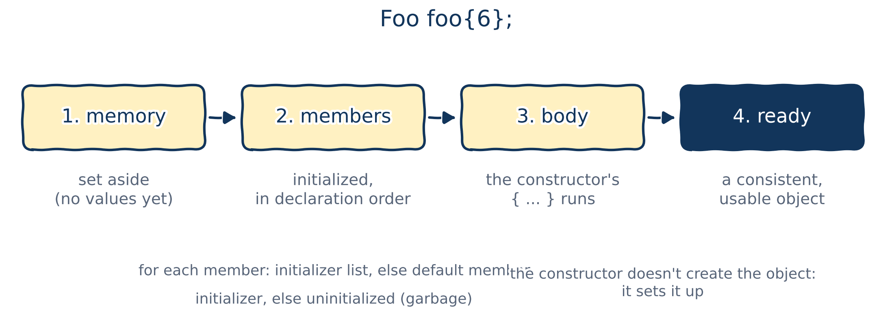
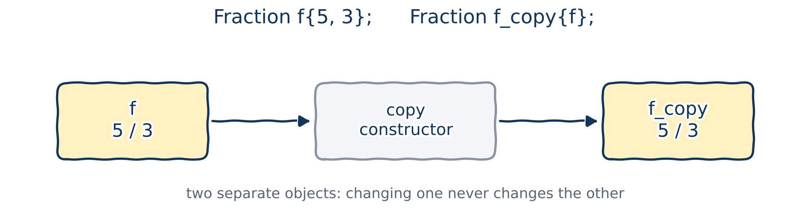

# Member access

## Public and private

In Chapter 10 we used `struct`s everywhere, which showed that a `struct` is almost the same as a `class`. The one difference that matters here:

- the members of a `struct` are **public** by default;
- the members of a `class` are **private** by default.

Now let's see what `public` and `private` actually mean.

## An analogy

{fig-alt="A tired student walks home past a noisy public park and a quiet, warm private house. Thinking: public... private... sigh... the park it is." width="38%"}

You're tired on the way home and want to sit down somewhere. Two options:

- The park, full of screaming kids. It's `public`: you **can** go in.
- The warm, quiet house with the TV. It's `private`: you **can't**.

It's not about what you want; it's about what you're allowed to do.

## Access levels

Every member of a class type has an **access level**, which decides who may use it:

1. `public`: anyone;
2. `private`: only the class's own members;
3. `protected`: we'll meet this one in Chapter 14, with inheritance.

Code that isn't a member of the class, like `main()`, is called **the public**.

## Members of a `struct` are public by default

::: {.columns}
::: {.column width="72%"}
```{.cpp filename="struct_public_by_default.cpp"}

```
:::
::: {.column width="28%"}
```{.text .output}
-42/42/42
```

A **public member** can be used by anyone: by the class's own members, and by the public. Nothing stops this nonsense date.
:::
:::

## Members of a `class` are private by default

```{.cpp filename="class_private_by_default.cpp" .no-compile}

```

```{.text .output .compiler}
error: no matching function for call to 'Date::Date(<brace-enclosed initializer list>)'
error: 'int Date::day' is private within this context
error: 'void Date::print() const' is private within this context
```

A **private member** can only be used by other members of the same class, never by the public.

## Setting access levels with access specifiers

::: {.columns}
::: {.column width="72%"}
```{.cpp filename="access_specifier_example.cpp"}

```
:::
::: {.column width="28%"}
```{.text .output}
2026/2/26
```

An **access specifier**, `public:`, `private:` or `protected:`, sets the access level of every member that follows it.
:::
:::

The usual layout: the **public interface** first (what users of the class need), then the **private** details.

## Access levels at a glance

| Access level | Specifier | Members of the class | Derived classes | The public |
|:---|:---|:---|:---|:---|
| Public | `public:` | yes | yes | yes |
| Protected | `protected:` | yes | yes | no |
| Private | `private:` | yes | no | no |

Don't worry about the middle column yet: derived classes come with inheritance, in Chapter 14. Notice the triangle of "yes" and the triangle of "no".

`struct` and `class` really are interchangeable: make every member of a `class` `public` and it acts like a `struct`, and vice versa.

## Access is per class, not per object {.dense-code}

::: {.columns}
::: {.column width="72%"}
```{.cpp filename="access_level_per_class_basis.cpp"}

```
:::
::: {.column width="28%"}
```{.text .output}
Joe says hello to Kate
```

`greet()` reads `other.name`, a private member of a *different* object. That's allowed: a member function of `Person` may use the private members of **any** `Person`.

Easy to miss, and a real headache if you don't know it!
:::
:::

## Naming private member variables

Many programmers prefix private member variables with `m_`. Here's why:

```{.cpp}
void set_name(const std::string& name) {
    name = name; // which name is which? This assigns the parameter to itself!
}
```

The parameter `name` **shadows** (hides) the member `name`. Write the member as `m_name`, or `name_`, and the problem disappears: `m_name = name;`.

::: {.fragment}
**Why mention it at all?** You'll read code like this all your career. But the `m_` prefix is declining: many big projects use a trailing underscore (`name_`) or no decoration at all. And modern C++ gives us better tools, as you'll see later today.
:::

## What real libraries do

Click the links:

- **Google**: a trailing underscore, `variable_`.
- **PyTorch** (the famous machine-learning library): no prefix, no suffix. [An example](https://github.com/pytorch/pytorch/blob/main/torch/csrc/api/include/torch/nn/modules/linear.h), lines 68–75.
- **deal.II** (a famous finite element library): no prefix, no suffix. [An example](https://github.com/dealii/dealii/blob/master/include/deal.II/fe/fe.h), lines 2522–2721.

::: {.fragment}
Real-world code looks complicated. Well, you want a six-figure salary and you want it to look simple?
:::

::: {.fragment}
::: {.callout-important title="A word about GenAI"}
I'm not against GenAI chatbots. But you can hate me for saying this: if you get ChatGPT or Gemini to write your solutions for programming courses, how do you expect to get, and keep, a job in industry? **Just think about that!**
:::
:::

# A detour: aggregates and member selection

## Aggregates {.dense-code}

To understand constructors, we need one more idea, and to finish off pointers from Chapter 08.

- In C++, an **aggregate** is (roughly) a class type with **only public data members** and no user-written constructors. A plain `struct` is the typical example.
- An aggregate can be initialized directly from a list of values: **aggregate initialization**.

::: {.columns}
::: {.column width="72%"}
```{.cpp filename="aggregate_initialization.cpp"}

```
:::
::: {.column width="28%"}
```{.text .output}
60000 45000
khiem: 42, 0
```

::: {.callout-tip title="Best practice"}
Prefer the braced form without `=`.
:::
:::
:::

## Member selection through a reference

A reference acts just like the object itself, so we select its members with `.` as usual:

::: {.columns}
::: {.column width="72%"}
```{.cpp filename="reference_selection_operator.cpp"}

```
:::
::: {.column width="28%"}
```{.text .output}
Id: 1
Age: 34
Wage: 68000
```
:::
:::

## Member selection through a pointer: what's wrong?

```{.cpp filename="pointers_to_structs_select_members_error.cpp" .no-compile}

```

::: {.fragment}
```{.text .output .compiler}
error: request for member 'id' in 'ptr', which is of pointer type 'Employee*'
(maybe you meant to use '->' ?)
```

`ptr` is not an `Employee`; it holds the *address* of one. (And no, my salary of 4.2 × 10^20^ is not the error.)
:::

## Fix 1: dereference first

::: {.columns}
::: {.column width="72%"}
```{.cpp filename="pointers_to_structs_select_members_deref.cpp"}

```
:::
::: {.column width="28%"}
```{.text .output}
4.2e+20
```

Now both my salary and my code are fine. The parentheses matter: `*ptr.wage` would mean `*(ptr.wage)`.
:::
:::

## Fix 2: the arrow operator `->`

::: {.columns}
::: {.column width="72%"}
```{.cpp filename="pointers_to_structs_select_members_arrow.cpp"}

```
:::
::: {.column width="28%"}
```{.text .output}
4.2e+20
```
:::
:::

The **arrow operator**, `->`, selects a member through a pointer: `ptr->wage` means exactly `(*ptr).wage`, just easier to read and type.

::: {.callout-tip title="Best practice"}
Use `.` with objects and references, and `->` with pointers.
:::

# Constructors

## Why do we need constructors?

In Introductory Programming 2 you wrote constructors in Python, as `__init__(self, ...)`. They don't just copy values (`self.age = age`); they also **check** them: is `age < 0`? Is the `id` unique? Is the birth date a real date?

::: {.fragment}
A `struct` with public members can use aggregate initialization. A class with **private** members can't:

```{.cpp filename="aggregate_init_private_error.cpp" .no-compile}

```

```{.text .output .compiler}
error: no matching function for call to 'Foo::Foo(<brace-enclosed initializer list>)'
```
:::

## ...and that's a good thing

Refusing aggregate initialization for classes with private members makes sense:

- it would require the user to know the class's **private** layout, exactly what we're trying to hide;
- if the class has an **invariant**, such as "working age is between 18 and 65", we'd be relying on every user to respect it.

So C++ classes have **constructors**, which can initialize the members *and* check the values, just like `__init__` in Python.

You can write constructors for a `struct` too; people just rarely do.

## Constructors

A **constructor** is a special member function that is called **automatically** when an object of a (non-aggregate) class type is created. The compiler picks the constructor that matches the initial values given, just as it picks among overloaded functions (Chapter 05).

{fig-alt="Creating Foo foo{6}: 1, memory is set aside; 2, members are initialized in declaration order; 3, the constructor body runs; 4, the object is ready. Each member gets its value from the initializer list, else its default member initializer, else it stays uninitialized." width="84%"}

::: {.callout-important title="Key idea"}
A constructor doesn't *create* the object: the memory already exists. It **sets the object up**, so that afterwards it's in a consistent, usable state.
:::

## Writing a constructor

- A constructor has **the same name as the class**, with the same capitalization.
- It has **no return type**, not even `void`.
- A class with a user-written constructor is no longer an aggregate.

```{.cpp}
class Student {
private:
    std::string name{};
    int age{};
    int id{};

public:
    Student(const std::string& new_name, int new_age, int new_id) {
        // set up the members here: does this remind you of __init__?
    }
};
```

## A first constructor {.dense-code}

```{.cpp filename="basic_constructor_example.cpp"}

```

```{.text .output}
Vector2D(4.2, 2.4) constructed
(4.2, 2.4)
```

# Member initializer lists

## Assigning in the body, Python style {.dense-code}

::: {.columns}
::: {.column width="72%"}
```{.cpp filename="mimic_python_constructor_01.cpp"}

```
:::
::: {.column width="28%"}
```{.text .output}
Foo(6, 7)
```

This works, but we had to invent new names, `x_in` and `y_in`. Can we keep `x` and `y`, like `self.x = x` in Python?
:::
:::

## `this`: C++'s `self` {.dense-code}

::: {.columns}
::: {.column width="72%"}
```{.cpp filename="mimic_python_constructor_02.cpp"}

```
:::
::: {.column width="28%"}
```{.text .output}
Foo(6, 7)
```

In every member function, **`this`** points at the implicit object. So `this->x` is the member; plain `x` is the parameter.

::: {.callout-note title="Coming from Python"}
`this` plays the role of `self`, but it's never a parameter, and you only need it when a name is ambiguous.
:::
:::
:::

## The member initializer list {.dense-code}

Modern C++ has a better way than assigning in the body: the **member initializer list**.

::: {.columns}
::: {.column width="72%"}
```{.cpp filename="member_initializer_list.cpp"}

```
:::
::: {.column width="28%"}
```{.text .output}
Foo(6, 7) constructed
Foo(6, 7)
```

It comes after the parameter list and **starts with a colon**: each member, its value in braces, separated by commas. In `x{x}`, the outer `x` can only be a member, so there's no ambiguity.
:::
:::

## Why is it better than assignment?

**Member initializer list,** `: x{x}`

- **Initialization, not assignment:** each member is created with its value, in one step.
- **Required for `const` and reference members**, which can't be left without a value and assigned later.
- **Faster** for class-type members: no default construction followed by assignment.

**Assignment in the body,** `this->x = x;`

1. Each member is first initialized: with its default member initializer if it has one, otherwise left with a garbage value.
2. Then the body runs, and the parameter is assigned over it.

## Initializer list or assignment?

| | Member initializer list `: x{x}` | Assignment in the body `this->x = x` |
|:---|:---|:---|
| What happens | direct initialization | default initialization, then assignment |
| Efficiency | faster: no double work | slower for complex members |
| `const` and reference members | works | doesn't compile |
| Order | always the **declaration** order in the class | the order of the statements |

::: {.callout-tip title="Best practice"}
Initialize members in the member initializer list, not by assignment in the constructor body. List them in the same order as they're declared: `-Wall` warns if you don't.
:::

## Formatting the member initializer list

C++ doesn't care about spaces and line breaks, so you'll see several styles:

::: {.columns}
::: {.column width="33%"}
```{.cpp}
Foo(int x, int y) : x{x}, y{y} {}
```
:::
::: {.column width="33%"}
```{.cpp}
Foo(int x, int y) :
    x{x},
    y{y}
{}
```
:::
::: {.column width="33%"}
```{.cpp}
Foo(int x, int y)
    : x{x}
    , y{y}
{}
```
:::
:::

If the list is short, one line is fine. Otherwise, the third style is easiest to read and to edit.

## Which initializer wins? {.dense-code}

::: {.columns}
::: {.column width="72%"}
```{.cpp filename="different_initializers.cpp"}

```
:::
::: {.column width="28%"}
```{.text .output}
Foo(6, 42, 0)
```

1. In the member initializer list? Use that value.
2. Else, a default member initializer? Use that.
3. Else, it's **uninitialized**. The `0` is luck: reading `z` is undefined behaviour, and g++ doesn't even warn.
:::
:::

## The constructor body

The body is usually **empty**: the member initializer list does the initializing. Use the body for anything else the object needs, such as checking an invariant, opening a file, or allocating memory (Chapter 09).

```{.cpp}
class Fraction {
private:
    int numerator{};
    int denominator{};

public:
    Fraction(int numerator, int denominator)
        : numerator{numerator}, denominator{denominator}
    {
        // Invariant: the denominator must not be zero.
        // The body is the place to check it, and deal with it.
    }
};
```

# Default constructors

## The default constructor

A **default constructor** is one that can be called with **no arguments**.

::: {.columns}
::: {.column width="72%"}
```{.cpp filename="default_constructor_example.cpp"}

```
:::
::: {.column width="28%"}
```{.text .output}
Foo default constructed
Foo default constructed
```
:::
:::

For a class with a default constructor, **value initialization** `Foo foo1{};` and **default initialization** `Foo foo2;` both call it.

## Default arguments make a default constructor {.dense-code}

If every parameter has a default argument (Chapter 05), the constructor can be called with no arguments, so it's a default constructor too:

```{.cpp filename="constructor_with_default_arguments.cpp"}

```

```{.text .output}
Foo(0, 0) constructed
Foo(6, 7) constructed
```

## Overloaded constructors {.dense-code}

Constructors are functions, so they can be overloaded:

```{.cpp filename="overloaded_constructors.cpp"}

```

```{.text .output}
Foo constructed
Foo(6, 7) constructed
```

## But only one default constructor! {.dense-code}

```{.cpp filename="overloaded_default_constructors_error.cpp" .no-compile}

```

```{.text .output .compiler}
error: call of overloaded 'Foo(<brace-enclosed initializer list>)' is ambiguous
```

Both constructors can be called with no arguments, so `Foo foo{}` is ambiguous (Chapter 05's ambiguous matches, again).

## The implicit default constructor

::: {.columns}
::: {.column width="62%"}
```{.cpp filename="implicit_default_constructor.cpp"}

```
:::
::: {.column width="38%"}
If a class declares **no constructors at all**, the compiler writes a public **implicit default constructor**, equivalent to:

```{.cpp}
public:
    Foo() {}
```

no parameters, no initializer list, an empty body.
:::
:::

## Writing any constructor removes it

```{.cpp filename="killing_implicit_default_constructor.cpp" .no-compile}

```

```{.text .output .compiler}
error: no matching function for call to 'Foo::Foo(<brace-enclosed initializer list>)'
```

Declare **any** constructor yourself, and the compiler stops writing the implicit default one. If you still need it, you must ask for it.

## `= default`: "compiler, write the usual one" {.dense-code}

::: {.columns}
::: {.column width="72%"}
```{.cpp filename="explicit_default_constructor.cpp"}

```
:::
::: {.column width="28%"}
```{.text .output}
Foo(0, 0)
Foo(6, 7)
```
:::
:::

`Foo() = default;` asks the compiler to generate the default constructor it would normally have written: an **explicitly defaulted default constructor**.

# Copy constructors

## Copying objects

You've already copied objects, in your assignments:

::: {.columns}
::: {.column width="72%"}
```{.cpp filename="copy_constructor_vector.cpp"}

```
:::
::: {.column width="28%"}
```{.text .output}
original[0]: 1.1
copy1[0]:    99.9
```
:::
:::

All three forms create a new vector as an independent copy of `original`. How does that work? Let's find out with our own class.

## How does `Fraction f_copy{f}` work? {.dense-code}

::: {.columns}
::: {.column width="78%"}
```{.cpp filename="copy_constructor_intro.cpp"}

```
:::
::: {.column width="22%"}
```{.text .output}
5/3
5/3
```

We never wrote a constructor taking a `Fraction`...

::: {.fragment}
...but the compiler did: the **copy constructor**.
:::
:::
:::

## The copy constructor

{fig-alt="Fraction f_copy{f}: f, holding 5/3, goes through the copy constructor to produce f_copy, also 5/3. Two separate objects: changing one never changes the other." width="78%"}

- A **copy constructor** initializes a new object from an existing object of the same type.
- If you don't write one, the compiler writes a public **implicit copy constructor**, which copies every member.

## Writing your own copy constructor {.dense-code}

```{.cpp filename="fraction.h"}

```

The copy constructor's parameter is a `const` reference to another `Fraction`; it copies each member in the member initializer list.

## Using it

::: {.columns}
::: {.column width="64%"}
```{.cpp filename="copy_constructor_fraction.cpp"}

```
:::
::: {.column width="36%"}
```{.text .output}
Copy constructor called
5/3
```
:::
:::

The `Fraction` class now lives in `fraction.h`, so the next examples can simply `#include` it.

## Copy constructor rules

::: {.callout-tip title="Best practice"}
- Prefer the **implicit** copy constructor, unless you have a specific reason to write your own.
- A copy constructor should only copy, with **no side effects**: the compiler is allowed to skip calling it (next slides!).
- Its parameter should be a **`const` reference**: `Fraction(const Fraction& other)`.
:::

Why must the parameter be a reference? If it were passed **by value**, calling the copy constructor would first need to copy the argument... using the copy constructor, which would first need to copy its argument... forever. The compiler refuses to compile that.

## Pass by value calls the copy constructor

::: {.columns}
::: {.column width="64%"}
```{.cpp filename="copy_constructor_pass_by_value.cpp"}

```
:::
::: {.column width="36%"}
```{.text .output}
Copy constructor called
5/3
```
:::
:::

Passing by value copies the argument into the parameter (Chapter 02), and for a class type that copy is made by the copy constructor. Another reason to pass class objects by `const` reference!

## Return by value and copy elision {.dense-code}

::: {.columns}
::: {.column width="64%"}
```{.cpp filename="copy_constructor_return_by_value.cpp"}

```
:::
::: {.column width="36%"}
```{.text .output}
Copy constructor called
0/1
Copy constructor called
1/2
Copy constructor called
4/2
```
:::
:::

In principle there are **five** copies: three into `print_fraction()`'s parameter and two for `return f;`. The output shows only three. The compiler skipped the copies in `return f;`, constructing `f` directly in the caller's object. This is **copy elision**.

## `= default` and `= delete` for copying

Ask for the implicit copy constructor explicitly, or forbid copying altogether:

```{.cpp}
Fraction(const Fraction& other) = default; // "the usual copy, please"
Fraction(const Fraction& other) = delete;  // "no copies allowed"
```

With `= delete`, any attempt to copy is a compile error:

```{.text .output .compiler}
error: use of deleted function 'Fraction::Fraction(const Fraction&)'
```

Try both yourself: `default_copy_constructor_using_default.cpp` and `remove_copy_constructor_using_delete.cpp` are on GitHub and Moodle.

# Wrapping up

## Summary

- `public` members can be used by anyone; `private` members only by the class's own members. Access is per **class**, not per object.
- Access specifiers set the access level; `struct` defaults to `public`, `class` to `private`.
- Select members with `.` through objects and references, and with `->` through pointers.
- A **constructor** sets up a new object. It has the class's name and no return type. Initialize members in the **member initializer list**.
- A **default constructor** takes no arguments. Writing any constructor removes the implicit one; `= default` brings it back.
- The **copy constructor** makes an object from another of the same type. It's used when passing by value, and often skipped on return (copy elision).

## Keep learning

Explore these on your own, with Google Gemini in Guided Learning mode or on [learncpp.com](https://www.learncpp.com):

1. [Public and private members and access specifiers](https://www.learncpp.com/cpp-tutorial/public-and-private-members-and-access-specifiers/)
2. [Constructor member initializer lists](https://www.learncpp.com/cpp-tutorial/constructor-member-initializer-lists/)
3. [Introduction to the copy constructor](https://www.learncpp.com/cpp-tutorial/introduction-to-the-copy-constructor/)
4. [Class initialization and copy elision](https://www.learncpp.com/cpp-tutorial/class-initialization-and-copy-elision/)

**Next up, Chapter 12:** more about classes, including the `this` pointer in depth and destructors.
