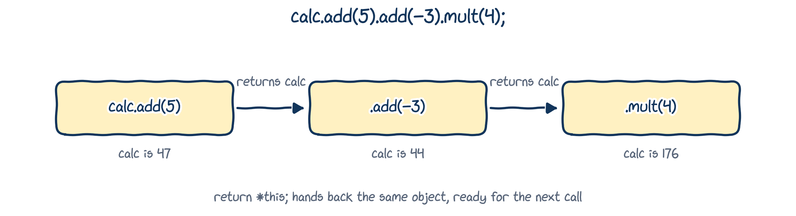
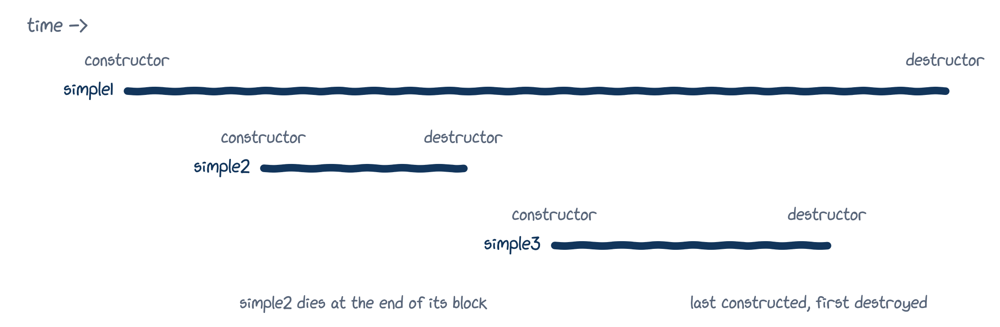
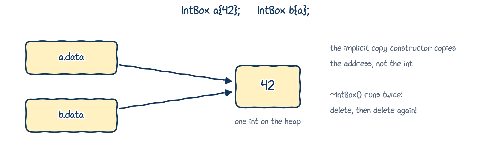

# The hidden `this` pointer

## From `self` to `this`

In Python, every method's first parameter, by convention called `self`, refers to the object the method was called on:

```{.python}
class Fraction:
    def __init__(self, numerator, denominator):
        self.numerator = numerator
        self.denominator = denominator
```

In Chapter 11 we met C++'s version, `this`. Now let's look at it properly: it plays the role of `self`, but it's a **pointer**, and you never write it as a parameter.

## The hidden `this` pointer

::: {.columns}
::: {.column width="72%"}
```{.cpp filename="hidden_pointer_this.cpp"}

```
:::
::: {.column width="28%"}
```{.text .output}
0
42.5
```

Inside every member function, **`this`** holds the address of the implicit object. Select its members with `->` (Chapter 11).
:::
:::

## How is `this` set?

When we write `simple.set_value(42.5);`, the compiler (conceptually) turns it into an ordinary function call, with the object's address as an extra, hidden argument:

```{.cpp}
Simple::set_value(&simple, 42.5); // not real C++: just what happens underneath
```

So in each call, `this` points at whichever object the function was called on:

```{.cpp}
Simple a{1.0}; // inside the constructor: this == &a
Simple b{2.0}; // inside the constructor: this == &b
a.set_value(12); // inside set_value():  this == &a
b.set_value(21); // inside set_value():  this == &b
```

In a `const` member function, `this` points to a `const` object: that's where Chapter 10's error message "*passing 'const Date' as 'this' argument*" came from.

## When to write `this` explicitly

Most of the time we don't: a plain `value` already means `this->value`. We need it when a parameter has the **same name** as a member:

```{.cpp}
struct Something {
    double data{};

    void set_data(double data) {
        this->data = data; // this->data is the member; data is the parameter
    }
};
```

## Returning `*this`: method chaining

You've been chaining calls since Chapter 01:

```{.cpp}
std::cout << "Hello, " << user_name;
// is evaluated as
(std::cout << "Hello, ") << user_name;
```

`(std::cout << "Hello, ")` prints, and then **returns `std::cout` itself**, ready for the next `<<`. Our member functions can do the same: return `*this`, the implicit object, by reference.

This is called **method chaining** (or *function chaining*). We'll come back to it in Chapter 13, when we write our own `<<`.

## Method chaining in action {.dense-code}

::: {.columns}
::: {.column width="60%"}
```{.cpp filename="method_chaining_example.cpp"}

```
:::
::: {.column width="40%"}
```{.text .output}
176
```

Each function returns a **reference** to the same object. Return by value instead, and each call would work on a copy!
:::
:::

## Method chaining, in a picture

{fig-alt="calc.add(5).add(-3).mult(4): calc.add(5) returns calc, which is now 47; the next call returns calc again; and so on, up to 176. return *this hands back the same object, ready for the next call." width="90%"}

`calc.add(5)` changes `calc` and returns `calc` itself, so `.add(-3)` is called on `calc` too, and so on. That's exactly how `std::cout << a << b` works.

# Destructors

## The cleanup problem

Remember memory leaks from Chapter 09? Here's a class that allocates memory when it's created:

```{.cpp filename="database_helper_without_destructor.cpp"}

```

## AddressSanitizer agrees

```{.text .terminal}
$ g++ -std=c++20 -g -fsanitize=address database_helper_without_destructor.cpp
$ ./a.out
Connected to 127.0.0.1:5432/my_database
==3376==ERROR: LeakSanitizer: detected memory leaks
Direct leak of 32 byte(s) in 1 object(s) allocated from:
    #1 in DatabaseHelper::DatabaseHelper(const std::string&) ...cpp:10
SUMMARY: AddressSanitizer: 59 byte(s) leaked in 2 allocation(s).
```

(Output shortened.) `db` is destroyed at the end of its block, but the `std::string` it created with `new` on line 10 is never deleted. And `connection` is private, so `main()` can't delete it either.

## A `cleanup()` function? {.dense-code}

::: {.columns}
::: {.column width="70%"}
```{.cpp filename="database_helper_with_cleanup.cpp"}

```
:::
::: {.column width="30%"}
```{.text .output}
Connected to 127.0.0.1:5432/my_database
Cleaned up
```

It works, but **every** user must **remember** to call `cleanup()`. Someone, someday, will forget.
:::
:::

## Destructors to the rescue

A **destructor** is a special member function that runs **automatically** when an object is destroyed, so the class can clean up after itself.

- Its name is the class name with a **tilde** in front: `~Simple()`.
- It takes **no arguments** and has **no return type**.
- A class has **exactly one** destructor.

Constructors set an object up; destructors tidy it away.

## A first destructor

::: {.columns}
::: {.column width="60%"}
```{.cpp filename="destructor_example.cpp"}

```
:::
::: {.column width="40%"}
```{.text .output}
Constructing 1
Constructing 2
Destructing 2
Constructing 3
Destructing 3
Destructing 1
```
:::
:::

## When do destructors run?

{fig-alt="A timeline. simple1 lives from its constructor to the end of main. simple2 is constructed later and destroyed at the end of its inner block. simple3 is constructed after that and destroyed before simple1: last constructed, first destroyed." width="84%"}

- A local object is destroyed at the end of the block where it was created, just like local variables in Chapter 02.
- Objects in the same block are destroyed in **reverse** order of creation: last constructed, first destroyed.
- If you don't write a destructor, the compiler writes an empty **implicit destructor**. If there's nothing to clean up, that's all you need.

## The database helper, fixed {.dense-code}

::: {.columns}
::: {.column width="70%"}
```{.cpp filename="database_helper.cpp"}

```
:::
::: {.column width="30%"}
```{.text .output}
Connected to 127.0.0.1:5432/my_database
Disconnecting from 127.0.0.1:5432/my_database
db is gone, and so is its memory
```

Nothing to remember, and AddressSanitizer reports no leaks.
:::
:::

## RAII: let objects clean up after themselves

The pattern we just used has a name: **RAII**, *Resource Acquisition Is Initialization* (a famously bad name for a great idea).

- **Acquire** a resource (memory, a file, a network connection) in the **constructor**.
- **Release** it in the **destructor**.

Then the resource lives exactly as long as the object, and cleanup can never be forgotten.

::: {.callout-important title="Key idea"}
This is how `std::string`, `std::vector` and `std::unique_ptr` (Chapter 09) manage their memory. Now you know how it's done!
:::

## A class template that owns an array {.dense-code}

::: {.columns}
::: {.column width="72%"}
```{.cpp filename="array_with_destructor.cpp"}

```
:::
::: {.column width="28%"}
```{.text .output}
4.2 4.2
Memory returned
```

`FixedArray` is a **class template** with a type parameter `T` and a value parameter `N` (more on class templates shortly).

Note `delete[]`, and `i < N`: writing `data[N]` would be out of bounds.
:::
:::

## Watch out: copying an object that owns memory {.dense-code}

::: {.columns}
::: {.column width="62%"}
```{.cpp filename="shallow_copy_problem.cpp"}

```
:::
::: {.column width="38%"}
```{.text .terminal}
$ ./shallow_copy_problem
42 42
free(): double free
detected in tcache 2
Aborted
```

It printed fine, then crashed on the way out. Why?
:::
:::

## What went wrong: a shallow copy

{fig-alt="IntBox b{a} copies the pointer, not the int: a.data and b.data both point at the same int on the heap, so ~IntBox runs twice: delete, then delete again." width="80%"}

The implicit copy constructor copies each member. The member is a **pointer**, so `b` gets the same address as `a`: a **shallow copy**. When `main()` ends, both destructors delete the same `int`. Undefined behaviour, and here a crash.

## The rule of three (and of zero)

::: {.callout-tip title="Best practice: the rule of three"}
If a class needs a **destructor**, it almost certainly also needs its own **copy constructor** and **copy assignment** (Chapter 13), or must forbid copying with `= delete` (Chapter 11).
:::

Better still, follow the **rule of zero**: let members that already manage themselves (`std::vector`, `std::string`, `std::unique_ptr`) own the resources. Then you need no destructor, and the implicit copy does the right thing.

# Class templates

## The same problem, for classes

We met this problem for functions in Chapter 06:

```{.cpp}
struct PairInt {
    int first{};
    int second{};
};

struct PairDouble {
    double first{};
    double second{};
};
```

And a pair of `std::vector<double>`s? Of strings? You've already used the answer: `std::vector<double>` is a **class template**.

## Class templates

A **class template** is a recipe for making class types, just as a function template is a recipe for functions.

::: {.columns}
::: {.column width="65%"}
```{.cpp filename="pair_class_template.cpp"}

```
:::
::: {.column width="35%"}
```{.text .output}
5 6
1.2 3.4
7.8 9
```

Start with `template <typename T>`, then write the `struct` or `class` as usual, using `T`. Use it as `Pair<int>`, `Pair<double>`, ...
:::
:::

## What the compiler generates {.dense-code}

::: {.columns}
::: {.column width="65%"}
```{.cpp filename="pair_class_template_compiler_pov.cpp"}

```
:::
::: {.column width="35%"}
```{.text .output}
5 6
1.2 3.4
```

As with function templates, the compiler stamps out one real class per type you use, `Pair<int>` and `Pair<double>`. You never write `template <>` like this yourself: it just shows you what happens.
:::
:::

## Class templates and function templates together {.dense-code}

::: {.columns}
::: {.column width="72%"}
```{.cpp filename="class_template_and_func_template.cpp"}

```
:::
::: {.column width="28%"}
```{.text .output}
6 is larger
3.4 is larger
```
:::
:::

For the call `max(p1)`, the compiler instantiates `Pair<int>` *and* the function `int max<int>(Pair<int> p)`. `constexpr` (Chapter 06) lets the compiler run `max()` at compile time when the arguments are known then.

## Several template types {.dense-code}

::: {.columns}
::: {.column width="65%"}
```{.cpp filename="class_multiple_template_types.cpp"}

```
:::
::: {.column width="35%"}
```{.text .output}
[1, 2.3]
[4.5, 6]
[7, 8]
```
:::
:::

## `std::pair`: the standard library's version

Pairs of values are so common that the standard library has exactly this class template, `std::pair` in `<utility>`, with members `first` and `second`:

```{.cpp filename="std_pair_example.cpp"}

```

```{.text .output}
max(p1) = 2.3
max(p2) = 6
1 2.3
```

# Friends

## Why friends?

You've written `std::cout << x;` countless times. `<<` is an operator with two operands, `std::cout` and `x`, much like `a + b`.

For our own classes, we'd love to write `std::cout << polynomial;`. The function behind that `<<` needs to see the polynomial's **private** data, but it can't be a member of our class (Chapter 13 explains why).

C++'s answer: make it a **friend**.

## Friendship

- Inside a class, a **friend declaration** (`friend ...;`) names a function or class that gets **full access** to this class's private (and protected) members.
- That function or class is a **friend**.

::: {.callout-important title="Key idea"}
Friendship is always **granted** by the class whose members will be accessed. It can't be claimed by the function or class that wants access.
:::

## A friend non-member function {.dense-code}

::: {.columns}
::: {.column width="72%"}
```{.cpp filename="friend_nonmember_function.cpp"}

```
:::
::: {.column width="28%"}
```{.text .output}
42
```

`print()` is an ordinary non-member function, but `Accumulator` declared it a friend, so it may read `accumulator.value`.
:::
:::

## Defining a friend inside the class

::: {.columns}
::: {.column width="72%"}
```{.cpp filename="friend_nonmember_function_inside_class.cpp"}

```
:::
::: {.column width="28%"}
```{.text .output}
5
```

Even though `print()` is defined inside `Accumulator`, it is **not** a member: we call it as `print(acc)`, not `acc.print()`.
:::
:::

## A friend of several classes {.dense-code}

::: {.columns}
::: {.column width="72%"}
```{.cpp filename="function_friend_with_multiple_classes.cpp"}

```
:::
::: {.column width="28%"}
```{.text .output}
12 degrees, 10% humidity
```

`class Humidity;` is a forward declaration of a class, needed because `Temperature` mentions `Humidity` before it's defined.
:::
:::

## Prefer non-friend functions {.dense-code}

::: {.columns}
::: {.column width="72%"}
```{.cpp filename="prefer_nonfriend_to_friend_01.cpp"}

```
:::
::: {.column width="28%"}
```{.text .output}
5
```

This works, but `print()` depends on a private detail. Rename `value`, and `print()` breaks too.
:::
:::

## ...when a public member will do {.dense-code}

::: {.columns}
::: {.column width="72%"}
```{.cpp filename="prefer_nonfriend_to_friend_02.cpp"}

```
:::
::: {.column width="28%"}
```{.text .output}
5
```

With a public getter, `print()` needs no friendship, and doesn't care what the member is called.
:::
:::

::: {.callout-tip title="Best practice"}
Prefer non-friend functions when the public interface is enough.
:::

## Friend classes {.dense-code}

::: {.columns}
::: {.column width="72%"}
```{.cpp filename="friend_class_example.cpp"}

```
:::
::: {.column width="28%"}
```{.text .output}
5 6.7
```

A **friend class** may use the private members of the class that befriends it: every member function of `Display` can read a `Storage`'s private data.
:::
:::

## Friendship has limits

1. **It isn't mutual.** `Display` is a friend of `Storage`, but `Storage` is not a friend of `Display`, unless `Display` says so too.
2. **It isn't transitive.** If `A` is a friend of `B`, and `B` is a friend of `C`, `A` is still not a friend of `C`.
3. **It isn't inherited.** If `A` befriends `B`, classes derived from `B` (Chapter 14) are not friends of `A`.

## Friend member functions (self-study)

Instead of befriending a whole class, you can befriend a single **member function**. It takes some care with the order of definitions, so this part is for **self-study**. We'll build it up in three attempts.

## Attempt 1: the friend's class isn't defined yet {.dense-code}

::: {.columns}
::: {.column width="72%"}
```{.cpp filename="friend_member_function_01.cpp" .no-compile}

```
:::
::: {.column width="28%"}
```{.text .output .compiler}
error: invalid use of incomplete type 'class Display'
```

To befriend `Display::show`, the compiler must have seen the **full definition** of `Display`, not just a forward declaration.
:::
:::

## Attempt 2: swap the classes around {.dense-code}

::: {.columns}
::: {.column width="72%"}
```{.cpp filename="friend_member_function_02.cpp" .no-compile}

```
:::
::: {.column width="28%"}
```{.text .output .compiler}
error: 'Storage' does not name a type
```

Now `Display::show()` mentions `Storage` before the compiler has heard of it.
:::
:::

## Attempt 3: declare first, define later {.dense-code}

::: {.columns}
::: {.column width="72%"}
```{.cpp filename="friend_member_function_03.cpp"}

```
:::
::: {.column width="28%"}
```{.text .output}
5 6.7
```

1. Forward-declare `Storage`.
2. *Declare* `show()`.
3. *Define* it after `Storage`.
:::
:::

# Wrapping up

## Summary

- **`this`** points at the implicit object. Write it when a parameter hides a member, and return `*this` by reference to allow **method chaining**.
- A **destructor** `~ClassName()` runs automatically when an object is destroyed. Objects in a block are destroyed in reverse order.
- **RAII**: acquire resources in the constructor and release them in the destructor. If you write a destructor, think about copying (**rule of three**); better, own nothing by hand (**rule of zero**).
- A **class template** is a recipe for classes: `Pair<int>`, `std::pair<int, double>`, `std::vector<double>`.
- A **friend** function or class may use a class's private members. Friendship is granted, not taken. Prefer non-friends when public members are enough.

## Keep learning

Explore these on your own, with Google Gemini in Guided Learning mode or on [learncpp.com](https://www.learncpp.com):

1. [The hidden `this` pointer and member function chaining](https://www.learncpp.com/cpp-tutorial/the-hidden-this-pointer-and-member-function-chaining/)
2. [Destructors](https://www.learncpp.com/cpp-tutorial/destructors/), and the [rule of three](https://en.cppreference.com/w/cpp/language/rule_of_three)
3. [Class templates](https://www.learncpp.com/cpp-tutorial/class-templates/)
4. [Friend classes and friend member functions](https://www.learncpp.com/cpp-tutorial/friend-classes-and-friend-member-functions/)

**Next up, Chapter 13:** operator overloading. We'll finally write our own `+` and `<<`.
