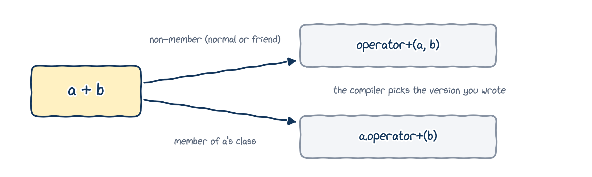
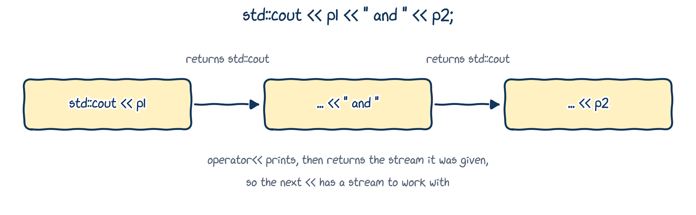

# Introduction to operator overloading

## Operators are functions

- Think of `1 + 2` as `add(1, 2)`: an operator is just a function with a special name and a convenient syntax.
- For our own `ComplexNumber` objects `a` and `b`, we'd like to write `a + b` instead of `add(a, b)` or `a.add(b)`.

In C++, operators really are implemented as functions, and we can **overload** them for our own types.

The words "in C++" matter: C and Java, for example, don't let you overload operators.

## Coming from Python: special methods

```{.python filename="complex_number_01.py"}

```

```{.text .output}
<__main__.ComplexNumber object at 0x7f3c2a1b2d50>
TypeError: unsupported operand type(s) for +: 'ComplexNumber' and 'ComplexNumber'
```

Python doesn't know how to print a `ComplexNumber`, or how to add two of them.

## In Python, special methods grant both wishes

```{.python filename="complex_number_02.py"}

```

```{.text .output}
a = 42 + 24i
a + b = 66 + 66i
```

C++ does the same job with functions called `operator<<` and `operator+`.

## How the compiler sees an operator

```{.cpp}
int x{42};
int y{24};
std::cout << x + y << '\n'; // x + y means operator+(x, y)
```

With `double x` and `double y`, the same `x + y` calls the `double` version instead: plain **overload resolution** (Chapter 05).

{fig-alt="a + b is turned into either operator+(a, b), a non-member function, or a.operator+(b), a member of a's class. The compiler picks the version you wrote." width="70%"}

## Without overloaded operators...

```{.cpp filename="operator_example_complex_number.cpp" .no-compile}

```

```{.text .output .compiler}
error: no match for 'operator+' (operand types are 'ComplexNumber' and 'ComplexNumber')
```

There's no built-in `+` for `ComplexNumber`: we have to tell the compiler what it means.

## ...and with them {.dense-code}

::: {.columns}
::: {.column width="72%"}
```{.cpp filename="operator_example_complex_number_fixed.cpp"}

```
:::
::: {.column width="28%"}
```{.text .output}
42 + 24i
24 + 42i
66 + 66i
```

This chapter explains every line of this program.
:::
:::

## Best practices (read at home)

::: {.callout-tip title="Best practice"}
- An overloaded operator should work on at least one type **you** defined.
- Keep each operator's meaning as close to its usual meaning as possible: `+` should add.
- If the meaning wouldn't be clear and intuitive, write a named function instead.
- Operators that don't change their operands (like `+`) should return their result **by value**.
- Operators that change their left operand (like `+=` and `=`) should return that operand **by reference**.
:::

# Arithmetic operators as friend functions

## Three ways to overload an operator

The arithmetic operators `+`, `-`, `*` and `/` take two operands, and all four are overloaded in exactly the same way. There are three ways to write them:

1. as a **friend** function;
2. as a **normal** (non-member, non-friend) function;
3. as a **member** function.

We start with friends, because they can read the private data of both operands.

## Our example class: `Pennies`

```{.cpp filename="class_pennies.cpp"}

```

- **`explicit`** stops the compiler from turning an `int` into a `Pennies` behind our back: `Pennies p = 42;` and passing `42` where a `Pennies` is expected won't compile. A penny count is a whole number, and we want every conversion to be on purpose.
- You write `Pennies{42}` when you mean it.

## Overloading `+` and `-` {.dense-code}

::: {.columns}
::: {.column width="72%"}
```{.cpp filename="overload_operators_plus_minus.cpp"}

```
:::
::: {.column width="28%"}
```{.text .output}
Together: 66
Difference: 18
```

`operator+` and `operator-` are **not** members; they're friends, so they may use `a.pennies` and `b.pennies`.
:::
:::

## The recipe

Overloading `+` is as simple as:

1. declaring a function named `operator+`;
2. giving it two parameters, one per operand (`const` references, since `+` doesn't change them);
3. picking a sensible return type (here, a new `Pennies` returned by value);
4. writing the body.

::: {.fragment}
**Your turn:** how would you make all of these work?

```{.cpp}
std::cout << (42 + mine).get_pennies();   std::cout << (mine + 42).get_pennies();
std::cout << (3 * mine).get_pennies();    std::cout << (mine * 3).get_pennies();
```

Start from `overload_operators_play_around.cpp`. My solution is in `overload_operators_play_around_solution.cpp`, but try first!
:::

## A friend can be defined inside the class

::: {.columns}
::: {.column width="72%"}
```{.cpp filename="friend_function_inside_class.cpp"}

```
:::
::: {.column width="28%"}
```{.text .output}
I have 66 pennies.
```

As in Chapter 12: a friend defined inside the class is still a **non-member** function.
:::
:::

## Operands of different types {.dense-code}

::: {.columns}
::: {.column width="72%"}
```{.cpp filename="vector3d_operands_of_different_types.cpp"}

```
:::
::: {.column width="28%"}
```{.text .output}
(43, 44, 45)
(43, 44, 45)
```

`42 + w` and `w + 42` are two **different** functions: the operands come in a different order. Overload both, just like any overloaded function.
:::
:::

## Implementing operators with other operators

To make `w + 42` give the same answer as `42 + w`, the second operator simply **calls** the first:

```{.cpp}
friend Vector3D operator+(const Vector3D& v, double s) {
    return s + v; // reuse operator+(double, const Vector3D&)
}
```

One real implementation, so there's only one place to fix if it's ever wrong.

# Operators as normal functions

## Friend or normal function?

We made `operator+` a friend because it needed the private member `pennies`. If a public getter gives it everything it needs, it doesn't have to be a friend:

```{.cpp}
// As a friend: reads the private members directly
friend Pennies operator+(const Pennies& a, const Pennies& b) {
    return Pennies{a.pennies + b.pennies};
}

// As a normal function: uses the public getter
Pennies operator+(const Pennies& a, const Pennies& b) {
    return Pennies{a.get_pennies() + b.get_pennies()};
}
```

That's the whole idea.

## A normal-function operator

::: {.columns}
::: {.column width="72%"}
```{.cpp filename="overload_operators_with_normal_functions.cpp"}

```
:::
::: {.column width="28%"}
```{.text .output}
I have 66 pennies.
```

Friends and normal functions behave almost identically. One difference: a friend's declaration in the class doubles as its **prototype**; a normal function needs its own. That matters when we split files.
:::
:::

## Normal-function operators with a header

::: {.columns}
::: {.column width="55%"}
```{.cpp filename="pennies/pennies.h"}

```
:::
::: {.column width="45%"}
```{.cpp filename="pennies/pennies.cpp"}

```

```{.cpp filename="pennies/main.cpp"}

```
:::
:::

## Building it

```{.text .terminal}
$ cd pennies
$ g++ -std=c++20 -Wall main.cpp pennies.cpp -o pennies
$ ./pennies
I have 66 pennies.
```

- Without the declaration of `operator+` in `pennies.h`, `main.cpp` couldn't use `mine + yours`: it's compiled on its own (Chapter 02).
- If `main.cpp` lives in another folder, include the header by its relative path, as in `main_pennies.cpp`: `#include "pennies/pennies.h"`.

# Overloading the I/O operators

## A `print()` function works, but... {.dense-code}

::: {.columns}
::: {.column width="76%"}
```{.cpp filename="point_with_print.cpp"}

```
:::
::: {.column width="24%"}
```{.text .output}
My point is Point(42, 24, 12) in Cartesian space.
```

`point.print()` breaks one output statement into three. We'd rather write `std::cout << point`, like Python's `__str__`.
:::
:::

## Overloading `operator<<`

`<<` is a binary operator too, just like `+`. In `std::cout << point`:

- the left operand is `std::cout`, an object of type **`std::ostream`**;
- the right operand is our `Point`.

So our function looks like this:

```{.cpp}
friend std::ostream& operator<<(std::ostream& out, const Point& p);
```

It can't be a member of `Point`: a member operator's left operand must be a `Point`. And it can't be a member of `std::ostream`, because we can't change the standard library.

## `operator<<` in action {.dense-code}

::: {.columns}
::: {.column width="76%"}
```{.cpp filename="point_overload_output_operator.cpp"}

```
:::
::: {.column width="24%"}
```{.text .output}
My points are Point(42, 24, 12) and Point(1, 2, 3)
```

Inside the function, `std::cout` is simply called `out`: a reference to whatever stream we're printing to.
:::
:::

## Why return `std::ostream&`?

{fig-alt="std::cout << p1 << \" and \" << p2: std::cout << p1 returns std::cout, so << \" and \" is applied to std::cout, which returns std::cout again, so << p2 works too. operator<< prints, then returns the stream it was given." width="88%"}

- **To allow chaining:** `operator<<` returns the stream it was given, so the next `<<` has a stream to work with. It's the same idea as returning `*this` in Chapter 12.
- **By reference:** `std::ostream` can't be copied, so returning it by value doesn't even compile.

## Overloading `operator>>` {.dense-code}

::: {.columns}
::: {.column width="72%"}
```{.cpp filename="point_overload_input_operator.cpp"}

```
:::
::: {.column width="28%"}
```{.text .terminal}
$ ./point_overload_input_operator
Enter a point: 1 2 3
You entered Point(1, 2, 3)
```

The mirror image of `<<`: the left operand is `std::cin`, a **`std::istream`**, and the `Point` parameter is **not** `const`, because we read into it.
:::
:::

# Operators as member functions

## Operators as member functions

When an operator is overloaded as a **member** function:

- it must be a member of the class of the **left** operand;
- the left operand becomes the implicit object, `*this`;
- the other operand becomes the only parameter.

Converting a friend operator into a member is easy, and no new rules are needed: it's just an ordinary member function with a special name.

## The friend version, again {.dense-code}

::: {.columns}
::: {.column width="72%"}
```{.cpp filename="overload_operator_plus_revisit.cpp"}

```
:::
::: {.column width="28%"}
```{.text .output}
I have 54 pennies.
```
:::
:::

## The member version {.dense-code}

::: {.columns}
::: {.column width="72%"}
```{.cpp filename="overload_operator_plus_member_function_01.cpp"}

```
:::
::: {.column width="28%"}
```{.text .output}
I have 54 pennies.
```

`mine + yours` now means `mine.operator+(yours)`. A member function can be defined outside the class, with `Pennies::` in front of its name.
:::
:::

## Members for `Pennies + int`, friends for `<<` {.dense-code}

::: {.columns}
::: {.column width="72%"}
```{.cpp filename="overload_operator_plus_member_function_02.cpp"}

```
:::
::: {.column width="28%"}
```{.text .output}
I have 54 pennies.
```

Watch out: `".\n"` (double quotes) is text. `'.\n'` (single quotes) would be a *multi-character literal*, which prints a strange number!
:::
:::

## `+=` as a member, `+` as a normal function {.dense-code}

::: {.columns}
::: {.column width="72%"}
```{.cpp filename="complex_plus_equal.cpp"}

```
:::
::: {.column width="28%"}
```{.text .output}
4 + 6i
```

`+=` changes its left operand, so it's a member returning `*this` by reference. `+` is then a normal function that takes `a` **by value** (a copy) and applies `+=` to it.
:::
:::

## Friend, normal or member? (read at home)

::: {.callout-tip title="Rules of thumb"}
- Assignment `=`, subscript `[]`, function call `()` and member selection `->` **must** be members: the language requires it.
- Unary operators (like `-x`): members.
- Binary operators that **don't change** their left operand (like `+`): normal functions (preferred) or friends.
- Binary operators that change their left operand, but whose left operand's class you can't change (like `<<` on `std::ostream`): normal functions or friends.
- Binary operators that change their left operand, in a class you can change (like `+=`): members.
:::

# Wrapping up

## Summary

- An operator is a function with a special name: `a + b` calls `operator+(a, b)` or `a.operator+(b)`.
- Overload operators as **friend**, **normal** or **member** functions. A member operator belongs to the left operand's class, which becomes `*this`.
- `+` returns a new object by value; `+=` changes `*this` and returns it by reference. Implement one operator in terms of another.
- `operator<<` and `operator>>` take a stream (`std::ostream&` or `std::istream&`) as the left operand, and return it by reference to allow chaining.
- Use `explicit` constructors to prevent unwanted conversions.
- Keep each operator's usual meaning; if in doubt, write a named function.

## Keep learning

Explore these on your own, with Google Gemini in Guided Learning mode or on [learncpp.com](https://www.learncpp.com):

1. [Overloading the arithmetic operators using friend functions](https://www.learncpp.com/cpp-tutorial/overloading-the-arithmetic-operators-using-friend-functions/)
2. [Overloading the I/O operators](https://www.learncpp.com/cpp-tutorial/overloading-the-io-operators/)
3. [Overloading operators using member functions](https://www.learncpp.com/cpp-tutorial/overloading-operators-using-member-functions/)
4. [Overloading the comparison operators](https://www.learncpp.com/cpp-tutorial/overloading-the-comparison-operators/), including C++20's `<=>`

**Next up, Chapter 14:** inheritance.
