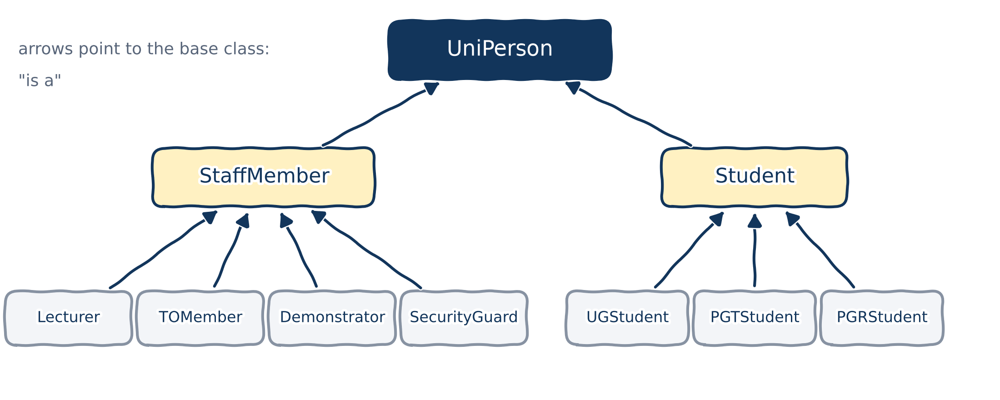
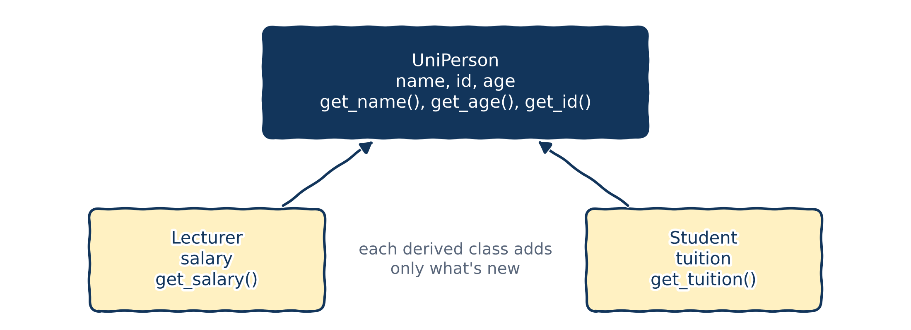
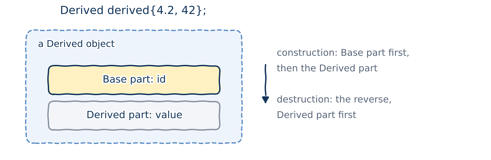
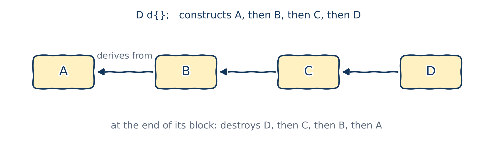
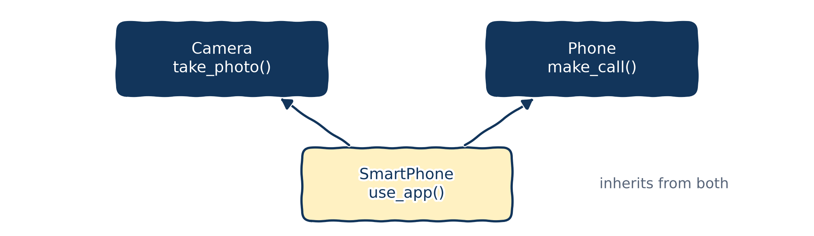

# Introduction to inheritance

## Shapes: "is a" and "has a"

You're building software that draws 2D shapes: rectangles, squares, polygons, circles, ellipses... One class per shape? Wait a minute:

::: {.columns}
::: {.column width="50%"}
**"Is a"** relationships:

- a `Square` **is a** `Rectangle`;
- a `Rectangle` **is a** `Polygon`;
- a `Circle` **is an** `Ellipse`;
- all of them **are** `Shape`s.
:::
::: {.column width="50%"}
**"Has a"** relationships:

- a `Polygon` **has a** list of `Point2D`s;
- an `Ellipse` **has a** centre (a `Point2D`) and two axis lengths `a` and `b`;
- a `Circle` is an `Ellipse` with `a == b`.
:::
:::

So why build all those classes separately? Drawing a square should just be drawing a rectangle with equal sides.

## Hierarchies

A **hierarchy** is a diagram showing how things are related.

{fig-alt="A hierarchy of shapes." width="60%"}

::: {.callout-warning title="Watch out"}
Everyday "is a" can mislead. A square *is* a rectangle, but if `Rectangle` has `set_width()`, a `Square` can't honour it without breaking its own rules. This classic trap is the *square–rectangle problem*. In code, "is a" must mean "can be used **anywhere** the base class is used".
:::

## The people of a university

If shapes don't convince you, look at our university:

- every **staff member** has a `name`, a `birthday` and an `ID`;
- every **student** has a `name`, a `birthday` and an `ID`;
- there are different kinds of staff: `Lecturer`, `TOMember`, `Demonstrator`, `SecurityGuard`;
- and different kinds of students: `UGStudent`, `PGTStudent` (postgraduate taught), `PGRStudent` (postgraduate research).

::: {.fragment}
::: {.columns}
::: {.column width="70%"}
Writing all seven classes separately means writing the common members seven times: copy, paste, repeat.

That breaks the golden rule from Chapter 02: **Don't Repeat Yourself**.
:::
::: {.column width="30%"}
{fig-alt="A copy-and-paste meme."}
:::
:::
:::

## A better design

{fig-alt="A hierarchy: UniPerson at the top. StaffMember and Student derive from it. Lecturer, TOMember, Demonstrator and SecurityGuard derive from StaffMember; UGStudent, PGTStudent and PGRStudent derive from Student. Arrows point to the base class." width="90%"}

What all people share goes in `UniPerson`; what all staff share goes in `StaffMember`; and each role adds only what's special about it.

# Basic inheritance in C++

## Terminology

In an inheritance ("is a") relationship:

- the class being inherited from is the **base class** (or *parent class*, or *superclass*);
- the class doing the inheriting is the **derived class** (or *child class*, or *subclass*).

{fig-alt="A parent class and a child class that inherits from it." width="62%"}

## A smaller example for our code

{fig-alt="UniPerson has name, id and age, and get_name(), get_age() and get_id(). Lecturer derives from it and adds salary and get_salary(); Student derives from it and adds tuition and get_tuition()." width="78%"}

Every `Lecturer` and every `Student` **is a** `UniPerson`, with a name, an ID and an age. What they *do* differently comes with polymorphism, in Chapter 15.

## The class `UniPerson` {.dense-code}

::: {.columns}
::: {.column width="72%"}
```{.cpp filename="uniperson.h"}

```
:::
::: {.column width="28%"}
A **`static`** member variable belongs to the **class**, not to any one object: all `UniPerson`s share one `next_id`. Each new person takes its value, then increments it.

**`inline`** (C++17) lets us initialize it right here, in the header.
:::
:::

## `Lecturer` without inheritance {.dense-code}

::: {.columns}
::: {.column width="72%"}
```{.cpp filename="lecturer_noinheritance.cpp"}

```
:::
::: {.column width="28%"}
It compiles. So what's the problem?

::: {.fragment}
- Everything from `UniPerson` is **copied and pasted**.
- `Lecturer` has its **own** `next_id`, so lecturer and student IDs can clash.
- Fix a bug in one copy, and you must remember all the others.
:::
:::
:::

## `Lecturer` inherits from `UniPerson` {.dense-code}

```{.cpp filename="lecturer.h"}

```

- `class Lecturer : public UniPerson` means "a `Lecturer` **is a** `UniPerson`". We'll see what `public` means here later today.
- `Lecturer` only adds what's new: `salary`. The member initializer list first passes `name` and `age` to `UniPerson`'s constructor (more on this soon).

## Using `Lecturer`

```{.cpp filename="main_uniperson_lecturer.cpp"}

```

```{.text .output}
Khiem, age 42, ID 100000
Albus, age 115, ID 100001
```

We never wrote `get_age()` or `get_id()` in `Lecturer`, yet we can call them: `Lecturer` inherited them from `UniPerson`.

## Adding `Student` is now easy

```{.cpp filename="student.h"}

```

## `Lecturer` and `Student` together

```{.cpp filename="main_uniperson_lecturer_student.cpp"}

```

```{.text .output}
Khiem (ID 100000), salary 55000
Peter Parker (ID 100001), tuition 9250
```

One shared counter: IDs never clash, whether you're a lecturer or a student.

# Splitting the program into files

## Why split, and how

A real program has many classes. As in Chapter 02, each class gets:

- a **header file** (`.h`), with the class definition and its member function *declarations*;
- an **implementation file** (`.cpp`), with the member function *definitions*.

We'll build four classes and a `main` program, in the folder `uni-program/`:

- `UniPerson`;
- `Lecturer` and `Student`, which inherit from `UniPerson`;
- `UGStudent`, which inherits from `Student`: an **inheritance chain**.

## `UniPerson`: the header {.dense-code}

```{.cpp filename="uni-program/uniperson.h"}

```

Only declarations of the member functions. And the classic way to handle a `static` member: declare it in the class, and define it once in the `.cpp` file.

## `UniPerson`: the implementation

```{.cpp filename="uni-program/uniperson.cpp"}

```

- Outside the class, every member's name gets the prefix `UniPerson::`.
- `int UniPerson::next_id{100000};` is the **one** definition of the static member. If it were in the header, every `.cpp` file including the header would define it again: a link error.

## `Lecturer`: header and implementation {.dense-code}

```{.cpp filename="uni-program/lecturer.h"}

```

```{.cpp filename="uni-program/lecturer.cpp"}

```

## `Student`: header and implementation {.dense-code}

```{.cpp filename="uni-program/student.h"}

```

```{.cpp filename="uni-program/student.cpp"}

```

## `UGStudent`: an inheritance chain {.dense-code}

```{.cpp filename="uni-program/ugstudent.h"}

```

```{.cpp filename="uni-program/ugstudent.cpp"}

```

## The main program, and building it {.dense-code}

```{.cpp filename="uni-program/main.cpp"}

```

```{.text .terminal}
$ g++ -std=c++20 -Wall main.cpp uniperson.cpp lecturer.cpp student.cpp ugstudent.cpp -o uni
$ ./uni
Khiem (ID 100000), salary 55000
Natasha (ID 100001), tuition 9250
Natasha (ID 100001) is writing a BSc thesis
```

# Order of construction

## A base class and a derived class

::: {.columns}
::: {.column width="72%"}
```{.cpp filename="base_and_derived.cpp"}

```
:::
::: {.column width="28%"}
`Derived` has its own member `value`, and inherits `id` and `get_id()` from `Base`.

What exactly happens when we create `derived`?
:::
:::

## A derived object has two parts

{fig-alt="A Derived object contains a Base part, with id, and a Derived part, with value. Construction builds the Base part first, then the Derived part; destruction goes the other way." width="80%"}

The members of `Base` are **not copied** into `Derived`. Instead, a `Derived` object is made of two parts: a `Base` part, and a `Derived` part on top of it.

## The base part is built first {.dense-code}

::: {.columns}
::: {.column width="72%"}
```{.cpp filename="parent_and_child_with_main.cpp"}

```
:::
::: {.column width="28%"}
```{.text .output}
Creating a Base:
  Base constructed
Creating a Derived:
  Base constructed
  Derived constructed
```

Creating a `Derived` runs the `Base` constructor **first**, then the `Derived` one. It makes sense: the derived part may rely on the base part being ready.
:::
:::

## Inheritance chains

{fig-alt="A chain A, B, C, D, where each class derives from the one before. D d{} constructs A, then B, then C, then D; at the end of its block it destroys D, then C, then B, then A." width="84%"}

Question: if I create an object of class `D`, which constructors run, and in which order?

## Construction order in a chain {.dense-code}

::: {.columns}
::: {.column width="60%"}
```{.cpp filename="inheritance_chain_four_classes.cpp"}

```
:::
::: {.column width="40%"}
```{.text .output}
Creating a D:
  A constructed
  B constructed
  C constructed
  D constructed
```

From the most basic class to the most derived: the great-grandparent `A`, then the grandparent `B`, then the parent `C`, and finally `D` itself.
:::
:::

# Constructing derived classes

## Coming from Python: `super()`

```{.python filename="uniperson_super.py"}

```

```{.text .output}
Lecturer Khiem is recruited.
ID assigned to Khiem: 100000
```

In Python, `super().__init__(...)` runs the parent's constructor. How do we do that in C++?

## The problem {.dense-code}

::: {.columns}
::: {.column width="72%"}
```{.cpp filename="initialization_of_derived_class.cpp"}

```
:::
::: {.column width="28%"}
`Derived(double)` sets `value`. But how can it set the `id` that every `Derived` inherits from `Base`?
:::
:::

## What happens when a `Derived` is created

When `Base base{42};` runs:

1. memory for a `Base` is set aside;
2. the right `Base` constructor is called: its member initializer list initializes the members, then its body runs.

When `Derived derived{4.2};` runs:

1. memory for a whole `Derived` (both parts) is set aside;
2. the right `Derived` constructor is called, **but first, the `Base` part is constructed** with a `Base` constructor. If we don't say which one, its **default constructor** is used;
3. then `Derived`'s member initializer list and body run.

## Attempt 1: initialize `id` in `Derived`'s list {.dense-code}

```{.cpp filename="initialization_of_derived_class_approach_01.cpp" .no-compile}

```

```{.text .output .compiler}
error: class 'Derived' does not have any field named 'id'
```

A member can only be initialized in the member initializer list of **its own** class's constructor. And by then, the `Base` part (with `id`) has already been constructed.

## Attempt 2: assign `id` in the body {.dense-code}

```{.cpp filename="initialization_of_derived_class_approach_02.cpp" .no-compile}

```

```{.text .output .compiler}
error: assignment of read-only member 'Base::id'
```

Remove the `const` and it compiles. But it doesn't work for `const` or reference members, and it's wasteful: `id` is initialized once by `Base`, then assigned again.

## The solution: call the base constructor {.dense-code}

```{.cpp filename="initialization_of_derived_class_base_constructor.cpp"}

```

::: {.columns}
::: {.column width="35%"}
```{.text .output}
id: 42, value: 4.2
```
:::
::: {.column width="65%"}
Call the `Base` constructor **first** in the member initializer list. It's C++'s `super().__init__()`.
:::
:::

## Passing values up a chain {.dense-code}

```{.cpp filename="initializing_base_members_inheritance_chain.cpp"}

```

::: {.columns}
::: {.column width="35%"}
```{.text .output}
A: 5
B: 4.3
C: R
```
:::
::: {.column width="65%"}
Each class calls only its **direct** parent's constructor, passing along what that parent needs.
:::
:::

## Destruction: the reverse order {.dense-code}

::: {.columns}
::: {.column width="58%"}
```{.cpp filename="destructor_inheritance_chain.cpp"}

```
:::
::: {.column width="42%"}
```{.text .output}
A constructed
B constructed
C constructed
C destroyed
B destroyed
A destroyed
```

When a derived object is destroyed, the destructors run in **reverse** order of construction: the most derived part is taken down first.
:::
:::

# Inheritance and access specifiers

## The `protected` access specifier

We've used `public` and `private`. The third access specifier, `protected`, only matters with inheritance:

- a **`protected`** member can be used by the class itself, its friends, **and its derived classes**;
- like a `private` member, it can't be used by the public.

Remember the table from Chapter 11? This is its middle column.

## Access specifiers and derived classes {.dense-code}

::: {.columns}
::: {.column width="72%"}
```{.cpp filename="access_specifiers_in_inheritance.cpp" .no-compile}

```
:::
::: {.column width="28%"}
```{.text .output .compiler}
error: 'int Base::private_member' is private within this context
error: 'int Base::protected_member' is protected within this context
```

`Derived` can use `protected_member`, but not `private_member`. `main()` can use neither.
:::
:::

## When should we use `protected`?

With a `protected` member, every derived class can use it directly. So if we later change it (its type, its meaning, its name), we may have to change **every** derived class too.

`protected` makes sense when:

- we (or our team) are the ones writing the derived classes;
- there are only a few of them.

In open-source code, anyone can derive from your class and misuse its `protected` members.

::: {.callout-tip title="Best practice"}
Favour `private` members over `protected` ones. Use `protected` only when derived classes are planned, and a `private` member plus public functions would cost too much.
:::

## Kinds of inheritance (read at home)

There are three ways to inherit: `public`, `protected` and `private`. Only `public` is common; the others are rare.

```{.cpp}
class Pub : public Base {};    // what we've used all along
class Pro : protected Base {};
class Pri : private Base {};
class Def : Base {};           // defaults to private for a class!
```

The type of inheritance can make inherited members *less* accessible:

| Member in `Base` | `public` inheritance | `protected` inheritance | `private` inheritance |
|:---|:---|:---|:---|
| `public` | public | protected | private |
| `protected` | protected | protected | private |
| `private` | inaccessible | inaccessible | inaccessible |

# Adding, redefining and extending behaviour

## Adding new functionality {.dense-code}

```{.cpp filename="base_derived.h"}

```

## Using the new functionality

::: {.columns}
::: {.column width="65%"}
```{.cpp filename="add_functionality_example.cpp"}

```
:::
::: {.column width="35%"}
```{.text .output}
I am a Base, ID 42
ID 42, value 24
```
:::
:::

One of the biggest benefits of inheritance: **reuse** what's written, and **add** what's new. A `Derived` object can use both what it inherited (`identify()`) and what it added (`print()`).

## A vector of derived objects

::: {.columns}
::: {.column width="72%"}
```{.cpp filename="add_functionality_example_vector.cpp"}

```
:::
::: {.column width="28%"}
```{.text .output}
ID 24, value 42
ID 42, value 24
ID 0, value 0
```
:::
:::

`for (const auto& element : list)` is a **range-based for loop**: it visits every element of `list`, like Python's `for element in list:`. The `const auto&` avoids copying each element (Chapter 07).

## Calling a base class function

::: {.columns}
::: {.column width="72%"}
```{.cpp filename="call_base_class_function.cpp"}

```
:::
::: {.column width="28%"}
```{.text .output}
Base::identify()
Base::identify()
```

`Derived` inherits `identify()` from `Base`, so `derived.identify()` calls `Base::identify()`.
:::
:::

## Redefining behaviour

::: {.columns}
::: {.column width="72%"}
```{.cpp filename="redefine_behaviors.cpp"}

```
:::
::: {.column width="28%"}
```{.text .output}
Base::identify()
Derived::identify()
```

If `Derived` defines its own `identify()`, a `Derived` object uses that one instead: it **hides** the base version.
:::
:::

## Adding to existing behaviour

::: {.columns}
::: {.column width="72%"}
```{.cpp filename="add_to_existing_functionality.cpp"}

```
:::
::: {.column width="28%"}
```{.text .output}
Derived::identify()
Base::identify()
```

To *extend* the base behaviour rather than replace it, call the base version explicitly: `Base::identify()`.
:::
:::

## Changing access with `using` (read at home) {.dense-code}

::: {.columns}
::: {.column width="62%"}
```{.cpp filename="change_inherited_member_access_level.cpp"}

```
:::
::: {.column width="38%"}
```{.text .output}
ID 42
```

A **`using` declaration** in the derived class changes an inherited member's access level. Under `public:`, `using Base::print_id;` makes a `protected` function public.

Under `private:`, the same trick **hides** a public member (`hide_functionality.cpp`). And `= delete` forbids calling it at all (`delete_functions_in_derived.cpp`).
:::
:::

# Multiple inheritance

## Multiple inheritance

**Multiple inheritance** lets a class inherit from more than one base class.

{fig-alt="SmartPhone, with use_app(), derives from both Camera, with take_photo(), and Phone, with make_call()." width="72%"}

A `Camera` can `take_photo()`; a `Phone` can `make_call()`; a `SmartPhone` is both, and adds apps on top.

## A smartphone in code {.dense-code}

::: {.columns}
::: {.column width="72%"}
```{.cpp filename="multiple_inheritance_smartphone.cpp"}

```
:::
::: {.column width="28%"}
```{.text .output}
Taking a photo!
Making a phone call!
Using Moodle!
```

::: {.callout-warning title="Watch out"}
Multiple inheritance gets complicated fast: what if both bases have a member with the same name? Use it only when the alternatives are worse.
:::
:::
:::

# Wrapping up

## Summary

- **Inheritance** models "is a": `class Lecturer : public UniPerson`. The derived class reuses the base class's members and adds its own.
- A derived object has a **base part** and a **derived part**. The base part is constructed first and destroyed last; in a chain, from the most basic class to the most derived.
- Initialize the base part by calling the **base constructor** first in the member initializer list: C++'s `super().__init__()`.
- **`protected`** members are visible to derived classes, but not to the public. Prefer `private`.
- A derived class can **add** functions, **redefine** (hide) inherited ones, or **extend** them by calling `Base::function()`.
- A class can inherit from **several** bases, but use that sparingly.

## Keep learning

Explore these on your own, with Google Gemini in Guided Learning mode or on [learncpp.com](https://www.learncpp.com):

1. [Constructors and initialization of derived classes](https://www.learncpp.com/cpp-tutorial/constructors-and-initialization-of-derived-classes/)
2. [Inheritance and access specifiers](https://www.learncpp.com/cpp-tutorial/inheritance-and-access-specifiers/)
3. [Hiding inherited functionality](https://www.learncpp.com/cpp-tutorial/hiding-inherited-functionality/)
4. [Multiple inheritance](https://www.learncpp.com/cpp-tutorial/multiple-inheritance/)

**Next up, Chapter 15:** virtual functions and polymorphism.
