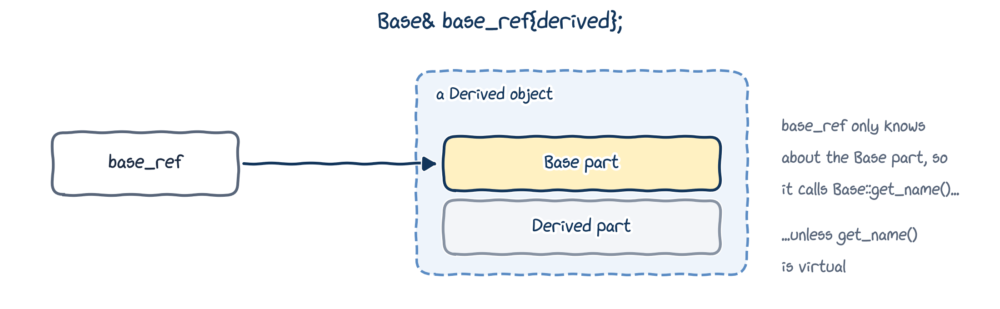
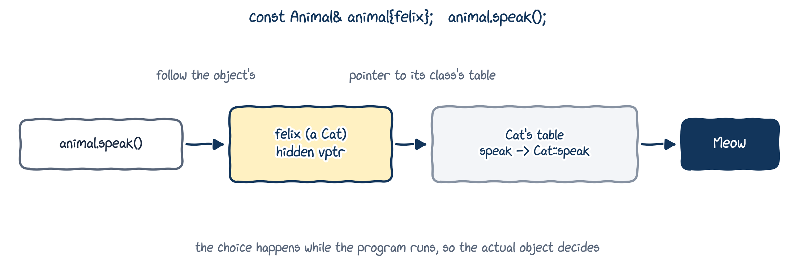
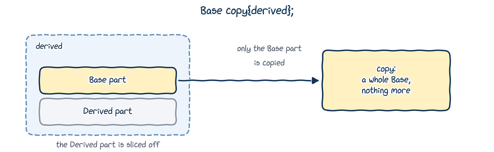

# Base class pointers and references

## Our `Base` and `Derived` {.dense-code}

::: {.columns}
::: {.column width="72%"}
```{.cpp filename="base_derived.h"}

```
:::
::: {.column width="28%"}
Nothing new here: `Derived` inherits from `Base`, and has its own `get_name()` that hides `Base::get_name()` (Chapter 14).
:::
:::

## Pointers and references to derived objects

::: {.columns}
::: {.column width="78%"}
```{.cpp filename="pointers_references_to_derived.cpp"}

```
:::
::: {.column width="22%"}
```{.text .output}
Derived 42.24
Derived 42.24
Derived 42.24
```
:::
:::

Still nothing new: a `Derived` reference or pointer behaves just like the `Derived` object itself.

## A *base* reference to a derived object

::: {.columns}
::: {.column width="72%"}
```{.cpp filename="base_pointers_references_to_derived.cpp"}

```
:::
::: {.column width="28%"}
```{.text .output}
Derived
Base
Base
```
:::
:::

A `Derived` object **has a** `Base` part, so a `Base` reference or pointer can refer to it. But look at what it calls!

## A base reference sees only the base part

{fig-alt="base_ref refers to a Derived object, but only knows about its Base part, so it calls Base::get_name(), unless get_name() is virtual." width="84%"}

`Derived::get_name()` hides `Base::get_name()` for `Derived` objects. But through a `Base` reference or pointer, the compiler only knows about the `Base` part, so it calls `Base::get_name()`.

## Why would we want that?

Suppose we have cats, dogs and tigers, and want to report what each one says:

```{.cpp}
void report(const Cat& cat) {
    std::cout << cat.get_name() << " says " << cat.speak() << '\n';
}
void report(const Dog& dog) {
    std::cout << dog.get_name() << " says " << dog.speak() << '\n';
}
void report(const Tiger& tiger) {
    std::cout << tiger.get_name() << " says " << tiger.speak() << '\n';
}
```

A zoo with 100 kinds of animal means 100 copies of the same function. We'd much rather write one:

```{.cpp}
void report(const Animal& animal) {
    std::cout << animal.get_name() << " says " << animal.speak() << '\n';
}
```

## Couldn't a template do it?

```{.cpp}
template <typename T>
void report(const T& animal) {
    std::cout << animal.get_name() << " says " << animal.speak() << '\n';
}
```

::: {.fragment}
It works, but:

- nothing says `T` must be an animal: `report(42)` gives a long, confusing template error;
- each type gets its own instance, decided at **compile time**. A template can't handle a collection of *mixed* animals whose types are only known when the program runs.
:::

## Our animals {.dense-code}

::: {.columns}
::: {.column width="72%"}
```{.cpp filename="animals_nonvirtual.h"}

```
:::
::: {.column width="28%"}
The constructor of `Animal` is `protected`, so nobody can create a plain `Animal`: only cats and dogs.

`std::string_view` is a cheap, read-only view of some text (Chapter 04).
:::
:::

## One array per kind of animal

::: {.columns}
::: {.column width="72%"}
```{.cpp filename="different_animal_arrays.cpp"}

```
:::
::: {.column width="28%"}
```{.text .output}
Fred says Meow
Misty says Meow
Zeke says Meow
Garbo says Woof
Pooky says Woof
Truffle says Woof
```
:::
:::

An array holds objects of **one** type, so each kind of animal needs its own array and its own loop. With 100 kinds, that's 100 arrays.

## One vector of `Animal` pointers?

::: {.columns}
::: {.column width="72%"}
```{.cpp filename="animal_array.cpp"}

```
:::
::: {.column width="28%"}
```{.text .output}
Fred says ???
Garbo says ???
Misty says ???
Pooky says ???
```
:::
:::

Base pointers let one vector hold every kind of animal. But they all say `???`: each call goes to `Animal::speak()`. We need **virtual functions**.

# Virtual functions

## Virtual functions

A **virtual function** is a member function that, when called through a base pointer or reference, resolves to the **most-derived** version for the actual object.

- Put `virtual` in front of the function in the **base class**.
- A function in a derived class with the same signature and return type **overrides** it, and is called an **override**. Mark it `override`.

## A first virtual function

::: {.columns}
::: {.column width="72%"}
```{.cpp filename="virtual_function_example.cpp"}

```
:::
::: {.column width="28%"}
```{.text .output}
base_ref is a Derived
```

One word, `virtual`, and the call through `base_ref` now reaches `Derived::get_name()`.
:::
:::

## Virtual functions in a chain {.dense-code}

::: {.columns}
::: {.column width="65%"}
```{.cpp filename="virtual_function_inheritance_chain.cpp"}

```
:::
::: {.column width="35%"}
```{.text .output}
base_ref is a C
```

`base_ref` refers to a `C`, so `C::get_name()` is called: the most-derived version **for the actual object**. `D` doesn't come into it, because the object isn't a `D`.
:::
:::

## The animals, with a virtual `speak()` {.dense-code}

::: {.columns}
::: {.column width="72%"}
```{.cpp filename="animals.h"}

```
:::
::: {.column width="28%"}
Two changes from before:

- `virtual` in front of `Animal::speak()`;
- `override` after each derived `speak()`.

(And a virtual destructor, explained later today.)
:::
:::

## Now every animal speaks for itself

::: {.columns}
::: {.column width="72%"}
```{.cpp filename="animals_with_virtual.cpp"}

```
:::
::: {.column width="28%"}
```{.text .output}
Felix says Meow
Rex says Woof
Fred says Meow
Garbo says Woof
```

The same `report()` function as before (`animals_without_virtual.cpp`, where everyone said `???`). Only the header changed.
:::
:::

## Behind the scenes (read at home)

{fig-alt="animal.speak(): follow the object's hidden pointer to its class's table, which says speak means Cat::speak, which prints Meow. The choice happens while the program runs." width="88%"}

Every object of a class with virtual functions carries a hidden pointer to its class's **virtual table**, which lists the right function for each virtual call. Following it costs a tiny bit of time, which is why C++ functions aren't virtual unless you ask.

## Polymorphism

**Polymorphism** means one name with many forms, chosen according to the types involved:

- **Compile-time polymorphism** is resolved by the compiler: function overloading (Chapter 05) and templates (Chapter 06).
- **Run-time polymorphism** is resolved while the program runs: **virtual functions**.

::: {.callout-important title="Key idea"}
With virtual functions, code written for the **base class** (like `report(const Animal&)`) automatically does the right thing for **every** derived class, even ones written years later.
:::

## The rules of overriding

- An override needs **exactly** the same signature as the base function (parameter types and `const`), and is itself virtual.
- The return types must match too:

```{.cpp filename="virtual_return_type_mismatch.cpp" .no-compile}

```

```{.text .output .compiler}
error: conflicting return type specified for 'virtual double Derived::get_value() const'
```

# The `override` and `final` specifiers

## Overrides that don't override {.dense-code}

::: {.columns}
::: {.column width="72%"}
```{.cpp filename="not_use_override_specifier.cpp"}

```
:::
::: {.column width="28%"}
```{.text .output}
A
A
```

Both calls go to `A`. `B::get_name_1(short)` takes a `short`, not an `int`, and `B::get_name_2` isn't `const`: neither is an override. Only `-Wall` hints at it: *"... was hidden"*.
:::
:::

## `override` turns the bug into an error {.dense-code}

```{.cpp filename="use_override_specifier.cpp" .no-compile}

```

::: {.columns}
::: {.column width="55%"}
```{.text .output .compiler}
error: 'B::get_name_1(short int) const' marked 'override', but does not override
error: 'B::get_name_2(int)' marked 'override', but does not override
```
:::
::: {.column width="45%"}
::: {.callout-tip title="Best practice"}
Write `virtual` only in the base class, and `override` on **every** override.
:::
:::
:::

## The `final` specifier {.dense-code}

**`final`** stops a function from being overridden any further:

```{.cpp filename="final_specifier_example.cpp" .no-compile}

```

```{.text .output .compiler}
error: virtual function 'virtual std::string_view C::get_name() const' overriding final function
```

And `class B final : public A` would stop anyone deriving from `B` at all.

# Slicing and virtual destructors

## Object slicing {.dense-code}

::: {.columns}
::: {.column width="76%"}
```{.cpp filename="object_slicing.cpp"}

```
:::
::: {.column width="24%"}
```{.text .output}
ref is a Derived
copy is a Base
```

A **reference** refers to the whole `Derived`. A **copy** into a `Base` keeps only the `Base` part: the rest is **sliced off**.
:::
:::

## What slicing means in practice

{fig-alt="Base copy{derived}: only the Base part of derived is copied, so copy is a whole Base and nothing more; the Derived part is sliced off." width="78%"}

- A `std::vector<Animal>` would slice every cat and dog into a plain `Animal`. That's why we used `std::vector<const Animal*>`.
- Pass polymorphic objects **by reference or pointer**, never by value.

## Deleting through a base pointer {.dense-code}

::: {.columns}
::: {.column width="65%"}
```{.cpp filename="virtual_destructor.cpp"}

```
:::
::: {.column width="35%"}
```{.text .terminal}
$ g++ -Wall virtual_destructor.cpp
warning: deleting object of polymorphic class type 'Base' which has non-virtual destructor might cause undefined behavior
$ ./a.out
~Base()
```

`~Derived()` never ran! If `Derived` owned memory, it would leak.
:::
:::

## Virtual destructors {.dense-code}

::: {.columns}
::: {.column width="65%"}
```{.cpp filename="virtual_destructor_fixed.cpp"}

```
:::
::: {.column width="35%"}
```{.text .output}
~Derived()
~Base()
```

With a **virtual destructor**, `delete ptr` calls the destructor of the actual object, then the base destructors in turn (Chapter 14).
:::
:::

::: {.callout-tip title="Best practice"}
A class meant to be a base class, especially one with virtual functions, should have a **virtual destructor**: `virtual ~Base() = default;`
:::

# Pure virtual functions and abstract classes

## Forgetting to override {.dense-code}

::: {.columns}
::: {.column width="72%"}
```{.cpp filename="virtual_function_forget_redefine.cpp"}

```
:::
::: {.column width="28%"}
```{.text .output}
Betsy says ???
```

We forgot `Cow::speak()`, so `Animal::speak()` quietly took over. No error, no warning: just a wrong answer.
:::
:::

## Pure virtual functions

A **pure virtual function** has no body in the base class; it's marked `= 0`:

```{.cpp}
virtual std::string_view speak() const = 0; // "every animal MUST say something"
```

- A class with at least one pure virtual function is an **abstract base class**: you **can't create objects** of it.
- A derived class must override every pure virtual function, or it's abstract too.
- Only virtual functions can be pure: `int do_something() = 0;` is a compile error.

So: what does an `Animal` say? There's no sensible default, and now we don't have to invent one.

## Forgetting now fails to compile {.dense-code}

```{.cpp filename="pure_virtual_function_forget_redefine.cpp" .no-compile}

```

```{.text .output .compiler}
error: cannot declare variable 'cow' to be of abstract type 'Cow'
```

A silent wrong answer is now a compile error: much better!

## ...and remembering works {.dense-code}

::: {.columns}
::: {.column width="72%"}
```{.cpp filename="pure_virtual_function_remember_redefine.cpp"}

```
:::
::: {.column width="28%"}
```{.text .output}
Betsy says Moo
```
:::
:::

## Interface classes

An **interface class** has no member variables, and only pure virtual functions. It defines **what** derived classes must be able to do, and leaves **how** entirely to them. Interface names often start with `I`:

```{.cpp}
class IErrorLog {
  public:
    virtual ~IErrorLog() = default; // so deleting through IErrorLog* is safe
    virtual bool open_log(std::string_view filename) = 0;
    virtual bool write_error(std::string_view message) = 0;
    virtual bool close_log() = 0;
};
```

Code that writes errors only needs an `IErrorLog&`. Whether errors go to a file, the screen or a database is decided by whichever class implements the interface.

## Putting it all together: shapes

The `Shape` promised in Chapter 10, one class per header (Chapter 14):

```{.cpp filename="shape.h"}

```

An abstract base class with a virtual destructor: it only says what every shape must be able to do.

## A circle (and a rectangle) {.dense-code}

```{.cpp filename="circle.h"}

```

`rectangle.h` is the same idea, with a `width` and a `height`.

## Every shape, in one loop {.dense-code}

::: {.columns}
::: {.column width="76%"}
```{.cpp filename="shapes.cpp"}

```
:::
::: {.column width="24%"}
```{.text .output}
circle: area 3.14159
rectangle: area 6
```
:::
:::

Abstract base class, overrides, a virtual destructor, and `std::unique_ptr` (Chapter 09) doing the `delete`: everything from today, working together.

# Wrapping up

## Summary

- A **base pointer or reference** can refer to a derived object, but only sees the base part.
- A **virtual function** call goes to the most-derived override for the **actual** object: run-time polymorphism.
- Write `virtual` in the base class and **`override`** on every override; **`final`** stops further overriding.
- Copying a derived object into a base object **slices** it: pass polymorphic objects by reference or pointer.
- Give base classes a **virtual destructor**.
- A **pure virtual function** (`= 0`) makes a class **abstract**; derived classes must override it. An **interface** is a class of pure virtual functions only.

## Keep learning

Explore these on your own, with Google Gemini in Guided Learning mode or on [learncpp.com](https://www.learncpp.com):

1. [Virtual functions and polymorphism](https://www.learncpp.com/cpp-tutorial/virtual-functions-and-polymorphism/)
2. [The `override` and `final` specifiers](https://www.learncpp.com/cpp-tutorial/the-override-and-final-specifiers-and-covariant-return-types/), and covariant return types
3. [Virtual destructors](https://www.learncpp.com/cpp-tutorial/virtual-destructors-virtual-assignment-and-overriding-virtualization/)
4. [Object slicing](https://www.learncpp.com/cpp-tutorial/object-slicing/)
5. [Pure virtual functions, abstract base classes and interface classes](https://www.learncpp.com/cpp-tutorial/pure-virtual-functions-abstract-base-classes-and-interface-classes/)

**Next up, Section 4:** describing object-oriented designs with UML.
