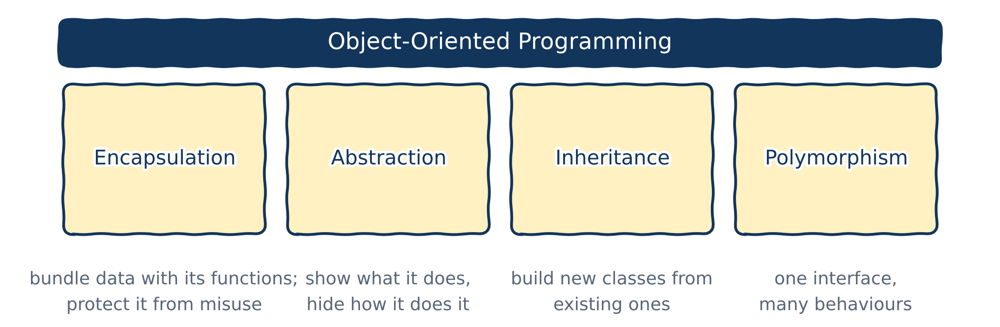
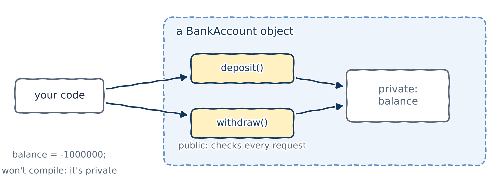
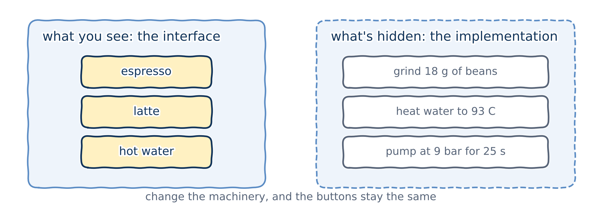
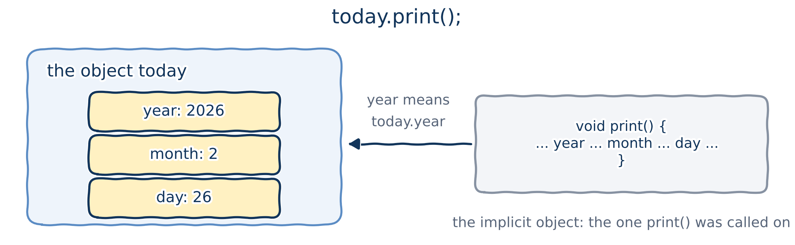

# Object-Oriented Programming {#sec-ch10}

So far our programs have been **procedural**: the data is in one place, and the functions that work on it are in another. In **object-oriented programming** we create our own types that bundle **data** (properties) together with **behaviour** (functions). This chapter covers the ideas behind OOP, classes and objects, member functions, and `const` objects.

## Why object-oriented programming?

You met OOP in Introductory Programming 2, so we won't spend long on why it matters. It's **natural**: it mirrors how we think about the world, as objects with properties and behaviours. It **scales**: it keeps large, complex systems manageable by walling data off, so that bugs can't spread. And it's **what industry uses**, and has been since the 1990s. Look at any job advert or large codebase. A MathWorks internship advert asks for object-oriented design and C++: you don't need MATLAB to work at the company that makes MATLAB. Airbus's adverts for software architects and developers ask for OOP, Git, and Java, an object-oriented language through and through.

That's the lazy explanation, though. The real one is what OOP gives you, its **four pillars**.

{fig-alt="Four pillars holding up object-oriented programming: encapsulation, abstraction, inheritance and polymorphism." width="49%"}

### Encapsulation

**Encapsulation** means bundling data and the functions that work on it into one unit, a **class**, and hiding the data from the outside world, to prevent accidental interference. You've relied on it in Python without noticing. A NumPy `ndarray` or a Matplotlib `Figure` hides its internals, and you just use it. When `np.array([1, 'two', 3], dtype=float)` fails, it tells you exactly what's wrong, thanks to checking that happens behind the scenes. And registering a student as `Student(name="", age=-7)` should fail: some code, somewhere, has to check the data.

{fig-alt="A BankAccount object. Its balance is private. Your code can only reach it through the public functions deposit() and withdraw(), which check every request. Writing balance = -1000000 directly won't compile." width="62%"}

C++ enforces encapsulation with **access specifiers**: `private` members can only be used inside the class, and `public` members can be used from outside. If anyone could change a bank account's `balance` directly, the bank would be in serious trouble. Instead, you go through `deposit()` and `withdraw()`, which check that each transaction is valid.

### Abstraction

**Abstraction** means showing what an object **does**, and hiding **how** it does it. Users deal with a simple interface, and developers can change the hidden machinery without changing how anyone uses it.

{fig-alt="A coffee machine. You see buttons: espresso, latte, hot water. Hidden inside: grind 18 g of beans, heat water to 93 C, pump at 9 bar for 25 s. Change the machinery and the buttons stay the same." width="62%"}

An example from graphics: we want to draw shapes, but a circle and a square are drawn differently. So we write an **abstract class** `Shape` that says "anything that is a shape must have a `draw()` function":

```{.cpp}
class Shape {
public:
    virtual void draw() = 0; // "= 0": every real shape must provide draw()
};
```

Code that draws shapes then only needs to know about `draw()`, not about circles and squares. We'll write classes like this in Chapter 15.

Encapsulation and abstraction are easy to confuse, and many examples sit at the intersection of both. Roughly, **encapsulation** is about **protection and data integrity**: refusing a negative `battery_level`, or a withdrawal larger than the balance. **Abstraction** is about **simplification and interfaces**: the user just calls `set_battery(50)`, without ever seeing the `if (value < 0)` check inside. Don't worry if the line between them still feels blurry.

### Inheritance and polymorphism

**Inheritance** lets us create a new class (a **derived** or **child** class) from an existing one (a **base** or **parent** class). The child **inherits** the parent's data and behaviour, so we don't write the same code over and over: Don't Repeat Yourself! Lecturers, technicians, teaching-office staff and demonstrators are all **employees**, each with a name, an age, a salary and so on. Put everything they have in common into an `Employee` class; each kind of employee inherits it, and only adds what's special about it (Chapter 14).

**Polymorphism** lets us treat an object as its parent type, while it still behaves according to its own type. Keep a list of different shapes and tell every one of them to `draw()`: each draws itself correctly, circles as circles and squares as squares. We'll understand this pillar properly in Chapter 15.

## Classes and objects

A **class** is a type that **you** define, a *program-defined* (or *user-defined*) type. Think of it as a **blueprint**. An **object** is one particular thing built from that blueprint: an **instance** of the class. `int` is a type and `int x{5};` is an object of that type; in the same way, `Date` will be a class and `Date today{2026, 2, 26};` an object.

A class is defined just like a struct, with the keyword `class` instead of `struct`:

```{.cpp}
class Employee {
    int m_id{};   // member variables (also called data members)
    int m_age{};  // m_ stands for "member"
    double m_wage{};
}; // don't forget this semicolon!
```

You'll see the `m_` prefix for **member variables** a lot in other people's code. It's one of three common conventions. Many companies use the prefix, `m_age`, which is handy in an IDE: type `m_` and it lists all the members. Google's C++ style guide asks for a trailing underscore, `age_`. Many modern open-source libraries use no decoration at all, `age`. These conventions exist to avoid *name shadowing* in constructors (Chapter 11). Modern C++ doesn't need them, so these notes mostly use plain names.

### `struct` versus `class`

Technically, `struct` and `class` are almost identical. The **only** differences are the defaults:

| | `struct` | `class` |
|:---|:---|:---|
| members are... | `public` by default | `private` by default |
| inheritance is... | `public` by default | `private` by default |

Anything you can write with one, you can write with the other. Change `struct Date` to `class Date` and add `public:` above its members, and it behaves just like the struct did: `Date date{26, 2, 2026};` still works, and prints `26/2/2026` (`class_just_like_struct.cpp`). Since the keywords behave almost identically, *we* give each one its meaning. Use a `struct` for **passive data**, a bundle of values with no rules to enforce, and a `class` for everything else. Google's C++ style guide says the same.

You've been using classes all along: `std::string`, `std::string_view` and `std::vector` are all classes, and so are most types in the standard library.

::: {.callout-important title="Key idea"}
Classes are the heart and soul of C++. They're so fundamental that C++ was originally called "C with Classes"!
:::

## Member functions

A class type can contain functions as well as data. Functions that belong to a class are **member functions**; all others are **non-member functions**. So far, to print a `Date` we'd write a non-member function, `void print(const Date& date)`, and call it as `print(today)` (`non_member_function_example.cpp`). Here is the member function version. We use a `struct`, to show that all of this applies to structs too:

```{.cpp filename="member_function_example.cpp"}

```

```{.text .output}
2026/2/27
```

`print()` is now **inside** `Date`, and we call it with `today.print()`, selecting it with `.` just like a member variable.

### The implicit object

{fig-alt="today.print(): inside print, the name year means today.year. today is the implicit object, the one print was called on." width="60%"}

With the non-member function we wrote `print(today)`; with the member function we write `today.print()`, and don't pass `today` as an argument. Instead, `today` is passed **implicitly**: it's the **implicit object**, the object the member function was called on. Inside `print()`, a bare member name like `year` means *the implicit object's* `year`, here `today.year`.

### Where is `self`?

Python passes the implicit object explicitly, as `self`:

```{.python filename="date_class.py"}

```

```{.text .output}
2026/2/26
2026/2/26
```

`Date.print(today)` is what `today.print()` really means. C++ has no `self` parameter; its version of `self`, called `this`, comes in Chapter 11.

::: {.callout-note title="Coming from Python"}
Python checks the object **late**, or **never**. `Date.print("khiem")` fails with *AttributeError: 'str' object has no attribute 'year'*, but only when that line **runs**: maybe during your demo (`date_class_wrong_object.py`). Pass an object of some unrelated class that happens to have `year`, `month` and `day` attributes, holding `"one"`, `"two"` and `3`, and it runs without a single complaint and prints `one/two/3` (`date_class_nonsense.py`). In C++, `Date::print` can only be called on a `Date`, and the compiler checks it before the program ever runs.
:::

Member functions can be overloaded, just like non-member functions (Chapter 05). With a second `print(const std::string& prefix)`, `today.print()` prints `2026/2/26` and `today.print("The date is: ")` prints `The date is: 2026/2/26` (`overload_member_functions.cpp`).

A bit of history: in C, structs could only hold data, never functions. When designing C++, Bjarne Stroustrup had to decide whether structs, inherited from C, should be allowed member functions, and decided they should. So in modern C++ it's perfectly fine for a struct to have member functions. Structs and classes are both called **class types**.

## `const` objects and `const` member functions

A `const` variable must be initialized, and can't be changed (Chapter 04). Objects of class type can be `const` too, and then their members can't be changed either: with `const Date today{2026, 2, 26};`, the statement `today.day += 1;` fails with *assignment of member 'Date::day' in read-only object* (`modify_members_of_const_objects.cpp`). That's no surprise. This may be:

```{.cpp filename="const_objects_call_non_const_mem_functions.cpp" .no-compile}

```

```{.text .output .compiler}
error: passing 'const Date' as 'this' argument discards qualifiers
```

`print()` only *reads* the date. But the compiler doesn't look inside `print()` to see what it does: as far as it knows, `print()` *might* change `today`, so it refuses.

### `const` member functions

A **`const` member function** promises not to change the object, and not to call any non-`const` member function. Put `const` after the parameter list:

```{.cpp filename="const_member_functions.cpp"}

```

```{.text .output}
2026/2/26
```

Local variables like `next_year` can still change; only the object's members are protected. Break the promise, say by writing `day += days;` inside a `const` member function, and the compiler stops you with *assignment of member 'Date::day' in read-only object* (`const_member_functions_change_data_members.cpp`). And a function that promises *not* to change an object is safe on any object, so a non-`const` `Date` can call a `const` `print()` too (`nonconst_objects_call_const_mem_functions.cpp`).

::: {.callout-tip title="Best practice"}
A member function that doesn't (and never will) change the object should be `const`, so that it works on both `const` and non-`const` objects.
:::

### Two golden rules

How are you supposed to remember all this `const` stuff? Asked for one or two golden rules, Gemini gave these (shortened a bit), which cover about 95% of cases:

::: {.callout-important title="Two golden rules"}
1. **The read-only rule, for member functions:** if a function doesn't change the object's data, mark it `const`. It's a promise to the compiler.
2. **The efficient-pass rule, for parameters:** pass objects by `const&` (const reference), unless they're tiny or the function needs to change them.
:::

The two rules meet all the time. Passing a class-type argument **by value** copies it, which is slow, so we pass it **by `const` reference** (Chapter 07). So besides `const` variables, there's a second common way to meet a `const` object: through a `const` reference parameter. **Inside that function**, the object is `const`. Spot the problem:

```{.cpp filename="const_objects_via_pass_by_const_ref_01.cpp" .no-compile}

```

```{.text .output .compiler}
error: passing 'const Date' as 'this' argument discards qualifiers
```

`today` isn't `const`, but inside `do_something()`, `date` is, and `print()` isn't a `const` member function. The fix is one word: make `print()` `const`, and both golden rules are satisfied (`const_objects_via_pass_by_const_ref_02.cpp`).

## Summary

- OOP bundles data and behaviour into **classes**. Its four pillars are encapsulation, abstraction, inheritance and polymorphism.
- A **class** is a blueprint (a type); an **object** is an instance of it.
- `struct` and `class` differ only in their defaults: `public` versus `private`. Use `struct` for passive data and `class` for everything else.
- **Member functions** belong to a class and work on the **implicit object**, the one they're called on. C++ has no `self` parameter.
- A **`const` object** can only call **`const` member functions**. Make every member function that doesn't change the object `const`.
- Pass class objects by `const` reference.

**Further reading** on [learncpp.com](https://www.learncpp.com): [introduction to OOP](https://www.learncpp.com/cpp-tutorial/introduction-to-object-oriented-programming/), [introduction to classes](https://www.learncpp.com/cpp-tutorial/introduction-to-classes/), [member functions](https://www.learncpp.com/cpp-tutorial/member-functions/), [const class objects and const member functions](https://www.learncpp.com/cpp-tutorial/const-class-objects-and-const-member-functions/).
