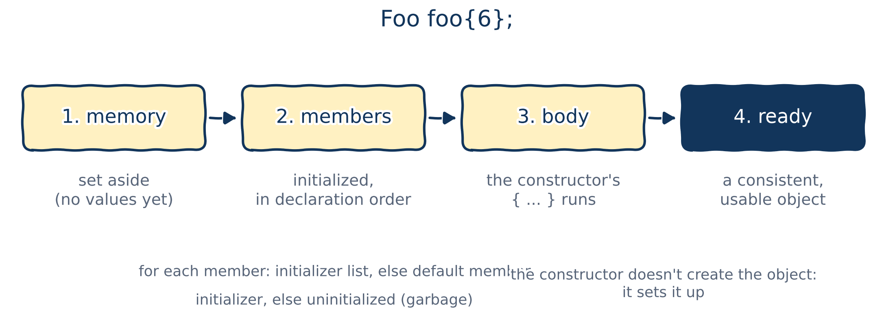
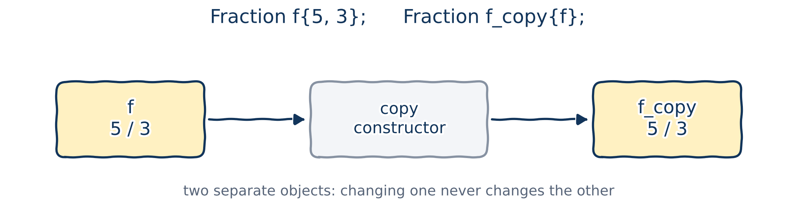

# Classes and Constructors {#sec-ch11}

Chapter 10 used `struct`s everywhere, to show that a struct is almost the same as a class. This chapter is about what makes a class a class: **access levels**, which decide who may use each member, and **constructors**, which set up every new object, including copies.

## Member access

Every member of a class type has an **access level**, which decides who may use it:

1. `public`: anyone;
2. `private`: only the class's own members;
3. `protected`: we'll meet this one in Chapter 14, with inheritance.

Code that isn't a member of the class, like `main()`, is called **the public**. It's not about what the public *wants*, but what it's *allowed* to do: on the way home you may sit in the public park, but not in the warm, quiet private house next to it, however tired you are.

The members of a `struct` are **public** by default, so anyone can use them, both the class's own members and the public. Nothing stops nonsense: `struct_public_by_default.cpp` happily sets `today.year = -42` and `today.month = 42`, and prints `-42/42/42`. The members of a `class` are **private** by default:

```{.cpp filename="class_private_by_default.cpp" .no-compile}

```

```{.text .output .compiler}
error: no matching function for call to 'Date::Date(<brace-enclosed initializer list>)'
error: 'int Date::day' is private within this context
error: 'void Date::print() const' is private within this context
```

A **private member** can only be used by other members of the same class, never by the public. (We'll see why the first line fails too, and how to fix it, later in the chapter.)

### Access specifiers

An **access specifier**, `public:`, `private:` or `protected:`, sets the access level of every member that follows it:

```{.cpp filename="access_specifier_example.cpp"}

```

```{.text .output}
2026/2/26
```

The usual layout puts the **public interface** first, what users of the class need, and then the **private** details. Here are all three levels at a glance:

| Access level | Specifier | Members of the class | Derived classes | The public |
|:---|:---|:---|:---|:---|
| Public | `public:` | yes | yes | yes |
| Protected | `protected:` | yes | yes | no |
| Private | `private:` | yes | no | no |

Don't worry about the middle column yet: derived classes come with inheritance, in Chapter 14. And `struct` and `class` really are interchangeable: make every member of a `class` `public` and it acts like a `struct`, and vice versa.

### Access is per class, not per object

This one is easy to miss, and a real headache if you don't know it:

```{.cpp filename="access_level_per_class_basis.cpp"}

```

```{.text .output}
Joe says hello to Kate
```

`greet()` reads `other.name`, a private member of a *different* object. That's allowed: a member function of `Person` may use the private members of **any** `Person`.

### Naming private member variables

Many programmers prefix private member variables with `m_`, and here's why:

```{.cpp}
void set_name(const std::string& name) {
    name = name; // which name is which? This assigns the parameter to itself!
}
```

The parameter `name` **shadows** (hides) the member `name`. Write the member as `m_name`, or `name_`, and the problem disappears: `m_name = name;`. You'll read code like this all your career, so it's worth knowing. But the prefix is declining: Google uses a trailing underscore, and big libraries such as PyTorch (machine learning) and deal.II (finite elements) use no decoration at all. Real-world code looks complicated at first; reading it is a skill you build by writing your own. And modern C++ has better tools, as you'll see in this chapter.

## Aggregates and member selection

To understand constructors, we need one more idea, and we need to finish off pointers from Chapter 08.

An **aggregate** is (roughly) a class type with **only public data members** and no user-written constructors; a plain `struct` is the typical example. An aggregate can be initialized directly from a list of values, which is called **aggregate initialization**. For a `struct Employee` with members `id`, `age{42}` and `wage`:

```{.cpp}
Employee frank = {1, 32, 60000.0}; // copy-list initialization
Employee joe{2, 28, 45000.0};      // list initialization (preferred)
Employee khiem{};                  // every member gets its default
```

Members without a value in the list get their default member initializer, or are value-initialized (zero) if they have none, so `khiem.age` is `42` and `khiem.wage` is `0` (`aggregate_initialization.cpp`).

::: {.callout-tip title="Best practice"}
Prefer the braced form without `=`: `Employee joe{2, 28, 45000.0};`.
:::

A reference acts just like the object itself, so we select its members with `.` as usual: a function taking `const Employee& employee` reads `employee.id` (`reference_selection_operator.cpp`). A pointer is different. With `Employee* ptr{&khiem};`, the expression `ptr.id` doesn't compile:

```{.text .output .compiler}
error: request for member 'id' in 'ptr', which is of pointer type 'Employee*'
(maybe you meant to use '->' ?)
```

`ptr` is not an `Employee`; it holds the *address* of one (`pointers_to_structs_select_members_error.cpp`). One fix is to dereference first: `(*ptr).wage` (`pointers_to_structs_select_members_deref.cpp`). The parentheses matter, because `*ptr.wage` would mean `*(ptr.wage)`. The better fix is the **arrow operator** `->`, which selects a member through a pointer: `ptr->wage` means exactly `(*ptr).wage`, but is easier to read and type (`pointers_to_structs_select_members_arrow.cpp`).

::: {.callout-tip title="Best practice"}
Use `.` with objects and references, and `->` with pointers.
:::

## Constructors

In Introductory Programming 2 you wrote constructors in Python, as `__init__(self, ...)`. They don't just copy values (`self.age = age`); they also **check** them: is `age < 0`? Is the `id` unique? Is the birth date a real date? A struct with public members can use aggregate initialization, but a class with **private** members can't. For `class Foo { int x{}, y{}; };`, the line `Foo foo{6, 7};` fails with *no matching function for call to 'Foo::Foo(<brace-enclosed initializer list>)'* (`aggregate_init_private_error.cpp`), the same first error as for the `Date` class above.

And that's a good thing. Aggregate initialization would require the user to know the class's **private** layout, exactly what we're trying to hide. And if the class has an **invariant**, such as "working age is between 18 and 65", we'd be relying on every user to respect it. So C++ classes have **constructors**, which initialize the members *and* can check the values, just like `__init__`. (You can write constructors for a struct too; people just rarely do.)

A **constructor** is a special member function that is called **automatically** when an object of a (non-aggregate) class type is created. The compiler picks the constructor that matches the initial values given, just as it picks among overloaded functions (Chapter 05).

{fig-alt="Creating Foo foo{6}: 1, memory is set aside; 2, members are initialized in declaration order; 3, the constructor body runs; 4, the object is ready. Each member gets its value from the initializer list, else its default member initializer, else it stays uninitialized." width="70%"}

::: {.callout-important title="Key idea"}
A constructor doesn't *create* the object: the memory already exists. It **sets the object up**, so that afterwards it's in a consistent, usable state.
:::

A constructor has **the same name as the class**, with the same capitalization, and **no return type**, not even `void`. A class with a user-written constructor is no longer an aggregate.

```{.cpp filename="basic_constructor_example.cpp"}

```

```{.text .output}
Vector2D(4.2, 2.4) constructed
(4.2, 2.4)
```

This constructor assigns in the body, Python style, but it had to invent new names, `new_x` and `new_y`, because `x = x;` would assign the parameter to itself. Can we keep `x` and `y`, like `self.x = x` in Python? Yes:

```{.cpp}
Foo(int x, int y) { // same names as the members...
    this->x = x;    // ...so use this-> for the members
    this->y = y;
}
```

In every member function, **`this`** points at the implicit object, so `this->x` is the member and plain `x` is the parameter (`mimic_python_constructor_02.cpp`). We look at `this` properly in Chapter 12.

::: {.callout-note title="Coming from Python"}
`this` plays the role of `self`, but it's never a parameter, and you only need to write it when a name is ambiguous.
:::

## Member initializer lists

Modern C++ has a better way than assigning in the body, the **member initializer list**:

```{.cpp filename="member_initializer_list.cpp"}

```

```{.text .output}
Foo(6, 7) constructed
Foo(6, 7)
```

It comes after the parameter list and **starts with a colon**: each member, then its value in braces, separated by commas. In `x{x}`, the outer `x` can only be a member, so there's no ambiguity, and no need for `this`.

Why is it better than assignment? With an initializer list, each member is **initialized** with its value, in one step. With assignment in the body, each member is first initialized (with its default member initializer if it has one, otherwise left with a garbage value), and *then* the body assigns the parameter over it.

| | Member initializer list `: x{x}` | Assignment in the body `this->x = x` |
|:---|:---|:---|
| What happens | direct initialization | default initialization, then assignment |
| Efficiency | faster: no double work | slower for complex members |
| `const` and reference members | works | doesn't compile |
| Order | always the **declaration** order in the class | the order of the statements |

`const` and reference members can't be left without a value and assigned later, so for them the initializer list is the only option.

::: {.callout-tip title="Best practice"}
Initialize members in the member initializer list, not by assignment in the constructor body. List them in the same order as they're declared: `-Wall` warns if you don't.
:::

C++ doesn't care about spaces and line breaks, so you'll see the list written in several styles. A short list fits on one line, `Foo(int x, int y) : x{x}, y{y} {}`; a long one is easiest to read and edit with one member per line, each line starting with the colon or a comma.

### Which initializer wins?

A member can get its value from the initializer list, from a default member initializer, or from neither:

```{.cpp filename="different_initializers.cpp"}

```

```{.text .output}
Foo(6, 42, 0)
```

If the member is in the initializer list, that value is used (`x`). Otherwise, if it has a default member initializer, that's used (`y`). Otherwise it's **uninitialized** (`z`). The `0` is luck: reading `z` is undefined behaviour, and g++ doesn't even warn.

The constructor **body** is usually empty, because the initializer list does the initializing. Use the body for anything else the object needs: checking an invariant (a `Fraction`'s denominator must not be zero), opening a file, or allocating memory (Chapter 09).

## Default constructors

A **default constructor** is one that can be called with **no arguments**, such as `Foo() { ... }`. For a class with a default constructor, **value initialization** `Foo foo1{};` and **default initialization** `Foo foo2;` both call it (`default_constructor_example.cpp`). A constructor whose parameters all have default arguments (Chapter 05), such as `Foo(int x = 0, int y = 0)`, can also be called with no arguments, so it's a default constructor too: `Foo foo1{};` calls it as `Foo(0, 0)` (`constructor_with_default_arguments.cpp`).

Constructors are functions, so they can be overloaded: a class can have both `Foo()` and `Foo(int x, int y)` (`overloaded_constructors.cpp`). But only **one** default constructor! If a class has both `Foo()` and `Foo(int x = 1, int y = 2)`, both can be called with no arguments, and `Foo foo{}` fails with *call of overloaded 'Foo(<brace-enclosed initializer list>)' is ambiguous* (`overloaded_default_constructors_error.cpp`), Chapter 05's ambiguous match again.

### The implicit default constructor

If a class declares **no constructors at all**, the compiler writes a public **implicit default constructor** for it, equivalent to `Foo() {}`: no parameters, no initializer list and an empty body (`implicit_default_constructor.cpp`). But declare **any** constructor yourself, and the compiler stops writing it:

```{.cpp .no-compile}
class Foo {
  private:
    int x{}, y{};

  public:
    Foo(int x, int y) : x{x}, y{y} {} // removes the implicit default one
};

Foo foo1{1, 2}; // fine: uses Foo(int, int)
Foo foo2{};     // error: there is no default constructor now
```

```{.text .output .compiler}
error: no matching function for call to 'Foo::Foo(<brace-enclosed initializer list>)'
```

If you still need it, ask for it. `Foo() = default;` tells the compiler to generate the default constructor it would normally have written, an **explicitly defaulted default constructor**, and `Foo foo2{};` works again (`killing_implicit_default_constructor.cpp` and `explicit_default_constructor.cpp`).

## Copy constructors

You've already copied objects in your assignments. With `std::vector<double> original{1.1, 2.2, 3.3, 4.4};`, all three of `copy1{original}`, `copy2(original)` and `copy3 = original` create a new vector as an independent copy: change `copy1[0]`, and `original[0]` stays `1.1` (`copy_constructor_vector.cpp`). How does that work? Take a `Fraction` class with a single constructor, `Fraction(int numerator = 0, int denominator = 1)`. Then `Fraction f{5, 3};` calls that constructor, but which constructor does `Fraction f_copy{f};` call? We never wrote one taking a `Fraction`... but the compiler did, and `f_copy.print()` prints `5/3` (`copy_constructor_intro.cpp`).

{fig-alt="Fraction f_copy{f}: f, holding 5/3, goes through the copy constructor to produce f_copy, also 5/3. Two separate objects: changing one never changes the other." width="62%"}

A **copy constructor** initializes a new object from an existing object of the same type. If you don't write one, the compiler writes a public **implicit copy constructor**, which copies every member. To see when copies happen, we write our own, which says so, and put the class in a header that the next examples include:

```{.cpp filename="fraction.h"}

```

The copy constructor's parameter is a `const` reference to another `Fraction`, and it copies each member in the member initializer list. Now `Fraction f_copy{f};` prints `Copy constructor called` (`copy_constructor_fraction.cpp`).

Why must the parameter be a reference? If it were passed **by value**, calling the copy constructor would first need to copy the argument... using the copy constructor, which would first need to copy its argument... forever. The compiler refuses to compile that.

::: {.callout-tip title="Best practice"}
- Prefer the **implicit** copy constructor, unless you have a specific reason to write your own.
- A copy constructor should only copy, with **no side effects**: the compiler is allowed to skip calling it (see below).
- Its parameter should be a **`const` reference**: `Fraction(const Fraction& other)`.
:::

### When copies happen, and when they don't

Passing by value copies the argument into the parameter (Chapter 02), and for a class type, that copy is made by the copy constructor: `print_fraction(f)` for a function `void print_fraction(Fraction f)` prints `Copy constructor called` (`copy_constructor_pass_by_value.cpp`). Another reason to pass class objects by `const` reference! Returning by value is more interesting:

```{.cpp filename="copy_constructor_return_by_value.cpp"}

```

```{.text .output}
Copy constructor called
0/1
Copy constructor called
1/2
Copy constructor called
4/2
```

In principle there are **five** copies: three into `print_fraction()`'s parameter, and two for `return f;`. The output shows only three. The compiler skipped the copies in `return f;`, constructing `f` directly in the caller's object. This is called **copy elision**, and it's why a copy constructor must have no side effects: you can't rely on it being called.

Finally, as with default constructors, you can ask for the implicit copy constructor explicitly, or forbid copying altogether:

```{.cpp}
Fraction(const Fraction& other) = default; // "the usual copy, please"
Fraction(const Fraction& other) = delete;  // "no copies allowed"
```

With `= delete`, any attempt to copy is a compile error, *use of deleted function 'Fraction::Fraction(const Fraction&)'* (`default_copy_constructor_using_default.cpp` and `remove_copy_constructor_using_delete.cpp`).

## Summary

- `public` members can be used by anyone; `private` members only by the class's own members. Access is per **class**, not per object.
- Access specifiers set the access level; `struct` defaults to `public` and `class` to `private`.
- Select members with `.` through objects and references, and with `->` through pointers.
- A **constructor** sets up a new object. It has the class's name and no return type. Initialize members in the **member initializer list**.
- A **default constructor** takes no arguments. Writing any constructor removes the implicit one; `= default` brings it back.
- The **copy constructor** makes an object from another of the same type. It's used when passing by value, and often skipped on return (**copy elision**).

**Further reading** on [learncpp.com](https://www.learncpp.com): [access specifiers](https://www.learncpp.com/cpp-tutorial/public-and-private-members-and-access-specifiers/), [member initializer lists](https://www.learncpp.com/cpp-tutorial/constructor-member-initializer-lists/), [the copy constructor](https://www.learncpp.com/cpp-tutorial/introduction-to-the-copy-constructor/), [class initialization and copy elision](https://www.learncpp.com/cpp-tutorial/class-initialization-and-copy-elision/).
