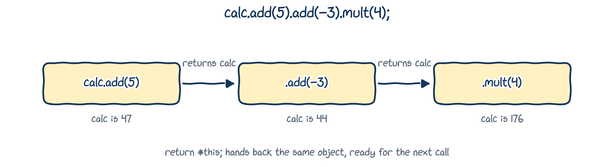
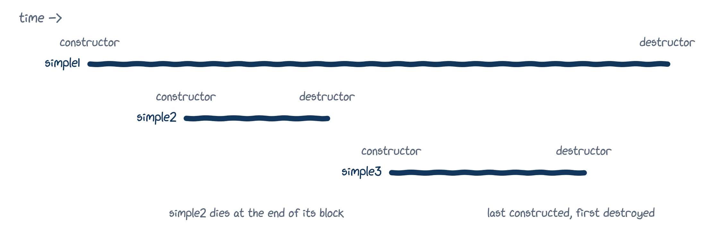
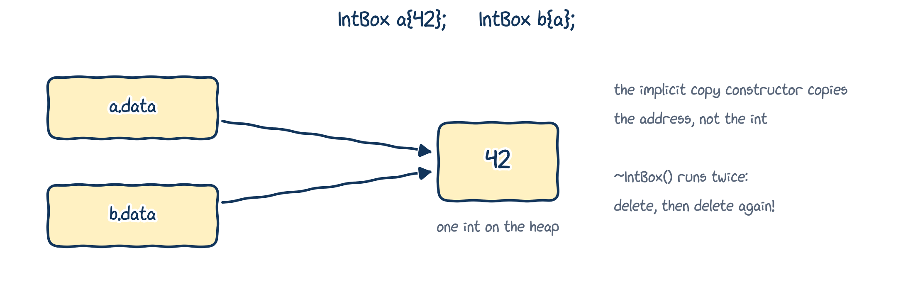

# More on Classes {#sec-ch12}

This chapter completes the basic toolkit for writing classes: the hidden **`this`** pointer and method chaining, **destructors** and the RAII idea behind them, **class templates**, and **friends**.

## The hidden `this` pointer

In Python, every method's first parameter, by convention called `self`, refers to the object the method was called on:

```{.python}
class Fraction:
    def __init__(self, numerator, denominator):
        self.numerator = numerator
        self.denominator = denominator
```

Chapter 11 introduced C++'s version, `this`. It plays the role of `self`, but it's a **pointer**, and you never write it as a parameter. Inside every member function, `this` holds the address of the implicit object, so we select its members with `->`:

```{.cpp filename="hidden_pointer_this.cpp"}

```

```{.text .output}
0
42.5
```

How is `this` set? When we write `simple.set_value(42.5);`, the compiler (conceptually) turns it into an ordinary function call, with the object's address as an extra, hidden argument:

```{.cpp}
Simple::set_value(&simple, 42.5); // not real C++: just what happens underneath
```

So in each call, `this` points at whichever object the function was called on: inside `a.set_value(12)`, `this == &a`, and inside `b.set_value(21)`, `this == &b`. The same goes for constructors: while `Simple a{1.0};` is being set up, `this == &a`. In a `const` member function, `this` points to a `const` object, which is where Chapter 10's error message *"passing 'const Date' as 'this' argument"* came from.

Most of the time we don't write `this` at all: a plain `value` already means `this->value`, as in `get_value()` above. We need it when a parameter has the **same name** as a member, as in `set_value()`: `this->value` is the member, and `value` is the parameter.

### Returning `*this`: method chaining

You've been chaining calls since Chapter 01:

```{.cpp}
std::cout << "Hello, " << user_name;
// is evaluated as
(std::cout << "Hello, ") << user_name;
```

`(std::cout << "Hello, ")` prints, and then **returns `std::cout` itself**, ready for the next `<<`. Our member functions can do the same, by returning `*this`, the implicit object, by reference. This is called **method chaining** (or *function chaining*):

```{.cpp filename="method_chaining_example.cpp"}

```

```{.text .output}
176
```

{fig-alt="calc.add(5).add(-3).mult(4): calc.add(5) returns calc, which is now 47; the next call returns calc again; and so on, up to 176. return *this hands back the same object, ready for the next call." width="70%"}

`calc.add(5)` changes `calc` and returns `calc` itself, so `.add(-3)` is called on `calc` too, and so on: (42 + 5 − 3) × 4 = 176. Each function must return a **reference**: return by value instead, and each call would work on a copy. We'll come back to this in Chapter 13, when we write our own `<<`.

## Destructors

Remember memory leaks from Chapter 09? Here's a class that allocates memory when it's created:

```{.cpp}
class DatabaseHelper {
  private:
    std::string* connection{}; // allocated on the heap

  public:
    DatabaseHelper(const std::string& path)
        : connection{new std::string{path}} {
        std::cout << "Connected to " << *connection << '\n';
    }
};
```

`main()` creates a `DatabaseHelper db{"127.0.0.1:5432/my_database"};` inside a block of its own (`database_helper_without_destructor.cpp`). AddressSanitizer isn't happy:

```{.text .terminal}
$ g++ -std=c++20 -g -fsanitize=address database_helper_without_destructor.cpp
$ ./a.out
Connected to 127.0.0.1:5432/my_database
==3376==ERROR: LeakSanitizer: detected memory leaks
Direct leak of 32 byte(s) in 1 object(s) allocated from:
    #1 in DatabaseHelper::DatabaseHelper(const std::string&) ...cpp:10
SUMMARY: AddressSanitizer: 59 byte(s) leaked in 2 allocation(s).
```

`db` is destroyed at the end of its block, but the `std::string` its constructor created with `new` (line 10 of the file) is never deleted. And `connection` is private, so `main()` can't delete it either. We could add a public `cleanup()` member function that deletes `connection` (`database_helper_with_cleanup.cpp`). It works, but **every** user must **remember** to call it, and someone, someday, will forget.

A **destructor** is a special member function that runs **automatically** when an object is destroyed, so that the class can clean up after itself. Its name is the class name with a **tilde** in front, `~Simple()`; it takes **no arguments** and has **no return type**; and a class has **exactly one**. Constructors set an object up, and destructors tidy it away.

```{.cpp filename="destructor_example.cpp"}

```

```{.text .output}
Constructing 1
Constructing 2
Destructing 2
Constructing 3
Destructing 3
Destructing 1
```

{fig-alt="A timeline. simple1 lives from its constructor to the end of main. simple2 is constructed later and destroyed at the end of its inner block. simple3 is constructed after that and destroyed before simple1: last constructed, first destroyed." width="65%"}

A local object is destroyed at the end of the block where it was created, just like the local variables of Chapter 02, and objects in the same block are destroyed in **reverse** order of creation: last constructed, first destroyed. If you don't write a destructor, the compiler writes an empty **implicit destructor**; if there's nothing to clean up, that's all you need. Here is the database helper, fixed:

```{.cpp filename="database_helper.cpp"}

```

```{.text .output}
Connected to 127.0.0.1:5432/my_database
Disconnecting from 127.0.0.1:5432/my_database
db is gone, and so is its memory
```

Nothing to remember, and AddressSanitizer reports no leaks.

### RAII

The pattern we just used has a name, **RAII**: *Resource Acquisition Is Initialization* (a famously bad name for a great idea). **Acquire** a resource, such as memory, a file or a network connection, in the **constructor**, and **release** it in the **destructor**. Then the resource lives exactly as long as the object, and cleanup can never be forgotten.

::: {.callout-important title="Key idea"}
This is how `std::string`, `std::vector` and `std::unique_ptr` (Chapter 09) manage their memory. Now you know how it's done!
:::

A class can own a whole array the same way: its constructor allocates with `new T[N]`, and its destructor frees the memory with `delete[]` (`array_with_destructor.cpp`, where `FixedArray<double, 5>` is a class template, coming shortly).

### Copying an object that owns memory

A class that owns memory needs care when it's copied:

```{.cpp filename="shallow_copy_problem.cpp"}

```

```{.text .terminal}
$ ./shallow_copy_problem
42 42
free(): double free detected in tcache 2
Aborted
```

It printed fine, then crashed on the way out. Why?

{fig-alt="IntBox b{a} copies the pointer, not the int: a.data and b.data both point at the same int on the heap, so ~IntBox runs twice: delete, then delete again." width="70%"}

The implicit copy constructor copies each member, and the member is a **pointer**, so `b` gets the same address as `a`: a **shallow copy**. When `main()` ends, both destructors delete the same `int`: undefined behaviour, and here a crash.

::: {.callout-warning title="Watch out"}
The implicit copy constructor copies a pointer member, not the object it points at. Two objects then own the same memory, and both delete it.
:::

::: {.callout-tip title="Best practice: the rule of three"}
If a class needs a **destructor**, it almost certainly also needs its own **copy constructor** and **copy assignment** (Chapter 13), or must forbid copying with `= delete` (Chapter 11).
:::

Better still, follow the **rule of zero**: let members that already manage themselves, such as `std::vector`, `std::string` and `std::unique_ptr`, own the resources. Then you need no destructor, and the implicit copy does the right thing.

## Class templates

We met this problem for functions in Chapter 06. A pair of `int`s and a pair of `double`s need two almost identical structs, `PairInt` and `PairDouble`; and a pair of vectors? Of strings? You've already used the answer: `std::vector<double>` is a **class template**, a recipe for making class types, just as a function template is a recipe for functions.

```{.cpp filename="pair_class_template.cpp"}

```

```{.text .output}
5 6
1.2 3.4
7.8 9
```

Start with `template <typename T>`, write the `struct` or `class` as usual using `T`, and use it as `Pair<int>`, `Pair<double>` and so on. As with function templates, the compiler stamps out one real class per type you use: here `Pair<int>` and `Pair<double>`, with `p3` reusing `Pair<double>`. `pair_class_template_compiler_pov.cpp` shows what the compiler generates, written out by hand (you never write `template <>` like that yourself).

Class templates and function templates work together. A function template can take a `Pair<T>`:

```{.cpp}
template <typename T>
constexpr T max(Pair<T> p) { // a function template taking a Pair<T>
    return (p.first < p.second) ? p.second : p.first;
}
```

For the call `max<int>(p1)` with `Pair<int> p1{5, 6};`, the compiler instantiates `Pair<int>` *and* the function `int max<int>(Pair<int> p)`, which returns `6` (`class_template_and_func_template.cpp`). `constexpr` (Chapter 06) lets the compiler run `max()` at compile time when the arguments are known then.

A class template can have several type parameters, too: with `template <typename T, typename U>` and members `T first{}` and `U second{}`, a `Pair<int, double>` holds an `int` and a `double` (`class_multiple_template_types.cpp`). Pairs of values are so common that the standard library has exactly this class template, `std::pair` in `<utility>`, with members `first` and `second`: `std::pair<int, double> p1{1, 2.3};` (`std_pair_example.cpp`).

## Friends

You've written `std::cout << x;` countless times. `<<` is an operator with two operands, `std::cout` and `x`, much like `a + b`. For our own classes, we'd love to write `std::cout << polynomial;`. The function behind that `<<` needs to see the polynomial's **private** data, but it can't be a member of our class (Chapter 13 explains why). C++'s answer is to make it a **friend**.

Inside a class, a **friend declaration** (`friend ...;`) names a function or class that gets **full access** to this class's private (and protected) members. That function or class is a **friend**.

::: {.callout-important title="Key idea"}
Friendship is always **granted** by the class whose members will be accessed. It can't be claimed by the function or class that wants access.
:::

```{.cpp filename="friend_nonmember_function.cpp"}

```

```{.text .output}
42
```

`print()` is an ordinary non-member function, but `Accumulator` declared it a friend, so it may read `accumulator.value`. A friend can also be *defined* inside the class, and it's still **not** a member: we call it as `print(acc)`, not `acc.print()` (`friend_nonmember_function_inside_class.cpp`).

A function can be a friend of several classes. In `function_friend_with_multiple_classes.cpp`, both `Temperature` and `Humidity` declare `friend void print_weather(const Temperature& t, const Humidity& h);`, so `print_weather()` may read both classes' private members and print `12 degrees, 10% humidity`. The file starts with `class Humidity;`, a **forward declaration** of a class, needed because `Temperature` mentions `Humidity` before it's defined.

### Prefer non-friend functions

Friendship has a cost. If `print()` is a friend that reads the private member `value` directly (`prefer_nonfriend_to_friend_01.cpp`), then renaming `value` breaks `print()` too. If the class has a public getter, `int get_value() const`, `print()` can use that instead: it needs no friendship, and doesn't care what the member is called (`prefer_nonfriend_to_friend_02.cpp`).

::: {.callout-tip title="Best practice"}
Prefer non-friend functions when the public interface is enough.
:::

### Friend classes

A whole class can be a friend. Then every member function of the **friend class** may use the private members of the class that befriends it:

```{.cpp}
class Storage {
  private:
    int int_value{};
    double double_value{};

  public:
    Storage(int i, double d) : int_value{i}, double_value{d} {}
    friend class Display; // Display may use our private members
};
```

Every member function of `Display` may now read a `Storage`'s private data: `display.show(storage)` prints `5 6.7` (`friend_class_example.cpp`).

Friendship has limits. It **isn't mutual**: `Display` is a friend of `Storage`, but `Storage` is not a friend of `Display`, unless `Display` says so too. It **isn't transitive**: if `A` is a friend of `B`, and `B` a friend of `C`, `A` is still not a friend of `C`. And it **isn't inherited**: if `A` befriends `B`, classes derived from `B` (Chapter 14) are not friends of `A`.

### Friend member functions (self-study)

Instead of befriending a whole class, `Storage` can befriend a single **member function**, `Display::show()`. It takes some care with the order of definitions. To befriend `Display::show`, the compiler must already have seen the **full definition** of `Display`; a forward declaration `class Display;` isn't enough, and gives *invalid use of incomplete type 'class Display'* (`friend_member_function_01.cpp`). But if we simply define `Display` first, `Display::show()` mentions `Storage` before the compiler has heard of it: *'Storage' does not name a type* (`friend_member_function_02.cpp`). The solution is to declare first and define later:

```{.cpp filename="friend_member_function_03.cpp"}

```

```{.text .output}
5 6.7
```

Forward-declare `Storage` (line 3), *declare* `show()` inside `Display` (line 7), and *define* it after `Storage` (line 20), outside the class, with `Display::` in front of its name.

## Summary

- **`this`** points at the implicit object. Write it when a parameter hides a member, and return `*this` by reference to allow **method chaining**.
- A **destructor** `~ClassName()` runs automatically when an object is destroyed. Objects in a block are destroyed in reverse order.
- **RAII**: acquire resources in the constructor and release them in the destructor. If you write a destructor, think about copying (**rule of three**); better, own nothing by hand (**rule of zero**).
- A **class template** is a recipe for classes: `Pair<int>`, `std::pair<int, double>`, `std::vector<double>`.
- A **friend** function or class may use a class's private members. Friendship is granted, not taken. Prefer non-friends when public members are enough.

**Further reading** on [learncpp.com](https://www.learncpp.com): [the hidden `this` pointer and member function chaining](https://www.learncpp.com/cpp-tutorial/the-hidden-this-pointer-and-member-function-chaining/), [destructors](https://www.learncpp.com/cpp-tutorial/destructors/) and the [rule of three](https://en.cppreference.com/w/cpp/language/rule_of_three), [class templates](https://www.learncpp.com/cpp-tutorial/class-templates/), [friend classes and friend member functions](https://www.learncpp.com/cpp-tutorial/friend-classes-and-friend-member-functions/).
