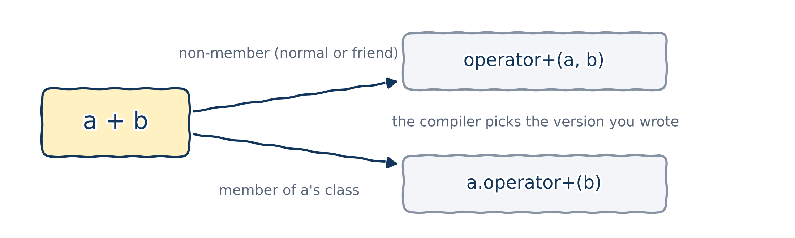
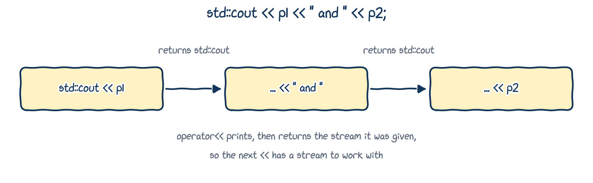

# Operator Overloading {#sec-ch13}

For our own `ComplexNumber` objects `a` and `b`, we'd like to write `a + b` and `std::cout << a`, just as for `int`s. This chapter shows how: as friend functions, as normal functions, and as member functions, including the input and output operators `>>` and `<<`.

## Operators are functions

Think of `1 + 2` as `add(1, 2)`: an operator is just a function with a special name and a convenient syntax. In C++, operators really are implemented as functions, and we can **overload** them for our own types, which C and Java, for example, don't allow.

::: {.callout-note title="Coming from Python"}
A Python class doesn't know how to print itself or add itself either: `print(a)` shows something like `<__main__.ComplexNumber object at 0x7f3c2a1b2d50>`, and `a + b` fails with *TypeError: unsupported operand type(s) for +* (`complex_number_01.py`). **Special methods** grant both wishes: define `__str__(self)`, which `print()` uses, and `__add__(self, other)`, which `+` uses, and the program prints `a + b = 66 + 66i` (`complex_number_02.py`). C++ does the same job with functions called `operator<<` and `operator+`.
:::

With `int x{42};` and `int y{24};`, the compiler treats `x + y` as a call to `operator+(x, y)`, the built-in version for two `int`s. With two `double`s, the same `x + y` calls the `double` version instead: plain **overload resolution** (Chapter 05). For a class type there's no built-in version, so for two `ComplexNumber` objects, `std::cout << a + b` doesn't compile (`operator_example_complex_number.cpp`):

```{.text .output .compiler}
error: no match for 'operator+' (operand types are 'ComplexNumber' and 'ComplexNumber')
```

We have to tell the compiler what `+` means.

{fig-alt="a + b is turned into either operator+(a, b), a non-member function, or a.operator+(b), a member of a's class. The compiler picks the version you wrote." width="56%"}

Here is the same program with the two operators overloaded. By the end of the chapter, you'll understand every line of it:

```{.cpp filename="operator_example_complex_number_fixed.cpp"}

```

```{.text .output}
42 + 24i
24 + 42i
66 + 66i
```

::: {.callout-tip title="Best practice"}
- An overloaded operator should work on at least one type **you** defined.
- Keep each operator's meaning as close to its usual meaning as possible: `+` should add.
- If the meaning wouldn't be clear and intuitive, write a named function instead.
- Operators that don't change their operands (like `+`) should return their result **by value**.
- Operators that change their left operand (like `+=` and `=`) should return that operand **by reference**.
:::

## Arithmetic operators as friend functions

The arithmetic operators `+`, `-`, `*` and `/` take two operands, and all four are overloaded in exactly the same way. There are three ways to write them: as a **friend** function, as a **normal** (non-member, non-friend) function, or as a **member** function. We start with friends, because they can read the private data of both operands. Our example class counts pennies:

```{.cpp filename="overload_operators_plus_minus.cpp"}

```

```{.text .output}
Together: 66
Difference: 18
```

The keyword **`explicit`** on line 6 stops the compiler from turning an `int` into a `Pennies` behind our back: `Pennies p = 42;`, and passing `42` where a `Pennies` is expected, won't compile. A penny count is a whole number, and we want every conversion to be on purpose, so you write `Pennies{42}` when you mean it.

`operator+` and `operator-` are **not** members; they're friends, so they may use `a.pennies` and `b.pennies`. Overloading `+` is as simple as:

1. declaring a function named `operator+`;
2. giving it two parameters, one per operand (`const` references, since `+` doesn't change them);
3. picking a sensible return type (here, a new `Pennies` returned by value);
4. writing the body.

As in Chapter 12, a friend can be defined inside the class, and it's still a **non-member** function (`friend_function_inside_class.cpp`).

### Operands of different types

To add a number to every component of a 3D vector, we need `double + Vector3D` and `Vector3D + double`. These are two **different** functions, because the operands come in a different order, so overload both, just like any overloaded function:

```{.cpp filename="vector3d_operands_of_different_types.cpp"}

```

```{.text .output}
(43, 44, 45)
(43, 44, 45)
```

Look at line 14: to make `w + 42` give the same answer as `42 + w`, the second operator simply **calls** the first. There's only one real implementation, so only one place to fix if it's ever wrong.

**Your turn.** With `Pennies mine{42};`, how would you make all of these work? Start from `overload_operators_play_around.cpp`, and try it before you look at the answer.

```{.cpp}
std::cout << (42 + mine).get_pennies() << '\n';
std::cout << (mine + 42).get_pennies() << '\n';
std::cout << (3 * mine).get_pennies() << '\n';
std::cout << (mine * 3).get_pennies() << '\n';
```

::: {.callout-tip title="My solution" collapse="true"}
`overload_operators_play_around_solution.cpp` prints `84`, `84`, `126` and `126`. It makes `operator+(int, const Pennies&)` and `operator*(int, const Pennies&)` friends, and implements the other two orders by calling them, so those two need no friendship at all:

```{.cpp}
Pennies operator+(int value, const Pennies& p) { // a friend of Pennies
    return Pennies{value + p.pennies};
}

Pennies operator+(const Pennies& p, int value) { // no friendship needed:
    return value + p;                            // it reuses the one above
}
```
:::

## Operators as normal functions

We made `operator+` a friend because it needed the private member `pennies`. If the public getter gives it everything it needs, it doesn't have to be a friend:

```{.cpp}
// Neither a member nor a friend: the getter is all it needs
Pennies operator+(const Pennies& a, const Pennies& b) {
    return Pennies{a.get_pennies() + b.get_pennies()};
}
```

With this, and no `friend` declaration in the class, `mine + yours` works as before (`overload_operators_with_normal_functions.cpp`). Friends and normal functions behave almost identically. One difference: a friend's declaration inside the class doubles as its **prototype**, while a normal function needs its own. That matters when we split the program into files (Chapter 02). The class and the operator's declaration go in a header:

```{.cpp filename="pennies/pennies.h"}

```

The definition of `operator+` goes in `pennies/pennies.cpp`, and `pennies/main.cpp` includes `pennies.h` and uses `mine + yours` as before:

```{.text .terminal}
$ cd pennies
$ g++ -std=c++20 -Wall main.cpp pennies.cpp -o pennies
$ ./pennies
I have 66 pennies.
```

Without the declaration of `operator+` in `pennies.h`, `main.cpp` couldn't use `mine + yours`, because it's compiled on its own. If `main.cpp` lives in another folder, include the header by its relative path, as in `main_pennies.cpp`: `#include "pennies/pennies.h"`.

## Overloading the I/O operators

A `print()` member function works, but it breaks one output statement into three:

```{.cpp}
std::cout << "My point is ";
point.print();
std::cout << " in Cartesian space.\n";
```

We'd rather write `std::cout << point`, like Python's `__str__` (`point_with_print.cpp`). `<<` is a binary operator too, just like `+`. In `std::cout << point`, the left operand is `std::cout`, an object of type **`std::ostream`**, and the right operand is our `Point`. So our function looks like this:

```{.cpp}
friend std::ostream& operator<<(std::ostream& out, const Point& p);
```

It can't be a member of `Point`, because a member operator's left operand must be a `Point`. And it can't be a member of `std::ostream`, because we can't change the standard library. So it's a friend (or a normal function):

```{.cpp filename="point_overload_output_operator.cpp"}

```

```{.text .output}
My points are Point(42, 24, 12) and Point(1, 2, 3)
```

Inside the function, `std::cout` is simply called `out`: a reference to whatever stream we're printing to.

{fig-alt="std::cout << p1 << \" and \" << p2: std::cout << p1 returns std::cout, so << \" and \" is applied to std::cout, which returns std::cout again, so << p2 works too. operator<< prints, then returns the stream it was given." width="70%"}

Why return `std::ostream&`? **To allow chaining:** `operator<<` returns the stream it was given, so the next `<<` has a stream to work with, the same idea as returning `*this` in Chapter 12. And **by reference**, because `std::ostream` can't be copied, so returning it by value doesn't even compile.

The input operator `>>` is the mirror image. Its left operand is `std::cin`, a **`std::istream`**, and the `Point` parameter is **not** `const`, because we read into it (`point_overload_input_operator.cpp`):

```{.cpp}
std::istream& operator>>(std::istream& in, Point& p) { // p is NOT const
    in >> p.x >> p.y >> p.z;
    return in;
}
```

```{.text .terminal}
$ ./point_overload_input_operator
Enter a point: 1 2 3
You entered Point(1, 2, 3)
```

## Operators as member functions

When an operator is overloaded as a **member** function, it must be a member of the class of the **left** operand. The left operand becomes the implicit object, `*this`, and the other operand becomes the only parameter. No new rules are needed: it's just an ordinary member function with a special name. Here is the friend `operator+` for `Pennies` (`overload_operator_plus_revisit.cpp`), converted into a member:

```{.cpp filename="overload_operator_plus_member_function_01.cpp"}

```

```{.text .output}
I have 54 pennies.
```

`mine + yours` now means `mine.operator+(yours)`. Like any member function, it can be defined outside the class, with `Pennies::` in front of its name. A member is a natural fit for `Pennies + int`, where the left operand is ours; but `<<` must still be a friend or normal function, because its left operand is a `std::ostream` (`overload_operator_plus_member_function_02.cpp`, which prints `I have 54 pennies.`).

::: {.callout-warning title="Watch out"}
In `std::cout << ".\n";` the double quotes make text. With single quotes, `'.\n'` would be a *multi-character literal*, which prints a strange number!
:::

### `+=` as a member, `+` as a normal function

`+=` changes its left operand, so it's a member that returns `*this` by reference. `+` can then be a normal function, implemented with `+=`:

```{.cpp filename="complex_plus_equal.cpp"}

```

```{.text .output}
4 + 6i
```

`operator+` takes `a` **by value**, so `a` is a copy and changing it is fine. It applies `+=` to the copy and returns the result: implementing one operator in terms of another again.

So which should you use: friend, normal or member?

::: {.callout-tip title="Rules of thumb"}
- Assignment `=`, subscript `[]`, function call `()` and member selection `->` **must** be members: the language requires it.
- Unary operators (like `-x`): members.
- Binary operators that **don't change** their left operand (like `+`): normal functions (preferred) or friends.
- Binary operators that change their left operand, but whose left operand's class you can't change (like `<<` on `std::ostream`): normal functions or friends.
- Binary operators that change their left operand, in a class you can change (like `+=`): members.
:::

## Summary

- An operator is a function with a special name: `a + b` calls `operator+(a, b)` or `a.operator+(b)`.
- Overload operators as **friend**, **normal** or **member** functions. A member operator belongs to the left operand's class, which becomes `*this`.
- `+` returns a new object by value; `+=` changes `*this` and returns it by reference. Implement one operator in terms of another.
- `operator<<` and `operator>>` take a stream (`std::ostream&` or `std::istream&`) as the left operand, and return it by reference to allow chaining.
- Use `explicit` constructors to prevent unwanted conversions.
- Keep each operator's usual meaning; if in doubt, write a named function.

**Further reading** on [learncpp.com](https://www.learncpp.com): [arithmetic operators using friend functions](https://www.learncpp.com/cpp-tutorial/overloading-the-arithmetic-operators-using-friend-functions/), [the I/O operators](https://www.learncpp.com/cpp-tutorial/overloading-the-io-operators/), [operators as member functions](https://www.learncpp.com/cpp-tutorial/overloading-operators-using-member-functions/), [comparison operators](https://www.learncpp.com/cpp-tutorial/overloading-the-comparison-operators/), including C++20's `<=>`.
