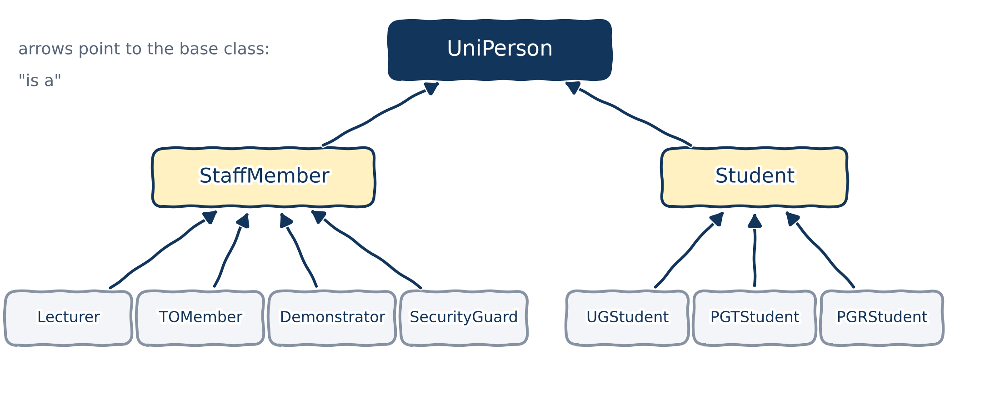
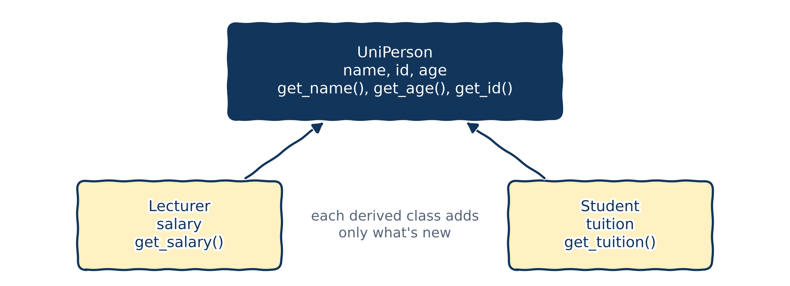
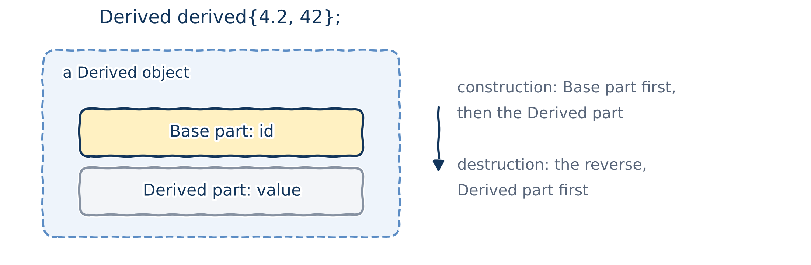
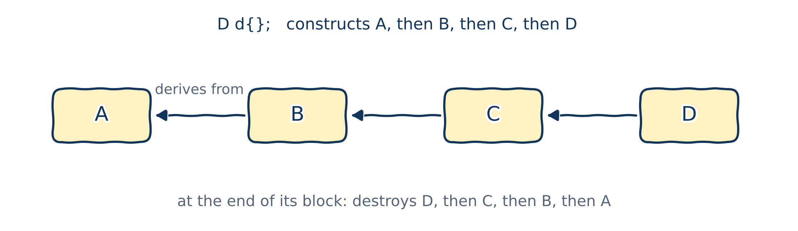

# Inheritance {#sec-ch14}

Classes often come in families: lecturers and students are both people at a university, and circles and rectangles are both shapes. This chapter derives new classes from existing ones, with **inheritance**: what a derived object is made of, how it's constructed, who may use which members, and how a derived class can add to, redefine or extend what it inherits.

## Introduction to inheritance

Suppose you're writing software that draws 2D shapes: rectangles, squares, polygons, circles, ellipses... One class per shape, written from scratch? Wait a minute. There are **"is a"** relationships between them: a `Square` **is a** `Rectangle`, a `Rectangle` **is a** `Polygon`, a `Circle` **is an** `Ellipse`, and all of them **are** `Shape`s. And there are **"has a"** relationships: a `Polygon` **has a** list of `Point2D`s, and an `Ellipse` **has a** centre and two axis lengths `a` and `b`, so a `Circle` is an `Ellipse` with `a == b`. Drawing a square should just be drawing a rectangle with equal sides. A diagram of how things are related like this is called a **hierarchy**.

::: {.callout-warning title="Watch out"}
Everyday "is a" can mislead. A square *is* a rectangle, but if `Rectangle` has `set_width()`, a `Square` can't honour it without breaking its own rules. This classic trap is the *square–rectangle problem*. In code, "is a" must mean "can be used **anywhere** the base class is used".
:::

If shapes don't convince you, look at a university. Every **staff member** has a `name`, a `birthday` and an `ID`, and so does every **student**. There are different kinds of staff, `Lecturer`, `TOMember`, `Demonstrator` and `SecurityGuard`, and different kinds of students, `UGStudent`, `PGTStudent` (postgraduate taught) and `PGRStudent` (postgraduate research). Writing all seven classes separately means writing the common members seven times: copy, paste, repeat. That breaks the golden rule from Chapter 02, **Don't Repeat Yourself**. A better design:

{fig-alt="A hierarchy: UniPerson at the top. StaffMember and Student derive from it. Lecturer, TOMember, Demonstrator and SecurityGuard derive from StaffMember; UGStudent, PGTStudent and PGRStudent derive from Student. Arrows point to the base class." width="70%"}

What all people share goes in `UniPerson`, what all staff share goes in `StaffMember`, and each role adds only what's special about it.

## Basic inheritance in C++

In an inheritance ("is a") relationship, the class being inherited from is the **base class** (or *parent class*, or *superclass*), and the class doing the inheriting is the **derived class** (or *child class*, or *subclass*). For our code we use a smaller version of the university:

{fig-alt="UniPerson has name, id and age, and get_name(), get_age() and get_id(). Lecturer derives from it and adds salary and get_salary(); Student derives from it and adds tuition and get_tuition()." width="62%"}

Every `Lecturer` and every `Student` **is a** `UniPerson`, with a name, an ID and an age. (What they *do* differently comes with polymorphism, in Chapter 15.) First, the base class:

```{.cpp filename="uniperson.h"}

```

Each person needs a unique ID, so the class keeps a counter, `next_id`. A **`static`** member variable belongs to the **class**, not to any one object: all `UniPerson`s share one `next_id`. Each new person takes its value, then increments it (`id{next_id++}`). **`inline`** (C++17) lets us initialize it right here, in the header.

Without inheritance, `Lecturer` would repeat everything in `UniPerson` and add a `salary` (`lecturer_noinheritance.cpp`). It compiles, but everything from `UniPerson` is **copied and pasted**; fix a bug in one copy, and you must remember all the others. Worse, `Lecturer` has its **own** `next_id`, so lecturer and student IDs can clash. With inheritance:

```{.cpp filename="lecturer.h"}

```

`class Lecturer : public UniPerson` means "a `Lecturer` **is a** `UniPerson`" (we'll see what `public` means here later). `Lecturer` only adds what's new, `salary`, and its member initializer list first passes `name` and `age` to `UniPerson`'s constructor, as we'll see shortly. `student.h` is the same with `tuition` in place of `salary`, and using both is easy:

```{.cpp filename="main_uniperson_lecturer_student.cpp"}

```

```{.text .output}
Khiem (ID 100000), salary 55000
Peter Parker (ID 100001), tuition 9250
```

We never wrote `get_name()` or `get_id()` in `Lecturer` or `Student`, yet we can call them: both classes inherited them from `UniPerson`. And there's one shared counter, so IDs never clash, whether you're a lecturer or a student.

### Splitting the program into files

A real program has many classes. As in Chapter 02, each class gets a **header file** (`.h`) with the class definition and its member function *declarations*, and an **implementation file** (`.cpp`) with the member function *definitions*. The folder `uni-program/` builds four classes this way: `UniPerson`; `Lecturer` and `Student`, which inherit from it; and `UGStudent`, which inherits from `Student`, an **inheritance chain**. The header `uni-program/uniperson.h` now only *declares* the member functions, such as `int get_age() const;`, and declares the counter as `static int next_id;`. The definitions go in the implementation file:

```{.cpp filename="uni-program/uniperson.cpp"}

```

Outside the class, every member's name gets the prefix `UniPerson::`. This also shows the classic way to handle a `static` member: declare it in the class, and define it **once**, in the `.cpp` file. `int UniPerson::next_id{100000};` can't go in the header, because every `.cpp` file that includes the header would then define it again: a link error. `Lecturer` and `Student` are split the same way. At the end of the chain, `class UGStudent : public Student` adds one member function, `write_bsc_thesis()`, and its constructor passes everything on to `Student`:

```{.cpp}
// Default arguments go in the header only (Chapter 05)
UGStudent::UGStudent(const std::string& name, int age, double tuition)
    : Student{name, age, tuition} {}
```

`main.cpp` creates a `Lecturer` and a `UGStudent`; compile all the `.cpp` files together:

```{.text .terminal}
$ g++ -std=c++20 -Wall main.cpp uniperson.cpp lecturer.cpp student.cpp ugstudent.cpp -o uni
$ ./uni
Khiem (ID 100000), salary 55000
Natasha (ID 100001), tuition 9250
Natasha (ID 100001) is writing a BSc thesis
```

`write_bsc_thesis()` calls `get_name()` and `get_id()`, which `UGStudent` inherited from `UniPerson` through `Student`.

## Order of construction

Take a base class with a member `id` and a function `get_id()`, and a class derived from it that adds a member `value` (`base_and_derived.cpp`). What exactly happens when we create a `Derived`?

{fig-alt="A Derived object contains a Base part, with id, and a Derived part, with value. Construction builds the Base part first, then the Derived part; destruction goes the other way." width="62%"}

The members of `Base` are **not copied** into `Derived`. Instead, a `Derived` object is made of two parts: a `Base` part, and a `Derived` part on top of it.

```{.cpp filename="parent_and_child_with_main.cpp"}

```

```{.text .output}
Creating a Base:
  Base constructed
Creating a Derived:
  Base constructed
  Derived constructed
```

Creating a `Derived` runs the `Base` constructor **first**, then the `Derived` one. That makes sense: the derived part may rely on the base part being ready.

{fig-alt="A chain A, B, C, D, where each class derives from the one before. D d{} constructs A, then B, then C, then D; at the end of its block it destroys D, then C, then B, then A." width="74%"}

In an inheritance chain, where `B` derives from `A`, `C` from `B` and `D` from `C`, creating a `D` constructs the parts from the most basic class to the most derived: the great-grandparent `A`, then the grandparent `B`, then the parent `C`, and finally `D` itself (`inheritance_chain_four_classes.cpp`). Destruction runs the other way, in **reverse** order of construction: the most derived part is taken down first. Give the classes of a chain `A`, `B`, `C` destructors that say so, and creating a `C c{};` in `main()` prints (`destructor_inheritance_chain.cpp`):

```{.text .output}
A constructed
B constructed
C constructed
C destroyed
B destroyed
A destroyed
```

## Constructing derived classes

::: {.callout-note title="Coming from Python"}
In Python, `super().__init__(name, age)` inside `Lecturer.__init__` runs the parent's constructor first, so the parent can set up `name`, `age` and `id` (`uniperson_super.py`).
:::

How do we do that in C++? Suppose `Base` has a constructor `Base(int id)` that sets `id`, and `Derived` has a constructor `Derived(double value)` that sets `value` (`initialization_of_derived_class.cpp`). How can `Derived`'s constructor set the `id` that every `Derived` inherits from `Base`? Recall what happens when `Derived derived{4.2};` runs:

1. memory for a whole `Derived` (both parts) is set aside;
2. the right `Derived` constructor is called, **but first, the `Base` part is constructed** with a `Base` constructor. If we don't say which one, its **default constructor** is used;
3. then `Derived`'s member initializer list and body run.

**Attempt 1:** initialize `id` in `Derived`'s member initializer list, as `: value{value}, id{id}`. It fails with *class 'Derived' does not have any field named 'id'* (`initialization_of_derived_class_approach_01.cpp`). A member can only be initialized in the member initializer list of **its own** class's constructor, and by then the `Base` part, with `id`, has already been constructed.

**Attempt 2:** assign it in the body, `this->id = id;`. If `id` is `const`, that fails with *assignment of read-only member 'Base::id'* (`initialization_of_derived_class_approach_02.cpp`). Remove the `const` and it compiles, but it still doesn't work for `const` or reference members, and it's wasteful: `id` is initialized once by `Base`, then assigned again.

**The solution:** call the `Base` constructor **first** in the member initializer list. It's C++'s `super().__init__()`:

```{.cpp filename="initialization_of_derived_class_base_constructor.cpp"}

```

```{.text .output}
id: 42, value: 4.2
```

That's exactly what `Lecturer` did with `: UniPerson{name, age}`. In a chain, each class calls only its **direct** parent's constructor, passing along what that parent needs. With `B(int a, double b) : A{a}` and `C(int a, double b, char c) : B{a, b}`, creating `C c{5, 4.3, 'R'}` prints `A: 5`, `B: 4.3` and `C: R` (`initializing_base_members_inheritance_chain.cpp`), just as `UGStudent` passed its arguments to `Student`, which passed `name` and `age` on to `UniPerson`.

## Inheritance and access specifiers

We've used `public` and `private`. The third access specifier, `protected`, only matters with inheritance. A **`protected`** member can be used by the class itself, its friends, **and its derived classes**; like a `private` member, it can't be used by the public. It's the middle column of the table in Chapter 11.

```{.cpp filename="access_specifiers_in_inheritance.cpp" .no-compile}

```

```{.text .output .compiler}
error: 'int Base::private_member' is private within this context
error: 'int Base::protected_member' is protected within this context
```

`Derived` can use `protected_member`, but not `private_member`, and `main()` can use neither. When should we use `protected`? Every derived class can use a `protected` member directly, so if we later change it (its type, its meaning or its name), we may have to change **every** derived class too. That's manageable when we, or our team, write the derived classes and there are only a few of them. But in open-source code, anyone can derive from your class and misuse its `protected` members.

::: {.callout-tip title="Best practice"}
Favour `private` members over `protected` ones. Use `protected` only when derived classes are planned, and a `private` member plus public functions would cost too much.
:::

### Kinds of inheritance

There are three ways to inherit, `public`, `protected` and `private`. Only `public` inheritance is common; the others are rare. Careful: for a `class`, leaving the keyword out means `private`, so `class Def : Base {};` is private inheritance (Chapter 10's table of defaults). The kind of inheritance can make inherited members *less* accessible:

| Member in `Base` | `public` inheritance | `protected` inheritance | `private` inheritance |
|:---|:---|:---|:---|
| `public` | public | protected | private |
| `protected` | protected | protected | private |
| `private` | inaccessible | inaccessible | inaccessible |

## Adding, redefining and extending behaviour

One of the biggest benefits of inheritance is that we **reuse** what's written and **add** what's new:

```{.cpp filename="base_derived.h"}

```

`Derived` adds a member `value` and a function `print()`, which may use the inherited `id` because it's `protected`. A `Derived` object can use both what it inherited and what it added: for `Derived derived{24.0, 42};`, `derived.identify()` prints `I am a Base, ID 42` and `derived.print()` prints `ID 42, value 24` (`add_functionality_example.cpp`). Derived objects go in a `std::vector<Derived>` like any others, and `add_functionality_example_vector.cpp` prints them all with `for (const auto& element : list) { element.print(); }`. That's a **range-based for loop**: it visits every element of `list`, like Python's `for element in list:`, and the `const auto&` avoids copying each element (Chapter 07).

### Redefining and extending

If `Derived` has nothing of its own, `derived.identify()` simply calls the inherited `Base::identify()` (`call_base_class_function.cpp`). If `Derived` defines its own `identify()`, a `Derived` object uses that one instead: it **redefines** the behaviour, and its version **hides** the base version (`redefine_behaviors.cpp`, which prints `Base::identify()` for a `Base` and `Derived::identify()` for a `Derived`). To **extend** the base behaviour rather than replace it, call the base version explicitly, as `Base::identify()`:

```{.cpp filename="add_to_existing_functionality.cpp"}

```

```{.text .output}
Derived::identify()
Base::identify()
```

A derived class can also change an inherited member's access level, with a **`using` declaration**. If `Base` has a `protected` function `print_id()`, writing `using Base::print_id;` under `public:` in `Derived` makes it public, so `main()` may call `d.print_id()` (`change_inherited_member_access_level.cpp`). Under `private:`, the same trick **hides** a public member (`hide_functionality.cpp`). And `void print_base() const = delete;` in the derived class forbids calling an inherited function altogether (`delete_functions_in_derived.cpp`).

## Multiple inheritance

**Multiple inheritance** lets a class inherit from more than one base class.

{fig-alt="SmartPhone, with use_app(), derives from both Camera, with take_photo(), and Phone, with make_call()." width="56%"}

A `Camera` can `take_photo()`; a `Phone` can `make_call()`; a `SmartPhone` is both, and adds apps on top. List the base classes after the colon, separated by commas: `class SmartPhone : public Camera, public Phone`. Then a `SmartPhone my_phone{};` can call `take_photo()`, inherited from `Camera`, `make_call()`, inherited from `Phone`, and its own `use_app("Moodle")` (`multiple_inheritance_smartphone.cpp`).

::: {.callout-warning title="Watch out"}
Multiple inheritance gets complicated fast: what if both bases have a member with the same name? Use it only when the alternatives are worse.
:::

## Summary

- **Inheritance** models "is a": `class Lecturer : public UniPerson`. The derived class reuses the base class's members and adds its own.
- A derived object has a **base part** and a **derived part**. The base part is constructed first and destroyed last; in a chain, from the most basic class to the most derived.
- Initialize the base part by calling the **base constructor** first in the member initializer list: C++'s `super().__init__()`.
- **`protected`** members are visible to derived classes, but not to the public. Prefer `private`.
- A derived class can **add** functions, **redefine** (hide) inherited ones, or **extend** them by calling `Base::function()`.
- A class can inherit from **several** bases, but use that sparingly.

**Further reading** on [learncpp.com](https://www.learncpp.com): [constructors and initialization of derived classes](https://www.learncpp.com/cpp-tutorial/constructors-and-initialization-of-derived-classes/), [inheritance and access specifiers](https://www.learncpp.com/cpp-tutorial/inheritance-and-access-specifiers/), [hiding inherited functionality](https://www.learncpp.com/cpp-tutorial/hiding-inherited-functionality/), [multiple inheritance](https://www.learncpp.com/cpp-tutorial/multiple-inheritance/).
