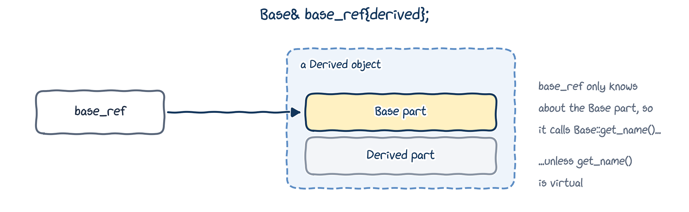
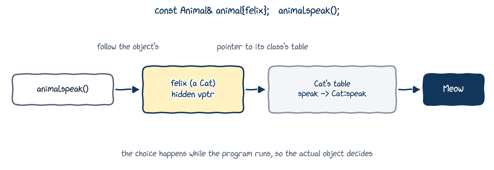
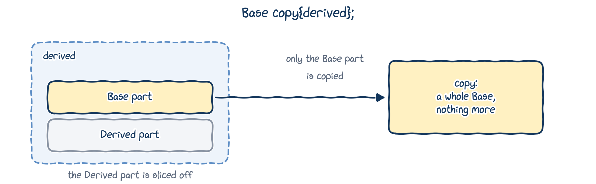

# Virtual Functions and Polymorphism {#sec-ch15}

Inheritance lets a derived class reuse a base class. This chapter brings in the fourth pillar of OOP, **polymorphism**: code written for a base class that does the right thing for every derived class, through **virtual functions**. It also covers `override` and `final`, object slicing, virtual destructors, and abstract classes.

## Base class pointers and references

We start from a familiar pair of classes, in `base_derived.h`. `Base` has a member function `get_name()` that returns `"Base"`. `Derived` inherits from `Base`, adds a member `value` with a getter `get_value()`, and has its own `get_name()`, returning `"Derived"`, which hides `Base::get_name()` (Chapter 14). A `Derived` reference or pointer behaves just like the `Derived` object itself: `derived.get_name()`, `ref.get_name()` and `ptr->get_name()` all give `Derived` (`pointers_references_to_derived.cpp`). Nothing new there. But a `Derived` object **has a** `Base` part, so a *`Base`* reference or pointer can refer to it too:

```{.cpp filename="base_pointers_references_to_derived.cpp"}

```

```{.text .output}
Derived
Base
Base
```

Look at what it calls!

{fig-alt="base_ref refers to a Derived object, but only knows about its Base part, so it calls Base::get_name(), unless get_name() is virtual." width="65%"}

`Derived::get_name()` hides `Base::get_name()` for `Derived` objects. But through a `Base` reference or pointer, the compiler only knows about the `Base` part, so it calls `Base::get_name()`. For the same reason, `base_ref.get_value()` wouldn't compile: a `Base` has no `get_value()`.

### Why would we want a base reference?

Suppose we have cats, dogs and tigers, and want to report what each one says. We could write one function per animal: `report(const Cat& cat)`, `report(const Dog& dog)`, `report(const Tiger& tiger)`, each with the same body. A zoo with 100 kinds of animal means 100 copies of the same function. We'd much rather write one:

```{.cpp}
void report(const Animal& animal) {
    std::cout << animal.get_name() << " says " << animal.speak() << '\n';
}
```

Couldn't a function template (Chapter 06) do it? It works, but nothing says `T` must be an animal, so `report(42)` gives a long, confusing template error. And each type gets its own instance, decided at **compile time**, so a template can't handle a collection of *mixed* animals whose types are only known when the program runs.

Our animals are in `animals_nonvirtual.h`. `Animal` has a `name`, a `get_name()`, and a `speak()` that returns `"???"`; `Cat` and `Dog` derive from it, and each has its own `speak()`, returning `"Meow"` or `"Woof"`. The constructor of `Animal` is `protected`, so nobody can create a plain `Animal`, only cats and dogs. (You'll see the classes in full below, in `animals.h`.) An array holds objects of **one** type, so without a common type each kind of animal needs its own array and its own loop (`different_animal_arrays.cpp`): with 100 kinds, that's 100 arrays. Base pointers let one vector hold every kind of animal:

```{.cpp filename="animal_array.cpp"}

```

```{.text .output}
Fred says ???
Garbo says ???
Misty says ???
Pooky says ???
```

But they all say `???`: each call goes to `Animal::speak()`. We need **virtual functions**.

## Virtual functions

A **virtual function** is a member function that, when called through a base pointer or reference, resolves to the **most-derived** version for the actual object. Put `virtual` in front of the function in the **base class**. A function in a derived class with the same signature and return type **overrides** it, and is called an **override**; mark it `override`.

```{.cpp filename="virtual_function_example.cpp"}

```

```{.text .output}
base_ref is a Derived
```

One word, `virtual`, and the call through `base_ref` now reaches `Derived::get_name()`. In a chain where `B`, `C` and `D` each override `A::get_name()`, an `A&` referring to a `C` calls `C::get_name()`: the most-derived version **for the actual object**. `D` doesn't come into it, because the object isn't a `D` (`virtual_function_inheritance_chain.cpp`).

Here are the animals again, with two changes: `virtual` in front of `Animal::speak()`, and `override` after each derived `speak()`. (The virtual destructor is explained later in this chapter, and `std::string_view` is a cheap, read-only view of some text, from Chapter 04.)

```{.cpp filename="animals.h"}

```

```{.cpp filename="animals_with_virtual.cpp"}

```

```{.text .output}
Felix says Meow
Rex says Woof
Fred says Meow
Garbo says Woof
```

It's the same `report()` function as before: with the non-virtual header, everyone said `???` (`animals_without_virtual.cpp`). Only the header changed.

{fig-alt="animal.speak(): follow the object's hidden pointer to its class's table, which says speak means Cat::speak, which prints Meow. The choice happens while the program runs." width="69%"}

How does it work? Every object of a class with virtual functions carries a hidden pointer to its class's **virtual table**, which lists the right function for each virtual call. Following it costs a tiny bit of time, which is why C++ functions aren't virtual unless you ask.

### Polymorphism

**Polymorphism** means one name with many forms, chosen according to the types involved. **Compile-time polymorphism** is resolved by the compiler: function overloading (Chapter 05) and templates (Chapter 06). **Run-time polymorphism** is resolved while the program runs: virtual functions.

::: {.callout-important title="Key idea"}
With virtual functions, code written for the **base class** (like `report(const Animal&)`) automatically does the right thing for **every** derived class, even ones written years later.
:::

An override needs **exactly** the same signature as the base function, parameter types and `const` included, and is itself virtual. The return types must match too: if `Base` has `virtual int get_value() const` and `Derived` declares `double get_value() const`, the compiler reports *conflicting return type specified for 'virtual double Derived::get_value() const'* (`virtual_return_type_mismatch.cpp`).

## The `override` and `final` specifiers

What happens when an "override" doesn't quite match?

```{.cpp filename="not_use_override_specifier.cpp"}

```

```{.text .output}
A
A
```

Both calls go to `A`. `B::get_name_1()` takes a `short`, not an `int`, and `B::get_name_2()` isn't `const`, so neither is an override: they're new functions that happen to share a name. It compiles, and only `-Wall` hints at the problem: *'virtual std::string_view A::get_name_1(int) const' was hidden*. Write `override` on both, and the bug becomes an error (`use_override_specifier.cpp`):

```{.text .output .compiler}
error: 'B::get_name_1(short int) const' marked 'override', but does not override
error: 'B::get_name_2(int)' marked 'override', but does not override
```

::: {.callout-tip title="Best practice"}
Write `virtual` only in the base class, and `override` on **every** override.
:::

**`final`** does the opposite job: it stops a function from being overridden any further. If `B` declares `get_name() const override final`, a class `C` derived from `B` can't override `get_name()` again: *virtual function 'virtual std::string_view C::get_name() const' overriding final function* (`final_specifier_example.cpp`). And `class B final : public A` would stop anyone deriving from `B` at all.

## Slicing and virtual destructors

```{.cpp filename="object_slicing.cpp"}

```

```{.text .output}
ref is a Derived
copy is a Base
```

A **reference** refers to the whole `Derived`. But a **copy** into a `Base` keeps only the `Base` part: the rest is **sliced off**, and what's left is a whole `Base` and nothing more.

{fig-alt="Base copy{derived}: only the Base part of derived is copied, so copy is a whole Base and nothing more; the Derived part is sliced off." width="68%"}

A `std::vector<Animal>` would slice every cat and dog into a plain `Animal`, which is why we used `std::vector<const Animal*>`. And a function `report(Animal animal)`, taking its parameter by value, would slice too.

::: {.callout-tip title="Best practice"}
Pass polymorphic objects **by reference or pointer**, never by value.
:::

### Virtual destructors

What happens when we delete a derived object through a base pointer?

```{.cpp filename="virtual_destructor.cpp"}

```

```{.text .terminal}
$ g++ -Wall virtual_destructor.cpp
warning: deleting object of polymorphic class type 'Base' which has non-virtual
destructor might cause undefined behavior
$ ./a.out
~Base()
```

`~Derived()` never ran! If `Derived` owned memory, it would leak. A destructor is a member function like any other, so through a `Base*` the non-virtual `~Base()` is called. The fix is the same as before: make it virtual. With `virtual ~Base()`, and `~Derived() override`, `delete ptr` calls the destructor of the actual object, which then calls the base destructors in turn (Chapter 14), and the program prints `~Derived()` and then `~Base()` (`virtual_destructor_fixed.cpp`).

::: {.callout-tip title="Best practice"}
A class meant to be a base class, especially one with virtual functions, should have a **virtual destructor**: `virtual ~Base() = default;`
:::

## Pure virtual functions and abstract classes

Suppose we add a `Cow` to our animals and forget to override `speak()` (`virtual_function_forget_redefine.cpp`). The program prints `Betsy says ???`: `Animal::speak()` quietly took over. No error, no warning, just a wrong answer. And what *does* an `Animal` say, anyway? There's no sensible default.

A **pure virtual function** has no body in the base class; it's marked `= 0`:

```{.cpp}
virtual std::string_view speak() const = 0; // "every animal MUST say something"
```

A class with at least one pure virtual function is an **abstract base class**: you **can't create objects** of it. A derived class must override every pure virtual function, or it's abstract too. (Only virtual functions can be pure: `int do_something() = 0;` is a compile error.) Now forgetting fails to compile:

```{.cpp filename="pure_virtual_function_forget_redefine.cpp" .no-compile}

```

```{.text .output .compiler}
error: cannot declare variable 'cow' to be of abstract type 'Cow'
```

A silent wrong answer is now a compile error: much better! Add `std::string_view speak() const override { return "Moo"; }` to `Cow`, and the program prints `Betsy says Moo` (`pure_virtual_function_remember_redefine.cpp`).

### Interface classes

An **interface class** has no member variables and only pure virtual functions. It defines **what** derived classes must be able to do, and leaves **how** entirely to them. Interface names often start with `I`:

```{.cpp}
class IErrorLog {
  public:
    virtual ~IErrorLog() = default; // so deleting through IErrorLog* is safe
    virtual bool open_log(std::string_view filename) = 0;
    virtual bool write_error(std::string_view message) = 0;
    virtual bool close_log() = 0;
};
```

Code that writes errors only needs an `IErrorLog&`. Whether errors go to a file, the screen or a database is decided by whichever class implements the interface.

### Putting it all together: shapes

Here is the `Shape` promised in Chapter 10, one class per header (Chapter 14). `Shape` is an abstract base class with a virtual destructor, which only says what every shape must be able to do:

```{.cpp filename="shape.h"}

```

`Circle` (in `circle.h`) derives from `Shape`, stores a `radius`, and overrides both functions: `area()` returns `std::numbers::pi * radius * radius`, and `name()` returns `"circle"`. `rectangle.h` is the same idea, with a `width` and a `height`. Now one loop handles every kind of shape:

```{.cpp filename="shapes.cpp"}

```

```{.text .output}
circle: area 3.14159
rectangle: area 6
```

An abstract base class, overrides, a virtual destructor, and `std::unique_ptr` (Chapter 09) doing the `delete`: everything from this chapter, working together.

## Summary

- A **base pointer or reference** can refer to a derived object, but only sees the base part.
- A **virtual function** call goes to the most-derived override for the **actual** object: run-time polymorphism.
- Write `virtual` in the base class and **`override`** on every override; **`final`** stops further overriding.
- Copying a derived object into a base object **slices** it: pass polymorphic objects by reference or pointer.
- Give base classes a **virtual destructor**.
- A **pure virtual function** (`= 0`) makes a class **abstract**; derived classes must override it. An **interface** is a class of pure virtual functions only.

**Further reading** on [learncpp.com](https://www.learncpp.com): [virtual functions and polymorphism](https://www.learncpp.com/cpp-tutorial/virtual-functions-and-polymorphism/), [`override`, `final` and covariant return types](https://www.learncpp.com/cpp-tutorial/the-override-and-final-specifiers-and-covariant-return-types/), [virtual destructors](https://www.learncpp.com/cpp-tutorial/virtual-destructors-virtual-assignment-and-overriding-virtualization/), [object slicing](https://www.learncpp.com/cpp-tutorial/object-slicing/), [pure virtual functions, abstract base classes and interface classes](https://www.learncpp.com/cpp-tutorial/pure-virtual-functions-abstract-base-classes-and-interface-classes/).

That's the end of Section 03. Section 04, *UML Class Diagrams*, shows how to describe object-oriented designs like these with diagrams, starting with Chapter 16.
