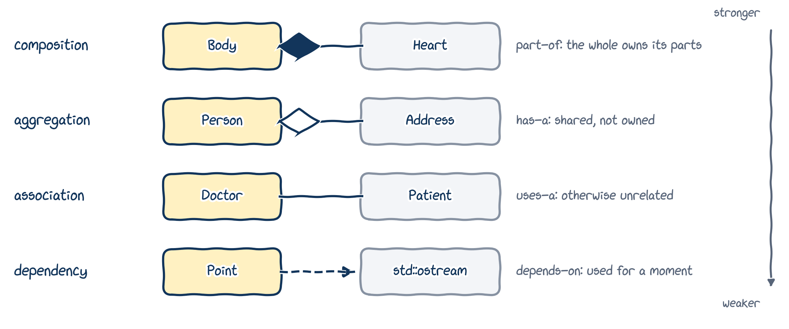
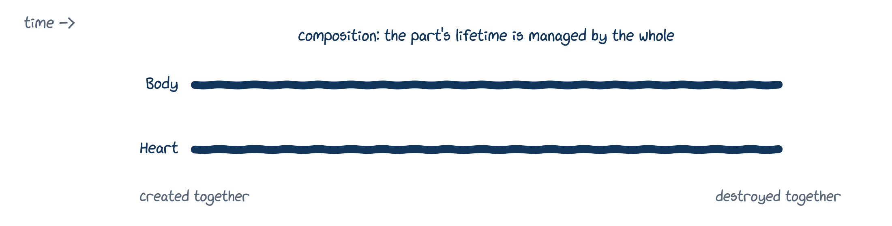
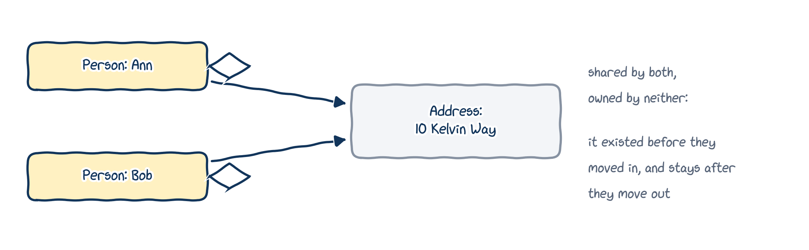
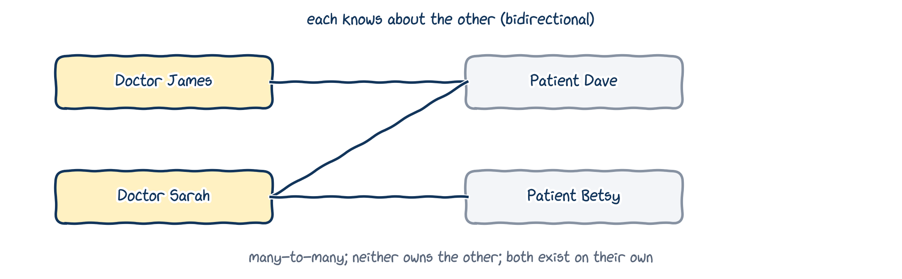

# Object relationships

## Relationships between objects

Life is full of objects that relate to each other, and we have everyday words for the kinds of relationship:

- a square **is a** shape; a lecturer **is a** university person (inheritance, Chapter 14);
- a car **has a** steering wheel; a person **has a** heart;
- a programmer **uses a** keyboard;
- a flower **depends on** a bee for pollination;
- a student is a **member of** a class; your brain is **part of** you.

Today: the relationships *other than* "is a", and how to write them as C++ classes. In Chapter 17, we'll draw them as UML diagrams.

## Four relationships, from strongest to weakest

{fig-alt="Composition: a Body owns its Heart, part-of. Aggregation: a Person has an Address, shared, not owned. Association: a Doctor and a Patient, otherwise unrelated, uses-a. Dependency: a Point uses std::ostream for a moment, depends-on. Ordered from stronger to weaker." width="92%"}

The little diamonds and arrows are a preview of UML notation (Chapter 17).

# Object composition

## Building objects from parts

Building a complex object from simpler ones is called **object composition**. You've been doing it since Chapter 10: every class with data members is built from parts.

- A computer is built from a CPU, a motherboard, some memory...
- A person is built from a head, a body, arms, legs...

Object composition models **"has a"** relationships: a computer *has a* CPU; a person *has a* heart. It comes in two kinds: **composition** and **aggregation**.

::: {.callout-warning title="Watch the terminology"}
*Object composition* is the general idea; *composition* and *aggregation* are its two subtypes. Don't confuse "object composition" with plain "composition".
:::

## Composition

In a **composition**, a part and its whole have this relationship:

1. the part is **part of** the whole;
2. the part can belong to **only one** whole at a time;
3. the part's **existence is managed** by the whole;
4. the part **doesn't know** about the whole.

{fig-alt="A timeline: the Body and the Heart are created together and destroyed together. The part's lifetime is managed by the whole." width="80%"}

## Composition, explained with a heart

1. **Part of:** a heart is part of a person's body.
2. **One whole at a time:** a heart in one person's body can't be in someone else's at the same time.
3. **Managed by the whole:** when the body is created, so is the heart; when the body is destroyed, so is the heart.
4. **Doesn't know:** the heart works away, unaware that it's part of a larger structure. The body knows about the heart, but not the other way round: a **unidirectional** relationship.

## A familiar composition: `Fraction`

```{.cpp filename="fraction_composition.cpp"}

```

- `numerator` and `denominator` are part of the `Fraction`, and belong to only one `Fraction`.
- They're created and destroyed with it.
- They don't know they're part of a `Fraction`: they just hold integers.

Obvious? Be patient: it's not always this simple.

## Implementing compositions

- Usually, the parts are simply **ordinary data members**: their lifetimes are automatically bound to the object's.
- If the parts need dynamic allocation (Chapter 09), use **pointer members**, and the class itself must do all the memory management: allocate in the constructor, free in the destructor (RAII, Chapter 12). The user of the class should never have to.

## A creature's location: `Point2D` {.dense-code}

```{.cpp filename="composition/point2d.h"}

```

## A creature has a location {.dense-code}

```{.cpp filename="composition/creature.h"}

```

## Playing the creature game {.dense-code}

::: {.columns}
::: {.column width="60%"}
```{.cpp filename="composition/creature_game.cpp"}

```
:::
::: {.column width="40%"}
```{.text .terminal}
$ ./creature_game
Enter a name for your creature: Gromit
Gromit is at (4, 7)
New x and y (or -1 -1 to quit): 1 2
Gromit is at (1, 2)
New x and y (or -1 -1 to quit): -1 -1
```

Every `Creature` **has a** `Point2D` location: a part of it, created and destroyed with it, and unaware of the creature it belongs to. A composition.
:::
:::

# Aggregation

## Aggregation

In an **aggregation**, a part and its whole have this relationship:

1. the part is **part of** the whole;
2. the part can (if desired) belong to **more than one** whole at a time;
3. the part's **existence is not managed** by the whole;
4. the part **doesn't know** about the whole.

Still a part–whole, unidirectional relationship. But the whole doesn't create or destroy its parts, and parts may be shared.

## Shared, not owned

{fig-alt="Ann and Bob both have the address 10 Kelvin Way. It is shared by both and owned by neither: it existed before they moved in, and stays after they move out." width="86%"}

Compare with the composition timeline: there, the heart lived and died with the body. Here, the address has a life of its own.

## Aggregation: two examples

::: {.columns}
::: {.column width="50%"}
**A person and their home address**

- Every person has an address.
- An address can belong to several people at once.
- The address isn't managed by the person: it existed before they moved in, and still exists after they move out.
- A person knows their address; an address doesn't know who lives there.
:::
::: {.column width="50%"}
**A department and its teachers**

- A department has teachers.
- A teacher could work for more than one department.
- Closing a department doesn't destroy its teachers: they existed before it, and go on existing after it.
- The department knows its teachers; a teacher needn't know the department.
:::
:::

## Implementing aggregations

Compositions and aggregations look almost the same in code: the parts are still data members. The difference is mostly about **ownership**:

- in an aggregation, the members are usually **references or pointers** to objects created **outside** the class;
- when the aggregate is destroyed, those references or pointers are destroyed, but the objects they refer to are not.

A `std::vector` can't hold plain references (Chapter 07: a reference must be bound when it's created, and can't be reseated). **`std::reference_wrapper<T>`**, from `<functional>`, is a reference that *can* be stored in a vector.

## A department and its teachers {.dense-code}

::: {.columns}
::: {.column width="72%"}
```{.cpp filename="school.h"}

```
:::
::: {.column width="28%"}
`Department` stores `std::reference_wrapper<const Teacher>`s: references to teachers who live elsewhere. That's what makes it an aggregation.

`Teacher` is just data, so it's a `struct` (Chapter 10).
:::
:::

## The teachers outlive the department

::: {.columns}
::: {.column width="72%"}
```{.cpp filename="teacher_department.cpp"}

```
:::
::: {.column width="28%"}
```{.text .output}
Department staff: Tony Natasha
Tony and Natasha still exist
```

The department never created its teachers, so it doesn't destroy them either.
:::
:::

## Composition versus aggregation

| | Composition | Aggregation |
|:---|:---|:---|
| Members are usually | ordinary data members (or pointers it manages itself) | references or pointers to outside objects |
| Creates and destroys its parts? | yes | no |
| Parts shared with other objects? | no | possibly |

- A single class can mix both: responsible for some parts, but not others.
- Aggregations are more error-prone: whoever creates the parts must make sure they live long enough (no dangling references, Chapter 07).

::: {.callout-tip title="Best practice"}
Implement the simplest relationship that meets the needs of your program, not the one that seems right in real life.
:::

# Association

## Association

In an **association**, two objects have this relationship:

1. the associated object is **otherwise unrelated** to the object: not a part of it;
2. the associated object can belong to **more than one** object at a time;
3. the associated object's **existence is not managed** by the object;
4. the associated object **may or may not know** about the object.

Unlike composition and aggregation, there's no part–whole relationship. And unlike aggregation, an association may be **bidirectional**: both objects know about each other.

## Doctors and patients

{fig-alt="Doctor James sees Patient Dave; Doctor Sarah sees Dave and Betsy. Each knows about the other. Many-to-many; neither owns the other; both exist on their own." width="80%"}

- A doctor clearly has a relationship with their patients, but a patient isn't *part of* a doctor.
- A doctor sees many patients, and a patient may see many doctors.
- Neither object's lifetime is tied to the other's.

## Implementing associations {.dense-code}

Associations are usually implemented with **pointers** (or references) to the associated objects.

```{.cpp filename="patient.h"}

```

`class Doctor;` is a forward declaration: a `Patient` only stores pointers to doctors, so the compiler just needs to know the name.

## The other side: `Doctor` {.dense-code}

```{.cpp filename="doctor.h"}

```

## A bidirectional association in action {.dense-code}

::: {.columns}
::: {.column width="76%"}
```{.cpp filename="doctor_patient.cpp"}

```
:::
::: {.column width="24%"}
```{.text .output}
Sarah sees: Dave Betsy
Dave sees: James Sarah
```

`add_patient()` updates **both** sides, so the links never get out of step. A bidirectional association needs that care; when you can, prefer a unidirectional one.
:::
:::

# Dependencies

## Dependencies {.dense-code}

A **dependency** occurs when one object uses another object's functionality to accomplish a specific task, **without keeping** it.

::: {.columns}
::: {.column width="78%"}
```{.cpp filename="dependency_example.cpp"}

```
:::
::: {.column width="22%"}
```{.text .output}
Point(42, 24, 42.24)
```

`Point` uses a `std::ostream` to print itself, but doesn't keep one.
:::
:::

## Dependency or association?

- In an **association**, one class keeps a **link** to the other as a **member**. You can always ask a `Doctor` who its patients are.
- In a **dependency**, the object used is typically **not a member**. It's created when needed (like opening a file to write to), or passed in as a parameter (like `std::ostream` in `operator<<`).

# Wrapping up

## The relationships at a glance

| Property | Composition | Aggregation | Association | Dependency |
|:---|:---|:---|:---|:---|
| Relationship | whole/part | whole/part | otherwise unrelated | otherwise unrelated |
| Can be shared | no | yes | yes | yes |
| Lifetime managed by the other | yes | no | no | no |
| Direction | unidirectional | unidirectional | either | unidirectional |
| In words | "part of" | "has a" | "uses a" | "depends on" |

## Summary

- **Object composition** builds complex objects from parts: **composition** (the whole owns its parts) and **aggregation** (the whole only refers to them).
- Compositions use ordinary data members, which live and die with the object. Aggregations usually use references or pointers to objects that live elsewhere.
- An **association** links otherwise unrelated objects, often in both directions, usually through pointers.
- A **dependency** uses another object for a moment, without keeping it.
- Implement the simplest relationship that does the job.

## Keep learning

Explore these on your own, with Google Gemini in Guided Learning mode or on [learncpp.com](https://www.learncpp.com), Chapter 23:

1. [Object relationships](https://www.learncpp.com/cpp-tutorial/object-relationships/)
2. [Composition](https://www.learncpp.com/cpp-tutorial/composition/) and [aggregation](https://www.learncpp.com/cpp-tutorial/aggregation/)
3. [Association](https://www.learncpp.com/cpp-tutorial/association/), including reflexive and indirect associations
4. [Dependencies](https://www.learncpp.com/cpp-tutorial/dependencies/)
5. [Container classes](https://www.learncpp.com/cpp-tutorial/container-classes/) and `std::initializer_list`

**Next up, Chapter 17:** drawing all of these as UML class diagrams.
