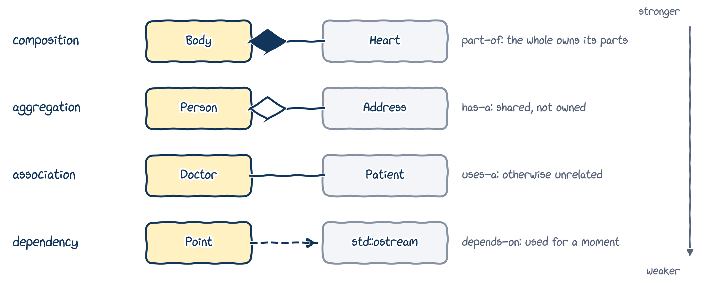
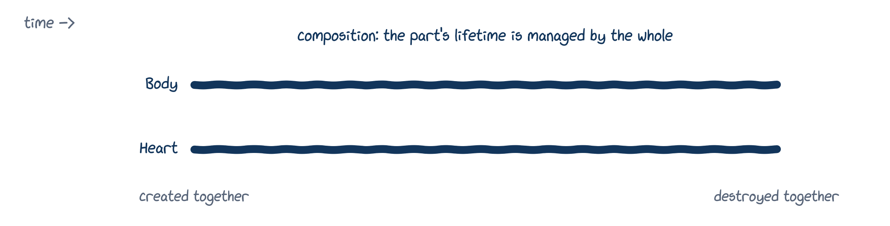
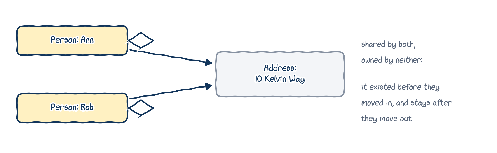
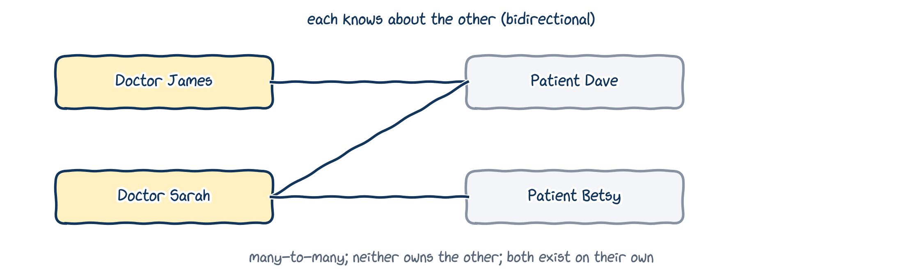

# Object Relationships {#sec-ch16}

Life is full of objects that relate to each other, and we have everyday words for the kinds of relationship. A square **is a** shape, and a lecturer **is a** university person: that's inheritance (Chapter 14). A car **has a** steering wheel, and a person **has a** heart. A programmer **uses a** keyboard. A flower **depends on** a bee for pollination. A student is a **member of** a class, and your brain is **part of** you. This chapter covers the relationships *other than* "is a", and how to write each of them as C++ classes. Chapter 17 draws them as UML diagrams.

{fig-alt="Composition: a Body owns its Heart, part-of. Aggregation: a Person has an Address, shared, not owned. Association: a Doctor and a Patient, otherwise unrelated, uses-a. Dependency: a Point uses std::ostream for a moment, depends-on. Ordered from stronger to weaker." width="80%"}

There are four of them, from the strongest to the weakest: composition, aggregation, association and dependency. The little diamonds and arrows in the figure are a preview of UML notation.

## Object composition

Building a complex object from simpler ones is called **object composition**. You've been doing it since Chapter 10: every class with data members is built from parts. A computer is built from a CPU, a motherboard, some memory and so on; a person is built from a head, a body, arms and legs. Object composition models **"has a"** relationships: a computer *has a* CPU, and a person *has a* heart. It comes in two kinds, **composition** and **aggregation**.

::: {.callout-warning title="Watch the terminology"}
*Object composition* is the general idea; *composition* and *aggregation* are its two subtypes. Don't confuse "object composition" with plain "composition".
:::

## Composition

In a **composition**, a part and its whole have this relationship:

1. the part is **part of** the whole;
2. the part can belong to **only one** whole at a time;
3. the part's **existence is managed** by the whole;
4. the part **doesn't know** about the whole.

Think of a heart. It's part of a person's body, and a heart in one person's body can't be in someone else's at the same time. When the body is created, so is the heart, and when the body is destroyed, so is the heart. And the heart works away, unaware that it's part of a larger structure: the body knows about the heart, but not the other way round. That makes composition a **unidirectional** relationship.

{fig-alt="A timeline: the Body and the Heart are created together and destroyed together. The part's lifetime is managed by the whole." width="68%"}

You've written compositions all along. In Chapter 11's `Fraction`, the members `numerator` and `denominator` are part of the `Fraction` and belong to only one `Fraction`; they're created and destroyed with it; and they don't know they're part of a `Fraction`, because they just hold integers (`fraction_composition.cpp`). Obvious? Be patient: it's not always this simple.

### Implementing compositions

Usually, the parts are simply **ordinary data members**, whose lifetimes are automatically bound to the object's. If the parts need dynamic allocation (Chapter 09), use **pointer members**, and then the class itself must do all the memory management: allocate in the constructor and free in the destructor (RAII, Chapter 12). The user of the class should never have to.

Here is a small game. A `Point2D` holds an `x` and a `y`, with a `set()` member function and an `operator<<` (`composition/point2d.h`). Every creature has a location:

```{.cpp filename="composition/creature.h"}

```

`composition/creature_game.cpp` asks for a name, creates a `Creature` at `(4, 7)`, and moves it until you enter `-1 -1`:

```{.text .terminal}
$ ./creature_game
Enter a name for your creature: Gromit
Gromit is at (4, 7)
New x and y (or -1 -1 to quit): 1 2
Gromit is at (1, 2)
New x and y (or -1 -1 to quit): -1 -1
```

Every `Creature` **has a** `Point2D` location: a part of it, created and destroyed with it, and unaware of the creature it belongs to. A composition.

## Aggregation

In an **aggregation**, a part and its whole have this relationship:

1. the part is **part of** the whole;
2. the part can (if desired) belong to **more than one** whole at a time;
3. the part's **existence is not managed** by the whole;
4. the part **doesn't know** about the whole.

It's still a part–whole, unidirectional relationship. But the whole doesn't create or destroy its parts, and parts may be shared.

{fig-alt="Ann and Bob both have the address 10 Kelvin Way. It is shared by both and owned by neither: it existed before they moved in, and stays after they move out." width="74%"}

Take a person and their home address. Every person has an address, and an address can belong to several people at once. The address isn't managed by the person: it existed before they moved in, and still exists after they move out. And a person knows their address, but an address doesn't know who lives there. Compare that with the composition timeline: there, the heart lived and died with the body; here, the address has a life of its own. A department and its teachers are another example. A department has teachers, and a teacher could work for more than one department. Closing a department doesn't destroy its teachers: they existed before it, and go on existing after it. The department knows its teachers, but a teacher needn't know the department.

### Implementing aggregations

Compositions and aggregations look almost the same in code: the parts are still data members. The difference is mostly about **ownership**. In an aggregation, the members are usually **references or pointers** to objects created **outside** the class. When the aggregate is destroyed, those references or pointers are destroyed, but the objects they refer to are not.

A `std::vector` can't hold plain references: a reference must be bound when it's created, and can't be reseated (Chapter 07). **`std::reference_wrapper<T>`**, from `<functional>`, is a reference that *can* be stored in a vector:

```{.cpp filename="school.h"}

```

`Department` stores `std::reference_wrapper<const Teacher>`s: references to teachers who live elsewhere. That's what makes it an aggregation. (`Teacher` is just data, so it's a `struct`, as in Chapter 10.)

```{.cpp filename="teacher_department.cpp"}

```

```{.text .output}
Department staff: Tony Natasha
Tony and Natasha still exist
```

The department never created its teachers, so it doesn't destroy them either.

### Composition versus aggregation

| | Composition | Aggregation |
|:---|:---|:---|
| Members are usually | ordinary data members (or pointers it manages itself) | references or pointers to outside objects |
| Creates and destroys its parts? | yes | no |
| Parts shared with other objects? | no | possibly |

A single class can mix both: responsible for some parts, but not others. Aggregations are more error-prone, because whoever creates the parts must make sure they live long enough, with no dangling references (Chapter 07).

::: {.callout-tip title="Best practice"}
Implement the simplest relationship that meets the needs of your program, not the one that seems right in real life.
:::

## Association

In an **association**, two objects have this relationship:

1. the associated object is **otherwise unrelated** to the object: not a part of it;
2. the associated object can belong to **more than one** object at a time;
3. the associated object's **existence is not managed** by the object;
4. the associated object **may or may not know** about the object.

Unlike composition and aggregation, there's no part–whole relationship. And unlike aggregation, an association may be **bidirectional**: both objects know about each other.

{fig-alt="Doctor James sees Patient Dave; Doctor Sarah sees Dave and Betsy. Each knows about the other. Many-to-many; neither owns the other; both exist on their own." width="68%"}

Doctors and patients are the classic example. A doctor clearly has a relationship with their patients, but a patient isn't *part of* a doctor. A doctor sees many patients, and a patient may see many doctors. And neither object's lifetime is tied to the other's.

### Implementing associations

Associations are usually implemented with **pointers** (or references) to the associated objects. A `Patient` keeps a `std::vector<const Doctor*> doctors{}`, and the file `patient.h` starts with `class Doctor;`, a forward declaration: a `Patient` only stores pointers to doctors, so the compiler just needs to know the name. The other side:

```{.cpp filename="doctor.h"}

```

```{.cpp filename="doctor_patient.cpp"}

```

```{.text .output}
Sarah sees: Dave Betsy
Dave sees: James Sarah
```

`add_patient()` updates **both** sides, the doctor's list of patients and the patient's list of doctors, so the links never get out of step. A bidirectional association needs that care; when you can, prefer a unidirectional one.

## Dependencies

A **dependency** occurs when one object uses another object's functionality to accomplish a specific task, **without keeping** it. You've seen one in every `operator<<` since Chapter 13:

```{.cpp}
// Point depends on std::ostream: it USES one, but doesn't keep one
friend std::ostream& operator<<(std::ostream& out, const Point& p) {
    return out << "Point(" << p.x << ", " << p.y << ", " << p.z << ')';
}
```

`Point` uses a `std::ostream` to print itself, `Point(42, 24, 42.24)`, but doesn't keep one (`dependency_example.cpp`).

How is that different from an association? In an **association**, one class keeps a **link** to the other as a **member**: you can always ask a `Doctor` who its patients are. In a **dependency**, the object used is typically **not a member**. It's created when it's needed (like opening a file to write to), or passed in as a parameter (like the `std::ostream` in `operator<<`).

## The relationships at a glance

| Property | Composition | Aggregation | Association | Dependency |
|:---|:---|:---|:---|:---|
| Relationship | whole/part | whole/part | otherwise unrelated | otherwise unrelated |
| Can be shared | no | yes | yes | yes |
| Lifetime managed by the other | yes | no | no | no |
| Direction | unidirectional | unidirectional | either | unidirectional |
| In words | "part of" | "has a" | "uses a" | "depends on" |

## Summary

- **Object composition** builds complex objects from parts: **composition** (the whole owns its parts) and **aggregation** (the whole only refers to them).
- Compositions use ordinary data members, which live and die with the object. Aggregations usually use references or pointers to objects that live elsewhere.
- An **association** links otherwise unrelated objects, often in both directions, usually through pointers.
- A **dependency** uses another object for a moment, without keeping it.
- Implement the simplest relationship that does the job.

**Further reading** on [learncpp.com](https://www.learncpp.com), Chapter 23: [object relationships](https://www.learncpp.com/cpp-tutorial/object-relationships/), [composition](https://www.learncpp.com/cpp-tutorial/composition/) and [aggregation](https://www.learncpp.com/cpp-tutorial/aggregation/), [association](https://www.learncpp.com/cpp-tutorial/association/) (including reflexive and indirect associations), [dependencies](https://www.learncpp.com/cpp-tutorial/dependencies/), [container classes](https://www.learncpp.com/cpp-tutorial/container-classes/) and `std::initializer_list`.
